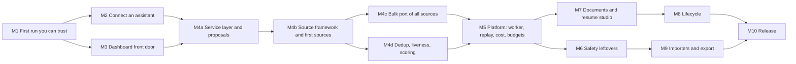

# CareerPilot roadmap

Written 2026-11-02. This is the one place for what is done, what is in progress and every stage still to come, with the tasks, tests, dependencies, risks and a "done when" for each. Plans it builds on: [`docs/APP_PLAN.md`](docs/APP_PLAN.md) (the application first), [`docs/MASTER_PLAN.md`](docs/MASTER_PLAN.md) (product, merge map, new ideas), [`docs/security/SECURITY_PLAN.md`](docs/security/SECURITY_PLAN.md) (security worklist), [`research/FEATURE_INVENTORY.md`](research/FEATURE_INVENTORY.md) (every feature of the three source projects).

Sizes are estimates for one to three people working with AI assistance, not measurements. Status words: **DONE**, **IN PROGRESS**, **NEXT**, **LATER**.

## 0. Decisions that shape everything

| Decision | Choice | Source |
|---|---|---|
| Base and licence | The dossier fork, AGPL-3.0-only. MIT code from career-ops and ai-job-search is ported with its notice kept | owner, 2026-11-01 |
| Who runs it | Local and self-hosted by whoever downloads it. No hosted service from us. Defaults must be safe if someone exposes it | owner, 2026-11-01 |
| Agent tools first | Claude Code and OpenCode (both installed on the owner's machine and tested for real) | owner, 2026-11-01/02 |
| Agents and status | Assistants may set DRAFT, REJECTED, DECLINED. Progress statuses (sent, screening, interview, offer, accepted) are proposed by an assistant and confirmed by the owner | owner, 2026-11-01 |
| Order of work | Application first (M1 to M4), then the platform (M5), then safety leftovers, documents, lifecycle, importers, release | owner, 2026-11-02 |
| Searches | The app runs them with its own keys and reports back as a run. Sources: all resources from ai-job-search and career-ops, ported into one framework | owner, 2026-11-02 |
| Sample data | None. The empty dashboard teaches the first steps | owner, 2026-11-02 |
| Hard rules in code | Nothing is sent or submitted without a click; text from the web or email is data, never instructions; code decides scores, ids and status, the model only extracts and judges; no invented facts in documents; the owner brings their own model and keys; no telemetry | MASTER_PLAN section 1 |
| Not doing | LinkedIn scraping (terms of service), career-ops's `local-parser` provider (runs configured commands), the unofficial Bundesagentur access, the TypeSafe/Jev scorer as a default, a hosted multi-tenant service | audits, MASTER_PLAN section 5 |

## 1. Where we are

**DONE** (committed on local `main`; nothing pushed yet)

- Sprint 1: Runs (live progress of agent work), REST write API, Runs page and Running-now card, `pilot` CLI, skill export for Claude Code and a generic file.
- Sprint 2: three audits (77 findings), about 25 fixes with tests, usage ping deleted, `CAREERPILOT_*` settings, licence and source notice, CI (Windows, audit, image build, e2e job), dependabot, repo hygiene. Worklist: `docs/security/SECURITY_PLAN.md`.
- M1 so far: empty dashboard teaches three first steps; README walked from a clean database; end-to-end suite runs on Windows (8 of 8 first specs pass).

**State of verification** (so nobody trusts more than has been checked): about 2,000 app tests and 24 CLI tests pass; typecheck, lint and production build clean; dashboard, Runs and the CLI were exercised live in a browser. The full end-to-end suite passes on Linux (152 of 152, see 1.4) and failed 6 of 147 on Windows (2 explained and fixed, 4 email specs not explained); the Docker image has never been built here (see 1.5).

## 2. Dependency map

M4 scans run in the web process at first (reported as runs). M5 moves them to a worker so a restart does not lose one. That is why M5 comes after the first sources work, not before.

## 3. Stages

### M1. A first run you can trust: IN PROGRESS (about 1 week, 40% done; row 1.4 FAILED, see below)

Goal: install in about ten minutes on Windows, macOS or Linux, sign in, and know what to do next.

| # | Task | Status | Done when |
|---|---|---|---|
| 1.1 | Walk the README from a clean database | DONE | Steps worked; port-5432 conflict documented |
| 1.2 | Empty dashboard shows three first steps | DONE | Test passes; links work |
| 1.3 | End-to-end suite runs on Windows | DONE for login and api specs | See 1.4 |
| 1.4 | Whole e2e suite green locally and in CI | **FAILED** (diagnosis closed 2026-11-02) | **Linux, 2026-11-02: 152 of 152 pass with the machine in UTC+5:30** (the 147 old specs plus 5 new); before the fixes 147 of 147 in UTC and 145 of 147 in UTC+5:30. The calendar and dashboard failures from the Windows run were two **test problems, no product bug**: the `sql` helper read `timestamp` columns (stored as UTC) in the machine's own zone, which put `calendar.spec` off by exactly the offset, and `dashboard.spec` assumed the demo's noon-UTC interview is "tomorrow", which is true only when the local date equals the UTC date. Fixed by reading timestamps as UTC and pinning the browser and the app server to UTC; the calendar spec was also run with a UTC+5:30 browser against a UTC server and passes. A latent clock bug in `runs-view.test.ts` (the real clock made a run "stalled" hours after its fixture date) was fixed too. **The four `email.spec` failures on Windows are not explained**: they pass 4 of 4 on Linux alone, in the full suite and with the machine in UTC+5:30, and nothing on their path is platform-specific (the labels are constants and the fake AI always returns a subject). **CI note (2026-11-02):** the Linux CI e2e job runs the whole suite green, **including the four `email.spec` specs**, so the failures are specific to the owner's Windows machine. **Closed as failed, cause unknown.** The diagnosis stopped here because the Windows `error-context.md` and trace from `apps/web/test-results/email-*` were never obtained, and nothing further can be learned on Linux. The four `email.spec` specs are therefore **not known to pass on Windows**, and the suite is not green there. Reopen only with that trace. Not rerun on Windows or in CI |
| 1.5 | Build the production image and smoke test it | DONE 2026-11-02 | **Built and started for real in GitHub Actions** (PR #8, run 18): the image builds in about 90 s, starts against a Postgres service, answers `/api/health`, and a real browser signs in and loads `/connect` and `/activity`. Getting there found two bugs, both fixed with a test: `docker/start.sh` was mode 100644, so the node base image ran it as `node ./start.sh` and the container died with a `SyntaxError` (it would have broken every user's container); and the smoke script printed only the container's stdout, hiding why. Not done: publishing the image (M10) |
| 1.6 | Linux first-run in CI: install, migrate, start, sign in | DONE 2026-11-02 | **Run 18 on `DEV`: all six jobs pass** (`check` with lint, types and the full suite with coverage; `e2e`, the whole Playwright suite; `windows`; `audit`; `docker`; `pilot` CLI). The first runs found and fixed: the Windows job comparing CRLF-checked-out files in `operations.test.ts`, and the image problem in 1.5 |
| 1.7 | `docs/ROADMAP` links and README quick start reviewed once more by someone who has not seen the project | NEXT | They reach the dashboard unaided |
| 1.8 | Flaky tests made deterministic | DONE 2026-11-02 | **`applications.spec.ts` "moves a card from the keyboard":** reproduced (1 failure in 31 runs with the machine's CPU oversubscribed): Enter was pressed before React had taken over the button, so the menu never opened. The spec now waits for hydration (`hydrated()` in `e2e/support.ts`); 50 of 50 runs pass under the same load. **`startups/text.test.ts`:** it asserted "under 500 ms" on a stopwatch; it now asserts that four times the input takes under ten times as long (linear work is about 4, a rescanning pattern about 16), with a check that the measure tells linear from quadratic. **`jobs/runner.db.test.ts`:** **not reproduced** (0 failures in 8 runs under load); its wait ceiling was 3 s and is now 20 s, which only matters when something is wrong. If it fails again, the failure output is the thing to read |

Risks: e2e specs assume Linux and a fixed clock in places; some failures may be genuine bugs hidden until now.

### M2. Connect an assistant on one screen: IN PROGRESS (about 1.5 weeks)

Goal: someone who has never seen the project connects Claude Code and OpenCode in under five minutes each and sees their first run.

**Screen:** a **Connect** page (route `/connect`, linked from Settings, the dashboard's third first-step, and the sidebar). The dashboard link currently points at Settings, API tokens; it moves here.

1. **Make a token.** Reuse the existing flow (name, scope, password asked again). Show the scope in plain words: read only, or "read, track applications, report runs".
2. **Pick your tool.** Three tabs, each with copy-paste blocks filled with this server's address and the new token:
   - **Claude Code:** the MCP command (`claude mcp add --transport http careerpilot <address>/api/mcp`, then `/mcp` to sign in), plus `pilot skills export` for the skill file. Already supported; this screen packages it.
   - **OpenCode:** an `opencode.json` snippet for a remote MCP server with OAuth (or a bearer header with the token), and the instructions file. **Verify against OpenCode's published schema (`https://opencode.ai/config.json`) and its own `opencode mcp add` before writing it; test with the installed 1.19.4.** Add an export target `opencode` to `pilot skills export` that writes the instructions OpenCode reads (it reads `AGENTS.md`).
   - **Other (Codex, Gemini CLI, scripts):** the generic export and the REST examples.
3. **Test connection.** The page waits for the first call from that token (or MCP client) and shows it arriving. Needs "last seen" for MCP OAuth clients, which today only API tokens have (`ApiToken.lastUsedAt`).
4. **Connected assistants list:** name, tool, last seen, calls today, runs, with Revoke.

| # | Task | Notes and tests |
|---|---|---|
| 2.1 | `lib/connect/instructions.ts`: pure functions producing each tool's commands and files from an address and a token name | **DONE.** Unit tests for every command, the OpenCode config shape and address handling (only the origin of a web address is ever put in a command; a token with quote characters is refused). The module records the tool versions and the date it was checked, and the screen shows them |
| 2.2 | OpenCode target: verify config schema, write `skillFiles("opencode")`, test against the real OpenCode | **DONE 2026-11-02**, with two gaps. Verified with the real OpenCode 1.19.4 (your version): its own validator accepts `{ "$schema", "mcp": { name: { "type": "remote", "url" } }, "instructions": [path] }` and rejects wrong shapes (`uri`, a string for `instructions`); `opencode mcp add NAME --url URL` runs without prompts and writes the global config; its OAuth sign-in returns to `http://127.0.0.1:19876/mcp/oauth/callback` (read from its own code), which the connector must allow. `pilot skills export --target opencode` writes `.opencode/careerpilot.md` and creates `opencode.json` only when missing (never overwrites yours, even with `--force`); the real CLI accepts what it writes. **Not reached:** `https://opencode.ai/config.json` itself (blocked from this sandbox by network policy; the types in `@opencode-ai/sdk` and the CLI's validator were used instead), and proof that the instructions text reaches a model (needs a model for `opencode run`; its debug commands do not show the loaded prompt). A bearer-header route is not offered: the MCP endpoint takes OAuth tokens only |
| 2.3 | MCP client last-seen: store on each authorised call; list clients with names | **DONE.** `McpClient` table (a hash of the client id, never the id), written at most once a minute; a failure to write never fails the call. Tested in the database, at the route, and with the real OpenCode (see 2.5) |
| 2.4 | `/connect` page + client component with copy buttons and the waiting state | **DONE.** Make a token (password asked again; scopes in plain words), three tool tabs with copy blocks, "Turn on the connector and allow OpenCode" button, Test connection (polls every 2 s for up to 3 minutes), connected assistants with last seen, actions today, runs and Revoke. 15 component tests and 4 browser specs (axe on all three tabs, a real API call arriving, revoke, wrong password) |
| 2.5 | Live check: a script that connects real Claude Code and OpenCode to a running dev server and performs one `run start/step/finish` and one `apps add` | **PARTLY DONE 2026-11-02.** Real OpenCode 1.19.4 against the production server on an empty database: the Connect button turned the connector on, `opencode mcp add` worked, `opencode mcp auth` printed the authorize URL, a browser approved it on the consent page, OpenCode said "Authentication successful!", `opencode mcp list` showed **✓ careerpilot connected**, the Connect page listed "OpenCode (MCP)", and a `list_applications` call with the token OpenCode stored showed in Activity as "AI assistant (OpenCode) used list_applications". Real Claude Code 2.1.316: `claude mcp add --transport http` was accepted and `claude mcp list` reports "Needs authentication" (the OAuth challenge works). **Not done:** finishing Claude Code's sign-in (its interactive `/mcp`), OpenCode itself calling a tool (needs a model), and a `run start/step/finish` or `apps add` through either tool |
| 2.6 | Update dashboard first-step link, README and `docs/AGENTS.md` | **DONE** except the README, which has no connect step to change. The dashboard's third step links to `/connect`, which is also in the sidebar; `docs/AGENTS.md` starts with the Connect screen and covers OpenCode |

Risks: OpenCode and Claude Code change their config formats; the generated text must carry the date it was checked and be re-verified on each release. OAuth to `localhost` from a desktop tool may need the redirect allow-list (already in Settings, MCP connector).

### M3. The dashboard as the front door: DONE 2026-11-02 (about 1 week)

Goal: the front screen answers "how many, where, how many resume versions, which template, what are my assistants doing" without a click.

Cards (each links to the detail page; all read from data that already exists unless noted):

| Card | Content | Data |
|---|---|---|
| Applications | Total, drafted vs sent, this week, trend | `Application`, `StatusEvent` |
| Where | Top five platforms and sources by application, with reply rate | `insights-data` (exists) |
| Resume | Number of resume versions and revisions in total and per application; which template and theme each application used; the template with the most replies | `Document`, `DocumentVersion`, template fields (Insights groups by them already) |
| Assistants | Connected assistants, last seen, what is running now, today's calls and runs | M2 data, `AgentRun` |
| Needs you | Drafts waiting for review, applications gone quiet, assistants' proposals (after M4a) | `awaitingReview`, `quietDays`, proposals |

Tasks: query functions in `lib/dashboard-data.ts` with tests (empty, one, many); card components with dom tests; keep the funnel and week chart; layout works at phone width; accessibility scan includes the new cards.

Done when the dashboard on a database with a few applications shows all five cards correctly, and the empty state still shows the three first steps.

**Result.** Built and verified. `lib/front-door.ts` arranges figures that already exist (Insights, connected assistants, running runs, agent drafts) and is tested on empty, one and many; `lib/front-door-data.ts` loads them (database tests); `app/(app)/front-door.tsx` draws the five cards, each linking to its detail page (Insights, Connect, Runs, Agent, "Worth a look"). They sit above the funnel, outside the time filter, and are absent from the empty welcome, which still teaches the three first steps. The Resume card needed two more Insights figures (resumes, and all versions including first drafts). Browser specs run on the demo data and on seeded assistant, run and agent-draft rows, in UTC+5:30, with axe at desktop and phone width (93 dashboard-related specs pass). The full unit and database suites pass (2,090).

Two choices to know about. "Needs you" shows agent drafts waiting for review and the count of things in "Worth a look"; **proposals from assistants are not in it yet** (they arrive with M4a). "Template with the most replies" is the most replies, ties broken by reply rate, and says "of N sent" so a small sample is not mistaken for a finding.

**Found on the way, fixed:** the funnel's sideways-scrolling areas were not keyboard-reachable (axe `scrollable-region-focusable`, only visible on a narrow screen), and the Insights tables widened the page on a phone. **Found, not fixed:** the app shell has no phone layout of its own (the sidebar stays 260px wide unless collapsed to icons, so every page overflows at 375px with it open, including ones this project did not touch). The cards were tested with the sidebar collapsed, the shell's supported small state; a real responsive shell is added to M10 task 10.2.

### M4. Assistants and the app do the job-search work: IN PROGRESS (about 6 to 8 weeks in four parts)

Goal: "find jobs in Berlin, score them, draft the best two" from Claude Code or OpenCode produces a run you can watch and two drafts waiting for your review, with nothing sent. The app runs the searches with its own keys.

#### M4a. One service layer and the proposal queue (about 1.5 weeks)

| # | Task | Notes |
|---|---|---|
| 4a.1 | A framework-free service layer in `lib/services/`: `postings` (add, check, score), `applications` (track, draft, move), `searches` (run, results), `runs` | Today logic is split across server actions, route handlers and MCP tools; they call the same functions after this | **DONE 2026-11-02 for the assistant doors.** `lib/services/{applications,postings,searches,runs}.ts` (list, read, track, move, propose, check, score, search, more, runs). REST and MCP call them; the dashboard's server actions still use their own modules and move over as later milestones touch them. Tests: `services/*.db.test.ts` |
| 4a.2 | The same operations over REST, the `pilot` CLI and MCP tools | One table of operation to door in `docs/AGENTS.md`; tests that each door reaches the same service | **DONE 2026-11-02.** `services/operations.ts` is the registry and the source of the table in `docs/AGENTS.md`. `operations.test.ts` reads each route, MCP tool and CLI command and fails if one stops calling its service, if a route or tool is unlisted, if a missing door has no reason, or if the table drifts. New doors: REST `GET /applications/{id}`, `POST /searches`, `GET /searches/{id}`, `POST /searches/{id}/more`, `POST /postings/scores`; CLI `apps show`, `search`, `search show`, `search more`, `scores save`. MCP `set_application_status` now uses `moveApplication` |
| 4a.3 | **Proposal queue.** `StatusProposal` table: an assistant proposes a progress status; it appears on the dashboard "Needs you" and on the application; one click confirms, one dismisses. Confirmation goes through the existing status machine with undo | Closes SECURITY_PLAN A-05 properly; tests for propose, confirm, dismiss, expiry, and that an assistant still cannot set it directly | **DONE 2026-11-02.** `StatusProposal` table and `lib/proposals.ts` (propose, list, confirm, dismiss, prune). Assistants propose over REST (`POST /api/v1/applications/{id}/proposals`, `GET /api/v1/proposals`), MCP (`propose_status`) and the CLI (`pilot apps propose`, `pilot proposals`); the owner answers in the dashboard's Needs-you card or on the application's header, by a session-checked action; confirming uses the status machine, so Undo works. Safety properties each have a test that fails without them: a proposal never changes the application; direct moves to progress statuses are still refused (and the refusal now says how to propose); only one pending proposal per application, capped at 50 waiting; the assistant's words are cleaned (secrets masked, control and invisible characters removed, 300 characters) and shown only as quoted text; of two simultaneous confirmations exactly one wins; expired proposals cannot be confirmed; signed-out callers cannot confirm or dismiss. Verified live: the real `pilot` CLI and OpenCode's own refreshed token proposed, a browser confirmed one and dismissed the other, and the ledger shows each step. **Not yet:** a scheduled prune of old proposals (the function exists, nothing calls it), and the proposals page for history |
| 4a.4 | Every operation reports as a run with steps, attributed to the assistant | Reuses `lib/runs.ts` | **DONE 2026-11-02.** `reportAsRun` in `services/runs.ts`: when an assistant (token/CLI or MCP) does track, move, propose, check, score, search or more, a run opens, gets one step with counts, and finishes OK, or FAILED with the reason (a refused move is a failed run). The owner's clicks and the app's own work are not reported. A failure to report never fails the work; unexpected error text stays in the server log, not the run. **Not yet:** the assistant cannot attach its own run to these calls |

#### M4b. The source framework and the first sources (about 2 weeks)

Dossier already has an adapter interface (`lib/job-search/adapter.ts`) and four adapters (JSearch, Adzuna, FreeHire, Bundesagentur). career-ops has a written contract for sources (`upstream/career-ops/providers/ADDING_A_PROVIDER.md`, `_types.js`, `_registry.mjs`) and shared helpers. Decide one contract (recommended: keep dossier's TypeScript adapter, add career-ops's capabilities: per-source config, country scope, trust validation, salary text parsing).

| # | Task | Notes |
|---|---|---|
| 4b.1 | Unify the adapter contract: id, name, country scope, required keys, `search(query)`, `fetchDescription`, rate and robots rules | ADR before code | **DONE 2026-11-02.** [ADR 0003](docs/adr/0003-job-sources.md): two kinds of source (search sources as today; board sources that list one employer's postings by slug), pure parsers over recorded responses, one network function that enforces https, a fixed host list, no redirects, size and time limits, slug validation; posting identity `(source, "<slug>:<id>")`; tracked companies table; a verdict file per source in `docs/sources/` before it ships |
| 4b.2 | Port the shared helpers as TypeScript with the MIT notice kept: SSRF-safe URL checks (`_safe-url`, `_ip-guard`, `_dns-cache`), `_http`, `_html-to-text`, `_html-entities`, `_salary-text`, `_ids`, `_trust-validator`, `_country` | We already have an SSRF-safe fetch; reuse it, port only what adds value; tests ported with the code | **IN PROGRESS.** Ported so far (`lib/job-search/boards/`): `html-text.ts` (`_html-entities` + `_html-to-text`, with their safety rules and tests), ids (`_ids`, inside the adapters), and a new `request.ts` that replaces `_http`, `_safe-url` and `_ip-guard` for boards by construction: https only, a fixed host list per adapter, no credentials in the address, `redirect: error`, validated and encoded slugs, size and time limits, bounded retries that honour `Retry-After` (clamped to 10 s). **Ported 2026-11-02 (`lib/job-search/helpers/`, 24 tests):** `salary-text.ts` (amounts, period words in English, Danish and German, currency, yearly total; nothing is guessed when a period or currency is not stated), `country.ts` (code to name), and `trust.ts` (`_trust-validator`: a link that is not https, a shortener or free-hosting address, a look-alike host, or a company name that does not appear in the link's host gives a score and plain-text notes; a hint, never a block). Link notes are stored with each scanned posting (`trustScore`, `trustFlags`, migration `20261102400000`) and shown on the Review page, in REST/MCP summaries and `pilot postings`. **Not ported:** `_dns-cache` (not needed while hosts are fixed). Listed as done in this row only for these three; the rest of the row was already done |
| 4b.3 | **First sources, the big ATS platforms:** Greenhouse, Lever, Ashby, plus the ones in the list below that are public JSON APIs | Fixture-based tests only (recorded responses); one opt-in live test per source, never in CI | **IN PROGRESS.** Greenhouse, Lever and Ashby parse and fetch (`greenhouse.ts`, `lever.ts`, `ashby.ts`, 30 tests): plain-text descriptions, ids kept per board, every location, work model, pay only from a real salary component with a stated interval, and address parsing that accepts a slug or the company's own careers link and nothing else. **Fixtures are hand-built from each source's documented shape and career-ops's cases, not recordings.** This environment's network policy blocks all three hosts (403 on connect), so recording is delegated to GitHub Actions: `scripts/record-board-fixtures.mjs` and `.github/workflows/record-board-fixtures.yml` (runs only while the marker file `.github/record-board-fixtures` is in the pull request) print trimmed real responses into the log and run the live tests (`boards.live.test.ts`, skipped unless `BOARDS_LIVE` is set). **Run 2026-11-02 on GitHub Actions: the live tests passed against the real Greenhouse (stripe), Lever (palantir) and Ashby (openai) services, 3 of 3.** Real recordings of Lever and Ashby are saved under `boards/fixtures/real/` and the parsers pass against them; the real data showed Ashby's `isListed` field, so a posting marked not publicly listed is now skipped (test fails without the fix). The Greenhouse recording fell outside the 5,000 log lines the log tool returns, so the script now prints each response on one line; the second run saved the real Greenhouse postings too (the parser passes against all three) and the live tests passed again. The third run recorded real Greenhouse offices that hold jobs, and the parser's offices map passes against them. All four recordings are saved under `boards/fixtures/real/` (Greenhouse jobs and offices, Lever, Ashby). The marker file was then removed, so the recording workflow no longer runs; to record again, add `.github/record-board-fixtures` to the pull request. Another real-data finding, not changed: Greenhouse can send a placeholder as the requisition id ("See Opening ID"); it is stored as given and never used as identity. Verdicts in `docs/sources/` are from documentation, not a live check. **Usable now through assistants:** `TrackedCompany` table, `services/companies.ts` (add, list, scan), REST (`GET/POST /api/v1/companies`, `POST /api/v1/companies/scan`), CLI (`pilot companies`, `companies add`, `companies scan`) and MCP (`add_company`, `scan_companies`), with tests at each layer. A scan reads boards one at a time within a 90 s budget, filters by keywords and place, returns snippets with links (never the whole text), and one failing board does not stop the others. **Not yet:** postings found by a scan are not kept or scored (they are returned, not stored; that is M4d), they do not appear in Find jobs, and there is no Settings screen for the list; the Workable-class sources wait for M4c |
| 4b.4 | ai-job-search's portal CLIs as adapters: FreeHire (already in dossier), Jobindex, Jobbank (Denmark), Jobdanmark, Jobnet. **Not LinkedIn** | Each is a small Bun/TypeScript CLI today; port the request and parse logic, drop the CLI shell | **DONE 2026-11-02, with three of four portals not shipped.** Verdict files first, reached from evidence a GitHub Actions probe (identifies itself, reads `robots.txt` and the terms pages, makes at most one request to an allowed address) collected: **Jobindex: not allowed** (robots.txt disallows its search path for automated agents; terms), **Jobbank: not allowed** (Cloudflare challenge on every address, robots.txt unreadable), **Jobnet: deferred** (only a website-internal interface, no robots.txt, no terms found), **Jobdanmark: allowed with limits** (robots allows its search call; user terms allow a job seeker's use; listing data only, opt-in, one request at a time). One mistake to disclose: the probe's first robots matcher ignored the query string, so one request went to a Jobindex address that robots.txt disallows; the matcher was fixed and the request is recorded in `docs/sources/jobindex.md`. **Jobdanmark adapter shipped 2026-11-02** (`jobdanmark.ts`, 13 tests; new `JOBDANMARK` source): the site's own search call, one POST per page with an honest `CareerPilot/<version>` user agent, listing data only (title, employer, city from the address, dates, job type and deadline as text), never marked complete, `details` never reads an ad page, postings older than the chosen time left out by the date the site states, a postcode with no city (real data) kept with an empty place, and an unexpected answer reported as "the source changed". Opt-in in Settings → Job search (Denmark only, no key, no distance filter); **the job agent does not search it** (its limit is one search per click). Fixtures are real items from the probe's sample (the recording was cut before the paging fields, which follow the upstream CLI's description). **Not verified live:** that the `municipality` place filter accepts the names people type (it is the upstream CLI's documented filter); a live test is ready (`JOBS_LIVE=jobdanmark`) and skipped by default. **Jobindex, Jobbank and Jobnet are not shipped** (see their verdicts); row done for what the verdicts allow |
| 4b.5 | Settings: tracked companies and saved searches per source, source health (last success, last error), per-source enable | Reuses dossier's Find jobs and Agent settings where possible | **DONE for tracked companies 2026-11-02.** Settings → **Watched companies**: add from a careers link or a board name (with the source), see each board's source, last read, posting count and the reason it failed, pause and resume, remove (asks first; saved postings stay on the Review page, the rest are closed; **assistants cannot remove**), and **Scan now**, which reads the boards, keeps and scores what it finds and says how each went; written to the Activity Ledger as the owner. Tests: service (18), actions (7, including signed out and Scan now with the network layer replaced), section (8), e2e (2) and the page in the axe sweep. **Not tested live:** Scan now against the real services from the browser (the same code is covered by the live board tests and the scan service tests). **Not yet:** saved searches per source
| 4b.6 | `searches.run` as a run: per-source steps, counts found, skipped and why | | **DONE for what exists 2026-11-02.** `searches.run` is reported as a run (M4a.4); `companies.scan` is a run with a step per board (found, or why it could not be read, or that the time ran out) and a closing step with totals; the ledger gets one line of counts. Assistant-only, like every operation run |

#### M4c. Bulk port of every remaining source (about 3 weeks, in batches)

career-ops has about 125 provider modules (145 files in `providers/`, minus shared helpers and docs). Port **all** of them, in batches grouped by kind, each batch a pull request-sized unit with its own fixtures:

1. Public ATS APIs (Workable, SmartRecruiters, Recruitee, Personio, Teamtailor, BambooHR, and similar).
2. Company career pages (large employers with JSON endpoints, for example the ones named `amazon`, `apple`, `alibaba` in the folder).
3. Aggregators and regional boards (Arbeitnow, Bundesagentur through the official route only, national boards).
4. HTML-scraped sites (highest maintenance; port last, behind per-source robots and terms checks).
5. Special feeds (Hacker News "who is hiring", WordPress job feeds, `scan-hn`, `scan-interamt`, `scan-dayforce`).

For **every** source, before it ships: read its terms and robots rules and record the verdict in `docs/sources/<name>.md` (allowed, allowed with limits, not allowed); drop it if not allowed. Keep the MIT notice and origin path at the top of each ported file. Provide a health check so a broken source shows red in Settings instead of failing silently.

Done when: every source in the table in `docs/sources/README.md` is ported, dropped with a reason, or deferred with a reason, and the count adds up to the original.

**Status 2026-11-04: batch 1 done, 115 providers still queued.** The ledger [`docs/sources/career-ops-providers.md`](docs/sources/career-ops-providers.md) lists all 126 provider modules (a test fails if one is missing, listed twice or not upstream, or if a row's verdict file is missing). Today: **7 ported** (Greenhouse, Lever, Ashby, Arbeitsagentur, and now **Workable, Recruitee, Teamtailor**), **2 dropped** (`local-parser`; **SmartRecruiters**, whose API host's robots.txt disallows every automated reader but LinkedIn's), **2 deferred** (**Personio**: its terms sit behind a security checkpoint; **BambooHR**: no real tenant sampled, terms not read), 115 queued. How batch 1 was done: two runs of the GitHub Actions source probe (robots.txt, terms links and windows, one sample each) gave the verdicts; a recording run saved real responses (Hugging Face on Workable, Channable on Recruitee, Podimo on Teamtailor) under `boards/fixtures/real/` and the live tests passed against all six board sources; adapters were written against those recordings (`batch1.test.ts`, 10 tests; request tests for tenant hosts and text feeds). The three new adapters share the board contract: HTTPS only, a host built only from a one-label tenant name, no redirects, time and size limits, text treated as data. Real-data findings: Teamtailor's links go to the company's own domain (stored as given), Workable marks some locations hidden (left out), Recruitee pay is monthly (annualised only because the interval is stated). Terms were searched for the relevant words, not read line by line (each verdict file says so). **Not done:** the other 115; batch 2 (company career pages) and later need the same verdict-first runs; Teamtailor branded domains and the liveness check for these three are not supported. **Batch 2 (company career pages), verdicts written 2026-11-04 from two probe runs:** **Apple dropped** (its website terms forbid page-scraping and robots; no robots.txt), **Google allowed with limits but only while robots.txt allows the path** (its terms say exactly that; the data is a 1.4 MB HTML page, so the adapter waits for batch 4), **Atlassian allowed with limits** (a JSON endpoint its own careers page uses; robots.txt allows it; only a customer agreement was found, nothing about reading listings), **Amazon, IBM, Dassault, Alibaba deferred** (their terms were not found or not read yet). Totals now: 7 ported, 2 with a verdict and no adapter yet, 3 dropped, 6 deferred, 108 queued. The same ledger test checks them.

#### M4d. Identity, liveness and scoring (about 2 weeks, can overlap M4c)

| # | Task | Source to port | Notes |
|---|---|---|---|
| 4d.1 | **Identity and dedup service:** URL normalisation, company+role, content fingerprint, repost detection, canonical key | career-ops `dedup-tracker.mjs`, `scan.mjs` dedup stack; ai-job-search `tools/job_key.py` | One service used by scans, applications and imports | **IN PROGRESS 2026-11-02.** `lib/job-identity.ts` (15 tests): URL normalisation (tracking parameters dropped, order and case folded, no key for a non-web address, and no key never matches another), company and title keys (legal suffixes, gender markers, accents; names that fold to nothing or lose letters get a hash so they never collide), a collision-safe canonical key (long titles capped with a hash, unfoldable titles use the posting's numeric id), a content fingerprint, and `relation` (same address, or same company, role and place under another address; one role in two cities is two openings). **Used by scans only** (a new stored posting is linked to an earlier copy). Applications and imports do not use it yet |
| 4d.2 | **Liveness check:** is the posting still open | career-ops `liveness-core/api/browser.mjs`, ai-job-search closed-at-source detection | Browser-based checks run in the worker (M5); API-based checks can run now | **IN PROGRESS.** For employer boards the board is the truth: a posting a good scan no longer lists is closed (`closedAt`), reopened if it returns, and a board that suddenly answers with nothing while it had open postings closes nothing (treated as a failed read). **API check for an application's link, DONE 2026-11-02** (`lib/job-liveness.ts`, 9 tests; `services/liveness.ts`, 5; action; 2 component tests; e2e): the Job posting tab has **Check if it's still open**. A direct Greenhouse, Lever or Ashby posting link asks that employer's own board (the hardened board request, fixed hosts); a company's own link (such as `stripe.com/jobs/search?gh_jid=…`) uses what a scan of a watched board last saw; anything else says plainly it can't tell. Conservative, as career-ops: "closed" only when a board that lists other postings no longer lists this one (Greenhouse, Ashby); an empty or failed board, or a Lever posting missing from Lever's list (which leaves some open postings out), is "can't tell", never closed. The answer is kept on the application (`postingOpen`, `postingCheckedAt`, `postingCheckNote`) without counting as an edit. **Owner's click only; no REST, CLI or MCP door yet.** **Dashboard (2026-11-04):** the Needs-you card counts drafts (not sent, archived or waiting for review) whose job the last check found closed and links to the draft, or to Applications when there are several (pure logic, loader, card and e2e tested). What a scan found is already on the Review page. **Not yet:** a check for the other 100+ sources, company-hosted Greenhouse links with no scan behind them (needs the embed redirect career-ops follows), checks that need a browser (M5), and kept Find jobs postings (only applications are checked)
| 4d.3 | **Deterministic scoring with reasons:** weights, bands, vetoes, evidence shown to the user | ai-job-search score weights and bands; career-ops A to G report as structured output; dossier's match as input | Code decides the number; the model only extracts and judges; every score stores its reasons | **DONE for scan results 2026-11-02.** `lib/job-scoring.ts` (14 tests): title 35, skills 30, place 20, pay 10, freshness 5, scaled over only the parts that can be judged (a missing salary is neither a penalty nor a free point); bands at 85, 70 and 50; owner vetoes (excluded words, excluded companies) score 0; text that tried to instruct an AI is capped at 49; every score stores up to six reasons and four red flags, and a score is forgotten only when what the posting says changes. Preferences come **only from the profile** (headline and recent roles, skills, city); the profile has no field for remote work, pay or exclusions, so those stay unknown and nothing is invented. **Settings → Posting preferences (2026-11-02):** the owner sets remote work (yes, no, not sure; "not sure" is the default), the lowest yearly pay with a currency, and words and companies to avoid; each control saves on its own, scans use them at once, and the kept postings are scored again when they change. Tests: setting parsing, merge, rescoring, the action (valid, tidied, refused), the section (7), e2e (2) and the page in the axe sweep
| 4d.4 | Posting guard at ingestion for every scan result (and the deferred hardening in M6) | `lib/guards/posting-guard.ts` | | **DONE for board scans 2026-11-02.** Every board posting goes through the posting guard before it is stored (hidden blocks and invisible characters removed, a flag and a counts-only note where the text looked like an instruction, a score cap); titles and places are cleaned to one line; links that are not http(s) are refused. **Not yet:** the deferred hardening listed under M6
| 4d.5 | Review queue: new, scored, live postings with reasons; dismiss and save | dossier Find jobs and Agent screens | | **DONE 2026-11-02.** The **Review** page (`/review`, in the sidebar under Job search): To review / Saved / Dismissed tabs with counts, each posting with its score, the reasons, what counts against it, a warning where its text tried to instruct an AI, and a link to read it; Save, Dismiss and Move back to review are one click each (`setScannedState`, written to the Activity Ledger as the owner; a session-checked action; deliberately **no REST or MCP door**, so an assistant cannot dismiss or save). Everything a board published is shown as text. The data side is also behind REST `GET /api/v1/postings/scanned`, `pilot postings` and MCP `list_scanned_postings`. Tests: service (18), action (3, including signed out), component (8), e2e (4) and the page in the axe sweep. The dashboard's **Needs you** card also counts the postings waiting on the page (open, not dismissed, saved, closed or copies) and links to it (2026-11-02; pure logic, loader, card and e2e tested). Scans can be run from Settings → Watched companies (Scan now), by an assistant, or with `pilot companies scan`

Done when (M4 overall): the end-to-end scenario above passes against fake sources in e2e, and once with real sources and a real assistant, recorded in this file.

### M5. The platform: worker, replay, cost, budgets: LATER (about 3 weeks)

| # | Task | Notes |
|---|---|---|
| 5.1 | `owner_id` on every user-owned table and a `Principal` passed to every service | The large schema change, done on its own, with data-migration tests. Single-user ships; this keeps a later multi-user change from being a rewrite |
| 5.2 | Separate **worker process** and a PostgreSQL queue (pg-boss or equivalent), scheduled jobs | Scans, liveness, backups and the agent's daily run move out of the web process; a restart no longer loses work. Spike first to confirm the library **DONE for the board scan 2026-11-04, the other job types not moved.** [ADR 0004](docs/adr/0004-worker-and-queue.md) (spike results, then what was built). pg-boss 12.38.0 in its own schema; a worker (`src/worker/`, bundled to `/app/tools/worker.mjs`, `yarn worker`) with a heartbeat that `/api/health` reports (`worker: ok | stale | none`); the board scan is the first job type (`scanOneBoard`, queue `board-scan`, `policy: short` so a board is queued once); `CAREERPILOT_WORKER=on` makes **Scan now** queue the boards, `CAREERPILOT_SCAN_SCHEDULE` makes the worker scan on a cron schedule; `compose.production.yml` has a `worker` service. Tests: worker against a real queue (7), handlers, status rule, health route, env, compose, Scan now with and without a worker; the CI `docker` job now starts the image **and a worker container** and queues a scan through it (`smoke-image.mjs --worker`); **it passed on GitHub Actions on 2026-11-04 (run 38, all six jobs): `worker ok: the worker read the board (it recorded: The source has no such board. Check the name.)`, and the database log showed the worker waiting for the web container's migrations before it started**. Run locally from the bundle against Postgres: queue, read, scheduler ledger line and clean shutdown all worked. **Not done:** moving liveness checks, the agent's daily run and backups; assistants' scans stay inline (they return the matches in the call); a killed-worker recovery test in the image (recovery is the spike's finding, about a minute)
| 5.3 | **Run replay:** open any past run and see each step, the source, the prompt version and the decision | Needs richer step data from M4 **BASELINE EXISTS, richer data not started.** `/runs/<id>` already replays a run: its steps oldest first, with who started it, timestamps, outcome and each step's data (`ActivityEvent` rows carrying the run id). What the task asks for and is missing: the source, the prompt version and the decision on each step are not recorded by the steps that exist today, so the page cannot show them. That needs the step writers (scan, scoring, drafts) to record those fields first |
| 5.4 | **Token and cost view:** tokens and money per task, per model, per day, per assistant | Cost per ledger event; pricing table kept in code with a date **TOKENS DONE 2026-11-04, money not.** Providers now report what each call used: Anthropic (input and output tokens), OpenAI-compatible servers (prompt and completion), Ollama (evaluated prompt and generated) in `ChatAnswer.usage`; `BaseProvider.complete` announces every call that answered (`lib/ai/usage.ts`), the second try of a malformed JSON answer included, and a call whose server gave no numbers is still counted, with no numbers made up. The app keeps one `AiCall` row per call (provider, model, task = the schema's name, tokens, who asked; never a prompt or an answer) in both the web process and the worker. The new **Usage** page (`/usage`, sidebar under Track) totals the last 30 days by day (in the owner's time zone), model, task and who asked, and says how many calls came back without numbers. Tests: provider mapping for three providers, retry counting, listener safety, the store, the totals (4), the view (3), e2e and the page in the axe sweep (light and dark). **Not done:** money. No price is built in and none is invented: the page says CareerPilot does not know what the provider charges. A dated price table, or prices the owner enters in Settings, is the next step; per-run cost and per-assistant cost beyond the 'who asked' column; Mistral and LM Studio inherit the OpenAI-compatible mapping but have no test of their own with usage numbers
| 5.5 | **Budget caps:** monthly AI spend limit with a warning, an automatic fall back to a cheaper or local model, and a hard stop | Gates scans, scoring and drafts |
| 5.6 | Ledger retention and pruning; include runs and ledger in export and backup (tokens never exported) | |

### M6. Safety leftovers: LATER (about 2 weeks, spread across M4 to M7)

From `docs/security/SECURITY_PLAN.md`, each with a test that fails without the fix:

| Item | Finding |
|---|---|
| Run the HTML guard on raw HTML before a fetched page is flattened to text | B-02 |
| Guard regexes with quadratic cost (the parity test against the Python original must stay green) | B-04 |
| Show guard findings to the user in the New application flow; stop trusting flagged postings and emails as fact sources | B-06, B-12 |
| Guard once at ingestion (search results, agent scoring, mail) instead of per reader | B-08, B-11 |
| Resume zip and PDF budgets, socket destroy on timeout, wider IP block list, scheme-check imported links | B-14 to B-18 |
| OAuth grants stored in the database: single-use codes, rotating refresh tokens, per-client revoke | A-07 |
| Pairing window for connector client registration; consent name from the redirect host | A-08 |
| Require the public address before the connector or Google connect can be turned on | A-12, B-19 |
| Configurable trusted-proxy hop count for the client IP | A-03 |
| Dockerfile `/tools` install from the lockfile; Yarn install-script allow-list and a release-age gate | C-10, C-18 |
| Generated npm dependency licence list shipped inside the image | C-03 |
| Licence check job in CI | C-08 |

Plus a second, focused review of everything M4 added: the new sources fetch untrusted pages at scale, so SSRF, parsing and ReDoS get a fresh audit before M10.

### M7. Documents and the resume studio: LATER (about 2 to 3 weeks)

The part that makes "how many times did my resume change, which template" rich, not just counted.

| # | Task |
|---|---|
| 7.1 | Tailored resume and letter on dossier's unit model; template and theme recorded per version (fields exist) |
| 7.2 | **Version history with diffs** between any two versions, who made each (you, the app's AI, an assistant), and why |
| 7.3 | ATS lint (career-ops text normalisation and ai-job-search layout checks) |
| 7.4 | PDF with page limit (exists); add ATS normalisation; LaTeX stays an optional later worker |
| 7.5 | **One fact gate** for generated documents: career-ops's hard gate plus dossier's heuristics, flagged postings and emails not trusted as sources |
| 7.6 | A reviewer pass (ai-job-search's drafter and reviewer pattern) |
| 7.7 | **Resume A/B and platform scorecards:** tag each application with resume version and template; show which gets more replies; per job board applications, replies, interviews, time to first response |
| 7.8 | Duplicate-application guard across platforms (first form exists: same posting link) extended with company+role and a cooldown window |

### M8. The application lifecycle: LATER (about 2 to 3 weeks)

| # | Task | Source |
|---|---|---|
| 8.1 | Follow-up cadence and urgency, in the app | career-ops `followup-cadence.mjs` |
| 8.2 | Gmail and Calendar reply handling with **proposed** status changes (the owner confirms), reply drafts, interview scheduling | dossier Google modules + proposal queue |
| 8.3 | Interview records, story bank, interview plans and practice | career-ops interview modes and `interview-prep` |
| 8.4 | Outreach drafts and contacts; a networking and referral tracker | career-ops outreach modes |
| 8.5 | Weekly digest; notifications by email or push for due follow-ups, replies and strong new matches | career-ops `weekly-digest.mjs` |
| 8.6 | Weekly goals and streaks; application readiness checklist (visa, salary, location knock-out questions) | MASTER_PLAN section 9 |

### M9. Importers, export and backup: LATER (about 1.5 weeks)

| # | Task |
|---|---|
| 9.1 | Importer framework: dry run with a preview report, idempotent, rollback |
| 9.2 | Import career-ops data (`data/applications.md`, reports, scan history, story bank) and ai-job-search workspaces (`job_search_tracker.csv`, `seen_jobs.json`, `documents/applications`) |
| 9.3 | Import and export of the new tables (runs, ledger, proposals) in the CareerPilot export; keep reading old exports |
| 9.4 | Backup and restore tested end to end, including a restore onto a clean database |

### M10. Release: LATER (about 2 weeks)

| # | Task |
|---|---|
| 10.1 | Final security review of the finished product against `docs/security/`; every finding fixed or accepted in an ADR |
| 10.2 | Accessibility gate (axe in e2e on every screen, including Runs, Connect and the new cards), keyboard pass, reduced-motion check, **and a phone layout for the app shell** (sidebar as an off-canvas menu below a width; today every page overflows at 375px with the sidebar open) |
| 10.3 | Publish a container image under this project's own name with a pinned base, SBOM and licence texts inside; versioned releases and release notes; the update check points at them |
| 10.4 | Docs: install on Windows, macOS, Linux, Docker and a small server behind HTTPS; connect Claude Code and OpenCode; backup and restore; upgrade; troubleshooting |
| 10.5 | Legal review (engineering notes are not legal advice): AGPL for a fork with no named upstream holder, the two credited forks, per-source terms, trademark of "career-ops" |
| 10.6 | Make the repository public; turn on branch protection, secret scanning and private vulnerability reporting |

## 4. Standards every stage must meet

- **Tests first** for new behaviour; each security fix keeps a test that fails without it. Target 80 percent coverage on new code; unit, database and end-to-end tests all used.
- **Verify for real.** Anything touching a browser, an assistant (Claude Code, OpenCode) or Docker is exercised live once and the result written down, not only mocked.
- **Windows and Linux** both pass CI. No Unix-only commands in scripts or tests.
- **Security checklist per milestone:** new untrusted input goes through the posting guard; new fetching uses the shared SSRF-safe fetch; new write paths are rate limited, attributed in the ledger and covered by the status rule; secrets never reach logs, run steps or exports; new dependencies are licence-checked.
- **Ported code** keeps its origin path and MIT notice; no copying of dossier-style files into MIT contexts and no use of the name "career-ops".
- **Commits** small and conventional; the plan documents updated in the same change as the code.

## 5. Open decisions

| # | Question | Blocks | Default if not answered |
|---|---|---|---|
| 1 | Which of the roughly 125 career-ops sources should be treated as must-have for the first release, and which can wait? | M4c ordering | The big ATS platforms and national boards first, scraped HTML sites last |
| 2 | Source terms: when a source's terms forbid automated access, drop it (default) or keep it behind a per-user opt-in? | M4c | Drop it |
| 3 | Where do scans run in the first version before the worker exists? | M4b | In the web process, with a per-scan time limit, moved to the worker in M5 |
| 4 | Publish a container image under which registry name, and when? | M10, compose docs | After M10; until then everyone builds their own |
| 5 | Name of the project and domain: keep "CareerPilot"? | M10 | Keep |
| 6 | Should the `pilot` CLI be published to npm, or stay in the repository? | M2 docs | Stay in the repository for now |

## 6. Recording progress

After each stage, update this file in the same commit: change the status words, tick the tasks, record what was verified live and what was not, and move anything deferred into the stage where it now belongs.
