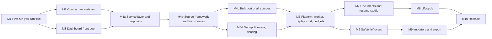

# CareerPilot roadmap

Written 2026-11-02. This is the one place for what is done, what is in progress and every stage still to come, with the tasks, tests, dependencies, risks and a "done when" for each. Plans it builds on: [`docs/APP_PLAN.md`](docs/APP_PLAN.md) (the application first), [`docs/MASTER_PLAN.md`](docs/MASTER_PLAN.md) (product, merge map, new ideas), [`docs/security/SECURITY_PLAN.md`](docs/security/SECURITY_PLAN.md) (security worklist), [`research/FEATURE_INVENTORY.md`](research/FEATURE_INVENTORY.md) (every feature of the three source projects).

Sizes are estimates for one to three people working with AI assistance, not measurements. Status words: **DONE**, **IN PROGRESS**, **NEXT**, **LATER**.

## 0. Decisions that shape everything

| Decision | Choice | Source |
|---|---|---|
| Base and licence | The dossier fork, AGPL-3.0-only. MIT code from career-ops and ai-job-search is ported with its notice kept | owner, 2026-11-01 |
| Who runs it | Local and self-hosted by whoever downloads it. No hosted service from us. Defaults must be safe if someone exposes it | owner, 2026-11-01 |
| Agent tools first | Claude Code and OpenCode (both installed on the owner's machine and tested for real) | owner, 2026-11-01/02 |
| Agents and status | Assistants may set DRAFT, REJECTED, DECLINED. Progress statuses (sent, screening, interview, offer, accepted) are proposed by an assistant and confirmed by the owner | owner, 2026-11-01 |
| Order of work | Application first (M1 to M4), then the platform (M5), then safety leftovers, documents, lifecycle, importers, release | owner, 2026-11-02 |
| Searches | The app runs them with its own keys and reports back as a run. Sources: all resources from ai-job-search and career-ops, ported into one framework | owner, 2026-11-02 |
| Sample data | None. The empty dashboard teaches the first steps | owner, 2026-11-02 |
| Hard rules in code | Nothing is sent or submitted without a click; text from the web or email is data, never instructions; code decides scores, ids and status, the model only extracts and judges; no invented facts in documents; the owner brings their own model and keys; no telemetry | MASTER_PLAN section 1 |
| Not doing | LinkedIn scraping (terms of service), career-ops's `local-parser` provider (runs configured commands), the unofficial Bundesagentur access, the TypeSafe/Jev scorer as a default, a hosted multi-tenant service | audits, MASTER_PLAN section 5 |

## 1. Where we are

**DONE** (committed on local `main`; nothing pushed yet)

- Sprint 1: Runs (live progress of agent work), REST write API, Runs page and Running-now card, `pilot` CLI, skill export for Claude Code and a generic file.
- Sprint 2: three audits (77 findings), about 25 fixes with tests, usage ping deleted, `CAREERPILOT_*` settings, licence and source notice, CI (Windows, audit, image build, e2e job), dependabot, repo hygiene. Worklist: `docs/security/SECURITY_PLAN.md`.
- M1 so far: empty dashboard teaches three first steps; README walked from a clean database; end-to-end suite runs on Windows (8 of 8 first specs pass).

**State of verification** (so nobody trusts more than has been checked): about 2,000 app tests and 24 CLI tests pass; typecheck, lint and production build clean; dashboard, Runs and the CLI were exercised live in a browser. The full end-to-end suite passes on Linux (152 of 152, see 1.4) and failed 6 of 147 on Windows (2 explained and fixed, 4 email specs not explained); the Docker image has never been built here (see 1.5).

## 2. Dependency map

M4 scans run in the web process at first (reported as runs). M5 moves them to a worker so a restart does not lose one. That is why M5 comes after the first sources work, not before.

## 3. Stages

### M1. A first run you can trust: IN PROGRESS (about 1 week, 40% done)

Goal: install in about ten minutes on Windows, macOS or Linux, sign in, and know what to do next.

| # | Task | Status | Done when |
|---|---|---|---|
| 1.1 | Walk the README from a clean database | DONE | Steps worked; port-5432 conflict documented |
| 1.2 | Empty dashboard shows three first steps | DONE | Test passes; links work |
| 1.3 | End-to-end suite runs on Windows | DONE for login and api specs | See 1.4 |
| 1.4 | Whole e2e suite green locally and in CI | IN PROGRESS | **Linux, 2026-11-02: 152 of 152 pass with the machine in UTC+5:30** (the 147 old specs plus 5 new); before the fixes 147 of 147 in UTC and 145 of 147 in UTC+5:30. The calendar and dashboard failures from the Windows run were two **test problems, no product bug**: the `sql` helper read `timestamp` columns (stored as UTC) in the machine's own zone, which put `calendar.spec` off by exactly the offset, and `dashboard.spec` assumed the demo's noon-UTC interview is "tomorrow", which is true only when the local date equals the UTC date. Fixed by reading timestamps as UTC and pinning the browser and the app server to UTC; the calendar spec was also run with a UTC+5:30 browser against a UTC server and passes. A latent clock bug in `runs-view.test.ts` (the real clock made a run "stalled" hours after its fixture date) was fixed too. **The four `email.spec` failures on Windows are not explained**: they pass 4 of 4 on Linux alone, in the full suite and with the machine in UTC+5:30, and nothing on their path is platform-specific (the labels are constants and the fake AI always returns a subject). It needs the Windows `error-context.md` and trace from `apps/web/test-results/email-*`. Not rerun on Windows or in CI yet |
| 1.5 | Build the production image and smoke test it | IN PROGRESS | The CI `docker` job now builds the image, starts it against a Postgres service and runs `apps/web/scripts/smoke-image.mjs` (`/api/health`, sign in with a real browser, `/connect` and `/activity` load). The script's health and sign-in half was run here against the production server (passes; fails on a wrong password and with no server). **The image itself was not built**: this sandbox's Docker Hub pulls were rate limited (429) and a public mirror was denied (403). Its first real run is the CI job, or any machine with Docker |
| 1.6 | Linux first-run in CI: install, migrate, start, sign in | NEXT | Every step was run on Linux here (install, migrate, build, start, sign in, the full e2e suite, the `check` job's lint, typecheck and `test:coverage` (2,068 tests, thresholds met), `pilot` tests, `yarn npm audit`), but no CI run has happened because nothing is pushed. The `windows` job cannot be run here at all |
| 1.7 | `docs/ROADMAP` links and README quick start reviewed once more by someone who has not seen the project | NEXT | They reach the dashboard unaided |

Risks: e2e specs assume Linux and a fixed clock in places; some failures may be genuine bugs hidden until now.

### M2. Connect an assistant on one screen: IN PROGRESS (about 1.5 weeks)

Goal: someone who has never seen the project connects Claude Code and OpenCode in under five minutes each and sees their first run.

**Screen:** a **Connect** page (route `/connect`, linked from Settings, the dashboard's third first-step, and the sidebar). The dashboard link currently points at Settings, API tokens; it moves here.

1. **Make a token.** Reuse the existing flow (name, scope, password asked again). Show the scope in plain words: read only, or "read, track applications, report runs".
2. **Pick your tool.** Three tabs, each with copy-paste blocks filled with this server's address and the new token:
   - **Claude Code:** the MCP command (`claude mcp add --transport http careerpilot <address>/api/mcp`, then `/mcp` to sign in), plus `pilot skills export` for the skill file. Already supported; this screen packages it.
   - **OpenCode:** an `opencode.json` snippet for a remote MCP server with OAuth (or a bearer header with the token), and the instructions file. **Verify against OpenCode's published schema (`https://opencode.ai/config.json`) and its own `opencode mcp add` before writing it; test with the installed 1.19.4.** Add an export target `opencode` to `pilot skills export` that writes the instructions OpenCode reads (it reads `AGENTS.md`).
   - **Other (Codex, Gemini CLI, scripts):** the generic export and the REST examples.
3. **Test connection.** The page waits for the first call from that token (or MCP client) and shows it arriving. Needs "last seen" for MCP OAuth clients, which today only API tokens have (`ApiToken.lastUsedAt`).
4. **Connected assistants list:** name, tool, last seen, calls today, runs, with Revoke.

| # | Task | Notes and tests |
|---|---|---|
| 2.1 | `lib/connect/instructions.ts`: pure functions producing each tool's commands and files from an address and a token name | Unit tests; snapshot of each output |
| 2.2 | OpenCode target: verify config schema, write `skillFiles("opencode")`, test against the real OpenCode | **DONE 2026-11-02**, with two gaps. Verified with the real OpenCode 1.19.4 (your version): its own validator accepts `{ "$schema", "mcp": { name: { "type": "remote", "url" } }, "instructions": [path] }` and rejects wrong shapes (`uri`, a string for `instructions`); `opencode mcp add NAME --url URL` runs without prompts and writes the global config; its OAuth sign-in returns to `http://127.0.0.1:19876/mcp/oauth/callback` (read from its own code), which the connector must allow. `pilot skills export --target opencode` writes `.opencode/careerpilot.md` and creates `opencode.json` only when missing (never overwrites yours, even with `--force`); the real CLI accepts what it writes. **Not reached:** `https://opencode.ai/config.json` itself (blocked from this sandbox by network policy; the types in `@opencode-ai/sdk` and the CLI's validator were used instead), and proof that the instructions text reaches a model (needs a model for `opencode run`; its debug commands do not show the loaded prompt). A bearer-header route is not offered: the MCP endpoint takes OAuth tokens only |
| 2.3 | MCP client last-seen: store on each authorised call; list clients with names | DB test; the ledger already names the client |
| 2.4 | `/connect` page + client component with copy buttons and the waiting state | dom tests; e2e: make a token, see the commands |
| 2.5 | Live check: a script that connects real Claude Code and OpenCode to a running dev server and performs one `run start/step/finish` and one `apps add` | Manual verification recorded in this file; not automatable in CI |
| 2.6 | Update dashboard first-step link, README and `docs/AGENTS.md` | |

Risks: OpenCode and Claude Code change their config formats; the generated text must carry the date it was checked and be re-verified on each release. OAuth to `localhost` from a desktop tool may need the redirect allow-list (already in Settings, MCP connector).

### M3. The dashboard as the front door: NEXT (about 1 week)

Goal: the front screen answers "how many, where, how many resume versions, which template, what are my assistants doing" without a click.

Cards (each links to the detail page; all read from data that already exists unless noted):

| Card | Content | Data |
|---|---|---|
| Applications | Total, drafted vs sent, this week, trend | `Application`, `StatusEvent` |
| Where | Top five platforms and sources by application, with reply rate | `insights-data` (exists) |
| Resume | Number of resume versions and revisions in total and per application; which template and theme each application used; the template with the most replies | `Document`, `DocumentVersion`, template fields (Insights groups by them already) |
| Assistants | Connected assistants, last seen, what is running now, today's calls and runs | M2 data, `AgentRun` |
| Needs you | Drafts waiting for review, applications gone quiet, assistants' proposals (after M4a) | `awaitingReview`, `quietDays`, proposals |

Tasks: query functions in `lib/dashboard-data.ts` with tests (empty, one, many); card components with dom tests; keep the funnel and week chart; layout works at phone width; accessibility scan includes the new cards.

Done when the dashboard on a database with a few applications shows all five cards correctly, and the empty state still shows the three first steps.

### M4. Assistants and the app do the job-search work: NEXT (about 6 to 8 weeks in four parts)

Goal: "find jobs in Berlin, score them, draft the best two" from Claude Code or OpenCode produces a run you can watch and two drafts waiting for your review, with nothing sent. The app runs the searches with its own keys.

#### M4a. One service layer and the proposal queue (about 1.5 weeks)

| # | Task | Notes |
|---|---|---|
| 4a.1 | A framework-free service layer in `lib/services/`: `postings` (add, check, score), `applications` (track, draft, move), `searches` (run, results), `runs` | Today logic is split across server actions, route handlers and MCP tools; they call the same functions after this |
| 4a.2 | The same operations over REST, the `pilot` CLI and MCP tools | One table of operation to door in `docs/AGENTS.md`; tests that each door reaches the same service |
| 4a.3 | **Proposal queue.** `StatusProposal` table: an assistant proposes a progress status; it appears on the dashboard "Needs you" and on the application; one click confirms, one dismisses. Confirmation goes through the existing status machine with undo | Closes SECURITY_PLAN A-05 properly; tests for propose, confirm, dismiss, expiry, and that an assistant still cannot set it directly |
| 4a.4 | Every operation reports as a run with steps, attributed to the assistant | Reuses `lib/runs.ts` |

#### M4b. The source framework and the first sources (about 2 weeks)

Dossier already has an adapter interface (`lib/job-search/adapter.ts`) and four adapters (JSearch, Adzuna, FreeHire, Bundesagentur). career-ops has a written contract for sources (`upstream/career-ops/providers/ADDING_A_PROVIDER.md`, `_types.js`, `_registry.mjs`) and shared helpers. Decide one contract (recommended: keep dossier's TypeScript adapter, add career-ops's capabilities: per-source config, country scope, trust validation, salary text parsing).

| # | Task | Notes |
|---|---|---|
| 4b.1 | Unify the adapter contract: id, name, country scope, required keys, `search(query)`, `fetchDescription`, rate and robots rules | ADR before code |
| 4b.2 | Port the shared helpers as TypeScript with the MIT notice kept: SSRF-safe URL checks (`_safe-url`, `_ip-guard`, `_dns-cache`), `_http`, `_html-to-text`, `_html-entities`, `_salary-text`, `_ids`, `_trust-validator`, `_country` | We already have an SSRF-safe fetch; reuse it, port only what adds value; tests ported with the code |
| 4b.3 | **First sources, the big ATS platforms:** Greenhouse, Lever, Ashby, plus the ones in the list below that are public JSON APIs | Fixture-based tests only (recorded responses); one opt-in live test per source, never in CI |
| 4b.4 | ai-job-search's portal CLIs as adapters: FreeHire (already in dossier), Jobindex, Jobbank (Denmark), Jobdanmark, Jobnet. **Not LinkedIn** | Each is a small Bun/TypeScript CLI today; port the request and parse logic, drop the CLI shell |
| 4b.5 | Settings: tracked companies and saved searches per source, source health (last success, last error), per-source enable | Reuses dossier's Find jobs and Agent settings where possible |
| 4b.6 | `searches.run` as a run: per-source steps, counts found, skipped and why | |

#### M4c. Bulk port of every remaining source (about 3 weeks, in batches)

career-ops has about 125 provider modules (145 files in `providers/`, minus shared helpers and docs). Port **all** of them, in batches grouped by kind, each batch a pull request-sized unit with its own fixtures:

1. Public ATS APIs (Workable, SmartRecruiters, Recruitee, Personio, Teamtailor, BambooHR, and similar).
2. Company career pages (large employers with JSON endpoints, for example the ones named `amazon`, `apple`, `alibaba` in the folder).
3. Aggregators and regional boards (Arbeitnow, Bundesagentur through the official route only, national boards).
4. HTML-scraped sites (highest maintenance; port last, behind per-source robots and terms checks).
5. Special feeds (Hacker News "who is hiring", WordPress job feeds, `scan-hn`, `scan-interamt`, `scan-dayforce`).

For **every** source, before it ships: read its terms and robots rules and record the verdict in `docs/sources/<name>.md` (allowed, allowed with limits, not allowed); drop it if not allowed. Keep the MIT notice and origin path at the top of each ported file. Provide a health check so a broken source shows red in Settings instead of failing silently.

Done when: every source in the table in `docs/sources/README.md` is ported, dropped with a reason, or deferred with a reason, and the count adds up to the original.

#### M4d. Identity, liveness and scoring (about 2 weeks, can overlap M4c)

| # | Task | Source to port | Notes |
|---|---|---|---|
| 4d.1 | **Identity and dedup service:** URL normalisation, company+role, content fingerprint, repost detection, canonical key | career-ops `dedup-tracker.mjs`, `scan.mjs` dedup stack; ai-job-search `tools/job_key.py` | One service used by scans, applications and imports |
| 4d.2 | **Liveness check:** is the posting still open | career-ops `liveness-core/api/browser.mjs`, ai-job-search closed-at-source detection | Browser-based checks run in the worker (M5); API-based checks can run now |
| 4d.3 | **Deterministic scoring with reasons:** weights, bands, vetoes, evidence shown to the user | ai-job-search score weights and bands; career-ops A to G report as structured output; dossier's match as input | Code decides the number; the model only extracts and judges; every score stores its reasons |
| 4d.4 | Posting guard at ingestion for every scan result (and the deferred hardening in M6) | `lib/guards/posting-guard.ts` | |
| 4d.5 | Review queue: new, scored, live postings with reasons; dismiss and save | dossier Find jobs and Agent screens | |

Done when (M4 overall): the end-to-end scenario above passes against fake sources in e2e, and once with real sources and a real assistant, recorded in this file.

### M5. The platform: worker, replay, cost, budgets: LATER (about 3 weeks)

| # | Task | Notes |
|---|---|---|
| 5.1 | `owner_id` on every user-owned table and a `Principal` passed to every service | The large schema change, done on its own, with data-migration tests. Single-user ships; this keeps a later multi-user change from being a rewrite |
| 5.2 | Separate **worker process** and a PostgreSQL queue (pg-boss or equivalent), scheduled jobs | Scans, liveness, backups and the agent's daily run move out of the web process; a restart no longer loses work. Spike first to confirm the library |
| 5.3 | **Run replay:** open any past run and see each step, the source, the prompt version and the decision | Needs richer step data from M4 |
| 5.4 | **Token and cost view:** tokens and money per task, per model, per day, per assistant | Cost per ledger event; pricing table kept in code with a date |
| 5.5 | **Budget caps:** monthly AI spend limit with a warning, an automatic fall back to a cheaper or local model, and a hard stop | Gates scans, scoring and drafts |
| 5.6 | Ledger retention and pruning; include runs and ledger in export and backup (tokens never exported) | |

### M6. Safety leftovers: LATER (about 2 weeks, spread across M4 to M7)

From `docs/security/SECURITY_PLAN.md`, each with a test that fails without the fix:

| Item | Finding |
|---|---|
| Run the HTML guard on raw HTML before a fetched page is flattened to text | B-02 |
| Guard regexes with quadratic cost (the parity test against the Python original must stay green) | B-04 |
| Show guard findings to the user in the New application flow; stop trusting flagged postings and emails as fact sources | B-06, B-12 |
| Guard once at ingestion (search results, agent scoring, mail) instead of per reader | B-08, B-11 |
| Resume zip and PDF budgets, socket destroy on timeout, wider IP block list, scheme-check imported links | B-14 to B-18 |
| OAuth grants stored in the database: single-use codes, rotating refresh tokens, per-client revoke | A-07 |
| Pairing window for connector client registration; consent name from the redirect host | A-08 |
| Require the public address before the connector or Google connect can be turned on | A-12, B-19 |
| Configurable trusted-proxy hop count for the client IP | A-03 |
| Dockerfile `/tools` install from the lockfile; Yarn install-script allow-list and a release-age gate | C-10, C-18 |
| Generated npm dependency licence list shipped inside the image | C-03 |
| Licence check job in CI | C-08 |

Plus a second, focused review of everything M4 added: the new sources fetch untrusted pages at scale, so SSRF, parsing and ReDoS get a fresh audit before M10.

### M7. Documents and the resume studio: LATER (about 2 to 3 weeks)

The part that makes "how many times did my resume change, which template" rich, not just counted.

| # | Task |
|---|---|
| 7.1 | Tailored resume and letter on dossier's unit model; template and theme recorded per version (fields exist) |
| 7.2 | **Version history with diffs** between any two versions, who made each (you, the app's AI, an assistant), and why |
| 7.3 | ATS lint (career-ops text normalisation and ai-job-search layout checks) |
| 7.4 | PDF with page limit (exists); add ATS normalisation; LaTeX stays an optional later worker |
| 7.5 | **One fact gate** for generated documents: career-ops's hard gate plus dossier's heuristics, flagged postings and emails not trusted as sources |
| 7.6 | A reviewer pass (ai-job-search's drafter and reviewer pattern) |
| 7.7 | **Resume A/B and platform scorecards:** tag each application with resume version and template; show which gets more replies; per job board applications, replies, interviews, time to first response |
| 7.8 | Duplicate-application guard across platforms (first form exists: same posting link) extended with company+role and a cooldown window |

### M8. The application lifecycle: LATER (about 2 to 3 weeks)

| # | Task | Source |
|---|---|---|
| 8.1 | Follow-up cadence and urgency, in the app | career-ops `followup-cadence.mjs` |
| 8.2 | Gmail and Calendar reply handling with **proposed** status changes (the owner confirms), reply drafts, interview scheduling | dossier Google modules + proposal queue |
| 8.3 | Interview records, story bank, interview plans and practice | career-ops interview modes and `interview-prep` |
| 8.4 | Outreach drafts and contacts; a networking and referral tracker | career-ops outreach modes |
| 8.5 | Weekly digest; notifications by email or push for due follow-ups, replies and strong new matches | career-ops `weekly-digest.mjs` |
| 8.6 | Weekly goals and streaks; application readiness checklist (visa, salary, location knock-out questions) | MASTER_PLAN section 9 |

### M9. Importers, export and backup: LATER (about 1.5 weeks)

| # | Task |
|---|---|
| 9.1 | Importer framework: dry run with a preview report, idempotent, rollback |
| 9.2 | Import career-ops data (`data/applications.md`, reports, scan history, story bank) and ai-job-search workspaces (`job_search_tracker.csv`, `seen_jobs.json`, `documents/applications`) |
| 9.3 | Import and export of the new tables (runs, ledger, proposals) in the CareerPilot export; keep reading old exports |
| 9.4 | Backup and restore tested end to end, including a restore onto a clean database |

### M10. Release: LATER (about 2 weeks)

| # | Task |
|---|---|
| 10.1 | Final security review of the finished product against `docs/security/`; every finding fixed or accepted in an ADR |
| 10.2 | Accessibility gate (axe in e2e on every screen, including Runs, Connect and the new cards), keyboard pass, reduced-motion check |
| 10.3 | Publish a container image under this project's own name with a pinned base, SBOM and licence texts inside; versioned releases and release notes; the update check points at them |
| 10.4 | Docs: install on Windows, macOS, Linux, Docker and a small server behind HTTPS; connect Claude Code and OpenCode; backup and restore; upgrade; troubleshooting |
| 10.5 | Legal review (engineering notes are not legal advice): AGPL for a fork with no named upstream holder, the two credited forks, per-source terms, trademark of "career-ops" |
| 10.6 | Make the repository public; turn on branch protection, secret scanning and private vulnerability reporting |

## 4. Standards every stage must meet

- **Tests first** for new behaviour; each security fix keeps a test that fails without it. Target 80 percent coverage on new code; unit, database and end-to-end tests all used.
- **Verify for real.** Anything touching a browser, an assistant (Claude Code, OpenCode) or Docker is exercised live once and the result written down, not only mocked.
- **Windows and Linux** both pass CI. No Unix-only commands in scripts or tests.
- **Security checklist per milestone:** new untrusted input goes through the posting guard; new fetching uses the shared SSRF-safe fetch; new write paths are rate limited, attributed in the ledger and covered by the status rule; secrets never reach logs, run steps or exports; new dependencies are licence-checked.
- **Ported code** keeps its origin path and MIT notice; no copying of dossier-style files into MIT contexts and no use of the name "career-ops".
- **Commits** small and conventional; the plan documents updated in the same change as the code.

## 5. Open decisions

| # | Question | Blocks | Default if not answered |
|---|---|---|---|
| 1 | Which of the roughly 125 career-ops sources should be treated as must-have for the first release, and which can wait? | M4c ordering | The big ATS platforms and national boards first, scraped HTML sites last |
| 2 | Source terms: when a source's terms forbid automated access, drop it (default) or keep it behind a per-user opt-in? | M4c | Drop it |
| 3 | Where do scans run in the first version before the worker exists? | M4b | In the web process, with a per-scan time limit, moved to the worker in M5 |
| 4 | Publish a container image under which registry name, and when? | M10, compose docs | After M10; until then everyone builds their own |
| 5 | Name of the project and domain: keep "CareerPilot"? | M10 | Keep |
| 6 | Should the `pilot` CLI be published to npm, or stay in the repository? | M2 docs | Stay in the repository for now |

## 6. Recording progress

After each stage, update this file in the same commit: change the status words, tick the tasks, record what was verified live and what was not, and move anything deferred into the stage where it now belongs.
