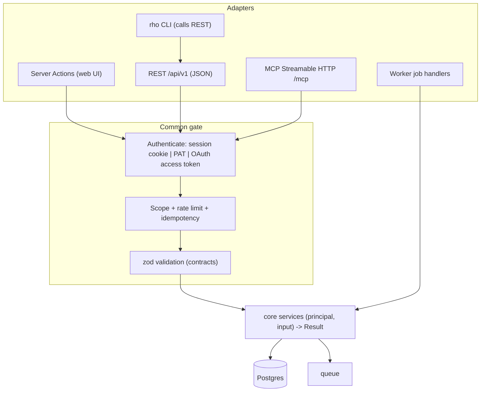

# API_DESIGN - REST, server actions, MCP and CLI for "Rho"

Inputs: dossier API surface (`PROJECT_DOSSIER.md` s8, s9), career-ops CLI/web API (`PROJECT_CAREER_OPS.md` s8), ai-job-search CLI contract (`PROJECT_AI_JOB_SEARCH.md` s8). Verified: `dossier/src/lib/connector/tools.ts` has 11 `registerTool` calls (names in s6); `dossier/src/lib/jobs/runner.ts` job concurrency; `career-ops/tracker-parse.mjs`/`tracker-utils.mjs` CLI exit codes `{OK:0, USAGE:1, NOT_FOUND:2, AMBIGUOUS:3, LOCK_TIMEOUT:4}` and the `/api/status` mapping `{2:404, 3:409, 4:503}` (`PROJECT_CAREER_OPS.md` s8b/s6).
Related: `UNIFIED_ARCHITECTURE.md` (service layer, auth), `DATABASE_DESIGN.md` (resource shapes), `IMPLEMENTATION_ROADMAP.md` (M8), `TECHNICAL_DECISIONS.md` (ADR-016/017).
Labels **[F]** fact / **[A]** assumption / **[R]** recommendation. Everything below is **[R]** except where tagged **[F]**.

---

## 1. Principles

1. **One service layer, many adapters.** No business logic in route handlers, server actions, MCP tools or CLI commands. dossier already says "mutations go through `action()`/`route()` wrappers -> domain modules" [F `PROJECT_DOSSIER.md` s4]; we extend the same rule to MCP and CLI.
2. **One contract package** (`packages/contracts`): zod schemas for every input/output, error codes, envelope. UI actions, REST, MCP tool schemas and the CLI client types are generated from or share these. OpenAPI is generated from the zod schemas [A: tooling to confirm in M0 spike].
3. **Default deny.** Every route/action/tool declares its required scope; a CI audit test fails if one is missing (dossier `session-audit.test.ts` enforces this for actions/routes today [F]).
4. **AI and long work are asynchronous**: `202 Accepted` + `job` resource + SSE, never a held HTTP request (dossier jobs + SSE with polling fallback [F]).
5. **No verb exists for submitting/sending an application through tokens.** The only send endpoints require a UI session and a confirmation token (architecture s6.2 HR2).
6. **Untrusted content is labelled** in responses that carry posting/email text (`meta.untrusted: true` on those payloads) so agent clients can wrap it.

---

## 2. Surfaces and how they relate



| Surface | Audience | Auth | Transport | Notes |
|---|---|---|---|---|
| Server Actions | the web UI only | session cookie + same-origin check | Next.js action POST | return `ActionResult` = envelope subset; not a public API [dossier has 144 of them, all wrapped in `action()` - F] |
| REST `/api/v1` | CLI, scripts, integrations, future mobile | PAT or session | JSON over HTTPS | the stable public contract |
| MCP `/mcp` | Claude/other MCP clients | OAuth 2.1 access token | Streamable HTTP (POST/GET/DELETE) [F dossier route] | curated subset; no delete/send tools [F dossier] |
| CLI `rho` | terminal/automation | PAT in OS keychain/env | calls REST | replaces ~166 career-ops scripts and ai-job-search Python tools with one thin client |
| Worker | internal | `Principal(via=WORKER, userId)` from job payload | direct service calls | acts as the job's owner; never elevates |

---

## 3. One operation, four doors (mapping)

| Operation | Service method | REST | MCP tool | CLI | UI action | Origin of the idea |
|---|---|---|---|---|---|---|
| Read profile | `profile.get` | `GET /profile` | `get_profile` | `rho profile show` | loader | dossier `get_profile` [F] |
| Import resume | `profile.importResume` | `POST /profile/imports` (multipart) -> 202 job | - | `rho profile import cv.pdf` | `startImport` | dossier `/api/profile/import` [F] |
| Add posting by URL/text | `postings.create` | `POST /postings` | `save_posting` (v1) | `rho postings add <url>` | `startReadingPosting` | dossier `fetchPostingText`; ai-job-search `/apply` step 0 |
| Search sources | `discovery.search` | `POST /postings:search` | `search_jobs`, `more_jobs` [F] | `rho search "..."` | `runJobSearch` | dossier |
| Scan tracked sources | `discovery.scan` | `POST /scans` -> 202 | - | `rho scan [--company X --dry-run --json]` | `runScanNow` | career-ops `scan.mjs` flags [F] |
| Evaluate posting | `evaluation.run` | `POST /postings/{id}/evaluations` -> 202 | `evaluate_posting` (v1), `save_job_scores` [F] | `rho eval <id\|url>` | `startScoringPosting` | all three |
| Check liveness | `postings.checkLiveness` | `POST /postings/{id}/liveness` | - | `rho liveness <id> / --file / --tracker` | button | career-ops `check-liveness.mjs` modes [F] |
| Create application | `applications.create` | `POST /applications` | `save_application` [F] | `rho apps create --posting <id>` | `createApplication` | dossier |
| Generate documents | `documents.generate` | `POST /applications/{id}/documents:generate` -> 202 | `draft_application`, `check_draft` [F] | `rho docs generate <app>` | `startWritingDocuments` | dossier |
| Edit unit | `documents.saveUnit` | `PATCH /documents/{id}/units/{unitId}` | - | `rho docs edit` | `saveUnit` | dossier |
| Render PDF | `documents.render` | `POST /documents/{id}/render` -> 202 (or 200 if cached) | - | `rho docs render <app> --kind resume` | download button | dossier `/api/pdf`; career-ops `generate-pdf.mjs` |
| Change status | `applications.setStatus` | `POST /applications/{id}/status` | `set_application_status` [F] | `rho apps status <id> applied` | `setStatus` | dossier + career-ops `set-status.mjs` |
| Undo status | `applications.undoStatus` | `POST /applications/{id}/status:undo` | - | `rho apps undo <id>` | `undoStatus` | dossier [F] |
| List applications | `applications.list` | `GET /applications` | `list_applications`, `get_application` [F] | `rho apps list` | loader | dossier |
| Follow-ups due | `followups.due` | `GET /follow-ups?due=today` | `list_followups` (v1) | `rho followups [--summary]` | dashboard | career-ops `followup-cadence.mjs --summary` [F] |
| Send application email | `comms.sendApplication` | **UI only** (needs confirmation token) | **none** | **none** | `sendWithGmail` | dossier [F]: only `sendWithGmail`/`sendReplyEmail` call `sendMail` |
| Export / import data | `data.export`, `data.import` | `GET /exports/latest`, `POST /imports` (+`?preview=1`) | - | `rho export`, `rho import <path> --dry-run` | settings | dossier `/api/export`,`/api/import` [F] |
| Health | `system.health` | `GET /health` | - | `rho doctor` | - | dossier `/api/health`; career-ops `doctor.mjs` |

The rule that makes this work: the mapping table is the test oracle. A parameterised contract test calls each operation through REST, MCP (where present) and the service directly, asserting identical results and identical scope enforcement.

---

## 4. Response envelope (all REST responses)

```jsonc
// success
{ "success": true,
  "data": { },                       // object | array
  "error": null,
  "meta": { "requestId": "01J...", "pagination": { "limit": 50, "nextCursor": "eyJ...", "hasMore": true, "total": 123 }, "untrusted": false } }

// failure
{ "success": false,
  "data": null,
  "error": { "code": "VALIDATION_FAILED", "message": "Human readable, safe to show",
             "fieldErrors": { "email": ["Invalid email"] }, "retryable": false, "details": { } },
  "meta": { "requestId": "01J..." } }
```
Rules:
- `success` is the only discriminator; `data` is `null` iff `success=false`; `error` is `null` iff `success=true`.
- `meta.pagination` present only on collection responses. Default **cursor** pagination (`limit` max 200, `cursor`); `total` is optional and only returned when `?withTotal=1` (counting can be expensive); small reference lists may also accept `page`/`limit` and then return `page`, `pages`.
- Messages are user-safe; internal detail only in server logs (dossier: "provider messages never surface", `logServerError` logs first message line + stack only [F]).
- Server Actions return the same shape minus `meta.pagination`; dossier's `ActionResult` is `{ok,data,toast?}|{ok:false,error,fieldErrors?}` [F] - ours is a superset.
- SSE events (jobs) use `event: job` with `data:` = envelope-shaped `data` payload; 15 s heartbeat comment line; `x-accel-buffering: no` (dossier [F]).
- Binary downloads (PDF, export): normal HTTP with `Content-Disposition`; errors still use the JSON envelope.
- Idempotency: `Idempotency-Key` header on `POST` that enqueue or create; same key + same body within 24 h returns the original response; same key + different body => `409 IDEMPOTENCY_CONFLICT`.
- Conditional writes: `If-Match: "<updated_at-etag>"` on `PATCH` for documents/units (stale-edit protection mirrors dossier refine optimistic check [F]) => `412 PRECONDITION_FAILED` (`STALE_EDIT`).

---

## 5. Authentication and authorization

| Credential | Presented as | Scope model | Notes |
|---|---|---|---|
| Browser session | HttpOnly cookie | all scopes of the user's role | CSRF: `Sec-Fetch-Site`/`Origin` same-origin check on mutating requests (dossier `route()` [F]) |
| Personal access token | `Authorization: Bearer rho_pat_...` | scopes chosen at creation | hashed at rest, expiry, revocable; shown once |
| OAuth access token (MCP) | `Authorization: Bearer <jwt>` | `mcp:read`, `mcp:write` | 1 h access / 30 d refresh / 5 min code; PKCE S256; revoked by password change, "disconnect apps", or generation bump (dossier [F]) |
| Worker | internal principal | owner's scopes minus none | no HTTP |

Scopes [R]: `profile:read|write`, `postings:read|write`, `eval:run`, `apps:read|write`, `docs:read|write|render`, `ai:run` (any call that spends model tokens), `data:export`, `admin`, `mail:send` (**never grantable to PAT/OAuth in MVP-v1**), `mcp:read|write`.
Endpoints require least scope; `ai:run` is additionally required by every endpoint that enqueues AI work, so a read-only token cannot burn the user's API budget.

Public (unauthenticated) endpoints are an explicit allowlist: `/api/v1/health` (status only; version hidden unless authenticated), `/api/v1/auth/*` (login/register-invite/logout), `/oauth/*` + `/.well-known/oauth-*` (404 while the connector is off, as dossier does [F]), Google callback (validated signed `state`).

---

## 6. Rate limiting

| Class | Limit [A: tune with real usage] | Key | Response |
|---|---|---|---|
| Login | 5 failures/min/IP, then 30 s doubling to 15 min; global backstop 30 failures/10 min | IP (trusted-proxy aware) and `*` | `429 RATE_LIMITED`, `Retry-After` - numbers copied from dossier `auth/throttle.ts` [F] |
| Read API | 120 req/min | principal | `429` + headers |
| Write API | 30 req/min | principal | |
| AI-triggering | 10 req/min and a configurable daily cap | principal | `429 AI_BUDGET_EXCEEDED` when cap hit |
| Discovery/scan | per source: dossier agent rule max 3 runs/24 h, manual >1 h apart [F]; adapter throttle default 10 concurrent, per-host delay | owner + adapter | `409 RUN_LIMIT` with next-allowed time |
| Uploads | 5 MB resume, 10 MB import (dossier [F]) | principal | `413 PAYLOAD_TOO_LARGE` |
| MCP | same as token class + per-tool cost weight | token | MCP error with retry hint |

Headers on every API response: `RateLimit-Limit`, `RateLimit-Remaining`, `RateLimit-Reset`; `Retry-After` on 429/503. Storage: Postgres `rate_limits` (single host) or Redis when scaled horizontally (architecture s9).

---

## 7. Error model

| HTTP | `error.code` | Meaning | Source analogue |
|---|---|---|---|
| 400 | `VALIDATION_FAILED` (`fieldErrors`) | zod failure | dossier `fieldErrors` [F] |
| 400 | `UNKNOWN_FLAG`/`USAGE` (CLI only) | | career-ops `validateFlags` fail-fast [F] |
| 401 | `UNAUTHENTICATED` | | |
| 403 | `FORBIDDEN`, `SCOPE_REQUIRED` | | |
| 404 | `NOT_FOUND` | also returned for other owners' rows (no existence leak) | career-ops exit 2 -> 404 [F] |
| 409 | `CONFLICT`, `SUPERSEDED` (undo of non-latest event), `AMBIGUOUS` (multiple matches), `IDEMPOTENCY_CONFLICT`, `RUN_LIMIT` | | career-ops exit 3 -> 409 [F]; dossier `"superseded"` [F] |
| 412 | `STALE_EDIT` | | dossier refine check [F] |
| 413 | `PAYLOAD_TOO_LARGE` | | |
| 422 | `GUARD_BLOCKED` (`details.gate`: `FACT_GATE`, `PRIVACY_EGRESS`, `FORBIDDEN_PHRASE`), `POSTING_UNREADABLE`, `SSRF_BLOCKED` | domain refusals | career-ops fact gate/privacy guard [F] |
| 424 | `AI_UNAVAILABLE`, `AI_CUT_OFF`, `AI_INVALID_OUTPUT`, `AI_KEY_MISSING`, `SOURCE_KEY`, `SOURCE_QUOTA`, `SOURCE_UNAVAILABLE`, `SOURCE_CHANGED` | dependency failure; `retryable` per kind | dossier `AiError.kind` (`retryable`), `JobSearchError.problem` key/quota/unavailable/changed [F] |
| 429 | `RATE_LIMITED`, `AI_BUDGET_EXCEEDED` | | |
| 500 | `INTERNAL` | generic; detail logged | dossier generic message [F] |
| 503 | `LOCK_TIMEOUT`, `UNAVAILABLE` | | career-ops exit 4 -> 503 [F] |

CLI exit codes mirror: 0 ok, 1 usage, 2 not found, 3 conflict/ambiguous, 4 unavailable/rate-limited, 5 auth/scope, 6 guard blocked (new); `--json` prints one envelope on stdout and logs on stderr (career-ops `emitJsonReceipt` convention [F]).

Job failures are not HTTP errors: the `job` resource has `status=FAILED` plus the same `error` object (dossier restart message "Dossier restarted before this finished" + Retry [F]).

---

## 8. REST resource list (`/api/v1`)

Conventions: plural nouns; ids are UUIDs; actions that are not CRUD use `:verb` suffix or sub-resource; filtering via query params; sorting `?sort=-score`; all collections cursor-paginated.

### 8.1 Account and system
| Path | Methods | Scope | Notes |
|---|---|---|---|
| `/meta` | GET | any | server version, API version, feature flags, enabled adapters |
| `/health` | GET | public | `{status, db}`; 200/503 |
| `/auth/login`, `/auth/logout`, `/auth/register` (invite) | POST | public/session | throttle |
| `/me` | GET, PATCH | any | locale, time zone |
| `/tokens` | GET, POST, DELETE `/{id}` | session only | PAT management |
| `/settings` | GET, PATCH | `settings` | typed; secrets never returned |
| `/secrets/{kind}` | PUT, DELETE | session only | write-only; GET returns `{state: "set"|"unset"}` (dossier `keyState` [F]) |
| `/ai/providers`, `/ai/providers/{kind}/models`, `/ai/test` | GET, POST | `ai:run` | `listModels`, `test` (provider interface [F]) |
| `/audit-log` | GET | `admin`/self | |

### 8.2 Profile
| Path | Methods | Notes |
|---|---|---|
| `/profile` | GET, PATCH | basics |
| `/profile/{experiences,projects,educations,publications,references,languages}` | GET, POST; `/{id}` PATCH, DELETE; `/order` PUT | `sort` reorder in one call |
| `/profile/skills` | GET, POST; `/{id}` PATCH, DELETE | citext unique |
| `/facts` | GET, POST; `/{id}` PATCH, DELETE | `?applicationId=` or global |
| `/stories` | CRUD | v1 |
| `/search-profiles` | CRUD | gates, filters, agent settings |
| `/profile/imports` | POST (multipart) -> 202; `GET /{id}`; `POST /{id}:apply` (merge/replace); `POST /{id}:discard` | preview with `unverified` markers |
| `/themes` | CRUD; `/themes/{id}/export`, `POST /themes:import` | v1 for custom |

### 8.3 Discovery
| Path | Methods | Notes |
|---|---|---|
| `/sources` | CRUD | tracked sources; `POST /{id}:test` |
| `/adapters` | GET | available adapter ids, capabilities, legal flags (acknowledgement required), quota hints |
| `/scans` | POST (-> 202), GET, GET `/{id}` | `dryRun`, `company`, `since` params like `scan.mjs` [F] |
| `/scan-history` | GET | filter by `outcome`, `urlKey` |
| `/postings` | GET, POST | create from URL/text; `?state=&minScore=&source=&q=` |
| `/postings/{id}` | GET, PATCH, DELETE | |
| `/postings/{id}:save`, `:dismiss`, `:restore` | POST | state moves |
| `/postings/{id}/snapshots` | GET | archived JD |
| `/postings/{id}/liveness` | POST (-> 202 or 200) | |
| `/postings/{id}/evaluations` | GET, POST (-> 202) | `kind=TRIAGE|FULL` |
| `/postings:search` | POST | aggregator search; returns `nextCursor`; cached 30 min [F dossier] |
| `/saved-searches` | CRUD | |
| `/blacklist` | CRUD | |
| `/companies`, `/companies/{id}/research` | GET, POST (refresh) | |
| `/review-queue` | GET | postings/applications awaiting review (agent output) |

### 8.4 Evaluation and applications
| Path | Methods | Notes |
|---|---|---|
| `/evaluations/{id}` | GET | blocks, dimensions, confidence |
| `/applications` | GET, POST | filters `status, q, archived, company` |
| `/applications/{id}` | GET, PATCH, DELETE | PATCH metadata only; status via action |
| `/applications/{id}/status` | POST `{to, note}` | returns new event |
| `/applications/{id}/status:undo` | POST | `409 SUPERSEDED` |
| `/applications/{id}/events` | GET | ledger |
| `/applications/{id}:archive`, `:unarchive`, `:approve` | POST | `:approve` moves AWAITING_REVIEW to APPROVED |
| `/applications/{id}/notes`, `/contacts`, `/interviews`, `/follow-ups`, `/answers` | CRUD | |
| `/applications/{id}/requirements:match` | POST (-> 202) | re-run match after profile change |
| `/follow-ups` | GET `?due=today|overdue` | |
| `/contacts` | CRUD | |
| `/analytics/funnel`, `/analytics/activity`, `/analytics/attention` | GET | computed by `dashboard` service |

### 8.5 Documents
| Path | Methods | Notes |
|---|---|---|
| `/applications/{id}/documents` | GET | resume, cover, email |
| `/applications/{id}/documents:generate` | POST (-> 202) | body: `{kinds[], tone, note, language}` |
| `/documents/{id}` | GET | |
| `/documents/{id}/units/{unitId}` | PATCH (If-Match) | autosave target |
| `/documents/{id}/units/{unitId}:regenerate` | POST (-> 202) | |
| `/documents/{id}/versions` | GET; `POST /{versionId}:restore` | |
| `/documents/{id}/render` | POST -> 202/200 | fact gate runs; `GUARD_BLOCKED` if unresolved unverified units unless `acknowledge[]` unit ids supplied |
| `/applications/{id}/refine` | POST `{message, targetUnit}` (-> 202); `GET /messages`; `POST /messages/{id}:undo` | v1 |
| `/files/{id}` | GET (download) | owner-scoped, short-lived signed URL option |

### 8.6 Communications (v1)
| Path | Methods | Notes |
|---|---|---|
| `/integrations/google` | GET status; `POST :connect` (returns consent URL), `DELETE` | callback at `/integrations/google/callback` |
| `/inbox` | GET; `POST :sync` | |
| `/inbox/{id}` | GET; `POST :dismiss`, `:handled`, `:link`; `POST :draft-reply` (-> 202) | |
| `/reply-proposals` | GET; `POST /{id}:accept`, `:dismiss` | accept applies status through `applications.setStatus` with `source=PROPOSAL_CONFIRMED` |
| `/applications/{id}:send` | **session + confirmation token only**; `POST /applications/{id}/send-preview` mints token | HR2; absent from OpenAPI for PAT, absent from MCP |
| `/calendar/free-slots`, `/applications/{id}/interviews/{iid}:sync` | GET, POST | |

### 8.7 Jobs, data, admin
| Path | Methods | Notes |
|---|---|---|
| `/jobs` | GET | recent job runs |
| `/jobs/{id}` | GET; `POST :cancel`, `:retry` | polling fallback |
| `/jobs/{id}/events` | GET (SSE) | 15 s heartbeat |
| `/exports` | POST (-> 202), GET `/latest` (download) | `rho-export` JSON |
| `/imports` | POST multipart (`?preview=1` dry run), GET `/{id}`, POST `/{id}:apply`, `:rollback` | formats: `dossier-export`, `career-ops`, `ai-job-search` (DATABASE_DESIGN s8) |
| `/backups` | GET, POST | admin |
| `/users` (admin, multi-user) | CRUD, invite | |
| `DELETE /me/data` | | "delete everything", double confirmation (dossier `deleteEverything` [F]) |

---

## 9. Jobs, events and webhooks

**Job resource**
```json
{ "id": "...", "type": "evaluate-posting", "key": "posting:...", "status": "RUNNING",
  "step": "Matching requirements", "applicationId": null, "result": null, "error": null,
  "createdAt": "...", "startedAt": "...", "finishedAt": null, "links": { "events": "/api/v1/jobs/.../events" } }
```
Job types (union of dossier's 13 [F] and new): `read-posting`, `evaluate-posting`, `write-documents`, `regenerate-unit`, `refine`, `write-email`, `render-pdf`, `zip-pdfs`, `import-profile`, `import-data`, `draft-reply`, `scan`, `agent-run`, `agent-draft`, `liveness-sweep`, `sync-inbox`, `refresh-company-research`.
Lifecycle: `QUEUED -> RUNNING -> DONE|FAILED|CANCELLED`; `step` updates broadcast over SSE; `cancel` aborts via `AbortController`; boot recovery marks orphaned RUNNING as FAILED with retry (dossier [F]). Retention default 24 h (configurable 1 h-30 d) [F dossier].

**Outbound webhooks (Later)**: subscription `{url, events[], secret}`; events `application.status_changed`, `posting.shortlisted`, `job.completed`, `follow_up.due`; payload = the envelope `data`; signature `X-Rho-Signature: t=<ts>,v1=<hmac_sha256(secret, ts.body)>`; retry with exponential backoff (up to 8 tries), `Idempotency` via event id; SSRF-guarded destination (same `ssrfFetch`); delivery log table. Never includes document bodies or email text by default (privacy).
**Inbound webhooks**: none in MVP. Gmail/Calendar are polled (dossier polls 5-120 min [F]); push notifications are a Later optimisation.

---

## 10. Versioning and compatibility

- URL major version `/api/v1`. Within a major: additive only (new optional fields/endpoints/enum values clients must tolerate). Breaking change => `/api/v2` coexisting for >= 2 minor releases; `Deprecation` and `Sunset` headers on old endpoints.
- `GET /api/v1/meta` returns `{serverVersion, apiVersion, minCliVersion, features}`; CLI warns/blocks on mismatch.
- `contracts` package semver; CI runs a snapshot test of the generated OpenAPI against the committed one and fails on non-additive diffs.
- MCP: server `version` field; tool names stable once released; new tools additive; input schemas follow the same additive rule.
- Data formats versioned separately: `rho-export` `schemaVersion` (importer accepts all earlier versions, like dossier's 1-7 [F]); prompt versions `id@N` stored with outputs.
- Feature flags for unstable endpoints: prefix `/api/v1/x/` (experimental) is excluded from stability guarantees.

---

## 11. MCP surface

**Server**: Streamable HTTP at `/mcp`; 404 while the connector is disabled; OAuth 2.1 AS endpoints `/oauth/{authorize,token,register}`, metadata at `/.well-known/oauth-authorization-server` and `/.well-known/oauth-protected-resource` (RFC 8414, 9728, DCR RFC 7591) - all as in dossier [F].

**Tools**
| Tool | Maps to | Tier | Origin |
|---|---|---|---|
| `get_profile` | `profile.get` (sanitised: no email/phone/address unless `include_contact`) | MVP-v1 | dossier [F] |
| `search_jobs`, `more_jobs` | `discovery.search` | v1 | dossier [F] |
| `get_posting`, `list_postings` | `postings.get/list` (payload flagged untrusted) | v1 | dossier `get_posting` [F] |
| `save_job_scores` | `evaluation.saveExternal` (validated; stored `kind=TRIAGE`, `written_with=mcp:<client>`) | v1 | dossier [F] |
| `evaluate_posting` | `evaluation.run` (enqueue; returns job id) | v1 | new |
| `list_applications`, `get_application` | read | v1 | dossier [F] |
| `save_application` | `applications.createFromDraft` (ids must exist in profile; fact gate applied; letter frame added by code) | v1 | dossier `save_application` + `connector/write.ts` [F] |
| `draft_application`, `check_draft` | `documents.generate` / `factGate.check` | v1 | dossier [F] |
| `set_application_status` | `applications.setStatus` for non-submission states (EVALUATED, DRAFTED, DISCARDED, SKIPPED, WITHDRAWN); a move to APPLIED or later from MCP is **not applied directly** but stored as a pending `reply_proposals` row (`payload.kind=STATUS`) that the user confirms in the UI (then `status_events.source=PROPOSAL_CONFIRMED`) | v1 | dossier has `set_application_status` [F]; we tighten it so a remote agent cannot record "applied" on its own (HR3) [R] |
| `list_followups` | `followups.due` | v1 | new |
| *(none)* delete, archive, send, apply, export, secrets | - | never | dossier has no delete/archive/send tools and instructs Claude never to invent facts [F] |

**Safety**: server instructions repeat "never invent facts; write drafts yourself; the user decides"; every tool result that includes posting/email text sets `meta.untrusted=true` and wraps text in an `<untrusted>` marker; per-tool rate limits; token generation counter for mass revoke; redirect-URI allowlist (Claude hosted callbacks, loopback, operator additions) [F dossier].
**Resources/prompts (Later)**: expose `rho://profile`, `rho://applications/{id}` as MCP resources and the task prompts (s6.5 of architecture) as MCP prompts.

---

## 12. CLI (`rho`)

Thin REST client (`apps/cli`), no direct DB access. Commands map 1:1 to REST (s3). Conventions inherited from career-ops [F]: unknown flags fail fast; `--json` for machine output; `--dry-run` where meaningful; exit codes per s7. Config: `RHO_URL`, `RHO_TOKEN` (or OS keychain).

| Command | Replaces |
|---|---|
| `rho scan [--company --since --dry-run --json]` | career-ops `scan.mjs` |
| `rho liveness [urls... \| --tracker --status X \| --discard-expired --apply]` | `check-liveness.mjs` |
| `rho eval <url\|id> [--full] [--model-tier]` | `gemini-eval/ollama-eval/openai-eval.mjs`, ai-job-search `/rank` single |
| `rho rank [--limit N --focus TEXT --all]` | ai-job-search `rank_state.py candidates/apply`; career-ops `rank-pipeline.mjs` |
| `rho apps list/show/status/undo/note` | `set-status.mjs`, `merge-tracker.mjs`, tracker CSV edits |
| `rho followups [--summary]` | `followup-cadence.mjs` |
| `rho docs generate/render/edit` | `generate-pdf.mjs`, `generate-cover-letter.mjs`, `/apply` |
| `rho profile import <file>` | `intake.mjs`, `/setup` |
| `rho import <dir\|file> --format career-ops\|ai-job-search\|dossier-export [--dry-run]` | one-shot migration |
| `rho export [--format json\|csv\|markdown-tracker]` | |
| `rho doctor` | `doctor.mjs` |
| `rho jobs watch <id>` | SSE tail |
| `rho mcp-config` | prints MCP connection details |

Batch behaviour (replacing `batch-runner.sh`): `rho eval --file urls.txt --parallel 3` enqueues N jobs and tails them; resumability comes free from the queue (retry failed = `rho jobs retry --failed`); worker enforces per-provider concurrency and 429 backoff with jitter (career-ops runner: 30 s start, doubling, +0-20% jitter, cap 300 s [F]).

---

## 13. Validation, security and testing of the API [R]

- Every handler: authenticate -> scope -> rate limit -> zod parse -> service -> envelope. Implemented once in a wrapper (`route()`/`action()`/`tool()` share a core, like dossier's wrappers [F]).
- Audit tests (blocking in CI): (1) every route/action/tool declares scopes; (2) no route outside the public allowlist is reachable unauthenticated; (3) forbidden-verb scan for send/submit in MCP/PAT paths; (4) cross-owner access returns 404 for every resource; (5) OpenAPI snapshot is additive-only.
- Contract tests per mapping row in s3; fake AI/jobs/Google servers (dossier E2E fakes via `*_TEST_BASE_URL` seams [F]) so no live calls in CI.
- Input limits: body 1 MB JSON default, multipart per endpoint, pagination `limit<=200`, string length caps at schema level.
- Output hygiene: `Cache-Control: private, no-store` default (dossier `route()` [F]); no secrets, no raw provider errors.
