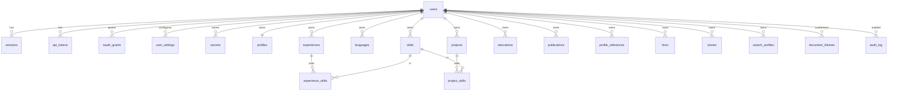
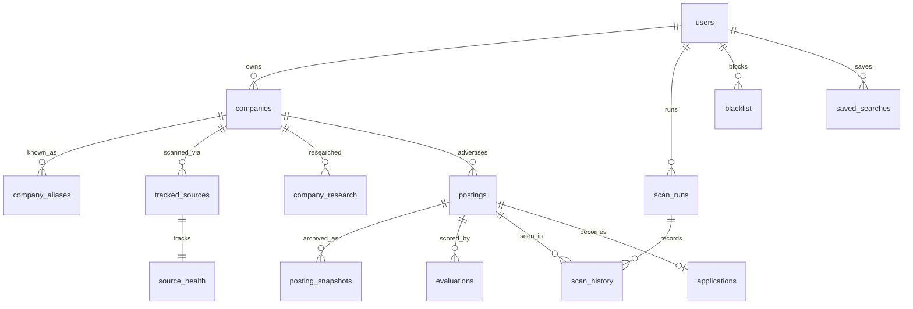
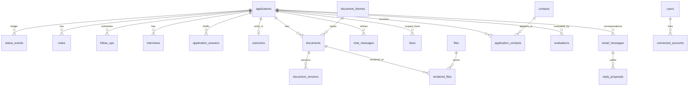
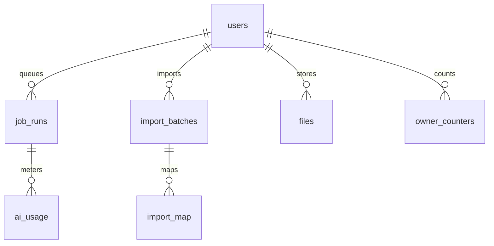

# DATABASE_DESIGN - unified schema for "Rho"

Inputs: `PROJECT_DOSSIER.md` s7 (30 models, enums, migrations), `PROJECT_CAREER_OPS.md` s7 (file artifacts), `PROJECT_AI_JOB_SEARCH.md` s7 (state files). Verified against source: `dossier/prisma/schema.prisma` (30 `model`s: ProfileField, Skill, Language, Experience, ExperienceSkill, Project, ProjectSkill, Education, Publication, Reference, Fact, Theme, Setting, Application, StatusEvent, Document, DocumentVersion, ChatMessage, Note, Posting, ClaudePaste, AgentCandidate, PostingScore, PostingSearch, Startup, StartupBlock, GoogleAccount, EmailMessage, LoginThrottle, Job; no `userId`/tenant); `career-ops/templates/states.yml` (10 states); `career-ops/tracker-parse.mjs` (`TSV_ADDITION_HEADER = num date company role status score pdf report notes`); `dossier/src/lib/data-export.ts` (`EXPORT_FORMAT="dossier-export"`, `EXPORT_SCHEMA_VERSION=7`, versions 1-7 importable, IDs kept).
Related: `UNIFIED_ARCHITECTURE.md` (RLS, queue), `API_DESIGN.md` (resources), `TECHNICAL_DECISIONS.md` (ADR-002 owner model, ADR-004 DB engine, ADR-013 DB-vs-files).

Labels **[F]** fact / **[A]** assumption / **[R]** recommendation. The schema itself is a **[R]**; the "Origin" columns are facts about the sources.

---

## 1. Conventions [R]

| Topic | Rule | Why / origin |
|---|---|---|
| Engine | PostgreSQL >= 16 (ADR-004). SQLite variant noted per feature in s9 | queue `SKIP LOCKED`, `jsonb`, `citext`, RLS; dossier already PG 18 [F] |
| IDs | application-generated UUIDv7 (`uuid`), never serial. Imported rows keep `legacy_ref` | time-ordered inserts; dossier uses cuid [F] |
| Ownership | every user-owned table has `owner_id uuid not null references users(id) on delete cascade`; uniques include `owner_id`. Child tables carry `owner_id` redundantly (denormalised) so RLS needs no join | dossier has none and retrofit is a rewrite [F]; ADR-002 |
| RLS | policy `owner_id = current_setting('app.user_id')::uuid` on every owned table; set via `SET LOCAL` per transaction; disabled by flag in single-user mode | defence in depth |
| Time | `timestamptz` UTC; user-facing dates as `date`; user time zone on `users.time_zone` | dossier stores `deadline @db.Date` [F] |
| Text | free text `text not null default ''` where forms autosave partial input (dossier convention [F]); `citext` for case-insensitive unique names (skills) | |
| JSON | `jsonb` only for (a) validated blobs with a zod schema in `contracts` and a `schema_version` key, (b) `extra` overflow for importers. Never query-critical fields | dossier validates JSON columns on read [F] |
| Soft delete | only where undo is a feature (`archived_at` on applications, `dismissed_at` on postings). Hard delete + cascade otherwise; "delete everything" is a user action | dossier cascades Application->children [F] |
| Enums | Postgres enums for closed sets that gate behaviour (status, kind); `text` + check for open sets (adapter ids, prompt versions) | |
| Provenance | every AI-written row stores `written_with` (model) and `prompt_version` (`id@N`) | dossier `writtenWith`/`promptVersion` [F] |
| Migrations | forward-only SQL migrations, one per change, run by one-shot service | dossier 34 migrations [F] |

---

## 2. Enums

| Enum | Values | Origin / note |
|---|---|---|
| `application_status` | EVALUATED, DRAFTED, APPLIED, RESPONDED, ASSESSMENT, INTERVIEW, OFFER, ACCEPTED, REJECTED, DECLINED, WITHDRAWN, NO_RESPONSE, DISCARDED, SKIPPED | union of three vocabularies, s4 |
| `funnel_stage` | APPLIED, SCREENING, INTERVIEW, OFFER, ACCEPTED | dossier `FunnelStage` SENT/SCREENING/INTERVIEW/OFFER/ACCEPTED [F]; RESPONDED+ASSESSMENT count as SCREENING |
| `posting_state` | NEW, SCORED, SHORTLISTED, DISMISSED, EXPIRED, UNREACHABLE, APPLIED | ai-job-search `new/skipped/ranked/expired/unreachable` [F] + dossier saved/dismissed/applied |
| `liveness` | ACTIVE, EXPIRED, UNCERTAIN, UNKNOWN | career-ops `classifyLiveness` [F] |
| `guard_verdict` | CLEAN, FLAGGED, UNCHECKED | ai-job-search `entry["guard"]` clean/text [F] |
| `evaluation_kind` | TRIAGE, FULL, MATCH | triage (cheap), A-G report, requirement match |
| `score_band` | STRONG (>=75), GOOD (>=60), MODERATE (>=45), WEAK (>=30), POOR | ai-job-search `BANDS` [F]; computed in code, stored for filtering |
| `confidence` | LOW, MEDIUM, HIGH | career-ops Machine Summary [F] |
| `legitimacy` | HIGH_CONFIDENCE, PROCEED_WITH_CAUTION, SUSPICIOUS, UNKNOWN | career-ops Block G [F]; does not affect score |
| `origin` | MANUAL, AGENT, IMPORT, MCP | dossier `ApplicationOrigin` MANUAL/AGENT [F] |
| `review_state` | NONE, AWAITING_REVIEW, APPROVED | dossier `awaitingReview` bool [F] |
| `status_source` | USER, SYSTEM, PROPOSAL_CONFIRMED, IMPORT | new (HR3 in architecture s6.2) |
| `work_mode` | REMOTE, HYBRID, ONSITE, UNKNOWN | dossier `mode` free text [F] -> enum |
| `document_kind` | RESUME, COVER_LETTER, EMAIL | dossier [F] |
| `version_cause` | WRITTEN, TRIMMED, REGENERATED, REFINED, UNDONE, BEFORE_RESTORE, RESTORED, EDITED, IMPORTED | dossier 7 values [F] + EDITED, IMPORTED |
| `fact_kind` | STATEMENT, METRIC, CREDENTIAL, FORBIDDEN_PHRASE, ADVISORY_PHRASE | dossier `Fact` + career-ops `cv-facts.json` [F] |
| `scan_outcome` | ADDED, DUPLICATE, SKIPPED_TITLE, SKIPPED_LOCATION, SKIPPED_AGE, SKIPPED_EXPIRED, SKIPPED_NO_APPLY_CONTROL, SKIPPED_EXPERIENCE, SKIPPED_COOLDOWN, SKIPPED_BLACKLIST, SKIPPED_OTHER | career-ops `scan-history.tsv` statuses [F] |
| `source_kind` | COMPANY, BOARD, AGGREGATOR_QUERY | `portals.yml` tracked_companies/job_boards [F] + dossier search |
| `job_status` | QUEUED, RUNNING, DONE, FAILED, CANCELLED | dossier 4 + CANCELLED |
| `email_direction` | OUTGOING, INCOMING | dossier [F] |
| `reply_kind` | REJECTION, INTERVIEW, QUESTION, OFFER, ACKNOWLEDGEMENT, OTHER | dossier [F] |
| `proposal_state` | PENDING, ACCEPTED, DISMISSED | career-ops reply-proposals [F] |
| `follow_up_state` | OPEN, DONE, CLEARED | career-ops follow-ups [F] |
| `contact_relation` | RECRUITER, HIRING_MANAGER, REFEREE, PEER, OTHER | career-ops contacts [A] |
| `user_role` / `user_status` | OWNER, ADMIN, MEMBER / ACTIVE, INVITED, DISABLED | new |
| `file_kind` | PDF, UPLOAD, PHOTO, JD_HTML, IMPORT_SOURCE, EXPORT | new |
| `tone` | WARM, DIRECT, FORMAL | dossier [F] |
| `creativity` | FAITHFUL, BALANCED, EXPRESSIVE | dossier [F] |
| `language_level` | NATIVE, C2, C1, B2, B1, A2, A1 | dossier [F] |
| `import_status` | PREVIEWED, APPLIED, FAILED, ROLLED_BACK | new |

---

## 3. Entity catalogue

Notation: `col type [constraints]`; `PK`, `FK->`, `UQ`, `IDX`. All owned tables also have `owner_id`, `created_at`, `updated_at` unless noted.

### 3.1 Identity, access, settings

| Entity | Fields | Constraints / indexes | Origin |
|---|---|---|---|
| `users` | id, email citext, password_hash text null, display_name, role, status, locale, time_zone, last_login_at | UQ(email) | new (dossier: password in env [F]) |
| `sessions` | id, user_id FK, token_hash, expires_at, persistent bool, ip, user_agent, revoked_at | UQ(token_hash), IDX(user_id) | dossier: stateless JWE cookie [F] -> revocable |
| `api_tokens` | id, user_id FK, name, token_hash, scopes text[], expires_at, last_used_at, revoked_at | UQ(token_hash) | new |
| `oauth_grants` | id, user_id FK, client_id, client_name, redirect_uri, scope, refresh_hash, generation int, expires_at, revoked_at | IDX(user_id), IDX(client_id) | dossier connector (signed-JWT client ids, no DB [F]) |
| `login_throttle` | key PK (ip or `*`), failures, window_start, blocked_until | IDX(updated_at) | dossier `LoginThrottle` [F] |
| `rate_limits` | key, window_start, count; PK(key, window_start) | TTL sweep | new |
| `user_settings` | owner_id, key, value jsonb; PK(owner_id,key) | | dossier `Setting` KV [F] |
| `secrets` | id, owner_id, kind (AI_KEY, JOB_SOURCE_KEY, GOOGLE_CLIENT, GOOGLE_TOKEN...), label, ciphertext bytea, iv, key_version, rotated_at | UQ(owner_id,kind,label) | dossier `apiKeyEnc`, `jsearchKeyEnc`, `GoogleAccount.refreshTokenEnc` [F] |
| `audit_log` | id, owner_id null, actor_user_id, action, target_type, target_id, meta jsonb, ip, at | IDX(owner_id,at) | new (absent in dossier [F s17]) |
| `owner_counters` | owner_id, name, value bigint; PK(owner_id,name) | `UPDATE ... RETURNING` | replaces `reserve-report-num.mjs` sentinels [F] |

### 3.2 Profile and facts

| Entity | Fields | Constraints / indexes | Origin |
|---|---|---|---|
| `profiles` | owner_id UQ, full_name, headline, summary, email, phone, location, links jsonb, photo_file_id FK, photo_on_resumes bool, show_age bool, birth_date date null, work_authorization jsonb, extra jsonb | 1:1 with owner | dossier `ProfileField` KV (`BASICS_FIELDS`, `showAge`, `photo`, `photoOnResumes`) [F] -> typed columns |
| `skills` | id, name citext, group_name text, sort int | UQ(owner_id,name) | dossier `Skill` [F] |
| `languages` | id, name citext, level, sort | UQ(owner_id,name) | dossier [F] |
| `experiences` | id, role, company, company_id FK null, location, descriptor, start_year, start_month, end_year, end_month, current bool, bullets text[], sort | IDX(owner_id,sort) | dossier `Experience` (bullets newline-separated) [F] |
| `projects` | id, name, link, start/end y/m, current, bullets text[], sort | | dossier `Project` [F] |
| `educations` | id, degree, school, dates..., current, notes, sort | | dossier [F] |
| `publications` | id, citation, link, on_resumes bool default true, sort | | dossier [F] |
| `profile_references` | id, name, relation, company, email, phone, sort | | dossier `Reference` [F] |
| `experience_skills`, `project_skills` | (experience_id, skill_id) PK, both FK cascade | IDX(skill_id) | dossier [F] |
| `facts` | id, application_id FK null (null = profile-level), kind fact_kind, text, sort | IDX(owner_id,application_id,sort) | dossier `Fact` [F] + career-ops `cv-facts.json` forbidden/advisory phrases [F] |
| `stories` | id, title, situation, task, action, result, reflection, tags text[], source_ref | | career-ops story-bank [F] |
| `search_profiles` | id, name, is_default, target_titles text[], archetypes jsonb, include_keywords text[], exclude_keywords text[], locations jsonb, work_mode_pref, countries text[], salary_floor, salary_currency, language_gate jsonb, eligibility_gate jsonb, dealbreakers jsonb, experience_band jsonb, cooldown jsonb, culture_screen jsonb, weights jsonb null (override of default 30/25/15/30), followup_cadence jsonb, agent_enabled bool, agent_hour smallint, agent_limits jsonb, version int | UQ(owner_id,name); partial UQ default | career-ops `profile.yml` + `portals.yml` filters [F]; ai-job-search gates (prose) [F]; dossier `agent*` settings [F] |
| `document_themes` | id, owner_id null (built-in), slug, built_in bool, name, tokens jsonb (fonts, accent, layout, align, heading/header/sidebar/date styles, photo shape/position, density), paper_size | UQ(owner_id,slug); trigger blocks delete of built_in | dossier `Theme` + trigger `Theme_prevent_builtin_delete` [F]; career-ops templates [F] |

### 3.3 Discovery

| Entity | Fields | Constraints / indexes | Origin |
|---|---|---|---|
| `companies` | id, name, canonical_key, website, ats_provider, ats_slug, careers_url, tier, notes, logo_file_id | UQ(owner_id,canonical_key) | career-ops company canonicalizer [F]; ai-job-search `company_research` keys |
| `company_aliases` | company_id FK, alias_key | UQ(owner_id,alias_key) | career-ops `buildCompanyCanonicalizer` [F] |
| `tracked_sources` | id, kind source_kind, company_id FK null, adapter_id text, config jsonb, enabled, filters_override jsonb, last_run_at, fail_streak, paused_reason | IDX(owner_id,enabled) | `portals.yml` tracked_companies / job_boards [F] |
| `scan_runs` | id, kind (SCHEDULED/MANUAL/AGENT), started_at, finished_at, status, params jsonb, counts jsonb, errors jsonb | IDX(owner_id,started_at) | `scan-runs.tsv` [F]; dossier `agentRuns` setting [F] |
| `scan_history` | id, scan_run_id FK, url_key, posting_id FK null, title, company_name, adapter_id, outcome scan_outcome, reason, blocks_rediscovery bool, at, extra jsonb | append-only; IDX(owner_id,url_key), IDX(owner_id,at) | `scan-history.tsv` (`OBSERVATIONAL_SCAN_HISTORY_STATUSES` carry no dedup weight [F]) |
| `source_health` | tracked_source_id PK, ok_streak, fail_streak, last_error_class, last_checked_at | | `portal-health.tsv`, `dead-boards.tsv` [F] |
| `blacklist` | id, kind (COMPANY/DOMAIN/URL), value_key, reason | UQ(owner_id,kind,value_key) | `data/blacklist.md` [F] |
| `saved_searches` | id, adapter_id, query jsonb, results jsonb, found int, next_cursor | IDX(owner_id,created_at) | dossier `PostingSearch` (kept so reopen costs no quota) [F] |
| `postings` | id, company_id FK null, company_name, title, location, country, work_mode, salary_min, salary_max, salary_currency, salary_period, posted_at, deadline date, url, url_key, apply_url, adapter_id, external_id, via, description_text, description_complete bool, fingerprint, identity_key, state posting_state, liveness, liveness_checked_at, guard_verdict, guard_findings jsonb, trust_score smallint, trust_flags text[], fetch_attempts int, first_unreachable_at, last_fetch_error (<=200 chars), expired_reason, first_seen_at, last_seen_at, saved_at, dismissed_at, current_evaluation_id FK null, quick_fit (high/medium/low) null, legacy_ref jsonb | UQ(owner_id,url_key); UQ(owner_id,adapter_id,external_id) where external_id not null; IDX(owner_id,state); IDX(owner_id,identity_key); IDX(owner_id,fingerprint); partial IDX(owner_id,deadline) where state in (SCORED,SHORTLISTED) | union: dossier `Posting`/`AgentCandidate` [F]; ai-job-search `seen_jobs.json` entry [F]; career-ops `Job` typedef + pipeline.md [F] |
| `posting_snapshots` | id, posting_id FK, captured_at, content_type, text, html_file_id FK null, sha256, guard_verdict, guard_findings jsonb | IDX(posting_id,captured_at) | career-ops mandatory "archived JD" in reports [F]; ai-job-search `job_posting.md` [F] |
| `company_research` | id, company_id FK, payload jsonb, source, fetched_at, expires_at | IDX(owner_id,company_id), TTL 30 d default | ai-job-search `company_research/*.json` [F] |
| `startup_leads` (v1+/Later) | id, source, external_id, company, website, summary, roles jsonb, emails jsonb, score, status, application_id FK null | UQ(owner_id,source,external_id) | dossier `Startup`, `StartupBlock` [F] |

`identity_key` = canonical `company-slug_title-slug` (ai-job-search `make_key` rules: NFKD slug, caps 40/60 + 6-hex sha1 suffix, non-Latin fallback to portal id/hash [F]) so one key serves dedup everywhere. `fingerprint` = career-ops listing fingerprint (cross-listing detection [F]). `url_key` = career-ops `normalizeUrlForDedup`.

### 3.4 Evaluation

`evaluations` (one table for all scorers):

| Field | Type | Notes |
|---|---|---|
| id, owner_id, posting_id FK, application_id FK null | uuid | |
| kind | evaluation_kind | TRIAGE (cheap), FULL (A-G), MATCH (requirements) |
| is_current | bool | partial UQ(posting_id, kind) where is_current |
| score | smallint 0-100 | computed by code from `dimensions` and weights |
| band | score_band | computed |
| dimensions | jsonb | `{technical:{score, evidence:supported|partial|unknown}, experience, behavioral, career, ...}` per ai-job-search four dims [F] + career-ops evidence statuses [F]; weights version recorded |
| weights_version | text | |
| vetoes | jsonb | `{location:PASS|FLAG|FAIL, language:..., eligibility:...}`; FAIL excludes from shortlist [F rank_state `GATE_VERDICTS`] |
| confidence | confidence | derived deterministically from evidence statuses |
| legitimacy | legitimacy | does not affect `score` [F] |
| reasons text[] (<=4), red_flags text[] (<=3), strengths text[] (<=3), gaps text[] (<=3) | | dossier `score-posting@2` caps [F]; ai-job-search strengths/gaps [F] |
| requirements | jsonb null | dossier `extracted` + `match` rows (covered/partial/gap) [F] |
| blocks | jsonb null | career-ops A-F + G + H structured |
| report_md | text null | rendered/imported report |
| report_no | int null | per-owner from `owner_counters`; UQ(owner_id, report_no) where not null |
| legacy_score_5 | numeric(2,1) null | career-ops original 1-5 (score = round(x*20) on import; band recomputed) |
| written_with, prompt_version | text | provenance |
| tokens_in, tokens_out | int | |
| IDX | (owner_id, posting_id), (owner_id, score desc) where is_current | |

### 3.5 Applications and lifecycle

| Entity | Fields | Constraints / indexes | Origin |
|---|---|---|---|
| `applications` | id, posting_id FK null, snapshot_id FK null, company_id FK null, company_name, title, role, location, work_mode, salary_text, salary_min/max/currency, deadline date, posting_url, status application_status default DRAFTED, furthest_stage funnel_stage null, origin, review_state, current_evaluation_id FK null, extracted jsonb, extracted_with, match jsonb, matched_with, tone, language, follow_theme_layout bool, show_photo bool null, sent_at, next_interview_at, channel, sector, role_type, source_label, email_thread_id, archived_at, legacy_ref jsonb | IDX(owner_id,status), IDX(owner_id,updated_at), partial UQ(owner_id,posting_id) where posting_id not null, IDX(owner_id,archived_at) | dossier `Application` [F]; ai-job-search tracker CSV columns `date,company,sector,role,role_type,channel,status,contact_person,fit_rating,notes,cv_file,cover_letter_file,source,deadline` [F]; career-ops `# Date Company Role Score Status PDF Report Notes (+Via, URL)` [F] |
| `status_events` | id, application_id FK cascade, from_status, to_status, at, source status_source, note, prev_furthest_stage, prev_sent_at, legacy jsonb | IDX(application_id, at); CHECK: source=SYSTEM cannot target APPLIED or later | dossier `StatusEvent` (stores undo data) [F]; career-ops `status-log.tsv` `tracker# date from to source note` [F] |
| `notes` | id, application_id FK cascade, body | | dossier `Note` [F] |
| `contacts` | id, name, email, phone, company_id FK null, company_name, title, linkedin_url, relation, notes, source | IDX(owner_id,lower(email)) | career-ops `contacts.tsv` [F]; ai-job-search `contact_person` |
| `application_contacts` | application_id, contact_id, role; PK both | | |
| `follow_ups` | id, application_id FK, due_on date, kind, attempt int, state, next_override date null, cleared_at | IDX(owner_id,state,due_on) | career-ops `follow-ups.md` + `DEFAULT_CADENCE` [F] |
| `interviews` | id, application_id FK, round, kind, scheduled_at, duration_min, location, calendar_event_id, calendar_id, outcome, notes, prep jsonb | IDX(application_id,scheduled_at) | career-ops `active-interviews.md`; dossier `nextInterviewAt/interviewEventId/interviewCalendarId` [F] |
| `application_answers` | id, application_id FK, question, answer, state, block_ref | | career-ops Block H [F] |
| `outcomes` | application_id PK, result, archived_at, offer jsonb, retro_md | | career-ops `outcome.mjs`; ai-job-search `outcome.md` [F] |
| `salary_observations` | id, company_id null, role, min, max, currency, period, source, observed_on, application_id null | | career-ops [F] |

### 3.6 Documents and files

| Entity | Fields | Constraints / indexes | Origin |
|---|---|---|---|
| `documents` | id, application_id FK null (null = base resume), kind, units jsonb, theme_id FK, written_with, prompt_version, trimmed jsonb, updated_at | UQ(application_id, kind); partial UQ(owner_id, kind) where application_id is null | dossier `Document` `@@unique([applicationId, kind])` [F] |
| `document_versions` | id, document_id FK cascade, units jsonb, cause, detail, created_at | IDX(document_id, created_at) | dossier [F] |
| `chat_messages` | id, application_id FK, role, text, target_unit, edits jsonb, undone bool, previous_tone, written_with, created_at | IDX(application_id, created_at) | dossier [F] |
| `files` | id, kind, storage_key, mime, size, sha256, expires_at | UQ(storage_key) | dossier DATA_DIR/downloads; career-ops `output/`, `jds/` [F] |
| `rendered_files` | id, document_id FK, version_id FK, file_id FK, format, template_id, page_count, fact_gate jsonb, generated_at, legacy_path | IDX(document_id) | career-ops `data/pdf-index.tsv` (report + kind keyed) [F] |

`Unit` shape in `documents.units` (dossier [F]): `{id, label, text, unverified?}` with ids `summary`, `experience:<id>`, `project:<id>`, `skills`, `education:<id>`, `publication:<id>`, `languages`, `paragraph:N`, `sign-off`, `recipient`, `greeting`, `to`, `subject`, `body`.

### 3.7 Communications and operations

| Entity | Fields | Constraints / indexes | Origin |
|---|---|---|---|
| `connected_accounts` | id, provider (GOOGLE), account_email, refresh_secret_id FK->secrets, scopes text[], history_id, last_sync_at, sync_problem, status | UQ(owner_id,provider) | dossier `GoogleAccount` (singleton) [F] |
| `email_messages` | id, provider_message_id, thread_id, application_id FK null, direction, from_name, from_address, to_address, subject, message_id, body (<=20k), sent_at, kind reply_kind, summary, questions jsonb, suggested_status, confirmed_at, classified_with, reply_draft, reply_gaps jsonb, drafted_with, handled_at, dismissed_at | UQ(owner_id,provider_message_id); IDX(thread_id), IDX(application_id,sent_at) | dossier `EmailMessage` [F] |
| `reply_proposals` | id, email_message_id FK null, application_id FK, kind, suggested_status, summary, state, payload jsonb, decided_at | IDX(owner_id,state) | career-ops `reply-proposals/*.json` [F] (also fed by manual paste) |
| `job_runs` | id, type, key, application_id FK null, status, step, input jsonb, result jsonb, error, created_at, started_at, finished_at | IDX(owner_id,key,created_at), IDX(status), IDX(application_id) | dossier `Job` [F] |
| `ai_usage` | id, job_run_id null, task, model, tokens_in, tokens_out, latency_ms, cost_micro_usd null, at | IDX(owner_id,at) | career-ops token tracker [F] |
| `import_batches` | id, source_format (CAREER_OPS, AI_JOB_SEARCH, DOSSIER_EXPORT, CSV), file_id FK, file_sha256, status, summary jsonb, warnings jsonb | | new |
| `import_map` | batch_id FK, source_kind, source_ref, entity_type, entity_id | UQ(owner_id,source_kind,source_ref,entity_type) | idempotency |
| `handoffs` (Later) | id, text, url, expires_at | TTL 14 d | dossier `ClaudePaste` [F] |

Not carried over: dossier `LoginThrottle` is kept as is; `StartupBlock` folds into `startup_leads` (hash column) when that feature ships; `PostingScore` becomes `evaluations(kind=TRIAGE)`; `AgentCandidate` becomes `postings` + `review_state`; `PostingSearch` becomes `saved_searches`.

---

## 4. Status vocabulary unification

| Unified | dossier `ApplicationStatus` | career-ops `states.yml` | ai-job-search tracker | Funnel stage reached |
|---|---|---|---|---|
| EVALUATED | - (a posting, not an application) | `evaluated` | - (`ranked` in `seen_jobs.json`) | - |
| DRAFTED | `DRAFT` | - | `drafted` | - |
| APPLIED | `SENT` | `applied` | `applied` | APPLIED |
| RESPONDED | `SCREENING` [A] | `responded` | - | SCREENING |
| ASSESSMENT | - | `assessment` | - | SCREENING |
| INTERVIEW | `INTERVIEW` | `interview` | `interview` | INTERVIEW |
| OFFER | `OFFER` | `offer` | `offer` | OFFER |
| ACCEPTED | `ACCEPTED` | `hired` | `hired` | ACCEPTED |
| REJECTED | `REJECTED` | `rejected` | `rejected` | (keeps `furthest_stage`) |
| DECLINED | `DECLINED` [A: dossier does not raise `SENT` for DECLINED, so it can occur pre-send] | - | `offer_declined` | - |
| WITHDRAWN | - | - | `withdrawn` | - |
| NO_RESPONSE | - | - | `no_response` | - |
| DISCARDED | - | `discarded` | - | - |
| SKIPPED | - | `skip` | - | - |

Rules carried over [F dossier `status.ts`]: any->any transition allowed; `sent_at ??= now` and `furthest_stage = max(furthest_stage, APPLIED)` for every target except DRAFTED/EVALUATED/SKIPPED/DISCARDED/DECLINED-before-send; `furthest_stage` never lowers; undo only for the latest event. career-ops treats `offer` as terminal [F `states.yml terminal:true`]; unified treats OFFER as in-progress (dossier: "in progress = DRAFT..OFFER" [F]). career-ops multilingual aliases (`aplicado`, `entrevista`, `başvuruldu`, ...) are loaded from a seed table `status_aliases(alias, status)` used by importers and the UI quick-add. Original string preserved in `status_events.legacy`.

Display score bridge: career-ops 1-5 <-> 0-100 via `score = round(x * 20)` [R, lossy; bands differ: career-ops 4.5+ strong vs ai-job-search >=75 strong]; imports recompute `band` and keep `legacy_score_5`.

---

## 5. ERDs

### 5.1 Identity, profile, settings

### 5.2 Discovery and evaluation

### 5.3 Applications, documents, communications

### 5.4 Operations

---

## 6. Indexing, integrity and performance notes [R]

- Hot queries: board by `(owner_id,status)`; queue by `(owner_id,state,score desc)` via `evaluations.is_current`; dedup lookups by `(owner_id,url_key)`, `(owner_id,identity_key)`, `(owner_id,fingerprint)`; due follow-ups by `(owner_id,state,due_on)`; inbox by `(application_id,sent_at)`; job progress by `job_runs(key)`.
- Integrity beyond FKs: partial uniques noted above; CHECK on `status_events` (HR3); trigger protecting built-in themes (dossier [F]); trigger or service rule keeping `applications.current_evaluation_id` pointing to an evaluation of the same application/posting.
- `FOR UPDATE` on `applications` row in status transitions (dossier [F]); unique constraints turn double-clicks into conflict errors handled as "already exists" (dossier P2002 handling [F]).
- JSON-heavy reads: `documents.units`, `saved_searches.results` read whole (dossier notes the same [F]); cap and prune `saved_searches` (keep N=50, 30 days).
- Retention: finished `job_runs` 24 h default; expired `files`; `posting_snapshots` kept (they are evidence); `scan_history` kept (dedup memory) - archive rows older than 2 years to a compact table only if size demands.
- Full-text: GIN on `postings.description_text` and `notes.body` (`to_tsvector`) for search (v1).
- Multi-tenant test: two-user fixtures; for every table assert reads/writes across `owner_id` fail (architecture s9).

---

## 7. Mapping from dossier models

Applies to (a) the data export JSON of a running dossier and (b) conceptual reuse of its model. See s8.4 for the legal note.

| dossier model [F] | Unified target | Transform |
|---|---|---|
| `ProfileField` (KV) | `profiles` columns + `extra` | keys listed in dossier `BASICS_FIELDS` map to columns; unknown keys -> `extra`; `photo` data URL -> `files(PHOTO)` |
| `Skill`, `Language`, `ExperienceSkill`, `ProjectSkill` | same names | 1:1; `owner_id` stamped |
| `Experience`, `Project`, `Education`, `Publication`, `Reference` | same | `bullets` newline text -> `text[]` |
| `Fact` | `facts` | `kind=STATEMENT`; `applicationId` preserved |
| `Theme` (built-in rows not exported [F]) | `document_themes` | enum columns -> `tokens` jsonb; built-ins re-seeded |
| `Setting` | `user_settings` + `search_profiles` + `secrets` | split: `agent*` -> `search_profiles`/agent limits; AI/job keys are **not importable** (encrypted per install [F]) - prompt user to re-enter |
| `Application` | `applications` | `DRAFT->DRAFTED`, `SENT->APPLIED`, `SCREENING->RESPONDED` [A]; `postingText` -> `posting_snapshots`; `extracted/match` kept jsonb; `awaitingReview=true` -> `review_state=AWAITING_REVIEW`; `origin` kept |
| `StatusEvent` | `status_events` | `source=IMPORT`; previous values kept |
| `Document`, `DocumentVersion`, `ChatMessage`, `Note` | same | `units` JSON validated against the `Unit` zod schema; invalid units quarantined into `extra`, never dropped silently |
| `Posting` | `postings` | `source` enum -> `adapter_id` (`jsearch`,`adzuna`,`arbeitsagentur`,`freehire`); `savedAt/dismissedAt` -> `state` |
| `PostingScore` | `evaluations(kind=TRIAGE)` | `score`, `reasons`, `redFlags`, `scoredWith`; dimensions null |
| `PostingSearch` | `saved_searches` | |
| `AgentCandidate` | `postings` (+ `scan_history`) | `status` SCORED/DRAFTING/DRAFTED/APPROVED/DISMISSED -> `posting_state`/`review_state`; `dedupeKey` -> `identity_key` |
| `Startup`, `StartupBlock` | `startup_leads` (Later) | skip in MVP, keep raw in `import_batches.summary.skipped` |
| `GoogleAccount`, `EmailMessage` | not exported by dossier [F] | re-connect Google; re-sync mail |
| `Job`, `LoginThrottle`, `ClaudePaste` | - | server-owned, not imported |

## 8. Migration and import strategy

### 8.1 Shared importer framework [R]
1. **Upload -> `import_batches(PREVIEWED)`** with sha256 (re-upload of identical file is a no-op).
2. **Parse** with strict readers; unknown columns -> `extra`; malformed rows -> warnings list, never abort silently (career-ops: "missing is not malformed" rule [F `web/AGENTS.md`]).
3. **Normalise** through the same `identity`, status-alias and company-canonicalizer packages the live app uses (career-ops `tracker-parse.mjs resolveColumns` alias idea [F]).
4. **Dry-run report**: counts per entity, merges, status remaps, unresolved references, dropped fields. User confirms.
5. **Apply in one transaction per entity group**, in order: companies -> postings -> snapshots -> evaluations -> applications -> status_events -> notes/contacts/follow_ups/interviews -> documents/files. Writes `import_map(source_ref -> entity_id)` so re-runs update instead of duplicate.
6. **Safety**: owner-scoped; file size caps; never execute content; no AI in the default path; text from files that later flows into LLM prompts passes the posting guard like any untrusted text; `status_events.source=IMPORT`.
7. **Rollback**: `rolled_back` deletes by `import_map` for that batch.

### 8.2 career-ops (flat files; MIT; code may be ported)
| Source artifact [F] | Target | Notes |
|---|---|---|
| `data/applications.md` (cols `# Date Company Role Score Status PDF Report Notes` + `Via`, `URL` after `--migrate-via/--migrate-urls`) | `applications` (+ `postings`, `companies`) | resolve columns **by name alias** (`tracker-parse.mjs resolveColumns`); `#` -> `legacy_ref.num`; Score `4.2/5` -> `legacy_score_5=4.2`, `score=84`; Status via `states.yml` aliases; PDF cell -> `rendered_files.legacy_path`; Notes -> `notes` + contact extraction |
| `data/status-log.tsv` (`tracker# date from to source note`) | `status_events` | authoritative dates for `sent_at` (career-ops derives applied date from it [F]) |
| `reports/NNN-*.md` (+ `## Machine Summary` YAML, archived JD section) | `evaluations(FULL)` + `posting_snapshots` | `report_no=NNN`; counter set to max+1; body -> `report_md`; block split best-effort -> `blocks` |
| `data/scan-history.tsv` (append-only, columns by name) | `scan_history` | statuses -> `scan_outcome`; unknown statuses -> `SKIPPED_OTHER` + `extra` |
| `data/pipeline.md` (`- [ ] url`, `- [!]`) | `postings(state=NEW)` | `[!]` -> `last_fetch_error='jd unavailable'` |
| `data/follow-ups.md`, `contacts.tsv`, `salary-observations.tsv`, `active-interviews.md`, `blacklist.md`, `assessments.tsv` | `follow_ups`, `contacts`, `salary_observations`, `interviews`, `blacklist`, `application_answers`/notes | best-effort parse; leftovers into `import_batches.warnings` |
| `data/portal-health.tsv`, `dead-boards.tsv`, `scan-runs.tsv` | `source_health`, `scan_runs` | |
| `portals.yml` | `tracked_sources` + `search_profiles` filters | `title_filter`, `location_filter`, `salary_filter`, `experience_filter`, `skip_tiers` etc.; `provider:` -> `adapter_id` if supported else disabled with note; **`local-parser` entries are dropped** (RCE) |
| `config/profile.yml`, `modes/_profile.md`, `_custom.md` | `search_profiles`, `profiles`, user prompt addenda | archetypes kept as text |
| `cv.md`, `article-digest.md`, `config/cv-facts.json`, `data/career-profile.yml` | profile rows via **AI-assisted import with preview** (dossier-style "unverified" markers) + `facts` | cv-facts forbidden/advisory phrases map 1:1 to `facts.kind` |
| `output/*.pdf`, `data/pdf-index.tsv` | `files` + `rendered_files` | optional upload; checksum |
| `.career-ops-web/*`, `batch/*`, `cache/*` | ignored | transient |
| story bank files | `stories` | |

### 8.3 ai-job-search (flat files; MIT)
| Source [F] | Target | Notes |
|---|---|---|
| `job_scraper/seen_jobs.json` (`{"seen": {key: entry}}`; entry `title, company, url, first_seen, posted_date, deadline, fit, status, portal, source, location, rank_score, rank_verdict, rank_date, location_verdict, language_gate, language_note, strengths, gaps, guard, fetch_attempts, first_unreachable, last_fetch_error, expired_reason`) | `postings` + `evaluations(TRIAGE)` | key -> `identity_key` (already canonical `company_title`; run `job_key --audit` rules to flag legacy 3-part keys); status `new->NEW`, `skipped->DISMISSED`, `ranked->SCORED`, `expired->EXPIRED`, `unreachable->UNREACHABLE`; `fit` -> `quick_fit`; `rank_score` -> `evaluations.score` (dimension breakdown absent -> null); gates -> `vetoes` |
| `job_search_tracker.csv` (`date,company,sector,role,role_type,channel,status,contact_person,fit_rating,notes,cv_file,cover_letter_file,source,deadline`; UTF-8 BOM tolerated; legacy space spellings tolerated) | `applications` | status vocab per s4; `contact_person` -> `contacts`; `fit_rating` bare number -> `legacy_ref`; cv/cover paths -> `rendered_files.legacy_path` (upload `.pdf` if present) |
| `documents/applications/<company>_<role>/job_posting.md`, `outcome.md` | `posting_snapshots`, `outcomes`/`notes` | `## posting_guard` counts section -> `guard_findings` |
| `company_research/*.json` | `company_research` | keep `expires_at` from file mtime + 30 d |
| `01..09` profile markdown + `cv/main_*.tex` | profile via AI-assisted import with preview | LaTeX CV text extracted; never trusted without review |
| `salary_data.json` | `salary_benchmarks` (Later) | |
| `gmail_sync/state.json`, `notion_sync.json` | ignored | re-sync |

### 8.4 dossier (running instance, export JSON v1-7)
- Use the app's own `GET /api/export` file (`{format:"dossier-export", schemaVersion}`) [F]. Importer refuses unknown versions (dossier does too [F]). Map per s7.
- Not in export (re-do after import) [F]: jobs, throttle, built-in themes, Google account and mail, encrypted keys, install settings.
- **Licence note [A, needs counsel - ADR-001]:** importing a user's own data file is processing user data, not copying AGPL code. To stay clean-room, write the importer against a captured sample export and the field list in this document, not by transcribing `data-export.ts`.
- If a user runs both products, offer a one-way "adopt dossier DB" mode: read-only connection to its Postgres, apply s7 mapping; no writes to the source.

### 8.5 Schema evolution and cutover
- Importers are versioned (`importer_version` in `import_batches.summary`) and tested against checked-in fixtures (anonymised sample trees for both file-based tools; a sample export file for dossier).
- Ongoing sync is **not** supported (one-shot import). career-ops users who want to keep editing markdown can use the s9 round-trip export, but writes made outside Rho are not read back.

## 9. Export and portability [R]
- `rho-export` JSON (versioned, IDs kept, secrets excluded) for backup/restore - mirrors dossier's design [F].
- CSV tracker export compatible with ai-job-search columns; markdown tracker export compatible with career-ops `applications.md` header (`# | Date | Company | Role | Score | Status | PDF | Report | Notes`) using canonical state labels, so those tools' viewers keep working.
- Reports exported as `NNN-slug-date.md` with Machine Summary YAML (career-ops format).
- **SQLite variant (ADR-004)**: drop RLS, `citext` (use `COLLATE NOCASE`), `text[]` (use JSON), partial uniques are supported; replace queue with an in-process table poller; accept single-writer limits. Not recommended unless the product is strictly single-user.

## 10. Open items
1. `DECLINED` semantics in dossier (see s4 [A]) - confirm in `status.ts` before writing the importer.
2. Whether `postings` should be a shared (non-owned) catalog with per-user overlays to save storage in SaaS - deferred; owner-scoped copy chosen for privacy and simplicity.
3. Per-dimension scores are absent in ai-job-search state and dossier scores; the dimension set for unified `evaluations.dimensions` is finalised in M6 with the golden set.
4. Retention policy for `email_messages.body` (20k chars stored by dossier [F]) in multi-user mode (privacy).
