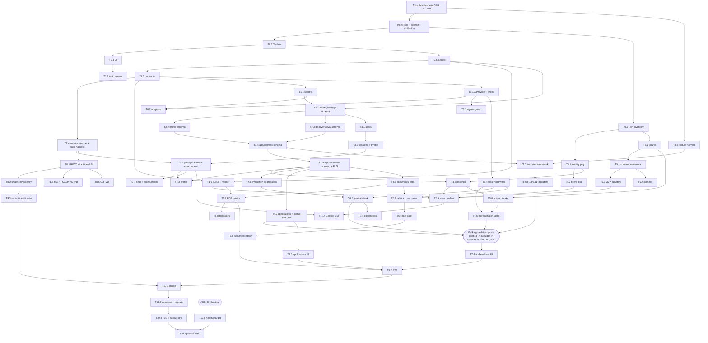

# IMPLEMENTATION_ROADMAP - "Rho"

Nothing here starts implementation; this is the plan. Inputs: `UNIFIED_PRODUCT_VISION.md` (scope tiers), `UNIFIED_ARCHITECTURE.md` (modules), `DATABASE_DESIGN.md` (schema, importers), `API_DESIGN.md` (surfaces), `TECHNICAL_DECISIONS.md` (ADR gates). Source facts inherited from `PROJECT_AI_JOB_SEARCH.md`, `PROJECT_CAREER_OPS.md`, `PROJECT_DOSSIER.md`. Concurrently produced by another agent, referenced only: `CROSS_PROJECT_COMPARISON.md`, `FEATURE_INVENTORY.md`, `LICENSE_AND_ATTRIBUTION_AUDIT.md`.

Labels **[F]** fact, **[A]** assumption, **[R]** recommendation. All sizing is **[A]**.

---

## 1. Sizing key and assumptions

| Size | Meaning (one engineer, focused, includes tests) |
|---|---|
| S | <= 2 days |
| M | 3-7 days |
| L | 8-15 days |

Assumptions [A]: TypeScript/Next/Postgres stack (ADR-003/004 as recommended); 3 engineers; AI-assisted coding; sources' MIT code is ported (not rewritten) where the vision says CODE; dossier ideas are re-implemented from the research docs (ADR-001 option A). If ADR-001 = "adopt AGPL and reuse dossier code" subtract roughly 20-30% from M4-M7 (many dossier modules lift almost directly: auth, status machine, units, AI providers, PDF) [A].
Totals (+-40%): **MVP ~ 350-400 engineer-days** (about 4-6 calendar months with 3 engineers), **v1 adds ~ 220-260**, **Later** open-ended.

## 2. Milestones in the requested order, and the order that minimises rework

Requested sequence: project init -> core infrastructure -> DB design -> auth -> main modules -> feature integration -> AI functionality -> frontend -> backend -> testing -> deployment. It is kept as the milestone list (M0-M10). Executing it as a strict waterfall causes the three classic rework loops this repo family already shows:
1. dossier has no `owner_id` and no principal in services, so adding users is a rewrite [F schema]; => principal + owner scoping land in M1-M3, before any domain code.
2. career-ops puts domain logic in file-bound scripts with import cycles [F]; => pure packages first, with ported tests.
3. ai-job-search/career-ops prove workflow only by testing prompt wording [F]; => AI tasks built against a Mock provider + golden fixtures, real models later.

**Rules for execution [R]**
- **R1 Decision gate**: ADR-001/002/003/004 decided before M0 exits (`TECHNICAL_DECISIONS.md` s2).
- **R2 Contract-first**: `contracts` (zod, envelope, errors) is the first code. UI and API are generated/derived from it.
- **R3 Pure packages before I/O**: `identity`, `filters`, `guards`, `liveness`, evaluation aggregation have no dependencies and are ported with their tests first (M4/M5 start). They unblock everything else.
- **R4 Walking skeleton by end of M5/M6**: paste posting -> guard -> Mock-AI evaluate -> application -> status -> export, running in CI. Widen only after it is green.
- **R5 Vertical slices for M7 (frontend) and M8 (backend)**: each slice = service + REST + (action) + UI + E2E; M7/M8 therefore overlap in time even though listed separately; REST/OpenAPI hardening (M8) finishes the contract that slices already used.
- **R6 Testing is continuous**: M9 is the hardening/gate milestone, not the first time tests exist; each milestone's DoD includes its own tests and the coverage ratchet.
- **R7 Google integration last** among integrations (largest external risk: OAuth app verification for restricted Gmail scopes [A]).
- **R8 Importers need stable schema**: fixtures harvested in M0, framework in M2, source importers at the end of M5.

---

## 3. Milestones and tasks

Columns: ID | Task | Size | Depends on | Tier | ADR gate. Tier: MVP / v1 / Later. "ADR gate" = decision that must be settled before the task starts (`TECHNICAL_DECISIONS.md`).

### M0 - Project init
| ID | Task | Size | Deps | Tier | ADR |
|---|---|---|---|---|---|
| T0.1 | Decision gate meeting: ADR-001, -002, -003, -004 (user) | S | - | MVP | - |
| T0.2 | Repo, `LICENSE`/`NOTICE`, workspace layout, third-party attribution file for ported MIT code (each ported file keeps origin + copyright line) | S | T0.1 | MVP | 001 |
| T0.3 | Tooling: TS strict, ESLint, formatter, commit convention, pre-commit | S | T0.2 | MVP | 003 |
| T0.4 | CI skeleton: lint, typecheck, test, dependency-review, CodeQL, lockfile committed | M | T0.3 | MVP | 003 |
| T0.5 | Spikes (time-boxed 3 days): ORM (Drizzle vs Prisma + RLS), queue lib, auth lib, OpenAPI-from-zod, AI SDK vs own adapters | M | T0.3 | MVP | 004,008,020 |
| T0.6 | Fixture harvest: anonymised sample trees for career-ops data root and ai-job-search state; one sample dossier export (schema v7) | M | T0.1 | MVP | - |
| T0.7 | Port inventory: list of MIT files/functions to port with source path + licence line (feeds the attribution audit) | S | T0.2 | MVP | 001 |
| T0.8 | ADR log + templates; threat model v0 (`UNIFIED_ARCHITECTURE.md` s9) | S | T0.1 | MVP | - |

### M1 - Core infrastructure
| ID | Task | Size | Deps | Tier | ADR |
|---|---|---|---|---|---|
| T1.1 | `contracts`: envelope, error codes, `Result`, `Principal`, scope registry | M | T0.5 | MVP | - |
| T1.2 | Config: zod env parse (lazy, fail-fast with all problems), no secrets needed to build | S | T1.1 | MVP | - |
| T1.3 | Logging: JSON logs; "first-line-only" error logging; redaction rules (never prompts/answers) | S | T1.1 | MVP | - |
| T1.4 | Service wrapper shared by action/route/tool/CLI + audit-test harness (every entry declares scopes) | M | T1.1 | MVP | - |
| T1.5 | Secrets crypto: AES-256-GCM, HKDF per purpose, key version | S | T1.2 | MVP | - |
| T1.6 | Queue package + worker entrypoint: enqueue/dequeue, cron, singleton keys, cancel, boot recovery, `job_runs` + SSE | L | T0.5, T1.1 | MVP | 008 |
| T1.7 | File store abstraction (fs volume / S3-compatible), retention sweeper | S | T1.2 | MVP | 006 |
| T1.8 | Test harness: Vitest projects (unit/db/dom), db reset helper with `_test` guard, fake AI/jobs/Google servers via `*_TEST_BASE_URL` seams | M | T0.4 | MVP | - |
| T1.9 | Dev docker compose (db, web, worker, optional ollama) | S | T0.4 | MVP | - |

### M2 - Database design
| ID | Task | Size | Deps | Tier | ADR |
|---|---|---|---|---|---|
| T2.1 | Migrations: identity/settings/secrets/audit/counters | M | T0.5, T1.5 | MVP | 002,004 |
| T2.2 | Migrations: profile, facts, search_profiles, themes | M | T2.1 | MVP | - |
| T2.3 | Migrations: companies, tracked_sources, postings, snapshots, scan tables, evaluations | M | T2.1 | MVP | - |
| T2.4 | Migrations: applications, status_events, documents, versions, chat, files, rendered_files, job_runs, ai_usage | M | T2.2, T2.3 | MVP | - |
| T2.5 | Repository layer with mandatory owner scoping; RLS policies behind flag; cross-tenant test | L | T2.4 | MVP | 002 |
| T2.6 | Seeds: built-in themes, status alias table | S | T2.4 | MVP | - |
| T2.7 | Importer framework: `import_batches/import_map`, dry-run report, rollback; no source parsers yet | M | T2.4, T0.6 | MVP | 013 |
| T2.8 | Schema review (database-reviewer) + synthetic-load check (100k postings, 10k applications) | S | T2.5 | MVP | - |
| T2.9 | v1 tables: connected_accounts, email_messages, reply_proposals, contacts, follow_ups, interviews, company_research | M | T2.4 | v1 | - |

### M3 - Auth
| ID | Task | Size | Deps | Tier | ADR |
|---|---|---|---|---|---|
| T3.1 | Users + argon2id + registration modes (first-user owner; invite/open flags) | M | T2.1 | MVP | 002,020 |
| T3.2 | Sessions (revocable), cookie flags, same-origin check, login throttle (5/min, 30 s doubling to 15 min) | M | T3.1 | MVP | - |
| T3.3 | Principal resolution in all entry points; scope enforcement; deny-by-default audit test | M | T1.4, T3.2 | MVP | - |
| T3.4 | PATs (hashed, scoped, expiry, revoke) | M | T3.3 | v1 | - |
| T3.5 | Password change/reset path; revoke-all-sessions; bootstrap CLI (`hash-password` equivalent) | S | T3.2 | MVP | - |
| T3.6 | SaaS-only (if ADR-002 = SaaS): email verification, password reset by email, invite emails, abuse controls, ToS/consent capture | L | T3.1 | Later* | 002 |
| T3.7 | Optional OIDC sign-in, TOTP/passkeys | M | T3.2 | Later | 020 |
(*Becomes MVP if ADR-002 = hosted SaaS.)

### M4 - Main modules (domain, no UI)
| ID | Task | Size | Deps | Tier | ADR |
|---|---|---|---|---|---|
| T4.1 | `identity` package: URL normalisation, company canonicalizer, role key, `make_key` slug rules (port + unify; port tests of `job_key.py` and career-ops dedup) | M | T0.7 | MVP | - |
| T4.2 | `filters` package: title/location/age/salary/experience predicates | M | T4.1 | MVP | - |
| T4.3 | Profile module: CRUD, reorder, skills/groups, facts, strength meter | M | T2.5, T3.3 | MVP | - |
| T4.4 | Search-profile module (gates, dealbreakers, cooldown, cadence settings) | M | T2.5 | MVP | - |
| T4.5 | Postings module: create/update, state machine, unreachable policy (3 attempts + 48 h), deadline sweep, "absence is not correction" | M | T4.1, T2.5 | MVP | - |
| T4.6 | Evaluation module: weights/bands/vetoes/confidence aggregation (port `rank_state` logic with exact rounding) | M | T2.5 | MVP | 014 |
| T4.7 | Applications module: status machine, `furthest_stage`, ledger + undo, row lock, review_state | L | T2.5 | MVP | - |
| T4.8 | Documents module (data only): units, versions, deterministic assembly helpers, theme resolve | M | T2.5 | MVP | - |
| T4.9 | Settings module (typed, owner-scoped, config precedence DB > env > default) | S | T2.1 | MVP | - |
| T4.10 | Follow-up cadence (port `computeUrgency`, `DEFAULT_CADENCE`) | S | T4.7 | v1 | - |
| T4.11 | Analytics: funnel, activity, attention (port logic ideas) | M | T4.7 | MVP | - |

### M5 - Feature integration (I/O, external systems)
| ID | Task | Size | Deps | Tier | ADR |
|---|---|---|---|---|---|
| T5.1 | `guards`: `ssrfFetch` (connect-time IP guard), robots (RFC 9309, fail-closed), `postingGuard` port with its tests, `safeLink` | L | T0.7 | MVP | - |
| T5.2 | `sources`: adapter contract, HTTP ctx, registry, contract-test kit with fixtures | M | T5.1 | MVP | 015 |
| T5.3 | Adapters MVP: Greenhouse, Lever, Ashby, FreeHire | L | T5.2 | MVP | 015 |
| T5.4 | `liveness`: `classifyLiveness` port + API-first checkers | M | T5.2 | MVP | - |
| T5.5 | Scan pipeline: tracked sources -> fetch -> filter -> dedup -> liveness -> persist + `scan_history` + source health | L | T4.2, T4.5, T5.3, T1.6 | MVP | - |
| T5.6 | Posting intake: URL/text -> fetch/parse (JSON-LD first) -> guard -> snapshot | M | T5.1, T4.5 | MVP | - |
| T5.7 | PDF service: Chromium pool (max 2), print route + path-bound token, page-limit trim by real PDF, ATS text normalisation | L | T4.8, T1.6 | MVP | 018 |
| T5.8 | 3 built-in templates + theme tokens (fonts with OFL notices) | M | T5.7 | MVP | - |
| T5.9 | Importers: ai-job-search | M | T2.7 | MVP | 013 |
| T5.10 | Importers: career-ops (tracker, ledger, reports, scan history, portals, profile) | L | T2.7 | MVP | 013 |
| T5.11 | Importer: dossier export v1-7 | M | T2.7 | MVP (can slip to v1) | 001 |
| T5.12 | Export (JSON, CSV, markdown tracker) + nightly backup job | M | T2.4, T1.6 | MVP | - |
| T5.13 | Aggregator adapters JSearch + Adzuna with quota awareness, saved searches, cache | M | T5.2 | v1 | - |
| T5.14 | Google: OAuth (scope groups), Gmail send/sync/match, Calendar two-way, slots | L | T3.3, T1.5 | v1 | - |
| T5.15 | More adapters (~20) | L | T5.3 | v1 | 015 |
| T5.16 | Browser-fallback liveness, trust validator, fingerprint/cross-listing dedup | M | T5.4 | v1 | - |

### M6 - AI functionality
| ID | Task | Size | Deps | Tier | ADR |
|---|---|---|---|---|---|
| T6.1 | `AiProvider` interface, base class (timeout, cancel, error taxonomy, one repair retry, cut-off), Mock provider | M | T1.1 | MVP | 009 |
| T6.2 | Adapters: OpenAI-compatible (quirk ladder), Ollama, Anthropic, Mistral; per-user key handling; `listModels/test` | L | T6.1, T1.5 | MVP | 009 |
| T6.3 | Egress guard (protected values, fail-closed) wired into the provider base | M | T6.1 | MVP | - |
| T6.4 | Task framework: prompt files with frontmatter, version stamping, shared prompt parts, golden-set runner | M | T6.1 | MVP | 005 |
| T6.5 | Tasks: extract-posting, match-requirements (code decides), extract-profile | M | T6.4, T5.6 | MVP | - |
| T6.6 | Task: evaluate (dimension JSON; code aggregates; gates; legitimacy) | M | T6.4, T4.6 | MVP | 014 |
| T6.7 | Tasks: tailor-resume (id-bound units), write-cover-letter (letter frame in code) | L | T6.4, T4.8 | MVP | 005 |
| T6.8 | Fact gate: heuristic S1 + hard gate S2 + write-back S3; stored on `rendered_files` | L | T6.7 | MVP | - |
| T6.9 | Regenerate-unit; refine chat with stale-edit check and undo | M | T6.7 | v1 (regenerate MVP) | - |
| T6.10 | Daily agent: scheduled run, limits, review queue, optional auto-draft | M | T5.5, T6.6 | v1 | - |
| T6.11 | Batch triage (cheap model, compact brief) + model routing by tier + usage ledger | M | T6.6 | v1 | - |
| T6.12 | Reply classify/draft, email-write tasks | M | T6.4, T5.14 | v1 | - |
| T6.13 | Live-model smoke tests behind env flags; prompt-injection fixture corpus | M | T6.5 | MVP | - |
| T6.14 | Export-skills command (agent-skill/markdown mode export) | S | T6.4 | Later | 005 |

### M7 - Frontend
| ID | Task | Size | Deps | Tier | ADR |
|---|---|---|---|---|---|
| T7.1 | App shell, nav, auth screens, UI primitives (Radix-based), toasts, error boundaries, i18n scaffolding | M | T3.3 | MVP | - |
| T7.2 | Settings: AI provider/model/test, keys (write-only), search profile, preferences | M | T6.2, T4.4 | MVP | - |
| T7.3 | Profile screens + resume-import wizard with unverified markers and merge/replace | L | T4.3, T6.5 | MVP | - |
| T7.4 | Add-posting + evaluate flow: progress (SSE), evaluation view (dimensions, gates, confidence, legitimacy, guard verdict) | L | T5.6, T6.6, T1.6 | MVP | - |
| T7.5 | Document editor: units, "check this" chips, autosave, versions, regenerate, preview, PDF download; export blocked on unresolved flags | L | T6.8, T5.7 | MVP | - |
| T7.6 | Applications board/table/detail, status change + undo, notes, archive | L | T4.7 | MVP | - |
| T7.7 | Dashboard (funnel, activity, attention) | M | T4.11 | MVP | - |
| T7.8 | Discover: sources, scan results queue, review/approve, saved searches | L | T5.5, T6.10 | v1 | - |
| T7.9 | Inbox, reply proposals, send-preview + confirmation, calendar | L | T5.14 | v1 | - |
| T7.10 | Accessibility pass: axe on every screen in E2E | M | T7.* | MVP | - |
| T7.11 | Theme builder, localisation of documents (RTL/CJK) | M | T5.8 | v1 | - |

### M8 - Backend surfaces (hardening of what slices exposed)
| ID | Task | Size | Deps | Tier | ADR |
|---|---|---|---|---|---|
| T8.1 | REST `/api/v1` complete for MVP resources; OpenAPI generated; additive-only snapshot test | L | T1.4 | MVP | 016 |
| T8.2 | Rate limiting, idempotency keys, ETag/If-Match, pagination helpers | M | T8.1 | MVP | - |
| T8.3 | CSP nonce, headers, upload caps, cookie/CSRF checks, `/health` | M | T3.2 | MVP | - |
| T8.4 | Audit log + admin views | M | T3.3 | v1 | - |
| T8.5 | MCP server + OAuth 2.1 AS (DCR, PKCE S256, revocation); tool-per-service mapping | L | T8.1, T3.3 | v1 | 017 |
| T8.6 | CLI `rho` (REST client, `--json`, exit codes) | M | T8.1 | v1 | - |
| T8.7 | Outbound webhooks | M | T8.1, T1.6 | Later | - |

### M9 - Testing and quality gates
| ID | Task | Size | Deps | Tier | ADR |
|---|---|---|---|---|---|
| T9.1 | Coverage ratchet in CI: global >= 80%; per-package floors (s6) | S | T1.8 | MVP | - |
| T9.2 | E2E (Playwright, fakes) for UC1-UC3, UC5, basic UC4; axe on all screens | L | M7 | MVP | - |
| T9.3 | Security audit suite: no-auto-submit scan, cross-tenant matrix, SSRF corpus, injection corpus, secrets-never-serialised | M | M8 | MVP | - |
| T9.4 | Golden-set evals per AI task (non-blocking at first, blocking after baseline) | M | T6.13 | MVP | - |
| T9.5 | Performance: scan 100 sources, 100k postings queries, PDF concurrency, memory ceiling | M | M5 | MVP | - |
| T9.6 | PDF visual regression in a pinned container (career-ops `cv-visual` idea [F]) | M | T5.8 | v1 | - |
| T9.7 | Cross-platform CI for CLI (Windows/macOS/Linux) [F career-ops matrix] | S | T8.6 | v1 | - |
| T9.8 | External security review / pen-test of auth + MCP | M | M8 | v1 (MVP if SaaS) | 002 |

### M10 - Deployment
| ID | Task | Size | Deps | Tier | ADR |
|---|---|---|---|---|---|
| T10.1 | Production image (web + worker commands), Chromium deps, healthcheck, non-root, mem limits | M | M5 | MVP | 006 |
| T10.2 | compose.production + one-shot migrate service (fail closed) | S | T10.1 | MVP | 006 |
| T10.3 | CI/CD: build/push image, tag release, release notes, migration gate on PRs | M | T10.1 | MVP | - |
| T10.4 | Reverse-proxy and TLS guide; backup/restore drill documented and rehearsed | M | T10.2, T5.12 | MVP | - |
| T10.5 | Operator docs: install, upgrade, import from the three tools, security model, privacy statement | M | M5 | MVP | - |
| T10.6 | Hosting target implementation (VPS script / PaaS template / managed DB) | M | ADR-006 | MVP | 006 |
| T10.7 | Private beta with real data (3-5 users incl. one career-ops and one dossier user) and fix list | M | T10.5 | MVP | - |
| T10.8 | Observability: structured logs, basic metrics, runbooks | S | T10.1 | v1 | - |

---

## 4. Task dependency graph

Critical path (MVP) [A]: T0.1 -> T0.5 -> T1.1 -> T2.1..T2.5 -> T3.3 -> T4.7 / T4.5 -> T5.1..T5.6 -> T6.1 -> T6.4 -> T6.6/T6.7 -> T6.8 -> walking skeleton -> T7.4/T7.5 -> T9.2 -> T10.1..T10.7.

## 5. Recommended order (concrete sequence) [R]

| Wave | Content | Parallelisable |
|---|---|---|
| W0 (weeks 1-2) | M0 complete; start `contracts` | decisions vs spikes |
| W1 (weeks 2-5) | M1, M2 schemas, pure packages `identity`/`filters`/`guards`(posting guard + robots)/`liveness` (ported with tests) | pure packages parallel to infra |
| W2 (weeks 4-8) | M3 minimal (users/sessions/principal), M4 domain modules, AI provider + Mock + task framework | 3 tracks |
| W3 (weeks 7-11) | M5 sources/scan/intake/PDF; M6 tasks; **walking skeleton green** | AI vs integration tracks |
| W4 (weeks 9-16) | M7/M8 vertical slices (profile+import, evaluate, documents, applications, dashboard); REST complete; importers | UI vs API |
| W5 (weeks 15-20) | M9 hardening, M10 deployment, private beta; MVP release | |
| v1 (after) | Google, MCP, CLI, agent, refine chat, more adapters, follow-ups, inbox | feature teams |
Week numbers are [A] for 3 engineers and assume decisions are made at T0.1.

If ADR-002 = SaaS: insert T3.6, T9.8 into MVP, add billing/quotas/abuse backlog, Google verification starts in W1 (long lead time), move ADR-006 forward. If ADR-004 = SQLite: drop RLS tasks, replace T1.6 with in-process poller, re-estimate M5 PDF/worker concurrency.

---

## 6. Test strategy (target >= 80% coverage)

| Layer | Scope | Tooling | Target / gate |
|---|---|---|---|
| Unit | pure packages (`identity`, `filters`, `guards`, `liveness`, evaluation aggregation, status machine, fact gate, cadence), schema validators | Vitest | **>= 90%** lines on these packages; ported test suites as the starting spec: ai-job-search (about 867 test functions across 67 files [F]) for `posting_guard`, `robots_check`, `job_key`, `rank_state`; career-ops per-provider fixture tests [F] |
| Integration (DB) | repositories, owner scoping/RLS, status ledger with row locks, importers, queue, migrations from empty and from previous release | Vitest `db` project, real PG, destructive-DB guard (`_test` suffix) [F dossier pattern] | >= 85% on `db`/`core`; cross-tenant matrix 100% of resources |
| Component/DOM | key React components, autosave hook, SSE hook | Vitest + Testing Library | meaningful-behaviour coverage, not a number |
| API contract | each mapping row of API_DESIGN s3 across REST/MCP/service; envelope shape; error mapping; OpenAPI snapshot | Vitest + supertest-style | all routes covered |
| AI tasks | schema/post-processing with Mock; golden sets (inputs + expected structural properties); prompt-injection corpus; fact-gate corpus (false-positive and false-negative rates tracked) | Vitest, eval harness | blocking after baseline; live-model tests only behind env flags (dossier `*.live.test.ts` [F]) |
| E2E | UC1-UC3, UC5, basic UC4 (+ v1 flows) in headless Chromium against production build, DB `_e2e`, fakes for AI/jobs/Google; axe WCAG 2.2 AA, no serious/critical | Playwright + `@axe-core/playwright` | all critical flows green; flake quarantine policy |
| Security | audit tests: every entry has scopes; unauthenticated allowlist; no-auto-submit verb scan; SSRF corpus (rebinding, redirects, IPv6, decimal IPs); secrets never in responses/logs; CSRF | Vitest | blocking |
| Performance | scan of 100 mocked sources < target; 100k postings list/filter p95; PDF 6 parallel; memory ceiling in worker | k6/scripts | budgets set at T9.5 |
| Visual (v1) | PDF templates snapshot in pinned container | Playwright | per template |
| Platform (v1) | CLI on Windows/macOS/Linux [F career-ops CI] | GH Actions matrix | green |

Coverage policy: global floor **80%** (lines/statements; branches ratchet from the first measured value), enforced per PR; per-package floors above; coverage ratchet never lowers (dossier uses a ratchet at 86/84/82/78 global and 94/92/90/83 for `src/lib` [F] - we start lower and ratchet up). TDD for domain/AI-post-processing modules (RED-GREEN-REFACTOR per project rules); UI via test-after plus E2E. Test fakes are first-class (`fake-ai`, `fake-jobs`, `fake-google`) and used in dev too.

Not verifiable from the sources: whether dossier/career-ops tests currently pass or their real coverage (nothing was executed) [F inherited caveat].

## 7. Definition of done

| Milestone | Done when |
|---|---|
| M0 | ADR-001/002/003/004 recorded (status ACCEPTED by user); repo builds, CI green on an empty change; attribution file lists every planned port; spike decisions written; fixtures committed (anonymised) |
| M1 | `contracts` + service wrapper used by one sample endpoint end-to-end; queue runs a sample job with SSE progress, cancel and crash recovery tested; env fails fast with a clear list; secrets round-trip tested; test harness runs unit+db projects in CI |
| M2 | All MVP tables migrated forward from empty; repositories refuse calls without a principal; two-user cross-tenant test passes for all tables; importer framework dry-run/rollback tested with a stub; schema reviewed |
| M3 | Register/login/logout/session revoke work; throttle numbers tested; every route/action declares scopes (audit test blocks); first-run bootstrap documented |
| M4 | Pure packages at >= 90% with ported tests passing; status machine matches rules in DATABASE_DESIGN s4 including undo/`superseded`; evaluation aggregation reproduces ai-job-search examples exactly (e.g. 59.5 rounds half-up); no `next/*` import in `core` (lint rule) |
| M5 | Scan of fixture sources adds/dedups/records history correctly; SSRF/robots/posting-guard corpora pass; PDF renders within page limit with ATS-normalised text on 3 templates; importers pass fixture round-trips with dry-run report and rollback; export -> import restores equal data |
| M6 | Mock-AI suite complete; adapters verified against fakes and (flagged) live models; no code path sends more than the egress guard allows; fact gate blocks forbidden phrases and unbacked quantified claims in corpus; every output stores `prompt_version` and `written_with`; no AI call has tools |
| M7 | Each MVP screen implemented against real API; keyboard/axe checks pass; AI output always shows provenance/flags; export disabled when unresolved flags; loading/error/empty states for every list |
| M8 | OpenAPI generated and snapshot-tested; rate-limit and idempotency tests; CSP/headers asserted in E2E; health endpoint behaves under DB loss (503) |
| M9 | Coverage gates active and green (>= 80% global, package floors); security audit suite blocking; E2E stable (3 consecutive green runs); perf budgets met; golden sets baselined |
| M10 | Fresh host: `docker compose up` to working app following docs only; migrate-on-boot fails closed; backup + restore drill passed; tagged release publishes image; private beta feedback triaged; privacy/security docs published |

## 8. Risks

| # | Risk | L | I | Mitigation |
|---|---|---|---|---|
| R1 | Licence mistake: dossier (AGPL) code copied into a product not under AGPL | M | H | ADR-001 decided first; port inventory + attribution audit (T0.7, `LICENSE_AND_ATTRIBUTION_AUDIT.md`); implementers work from the research docs, not dossier source, if option A; legal review [A: needs counsel] |
| R2 | Scope explosion (3 products' worth of features) | H | H | Tiering in vision; MVP gate; walking skeleton first; v1 behind feature flags |
| R3 | Scraper/adapter rot and ToS exposure (career-ops: "maintenance treadmill" [F], LinkedIn/Arbeitsagentur legal notes [F]) | H | M | 4 MVP adapters only; contract tests with fixtures; source health auto-pause; legal-flag adapters off by default |
| R4 | LLM nondeterminism and quality drift | H | M | code-owned aggregation; schema-validated outputs; golden sets; prompt version stamps |
| R5 | Fact gate noisy (false positives annoy) or leaky (false negatives) | M | H | two-stage gate; track rates on a corpus; per-language tuning; user acknowledge-per-unit flow |
| R6 | Prompt injection via postings/emails | M | H | layered defence (arch s6.3); no tools on reading calls; HR1-HR6; corpus tests; residual risk documented |
| R7 | Accidental auto-send/submit | L | H | structural rules + blocking audit test; MCP/PAT cannot hold `mail:send` |
| R8 | Chromium memory/perf in worker | M | M | pool max 2, mem limit >= 1 GB [F dossier measured 520 MB peak], render queue, timeouts |
| R9 | Google restricted-scope verification delays (SaaS) [A] | M | M | self-host BYO OAuth client first; start verification early if SaaS |
| R10 | Dependency churn: very new versions in sources (Next 16, Prisma 7, Vitest 5, TypeScript 7 [F manifests]; unverified here) | M | M | spike in T0.5; pin and lock; renovate/dependabot |
| R11 | Import fidelity (markdown tables edited by hand, LLM-edited CSV [F]) | H | M | alias-based column resolution; dry-run report; warnings not aborts; fixtures from real-ish data; rollback |
| R12 | Multi-user retrofit later (if ADR-002 deferred) | M | H | `owner_id` + Principal from M1; RLS written early |
| R13 | Key person / maintainability (sources are largely single-author [F]) | M | M | small modules (<800 lines), ADR log, tests as spec |
| R14 | Cost of hosted LLM for users; surprise bills | M | M | usage ledger (v1), daily caps, tier routing, local-model default path |
| R15 | PII leakage via logs/telemetry/prompt egress | L | H | log redaction rules, egress guard, no default telemetry, secrets never serialised |
| R16 | Prompts with embedded user-specific content copied from sources | M | L | strip personal archetypes from career-ops `_profile.md` examples; review in port inventory |

## 9. Post-MVP waves (not scheduled; sizes [A])

| Wave | Contents | Size |
|---|---|---|
| v1-A Comms | Google OAuth/Gmail/Calendar, inbox, reply proposals, send-with-confirmation | ~35 d |
| v1-B Agent surfaces | MCP + OAuth AS, PATs, CLI, audit log | ~30 d |
| v1-C Discovery depth | aggregators, ~20 adapters, daily agent, review queue, fingerprint dedup, browser liveness, batch triage | ~45 d |
| v1-D Writing depth | refine chat, email drafts, theme builder, localisation, ATS lint, form answers, golden-set CI blocking | ~40 d |
| v1-E Lifecycle | follow-ups, contacts, interviews, story bank, company research | ~30 d |
| Later | startups, jurisdiction signals, analytics/patterns, offers/negotiation, webhooks, apply assistant with submit-event interlock, skills export, LaTeX path, Notion/ICS | open |
