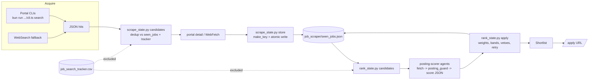

# PROJECT_AI_JOB_SEARCH - Architecture and Feature Analysis

Repo analysed: `C:\Projects\project_rho\ai-job-search` (git HEAD `7f01d75`, "ci: weekly SemVer releases ... freeze CHANGELOG.md at 1.7.4 (#800)"). Analysis is read-only; nothing in the repo was modified, no dependencies installed, no project code run. All paths are relative to the repo root unless prefixed otherwise.

Labels: **FACT** = verified in source (path given). **ASSUMPTION** = inferred, not proven. **RECOMMENDATION** = my suggestion. Status: **IMPLEMENTED / PARTIAL / PLANNED**.

Terminology trap (FACT): "posting guard" (`tools/posting_guard.py`) is an *inbound integrity gate* for fetched job-posting text (hidden HTML / prompt-injection scan). It is NOT a guard on posting/submitting anything outbound. Likewise "salary conversion" is *Excel-to-JSON conversion* of a salary-index dataset (`tools/convert_salary_excel.py`); there is no currency conversion anywhere (grep for currency/exchange rate finds only a `salary_currency` type field in `.agents/skills/freehire-search/cli/src/helpers.ts:147` and test text).

---

## 1. Project overview

- **What it is (FACT, `README.md`, `AGENTS.md`, `CLAUDE.md`):** a "job application workspace" template built on Claude Code. It is a fork-and-personalize repo: markdown slash-command/skill specs that instruct an LLM, plus small deterministic Python helpers and TypeScript (Bun) portal-search CLIs. There is no server, no UI, no database.
- **Problem solved:** automates the repetitive parts of a job search: find postings (`/scrape`), triage them (`/rank`), draft a tailored 2-page LaTeX CV and 1-page cover letter with an independent reviewer pass (`/apply`), track outcomes (`/outcome`, `/gmail-sync`, `/notion-sync`, `/html-report`), prep interviews (`/interview`), and plan upskilling (`/upskill`).
- **Users (FACT):** an individual job seeker who forks the repo, runs `/setup` to replace `[PLACEHOLDER]` tokens in `CLAUDE.md` and the `.claude/skills/job-application-assistant/*.md` profile files, and uses Claude Code interactively. Author: Mads Lorentzen (`LICENSE`, `.github/FUNDING.yml`). Ships Danish demo portals (disabled by default) plus country-agnostic LinkedIn and FreeHire portals.
- **Design philosophy (FACT, `AGENTS.md`, `CONTRIBUTING.md` per graph; `README`):** "Markdown specs are the implementation": the workflow logic lives in `.claude/commands/*.md` and `.claude/skills/*`; Python is used only where determinism matters (state files, dedup keys, injection scan, PDF checks). `AGENTS.md` is a thin pointer so other agent runtimes (Codex, Antigravity, Cursor, Gemini CLI) read the same `.claude/` specs.
- **Never auto-submits (FACT, `.claude/commands/apply.md` Step 6; `.github/workflows/upstream-watch.yml` comments):** `/apply` writes files and a tracker row (`drafted`); the human submits. No code path in the repo submits an application.

## 2. Directory structure

(FACT, from `git ls-files` and directory listing; 316 files incl. fonts/tests; `graphify-out/` is a local, untracked analysis artifact, not part of the project.)

```
.agents/skills/<portal>-search/        6 portal skills: SKILL.md + cli/ (Bun/TS) + url-reference.md
    cli/src/{cli.ts,helpers.ts,commands/{search,detail,...}.ts}   cli/tests/*.test.ts   cli/package.json tsconfig.json
    freehire-search linkedin-search (enabled) | jobbank jobdanmark jobindex jobnet (Danish, enabled:false)
.claude/
  settings.json                        permission allow/ask/deny lists (no hooks, no env)
  commands/   12 slash commands: setup apply rank outcome interview expand reset
              add-portal add-template gmail-sync notion-sync html-report
  agents/     posting-fetcher.md posting-scorer.md application-reviewer.md   (read-only subagents)
  skills/job-application-assistant/    SKILL.md + 01..09 methodology/profile markdown
  skills/job-scraper/                  SKILL.md (= /scrape) + search-queries.md
  skills/upskill/SKILL.md              (= /upskill)
tools/                                 Python 3 stdlib helpers (job_key, scrape_state, rank_state, posting_guard,
                                       page_decode, fetch_page, robots_check, verify_pdf, verify_layout,
                                       convert_salary_excel, lint_skills, security_guards,
                                       install_portal_clis, check_framework_version,
                                       check_upstream_updates, upstream_triage) + README_SALARY_TOOL.md
salary_lookup.py                       repo-root salary benchmark CLI
cv/main_example.tex                    moderncv "banking" CV template
cover_letters/{cover.cls,cover_example.tex,OpenFonts/fonts/{lato,raleway}}
templates/README.md                    registry for custom templates (/add-template)
documents/{cv,linkedin,diplomas,references,projects,postings,applications}/  personal inputs/archives (.gitkeep only tracked)
company_research/, job_scraper/        gitignored data dirs (.gitkeep tracked)
tests/                                 71 Python files (67 test_*.py + _bash.py, _upstream.py, __init__) - unittest
.github/workflows/{ci,release,upstream-watch}.yml   .github/{ISSUE_TEMPLATE,PULL_REQUEST_TEMPLATE.md,FUNDING.yml,upstream-wontport.txt}
README.md SETUP.md SECURITY.md CONTRIBUTING.md CHANGELOG.md(frozen 1.7.4) AGENTS.md CLAUDE.md LICENSE .cz.toml .gitignore
```

Note (FACT): `/scrape` is defined as a *skill* (`.claude/skills/job-scraper/SKILL.md`, frontmatter `name: scrape`), not under `.claude/commands/`; `/upskill` likewise.

## 3. Technology stack

| Layer | Tech | Version evidence |
|---|---|---|
| Python tooling | Python 3 stdlib only (argparse, json, re, unicodedata, subprocess, hashlib, tempfile) | `SETUP.md:19` "Python 3.10+"; CI matrix 3.10-3.14 (`ci.yml:74`); code uses `X \| None` annotations (3.10+) |
| Python optional libs | `openpyxl` (Excel converter; not in any manifest, `pip install openpyxl` per docstring; CI pins `openpyxl==3.1.5`), `pypdf` (optional, `tools/verify_pdf.py`), `pyyaml` (CI lint job only) | `tools/convert_salary_excel.py:6-9`, `ci.yml:50,83` |
| Portal CLIs | TypeScript on Bun runtime (`bun run src/cli.ts`), `type: module` | each `.agents/skills/*/cli/package.json` |
| CLI deps (Danish 4) | `@bunli/core 0.9.1`, `@bunli/utils 0.6.0`, `zod ^3.23.0`, `node-html-parser ^6.1.x` (jobnet: no node-html-parser) | `jobbank/jobdanmark/jobindex/jobnet-search/cli/package.json` |
| CLI deps (linkedin, freehire) | none at runtime (`"dependencies": {}`) | their `package.json` |
| CLI devDeps | `typescript ^5.4.0`, `@types/bun 1.3.14`, (Danish 4) `@types/node 26.6.5` | same |
| Document build | LaTeX: lualatex + `moderncv` (CV), xelatex + custom `cover.cls` (needs `fontspec`), fonts Lato + Raleway checked in | `cv/main_example.tex:9`, `cover_letters/cover.cls`, `CLAUDE.md` checklist |
| PDF inspection | Poppler `pdftotext -bbox`/`-layout` (external), pypdf | `tools/verify_layout.py`, `tools/verify_pdf.py` |
| AI runtime | Claude Code (slash commands, skills, subagents, `Agent`/`WebFetch`/`WebSearch` tools); optional Gmail and Notion MCP servers | `.claude/**`, `commands/gmail-sync.md:14`, `commands/notion-sync.md:32` |
| Release tooling | commitizen 4.19.3 via `uvx` (CI only), `.cz.toml` (`version_provider = "scm"`, `tag_format = "v$version"`) | `release.yml`, `.cz.toml` |
| CI | GitHub Actions; actions pinned by SHA (checkout v4, setup-python v5, setup-bun v2, dependency-review-action v4.9.0, setup-uv v10.3.3) | `.github/workflows/*.yml` |

No lock files are committed (`bun.lock` is gitignored, `.gitignore:2`); no `requirements.txt`/`pyproject.toml` exists. ASSUMPTION: transitive Bun dependency versions therefore float.

## 4. System architecture

FACT summary: a **prompt-orchestrated, file-state pipeline**. The LLM (Claude Code) is the controller; it reads markdown specs, calls pre-approved shell tools, and spawns constrained subagents. State lives in flat files in the working directory.

Layers:
1. **Spec layer (markdown):** `.claude/commands/*.md`, `.claude/skills/**`, `.claude/agents/*.md`, methodology files `01..09`. This is where workflow logic lives (e.g. fit-score weights are in `04-job-evaluation.md` and mirrored in code).
2. **Deterministic tool layer (Python):** state mutation (`scrape_state.py`, `rank_state.py`), identity (`job_key.py`), safety (`posting_guard.py`, `robots_check.py`, `fetch_page.py`, `security_guards.py`), verification (`verify_pdf.py`, `verify_layout.py`), data conversion/lookup (`convert_salary_excel.py`, `salary_lookup.py`).
3. **Acquisition layer (Bun CLIs):** one CLI per portal with a uniform `search`/`detail` contract (see section 8).
4. **Permission layer:** `.claude/settings.json` + frontmatter `allowed-tools` + CI guard `tools/security_guards.py`.
5. **Output layer:** LaTeX sources -> PDFs under `cv/`, `cover_letters/`; archives under `documents/applications/<company>_<role>/`; tracker CSV; optional offline HTML dashboard; optional Notion mirror.

Design decisions evidenced in source:
- State-through-tools, not through context (FACT, `rank.md` Rule 5; `rank_state.py` docstring): `seen_jobs.json` is never loaded into the conversation; tools select/project/write.
- Report/act separation for untrusted data: `posting-fetcher`/`posting-scorer`/`application-reviewer` have no Edit/Write (`.claude/agents/*.md` frontmatter `tools:`).
- Fork-friendliness: CI branches on `github.repository == 'ai-job-search-dev/ai-job-search'` for upstream-only checks (`ci.yml:53,205,272`); portals are discovered by glob, not listed (`install_portal_clis.py`, `ci.yml` `discover-clis`).

## 5. Frontend architecture

**None** as an application. FACT: no web app, no JS framework, no server. Only UI-like artifacts:
- `/html-report` instructs the LLM to emit a self-contained offline HTML dashboard (inline SVG charts, filterable table) to `reports/application-dashboard.html` from `job_search_tracker.csv` + `documents/applications/` (`.claude/commands/html-report.md`). It is LLM-generated each time; there is no template file or generator script in the repo (FACT: no `.py`/`.html` for it; `tests/test_html_report_command.py` tests only the spec and gitignore). IMPLEMENTED as spec.
- README assets are static SVGs/GIF (`assets/readme/*.svg`, `assets/mascot/pip_flight_loop.gif`).

## 6. Backend/tooling architecture

No backend service. "Backend" = local scripts invoked by the LLM via Bash under an allowlist.

Python tools (all stdlib; each has `_force_utf8_output()` to avoid Windows cp1252 crashes - FACT in every tool):
| Tool | Role |
|---|---|
| `tools/job_key.py` | Canonical dedup key `make_key(company,title,url)`; `--audit` mode |
| `tools/scrape_state.py` | `candidates` / `store` / `history` subcommands for `/scrape` |
| `tools/rank_state.py` | `candidates` / `sweep` / `apply` subcommands for `/rank`; owns weights, bands, status sets |
| `tools/posting_guard.py` | Integrity gate for fetched postings |
| `tools/page_decode.py` | Charset-aware decode of saved pages (honours BOM/`<meta charset>`; whitelist of codecs) |
| `tools/fetch_page.py` | Browser-header GET retry (curl or urllib fallback), robots-gated per hop |
| `tools/robots_check.py` | RFC 9309 robots.txt evaluator; fail-closed |
| `tools/verify_pdf.py` | Page count, text-layer extraction (pypdf then pdftotext), `--contains`, `--ascii-dates`, `--dump-text` |
| `tools/verify_layout.py` | Layout metrics from `pdftotext -bbox` (holes, orphans, footer collisions) |
| `tools/convert_salary_excel.py`, `salary_lookup.py` | Salary dataset conversion and fuzzy lookup |
| `tools/lint_skills.py`, `tools/security_guards.py` | CI linters/guards |
| `tools/install_portal_clis.py` | `bun install --ignore-scripts` in each discovered portal CLI |
| `tools/check_framework_version.py`, `check_upstream_updates.py`, `upstream_triage.py` | Fork/upstream maintenance |

Import structure (FACT): `scrape_state.py` imports `make_key` from `job_key.py` and `STATE, TRACKER, load_state, norm, save_state, tracker_pairs` from `rank_state.py` (`scrape_state.py:15-16`); `posting_guard.py` and `fetch_page.py` import `page_decode`; `fetch_page.py` imports `robots_check`.

## 7. Data/storage architecture

No database (FACT: no DB driver in any manifest or import). All state is flat files, almost all gitignored as personal data (`.gitignore`).

| File | Format | Writer | Notes |
|---|---|---|---|
| `job_scraper/seen_jobs.json` | JSON `{"seen": {<key>: entry}}` | `scrape_state.py store`, `rank_state.py apply/sweep` | Append-only history; atomic write via `tempfile.mkstemp` + `os.replace` (`rank_state.py:98-108`). Gitignored `**/job_scraper/seen_jobs.json`. |
| `job_search_tracker.csv` | CSV, header `date,company,sector,role,role_type,channel,status,contact_person,fit_rating,notes,cv_file,cover_letter_file,source,deadline` | `/apply` Step 6b, `/outcome`, `/gmail-sync` (via LLM edits, not a script) | Read by `rank_state.tracker_pairs()` (`utf-8-sig`, errors with a hint if not UTF-8). Header from `apply.md:388` and `outcome.md:36`. |
| `documents/applications/<company>_<role>/{job_posting.md,outcome.md,...}` | Markdown | `/apply` 6b.7, `/outcome` Step 3 | `job_posting.md` holds cleaned posting + `## posting_guard` counts only |
| `company_research/<normalized-company>.json` | JSON cache, 30-day TTL | `/apply` Step 4.0 (orchestrator writes; reviewer cannot), `/interview` | `04-job-evaluation.md` "Company Research Cache" |
| `gmail_sync/state.json` | `{"last_sync":null,"processed_message_ids":[]}` | `/gmail-sync` | `gmail-sync.md` Step 2 |
| `job_scraper/notion_sync.json` | JSON sync state | `/notion-sync` | |
| `salary_data.json` | JSON `{metadata:{source,index_baseline,index_label,baseline_description},companies:[{company,city,categories:{<cat>:{count,index}}}]}` | `convert_salary_excel.py` or by hand | gitignored; validated by `salary_lookup.py --validate` |
| `upskill/report-*.md`, `reports/*.html` | generated reports | `/upskill`, `/html-report` | gitignored |
| `cv/main_<company>_<role>.tex`, `cover_letters/cover_<company>_<role>.tex` (+PDF) | LaTeX | `/apply` | gitignored (`cv/main_*.*` minus example) |

**`seen_jobs.json` entry schema (FACT, `job-scraper/SKILL.md` Step 4; enforced in `scrape_state.py:110-117`):** `title, company, url, first_seen, posted_date|null, deadline|null, fit(high|medium|low), status, portal, source(cli|websearch)` + `location` and other fetched fields. `/rank` adds `rank_score, rank_verdict, rank_date, location_verdict, language_gate, language_note, strengths[<=3], gaps[<=3], guard, fetch_attempts, first_unreachable, last_fetch_error, expired_reason`.
- Status values: `new, skipped, ranked, expired, unreachable`. **Discrepancy (FACT):** `SKILL.md:171` lists all five for `store`, but `scrape_state.py:114` only accepts `new|skipped|expired` on insert (the rest are set later by rank_state).

**Tracker status vocabulary (FACT, `outcome.md:52-59`):** `drafted | applied | interview | offer | hired | rejected | no_response | offer_declined | withdrawn`; Final = hired, rejected, no_response, offer_declined, withdrawn; legacy space spellings tolerated on read. Pinned by `tests/test_tracker_status_vocab.py`.

## 8. API/CLI architecture

### 8.1 Slash commands and skills (FACT: `.claude/commands/*.md`, `.claude/skills/*/SKILL.md`)
| Invocation | Spec | Purpose |
|---|---|---|
| `/setup` | `commands/setup.md` | Onboarding: Path A (documents folder), B (single CV), C (interview mode); fills profile files; `--section <name>` update mode; warns before writing personal data if `origin` is a public fork |
| `/scrape [focus\|broad\|health [portal]]` | `skills/job-scraper/SKILL.md` | Search portals, dedup, store, health-check, present |
| `/rank [focus] [--all] [--limit N] [--top N]` | `commands/rank.md` | Batch triage scoring |
| `/apply <url\|text>` | `commands/apply.md` | Drafter-reviewer CV + cover letter |
| `/outcome [company]` | `commands/outcome.md` | Record result; follow-up branch (2b); stale sweep (2c) |
| `/interview` | `commands/interview.md` | Stage-specific prep pack + optional mock |
| `/upskill` | `skills/upskill/SKILL.md` | Skill-gap heatmap + learning plan |
| `/expand` | `commands/expand.md` | Additive competency discovery from docs/GitHub |
| `/gmail-sync` | `commands/gmail-sync.md` | Classify Gmail replies (approval-gated) |
| `/notion-sync` | `commands/notion-sync.md` | Push read-only view to Notion |
| `/html-report [path]` | `commands/html-report.md` | Offline dashboard |
| `/add-portal` | `commands/add-portal.md` | Generate a new portal CLI skill |
| `/add-template` | `commands/add-template.md` | Register custom CV/cover template (LaTeX, Typst, ...) |
| `/reset [profile\|documents]` | `commands/reset.md` | Destructive reset with confirmation |
| `job-application-assistant` skill | `skills/job-application-assistant/SKILL.md` | Conversational evaluate/tailor/prep; `allowed-tools: Read, Glob, Grep, WebFetch, WebSearch, Edit, Write, AskUserQuestion` |

### 8.2 Portal CLI contract (FACT, `.agents/skills/*/cli/src/cli.ts`, `SKILL.md`)
`bun run .agents/skills/<portal>-search/cli/src/cli.ts <search|detail> [flags] --format json|table|plain`. Search emits `{meta:{count,page}, results:[{id,title,company,companyUrl,location,date,url}]}` (LinkedIn: `helpers.ts` `JobCard`). Errors: JSON on stderr `{error, code}` (`writeError`), exit 1. Unknown flags are rejected (tests `cli-flag-validation.test.ts`). Extra commands per portal: jobdanmark `autocomplete/categories/locations`, jobnet `occupations/suggestions`. Each `SKILL.md` frontmatter carries `enabled:` (true for linkedin/freehire; `false` for the four Danish) and `allowed-tools: Bash(bun run <own cli> *)`.

### 8.3 Python CLIs
`job_key.py --company --title [--url] | --audit [STATE]`; `scrape_state.py candidates|store --results FILE | history --portal --domain`; `rank_state.py candidates|sweep|apply` (flags in section 10.2); `posting_guard.py [--in F] [--html|--text] [--out F] [--json]`; `fetch_page.py URL [--out] [--text] [--max-chars]`; `robots_check.py URL`; `verify_pdf.py PDF [--pages N] [--contains S] [--ascii-dates] [--dump-text F] [--min-chars N]`; `verify_layout.py PDF`; `salary_lookup.py "Company" [--city] [--json] [--list-all] [--validate]`; `convert_salary_excel.py FILE [--output] [--source] [--baseline] [--baseline-desc]`. Exit-code conventions are documented per tool (e.g. `fetch_page.py`: 0 fetched, 1 robots refusal, 2 transport error; `verify_layout.py`: 2 = skipped/no bbox-capable extractor).

## 9. Authentication & authorization

FACT summary: the project has **no user accounts and no auth layer**. Credentials/sessions:
- Portal CLIs: all shipped ones are unauthenticated public endpoints (`linkedin`: `jobs-guest`; `freehire`: public JSON "no API key"; Danish four: public pages/APIs). No tokens in code (`grep` for Authorization/API key finds only comments).
- Future portals: `/add-portal` mandates credentials only from env var `<SERVICE>_API_TOKEN`, never as a flag, never hardcoded (`add-portal.md:88`). `.env` and `.env.*` are gitignored and `Read(.env)` is denied in `settings.json`.
- Gmail / Notion: delegated to MCP servers authenticated interactively by the user (OAuth); `/gmail-sync` stops if `mcp__claude_ai_Gmail__*` tools are absent and refuses to use IMAP/Bash (`gmail-sync.md:14`); `/notion-sync` never initiates OAuth (`notion-sync.md:35`).
- "Authorization" = Claude Code permission rules (section 17): allow/ask/deny in `.claude/settings.json`, per-skill `allowed-tools`, per-agent `tools:`.

## 10. Important modules and core business logic

### 10.1 Scraping (IMPLEMENTED; orchestration is LLM-driven)
- Spec: `.claude/skills/job-scraper/SKILL.md`. Flow: Step 0 read `search-queries.md` (a placeholder template: `site:[YOUR_JOB_BOARD] "[YOUR_PRIMARY_JOB_TITLE_1]" ...`, FACT) -> Step 1a `bun --version` (if absent, WebSearch-only fallback) -> 1b discover `.agents/skills/*/SKILL.md`, skip `enabled: false`, translate queries to each portal's flags, scope to last 14 days (portal recency flag or client-side `date` filter), cap ~20/call, `--format json`, run in parallel via `Agent` -> 1c WebSearch fallback for portals without CLI or on failure -> Step 2 write hits to a temp JSON and run `scrape_state.py candidates` to drop already-seen/applied/in-batch duplicates *before* paying for `detail` calls -> detail fetch (+ LinkedIn `isActive:false` -> store as `expired`, never silently drop) -> 2.5 mass-posting consolidation (flag, never accuse) -> 3 quick fit (high/medium/low; Language Gate override) -> 4 `scrape_state.py store` -> 4.5 LinkedIn people-search *links* (no scraping) -> 4.75 portal health check (degraded scan, yield history via `scrape_state.py history`, one sentinel probe, 429 is never evidence of breakage) -> 5 present table.
- Portal CLI internals (FACT, `linkedin-search/cli/src/helpers.ts`): `htmlFetch` with UA `Mozilla/5.0 (compatible; linkedin-search-cli/1.0)`, 15 s timeout, up to 6 retries with exponential backoff + jitter on 429/5xx, 404 -> `""`; regex-based card parsing (comment states node-html-parser has nesting bugs on LinkedIn cards); `stripInvisible` removes zero-width/tag characters and hidden elements from output (CLI-side sanitization; also tests `hidden-text.test.ts` in every CLI). FreeHire: JSON API with `Retry-After` handling and a 30 s total retry budget (`helpers.ts` `RETRY_BUDGET_MS`), base URL override `FREEHIRE_API_URL`.
- Code-enforced vs spec-enforced (FACT): dedup, key creation, schema validation, atomic write are code (`scrape_state.py`); portal choice, flag translation, fit assessment, health checks are spec-level instructions to the LLM (no script).

### 10.2 Ranking (IMPLEMENTED)
- Selection `rank_state.py candidates` (`cmd_candidates`): status in `{new, unreachable}` (or any non-`skipped` with `--all`); excludes company+role pairs already in the tracker (`norm()` casefold+alnum-only); optional `--focus` substring over title, company, stored strengths/gaps; default `--limit 10` (`DEFAULT_LIMIT`, `0` = no cap); output keys `key,title,company,url,portal,deadline,posted_date`.
- Scoring happens in LLM subagents `posting-scorer` (~5 jobs each, parallel) that fetch each posting via the escalation order, pipe it through `posting_guard.py`, and return JSON `{key,status(scored|expired|unreachable),scores{technical,experience,behavioral,career},location_verdict,language_gate,language_note,deadline,strengths,gaps,language,guard}` (`rank.md` Step 2).
- Aggregation in code, `rank_state.py`: `WEIGHTS = {technical .30, experience .25, behavioral .15, career .30}`; `overall_score()` uses `fractions.Fraction` to avoid float error (e.g. 59.5), rounds half-up (`int(total + 1/2)`), rejects non-numeric/bool/out-of-0..100 values; `BANDS` Strong>=75, Good>=60, Moderate>=45, Weak>=30, Poor. Weights match `04-job-evaluation.md:238-241` (FACT).
- Vetoes: `location_verdict == FAIL` or `language_gate == FAIL` -> `vetoed` list (excluded from shortlist); `FLAG` stays ranked with a marker. Sort by `(score, urgent)` descending, urgent = deadline within `URGENT_DAYS=7`.
- Deadline handling: a passed deadline (fresh or stored) forces `status=expired`; a missing fresh deadline never overwrites a stored one ("absence is not a correction"); `sweep --write` expires stored-deadline-passed `ranked` entries, lists `closing_soon`, reports `unparseable_deadlines` (strict `YYYY-MM-DD` via `parse_iso`).
- Unreachable retry policy (FACT, `rank_state.py:77-80`): `unreachable` + `fetch_attempts`; gives up to `expired` (`expired_reason: unreachable`) only after `UNREACHABLE_MAX_ATTEMPTS=3` and a span of >= `UNREACHABLE_MIN_SPAN=48h`; `last_fetch_error` capped at 200 chars.
- Guard verdict persisted as `entry["guard"]` (`"clean"` or text capped at 200 chars); a rescore without a guard deletes a stale one.
- Spec-only rule (FACT, `rank.md` Step 3.7): staleness flag for `posted_date` > 30 days is described for the LLM; I found no code implementing the 30-day check in `rank_state.py` (the row echoes `posted_date`; flagging is left to the report writer). PARTIAL as code, IMPLEMENTED as spec.
- Eligibility Gate (citizenship/PR hard filter) and Language Gate are prose in `04-job-evaluation.md:9-47` (FACT); only the Language/Location verdict *values* are code-validated (`GATE_VERDICTS`).

### 10.3 Apply/draft workflow (IMPLEMENTED; entirely spec + tools)
`.claude/commands/apply.md`, strictly ordered:
0. Parse input. URL -> dispatch `posting-fetcher` subagent (Read/Glob/WebFetch/WebSearch/Bash, no Edit/Write): portal CLI `detail` -> WebFetch -> `fetch_page.py` -> WebSearch for employer posting; runs `posting_guard.py`; returns verdict, findings, metadata, cleaned text. Pasted text: written to scratchpad and run through the guard by the orchestrator.
1. Fit evaluation per `04-job-evaluation.md` (+ `salary_lookup.py "<Company>" --json [--city]` if configured); **source host verification**: installed portal host / one of six ATS apexes (`greenhouse.io, lever.co, myworkdayjobs.com|workday.com, ashbyhq.com, smartrecruiters.com, workable.com`, exact or `.apex` suffix; look-alikes fail closed) / else "Unverified source host" warning; show guard verdict first, ask "Continue with this posting?" if flagged; ask whether to draft.
2. Draft `cv/main_<company>_<role><ext>` (profile CV language, <= 2 pages, moderncv) and `cover_letters/cover_<company>_<role><ext>` (posting language, 1 page, `cover.cls`); resolves an `ACTIVE-TEMPLATE` block if `/add-template` was used; Grounding Audit against union of `01-candidate-profile.md` + `cv/main_example.tex` + `CLAUDE.md`.
3. `application-reviewer` subagent (hiring-manager proxy; research via cache `company_research/*.json` or WebSearch/WebFetch; returns Part A JSON `{file,old_string,new_string,reason}` edits + Part B narrative + a "Company research (for the cache)" block).
4. Orchestrator writes the research cache, applies Part A with Edit, addresses Part B, refuses fabrication.
5. Mandatory compile (lualatex CV / xelatex cover letter; compile commands are NOT pre-approved, by design), `verify_pdf.py --pages 2|1`, `verify_layout.py`, visual Read of PDFs, iterate; ATS check (`verify_pdf.py --ascii-dates --dump-text`, keyword coverage table covered/synonym-only/missing(have it)/missing(gap), never keyword-stuff); clean build artifacts.
6. Verification checklist from `CLAUDE.md`; 6b record tracker row (`status=drafted`, `fit_rating` bare number because `/upskill` does arithmetic on it, `deadline` ISO) and archive `job_posting.md` (never overwrites an existing one; counts only from the guard).
Standing rule: new user-confirmed facts must be written back to `01-candidate-profile.md` the same turn (otherwise a later grounding audit strips them).
Code-enforced parts: guard, robots, PDF/layout checks, key/state tools. Everything else relies on LLM compliance.

### 10.4 Posting guard (`tools/posting_guard.py`, IMPLEMENTED)
`guard(raw, mode)` -> `(cleaned_text, findings)`. Pipeline: `clean_html()` (hand-rolled tag walker with HTML5 implied end tags; removes comments and `script|style|noscript|svg|template`; hides elements with `hidden`, `aria-hidden=true`, or CSS `display:none`, `visibility:hidden`, `opacity:0`, `font-size:0`, `color:transparent`, `clip`, `clip-path:inset(100%)`, offscreen `left/top/text-indent:-NNNNpx`, or collapsed box + `overflow:hidden`; style read after entity decode + CSS-comment strip) -> `clean_text()` (removes zero-width, bidi, soft hyphen, BOM, Unicode tag block U+E0000-E007F except the three RGI UK flag sequences; decodes tag-character and variation-selector runs into `invisible_text`) -> `scan()` (about 17 `INSTRUCTION_PATTERNS`, e.g. "ignore previous", "system prompt", `curl|wget|ssh|scp`, `settings.json`, `allowed-tools`; hidden URLs; Latin/Cyrillic/Greek mixed-script words) -> `verdict()` one line: alarms (instruction-like lines, in-word invisible chars, tag chars, invisible text, mixed-script) produce a `⚠` line; hidden blocks/URLs are context only. Advisory, never blocks; exit 0 unless input unreadable (2). Wired into `/apply`, `/rank` scorers, `/interview`, `/outcome` (`tests/test_posting_gate_wiring.py`). Limit (FACT, `SECURITY.md`): natural-language manipulation without a trace is not detectable.

### 10.5 Dedup and `job_key` (IMPLEMENTED)
`make_key(company,title,url)` returns `"<company-slug>_<title-slug>"`:
- `slugify`: NFKD -> ASCII ignore -> lowercase -> `[^a-z0-9]+` to `-`.
- `_cap(slug, limit)`: company 40, title 60; over-limit appends 6 hex of `sha1(full slug)` (deterministic truncation, fixes real duplicate-Deloitte case in docstring).
- Non-Latin / lossy names (`_lost_letters`: any non-ASCII alphabetic char whose Unicode name is not LATIN): company -> `company-<sha1(casefolded NFC name)[:6]>` (or `unknown-company`); title -> portal numeric id (`\d{6,}` from URL) else `sha1(url or title)[:6]`. Latin letters lacking decomposition (ø, æ, ß, ł) deliberately not "lossy" (back-compat).
- `is_canonical` regex `^[a-z0-9][a-z0-9-]*_[a-z0-9][a-z0-9-]*$`; `is_legacy_shape` (3-part keys); `--audit` reports malformed keys, legacy keys, duplicate URLs, key drift (exit 1 only on malformed/duplicates).
Dedup at selection time (`scrape_state.select`): skip if URL (trailing `/` stripped) in seen OR `(norm(company), norm(title))` in seen -> `already_seen`; else pair in tracker -> `already_applied`; else repeated in batch. `store` is strict (invalid job aborts), validates required fields/enums, and refuses a canonical-key collision for a different posting. Note (FACT): key is based on slug text while selection dedup uses `norm()` on full text, so the two layers use different normalisations.

### 10.6 Salary conversion/lookup (IMPLEMENTED; optional; no currency conversion)
- `tools/convert_salary_excel.py` `parse_sheet(ws)`: finds header row in first 10 rows (strict pass requires a company-pattern cell plus a different city/count/index cell; fallback pass accepts a lone company word), multilingual header patterns (`COMPANY_PATTERNS` firma/company/..., Danish compound handling via `COMPOUND_PATTERNS`), pairs count+index columns by derived category (`DEFAULT_CATEGORY = "all_employees"`), standalone numeric columns as categories, `parse_numeric_cell` handles European vs US separators and rejects ambiguous `1,234`/`1.234`; writes `salary_data.json` at repo root with `metadata.index_baseline` (default 100).
- `salary_lookup.py`: `normalize()` strips legal suffixes (A/S, ApS, ...), `anglicize()` folds ø/æ/å/ö/ä/ü; `match_score_optimized()` ladder (exact 100, containment 80-90 with short-token guards, anglicized equal 85, anglicized containment 75, single-word 70, multi-word overlap `30 + coverage*40`); `search_company()` keeps score >= 30, optional `--city` filter; `format_entry()` prints count / index / `% vs baseline`, `N/A*` for suppressed index. `--validate` reports errors (exit 1) and warnings (duplicates, exit 0).
- Data source is user-supplied (demonstrated on Danish union index data); no data is shipped (FACT: `salary_data.json` gitignored, absent).

### 10.7 Other core logic
- `fetch_page.py`/`robots_check.py`: robots gate before each hop; disallow for `*` OR `Claude-User` blocks; ties go to Disallow; longest match wins; non-404 fetch failures = no permission; undecodable rule lines (U+FFFD) fail closed; policy read as a browser if honest request is 403'd, then obeyed strictly. `fetch_page.py` bounds: 45 s, 5 redirects, 10 MB, refuses `--out` inside repo.
- `verify_layout.py` heuristics: hole > 100pt, non-final page ending > 25% early, final page > 35% empty, footer collisions, stranded entry/section headings.
- `/outcome`: tracker update + `outcome.md` archive; follow-up draft branch; stale sweep (batch `no_response`, default 60 days, `/outcome stale <N>` overrides; FACT `outcome.md:27-28`).

## 11. Data-flow diagrams



```mermaid
sequenceDiagram
  participant U as User
  participant O as Orchestrator (Claude Code)
  participant F as posting-fetcher
  participant G as posting_guard.py
  participant R as application-reviewer
  participant L as lualatex/xelatex + verify_*.py
  U->>O: /apply <url>
  O->>F: URL only
  F->>G: fetched body
  G-->>F: verdict + cleaned text
  F-->>O: verdict, metadata, cleaned posting
  O->>U: fit eval + host check + guard verdict; proceed?
  U-->>O: yes
  O->>O: draft CV + cover letter (grounding audit)
  O->>R: drafts + posting inline
  R-->>O: Part A edits, Part B notes, research block
  O->>O: write cache, apply edits
  O->>L: compile, verify_pdf, verify_layout
  O->>U: checklist, files; tracker row 'drafted'; posting archived
```

```text
Untrusted web --> [portal CLI stripInvisible | fetch_page.py (robots-gated) | WebFetch]
              --> posting_guard.py (clean + scan, advisory) --> LLM context (data, never instructions)
LLM --(only allowlisted Bash)--> tools/*.py --> flat files (seen_jobs.json, tracker.csv, documents/)
```

## 12. External integrations

| Integration | How | Evidence |
|---|---|---|
| LinkedIn public jobs (`linkedin.com/jobs-guest/jobs/api/seeMoreJobPostings/search`, `.../jobPosting`) | HTTP+regex, no auth; ToS warning "personal use only" | `linkedin-search/cli/src/helpers.ts:6-9`, `SKILL.md` |
| freehire.me public JSON API | HTTP JSON, `FREEHIRE_API_URL` override; UA `ai-job-search-dev/ai-job-search/1.0 (freehire-search)` | `freehire-search/cli/src/helpers.ts` |
| jobindex.dk, jobbank.dk, jobdanmark.dk, jobnet.dk (`/bff`) | HTTP; HTML parsing (node-html-parser) / JSON | each `helpers.ts` `BASE_URL` |
| WebFetch / WebSearch | Claude Code tools | commands/skills |
| Gmail MCP (`mcp__claude_ai_Gmail__*`) | `/gmail-sync` | `gmail-sync.md:14` |
| Notion MCP (`https://mcp.notion.com/mcp`) | `/notion-sync` | `notion-sync.md:33` |
| GitHub API / Actions | CI, releases, upstream-watch issue (`gh`) | workflows |
| GitHub `ai-job-search-dev/ai-job-search` upstream | `check_upstream_updates.py`, `upstream_triage.py`, `upstream-watch.yml` | tools, workflow |
| Ko-fi / GitHub Sponsors | `.github/FUNDING.yml` | `github: MadsLorentzen`, `ko_fi: madslorentzen` |
| Poppler (`pdftotext`, `pdfinfo`), TeX Live/MiKTeX | external binaries | `verify_*.py`, CI |

## 13. AI & automation workflows

- **Subagents (FACT, `.claude/agents/`):** `posting-fetcher` (`/apply` Step 0), `posting-scorer` (`/rank` Step 2), `application-reviewer` (`/apply` Step 3). All declare `tools: Read, Glob, [Grep], WebFetch, WebSearch, Bash` and no Edit/Write/Agent; CI enforces this (`security_guards.py` check 5, `ALLOWED_AGENT_TOOLS`). Bash within them is scoped only by the session allowlist.
- `/scrape` parallelism uses `general-purpose` agents (stated in `SECURITY.md` table) - not constrained to read-only. FACT.
- Pattern: drafter-reviewer (`/apply`), orchestrator-workers (`/rank`, `/scrape`), deterministic-gate-before-LLM (posting_guard), tool-owned state (rank_state/scrape_state).
- Cross-runtime: `AGENTS.md` thin pointer; portal skills in `.agents/skills/` use portable Agent Skills format (`SKILL.md` with `name/description/enabled/allowed-tools`).
- Methodology files (LLM prompts as data): `01-candidate-profile.md`, `02-behavioral-profile.md`, `03-writing-style.md`, `04-job-evaluation.md` (Eligibility Gate, Language Gate, 5 scoring dimensions, research cache), `05-cv-templates.md`, `06-cover-letter-templates.md`, `07-interview-prep.md`, `08-application-forms.md`, `09-web-research.md` (trust boundary, 403/robots escalation).
- Scheduled automation: only CI (weekly release Mon 06:00 UTC; weekly upstream-watch Mon 08:00 UTC on forks). No scheduled job-search runs are shipped. ASSUMPTION: users may schedule via Claude Code themselves (rank.md mentions "a scheduled run" in passing).
- Verification culture: mandatory Verification Checklist in `CLAUDE.md` (factual accuracy, targeting, consistency, quality, compiled-PDF checks, ATS checks).

## 14. Error handling

FACT patterns:
- Tools exit non-zero with stderr messages and use explicit exit-code contracts (`fetch_page.py` 0/1/2; `posting_guard.py` 2 only on unreadable input; `rank_state.py apply` returns 1 when `errors` non-empty but still prints and writes valid rows).
- Fail-closed on safety (`robots_check`: unreadable policy = no retry; undecodable rule = block; look-alike hosts rejected) and fail-open-with-warning on advisory checks (`posting_guard` never blocks; `verify_layout.py` exit 2 "skipped", "never a layout verdict").
- Defensive parsing: malformed deadlines/timestamps treated as absent (`parse_iso`, `parse_timestamp`); `store` aborts the batch on invalid job (`strict=True`) while `candidates` reports `invalid` and continues.
- Atomicity: `save_state` temp-file + `os.replace`, cleaned in `except BaseException`.
- Encoding: every tool reconfigures stdout/stderr to UTF-8; tracker read as `utf-8-sig` with a user-actionable error.
- CLI side: `{error, code}` JSON on stderr; retries with backoff for 429/5xx; `404 -> ""`.
- Workflow level: `unreachable` vs `expired` semantics prevent writing off live postings on fetch failure; bounded health-probe escalation; graceful exit when MCP servers are missing.
- Weakness (FACT): concurrent writes to `seen_jobs.json` are not locked; atomic replace prevents torn files but not lost updates between two simultaneous processes. ASSUMPTION: low risk since runs are interactive.

## 15. Testing architecture

- **Python (FACT):** stdlib `unittest`; no pytest import anywhere (`grep "import pytest"` empty). Run as `python -m unittest discover -s tests -t . -v` (`ci.yml:84,105`). ~867 `def test_` functions across 67 `test_*.py` files; helpers `tests/_bash.py`, `tests/_upstream.py`. Tests insert `tools/` on `sys.path` and import modules directly or run them via subprocess (e.g. `tests/test_posting_guard.py`).
- **Two test styles:** (1) behavioural tests of tools (`test_job_key`, `test_scrape_state`, `test_rank_state`, `test_posting_guard`, `test_robots_check`, `test_fetch_page` with a local HTTP server `_Handler`, `test_verify_pdf`, `test_verify_layout` with synthetic bbox pages, `test_convert_salary_excel*` incl. real openpyxl integration, 12 `test_salary_*_cli`); (2) **spec-guard tests** that read the markdown specs and assert required wording/structure (`test_rank_command`, `test_apply_*`, `test_setup_command`, `test_reset_*`, `test_tracker_status_vocab`, `test_untrusted_input_rules`, `test_posting_gate_wiring`, `test_security_guards`, `test_python_command_specs`, `test_placeholder_integrity`). The second style is how prompt logic is regression-tested.
- **TypeScript (FACT):** `bun test --timeout 30000`, 71 `*.test.ts` files across the six CLIs (flag validation, retry-backoff, request-timeout, hidden-text, parsing/fixtures such as `linkedin-search/cli/tests/fixtures/`); `bun run typecheck` = `tsc --noEmit`. No live-network tests in CI by policy (`ci.yml:10-14`); some tests use `reject-network.ts` preloads.
- **Not covered / gaps (FACT or ASSUMPTION):** LLM behaviour itself (only spec wording is pinned); end-to-end `/scrape`->`/rank`->`/apply` runs; no coverage tool configured (the user's 80% rule cannot be verified here - ASSUMPTION it is not measured); `/html-report` output (no generator).
- **Platforms:** Linux Python 3.10-3.14 plus a Windows job (Python 3.14 under Git Bash) specifically for cp1252/file-lock/path regressions (`ci.yml:86-105`).

## 16. Deployment/CI

No deployment (local tool). CI (`.github/workflows/`):
- `ci.yml` (push to master, PRs, manual): `lint` (pyyaml, `lint_skills.py`, upstream-only `check_framework_version.py`), `security-guards` (`security_guards.py`), `python-tests` (3.10-3.14), `python-tests-windows`, `dependency-review` (PR only; probes Dependency graph, warns+passes if unavailable; fails on high), `latex-smoke` (2 containers: `texlive/texlive:latest` and `debian:bookworm`; compiles example CV with lualatex and cover letter with xelatex, checks no `^!` in logs, `verify_pdf.py` text; upstream-only exact page/content asserts), `discover-clis` + `cli-checks` matrix (`bun install`, `bun run typecheck`, `bun test`), `placeholder-integrity` (upstream only; ensures personal data was not committed over `[YOUR_NAME]` etc.).
- `release.yml`: Monday 06:00 UTC; derives SemVer via `cz bump --get-next` (commitizen 4.19.3), requires CI success on HEAD, creates GitHub Release with generated notes; upstream repo only; `CHANGELOG.md` frozen at 1.7.4 (`tests/test_changelog_structure.py`, `FrozenChangelogTests`).
- `upstream-watch.yml`: forks only; opens/updates a rolling issue "Upstream sync watch" via `upstream_triage.py`; report-only, never merges.
- Hardening (FACT, `tests/test_workflow_hardening.py`, `ci.yml:24-25`): SHA-pinned actions, `permissions: contents: read`, `persist-credentials: false`, env-passed matrix values.
- Install: `python tools/install_portal_clis.py` (`bun install --ignore-scripts`; skips manifests with lifecycle scripts, `trustedDependencies`, `workspaces`, `bunfig.toml`, `.npmrc`).

## 17. Security considerations

FACT (`SECURITY.md`, `.claude/settings.json`, `tools/security_guards.py`):
- Explicit threat model: LLM with file access reads untrusted web content next to personal data. Two defence levels - instruction-level (trust-boundary paragraph in every spec that reads third-party content, enforced by `tests/test_untrusted_input_rules.py`) and permission-level.
- `settings.json` `allow`: exact portal CLI invocations, `python[3] salary_lookup.py/tools/{rank_state,job_key,scrape_state,verify_pdf,verify_layout,robots_check,fetch_page,posting_guard}.py:*`, `Skill(job-application-assistant)`. `ask`: edits to settings, skills' SKILL.md, commands, agents, `.github/**`, `tools/**`, `.agents/**`, `salary_lookup.py`, and `git push`. `deny`: `.env*`, `~/.ssh`, `~/.aws`, `~/.gnupg` reads; curl/wget with data/form/upload flags; scp/sftp/ssh/nc/ncat/netcat. No hooks, no `env` (a hook-based worm vector is cited).
- `security_guards.py` CI checks: exact allowlists (`ALLOWED_PERMISSIONS`, `ALLOWED_SKILL_TOOLS`, `ALLOWED_AGENT_TOOLS`, `ALLOWED_SETTINGS_KEYS`), required ignore rules read as git reads them (whitespace, subdirectory `.gitignore` negations, GHSA-rv99-7xf2-8f4p), package-manifest lifecycle scripts, tracked `node_modules`.
- Personal-data hygiene: gitignore of tracker, `seen_jobs.json`, CV/cover outputs, `documents/**`, `gmail_sync/`, `salary_data.json`, `.env`; `/setup` warns before writing PII if `origin` is a public fork.
- `fetch_page.py` is a GET-only wrapper so the allowlist names a script, not `curl` (which would allow uploads).
- Documented limits (FACT, `SECURITY.md` "What this does not do"): not a sandbox (Claude Code sandbox absent on native Windows); prefix deny rules are tripwires; `WebFetch` unrestricted by domain; scorer agents hold rubric and untrusted text in one context; guard is deterministic, not an oracle.
- Doc discrepancy (FACT): `SECURITY.md:12` table lists the allowlisted tools without `scrape_state` and `posting_guard`, though `settings.json` allows them. Minor documentation lag.
- Compile commands (`lualatex`, `xelatex`) intentionally not pre-approved because of `-shell-escape`.
- Scraping ToS risk: LinkedIn CLI states personal use only; CI never hits portals.
- RECOMMENDATION when reusing: treat `salary_data.json`, tracker and archive paths as PII; keep `.env` conventions.

## 18. Performance considerations

- Token/cost control is a first-class design goal (FACT): tools keep growing history out of context; `/rank` batch cap (10) with `deferred`; ~5 jobs per scorer; `candidates` dedup before detail fetches; `/apply` forbids re-reading files already in context and passes drafts inline to the reviewer; 30-day company-research cache.
- Network: per-CLI backoff/jitter, 15 s timeouts, FreeHire 30 s retry budget; `fetch_page.py` 45 s/10 MB bounds.
- Complexity: `scrape_state.select` builds sets (O(n+m)); `salary_lookup.search_company` is a linear scan per query with precomputed query forms (fine for thousands of companies); robots matching documented as linear-time (git log: "match wildcard rules in linear time").
- `seen_jobs.json` is rewritten whole on each store/apply (O(file) per write); grows monotonically. ASSUMPTION: acceptable for thousands of entries, not tens of thousands.
- `posting_guard.clean_html` uses regex alternations over whole markup (`DROP_BLOCKS` with `.*?` and `re.S`); potential super-linear cases on adversarial input are not tested in what I read (UNVERIFIED).
- LaTeX compile and `pdftotext -bbox` dominate `/apply` wall time (ASSUMPTION).

## 19. Technical debt & missing features

- FACT: workflow logic is natural-language; correctness depends on LLM adherence. Tests pin wording, not behaviour.
- FACT: `/html-report`, `/outcome` tracker edits, `/gmail-sync`, `/notion-sync` have no script backing; CSV edits are LLM-performed (`rank_state.tracker_pairs` is read-only). Tracker has no schema validator besides `test_tracker_status_vocab` and `test_tracker_notes_csv_safe` spec guards.
- FACT: no lock files, no Python manifest, `openpyxl`/`pypdf` undeclared except in docs/CI.
- FACT: staleness (30-day `posted_date`) and mass-posting detection are spec-only.
- FACT: `/scrape` Step 4 status list vs `scrape_state.py` accepted set mismatch (section 7).
- FACT: two normalisations for dedup (slug key vs `norm()` pair) - collisions between different titles that `norm()` equate are skipped as `already_seen`.
- FACT: portal parsers are scrapers and rot; mitigation is the health-check step and fixtures, not CI live tests. LinkedIn regex parser is brittle by its own admission.
- FACT: `search-queries.md`, profile files, `04-job-evaluation.md` are placeholder templates; the repo is non-functional until `/setup` is run.
- FACT: Danish-specific constants are embedded in generic tools (`salary_lookup.SPELLING_VARIANTS`, `STRIP_PATTERNS` including `danmark`, `convert_salary_excel.COMPOUND_PATTERNS` Danish). The docstring says forks edit them.
- FACT: `.claude/skills/job-scraper` is a skill, README/SECURITY refer to `/scrape` interchangeably; mixed `python`/`python3` guidance with a Windows note repeated in each spec (test `test_python_command_specs`).
- FACT: no concurrency guard on state files; no backup/rollback besides git (and the files are gitignored).
- PLANNED items: none found in a TODO/roadmap sense; `CONTRIBUTING.md` and `.github/upstream-wontport.txt` exist but I did not mine them for a roadmap (UNVERIFIED).
- RECOMMENDATION: add `pyproject.toml` with optional extras (`openpyxl`, `pypdf`), commit `bun.lock` per CLI for reproducibility, move tracker I/O into a `tracker_state.py` mirroring `rank_state.py`, and unify the dedup normalisation.

## 20. Strengths / weaknesses

**Strengths**
- Defense-in-depth for prompt injection is unusually thorough and tested (guard + read-only subagents + allowlist + CI guards + trust-boundary tests).
- Deterministic cores are small, stdlib-only, well documented and heavily tested (tens of edge cases for Unicode/encoding/Windows).
- Token-aware architecture (tool-owned state, batch caps, caching).
- Honest-by-design outputs: grounding audit, `unreachable` vs `expired`, "never backfill/infer" rules, no keyword stuffing, no auto-submit.
- Fork-aware CI/maintenance (upstream watch, framework_version stamps, placeholder integrity).
- Portable portal-CLI contract + generator (`/add-portal`) makes adding sources cheap.

**Weaknesses**
- Heavy dependence on a specific host (Claude Code semantics: skills, subagents, permission syntax); `AGENTS.md` pointer does not make the permission model portable.
- Core orchestration is not unit-testable; regressions in LLM behaviour are invisible to CI.
- Scraper fragility and ToS exposure (LinkedIn).
- Personal-data-first design: reusing components in another product requires stripping profile/CV coupling.
- No dependency pinning for transitive Bun packages; unverified licence of `@bunli/*`.
- Fonts redistributed without licence text (section 21).

## 21. LICENSE

- **Repo licence (FACT, `LICENSE`):** MIT License, "Copyright (c) 2026 Mads Lorentzen", standard MIT text (permission to use/copy/modify/merge/publish/distribute/sublicense/sell; AS IS warranty disclaimer). **Obligation:** include the copyright notice and permission notice in all copies or substantial portions. No other attribution requirement. `README.md` badge also says MIT. No `NOTICE` file; no per-file headers observed in the files read.
- **Reuse implication (RECOMMENDATION):** modules in `tools/` and the CLIs can be copied into another project under MIT by retaining `LICENSE` text (or the notice) for the copied portions.

Direct dependencies and bundled third-party assets (offline: I did not read any package metadata; there are no lock files or `node_modules`; licences below are from general knowledge and are ASSUMPTIONS unless marked FACT):

| Component | Where declared (FACT) | Licence (ASSUMPTION unless noted) |
|---|---|---|
| `zod ^3.23.0` | 4 Danish CLIs | MIT |
| `node-html-parser ^6.1.x` | jobbank, jobdanmark, jobindex | MIT |
| `@bunli/core 0.9.1`, `@bunli/utils 0.6.0` | 4 Danish CLIs | UNVERIFIED offline (I do not know with confidence; check the npm package metadata before reuse) |
| `typescript ^5.4.0` | all CLIs (dev) | Apache-2.0 |
| `@types/bun 1.3.14`, `@types/node 26.6.5` | dev | MIT (DefinitelyTyped convention) |
| Bun runtime | required, not a manifest dep | MIT (Bun itself; bundles other licences) |
| `openpyxl` (CI pins 3.1.5) | `ci.yml`, docstring | MIT |
| `pypdf` | optional (`verify_pdf.py`), README says BSD | BSD-3-Clause |
| `pyyaml` | CI lint job | MIT |
| `commitizen 4.19.3` | `release.yml` (uvx) | MIT |
| Poppler (`pdftotext`), TeX Live, MiKTeX | external, not bundled | GPL (Poppler), LPPL/various (TeX) - not redistributed |
| `moderncv` | loaded by `cv/main_example.tex`, not bundled | LPPL (ASSUMPTION) |
| Fonts Lato (`Lato-*.ttf`) and Raleway (`Raleway-*.otf`) | **bundled** in `cover_letters/OpenFonts/fonts/` | Both are, to my knowledge, SIL OFL 1.1 (ASSUMPTION). **FACT:** no OFL/licence text or copyright file is shipped alongside them (`find -iname "*licen*"` found only the root `LICENSE`; grep for OFL finds nothing). OFL requires the licence/copyright to accompany redistributed fonts. RECOMMENDATION: add upstream licence files if redistributing. |
| `cover_letters/cover.cls` | bundled | header says "Cover letter class 2024/04/30"; provenance/licence not stated in the file head I read (UNVERIFIED; resembles a common CV-template class) |
| Mascot GIF and README SVGs | `assets/` | Provenance/licence not stated; presumed project-owned (ASSUMPTION) |

## 22. FEATURE TABLE

| Feature | Status | Key files | How it works | Data/APIs/tables | Deps | Reusable independently? | Needs modification? |
|---|---|---|---|---|---|---|---|
| Multi-portal job scraping orchestration (`/scrape`) | IMPLEMENTED (spec-driven) | `.claude/skills/job-scraper/SKILL.md`, `search-queries.md` | LLM discovers `.agents/skills/*/SKILL.md`, skips `enabled:false`, runs CLIs in parallel, 14-day scope, dedup, store, present | `seen_jobs.json`, tracker CSV, portal endpoints | Bun, Claude Code `Agent`/`WebSearch` | Low (needs Claude Code); spec is portable as a prompt | Yes: fill queries, depends on `/setup` placeholders |
| LinkedIn public search/detail CLI | IMPLEMENTED | `.agents/skills/linkedin-search/cli/src/{cli,helpers}.ts`, `commands/{search,detail}.ts` | HTTP to `jobs-guest` endpoints, regex card parse, backoff, `isActive` banner detection, `stripInvisible` | LinkedIn guest HTML endpoints | Bun, none at runtime | High (standalone CLI) | ToS review; parser may rot |
| FreeHire.me search/detail CLI | IMPLEMENTED | `.agents/skills/freehire-search/cli/src/{cli,helpers}.ts` | JSON API with facets, `Retry-After`-aware retry, host-check helper | `freehire.me` agent/jobs/search API, `FREEHIRE_API_URL` | Bun | High | Hosted third-party API stability |
| Danish portal CLIs (Jobindex, Jobnet, Jobbank, Jobdanmark) | IMPLEMENTED (shipped disabled) | `.agents/skills/{jobindex,jobnet,jobbank,jobdanmark}-search/` | Bunli CLI framework; HTML/JSON parsing; extra commands (autocomplete, occupations, suggestions) | jobindex.dk, jobnet.dk/bff, jobbank.dk, jobdanmark.dk | Bun, `@bunli/*`, zod, node-html-parser | Medium | Only for Denmark; enable via `/setup` |
| Portal health check (`/scrape health`) | PARTIAL (spec only; supporting `history` subcommand coded) | `job-scraper/SKILL.md` Step 4.75, `scrape_state.py history` | Degraded scan, yield history, bounded sentinel probe, verdicts | `seen_jobs.json` by `portal` or URL host | none | Medium (idea portable) | Needs LLM executor |
| Canonical dedup key | IMPLEMENTED | `tools/job_key.py` | NFKD slug, length caps with SHA-1 suffix, non-Latin fallbacks to portal id/hash, `--audit` | `seen_jobs.json` keys | stdlib | **Yes** (single file) | Maybe tune caps/hash length |
| Scrape state selection/storage | IMPLEMENTED | `tools/scrape_state.py` | `candidates` (url/pair/tracker/batch dedup), `store` (strict validation, collision refusal, atomic write), `history` | `seen_jobs.json`, tracker CSV | stdlib + `job_key`, `rank_state` | Medium (coupled to `rank_state` helpers) | Decouple `load_state/save_state/norm` into shared module |
| Rank triage scoring + write-back | IMPLEMENTED | `.claude/commands/rank.md`, `tools/rank_state.py`, `.claude/agents/posting-scorer.md` | Select N candidates, parallel scorer agents, Fraction weighted score, bands, vetoes, retry/expiry rules | `seen_jobs.json`, tracker CSV | stdlib; Claude Code subagents | Partially: `overall_score/band/sweep` logic reusable | Weights/bands hardcoded; rubric in prose |
| Deadline sweep / closing-soon | IMPLEMENTED | `rank_state.py` `cmd_sweep`, `parse_iso` | Date comparison against stored `deadline`; `--write` expires | `seen_jobs.json` | stdlib | Yes | Needs strict ISO deadlines |
| Unreachable-retry state machine | IMPLEMENTED | `rank_state.py:77-80,344-386` | 3 attempts + 48 h span before giving up | fields `fetch_attempts`, `first_unreachable`, `last_fetch_error` | stdlib | Yes (pattern) | None |
| Staleness flag (>30 days posted) | PARTIAL (spec only) | `rank.md` Step 3.7 | LLM computes age from `posted_date` | `posted_date` | none | Low | Implement in `rank_state.apply` output if wanted |
| Fit-evaluation framework + Eligibility/Language gates | IMPLEMENTED (prose) / PARTIAL (code only validates verdict enums) | `04-job-evaluation.md`, `rank_state.GATE_VERDICTS` | Gates classify posting vs profile; 4 weighted dimensions | profile markdown | none | Prompt-portable | Placeholder profile must be filled |
| `/apply` drafter-reviewer workflow | IMPLEMENTED (spec) | `.claude/commands/apply.md`, `agents/{posting-fetcher,application-reviewer}.md` | Fetch -> gate -> evaluate -> draft -> reviewer edits JSON -> apply -> compile -> verify -> record | tracker CSV, `documents/applications/`, `company_research/` | LaTeX, Claude Code | Low-Medium | Requires profile + LaTeX toolchain |
| Posting integrity gate | IMPLEMENTED | `tools/posting_guard.py`, `tools/page_decode.py` | Hidden-HTML/invisible-char stripping, instruction-pattern scan, mixed-script detection, verdict line | stdin/file text | stdlib | **Yes** (strong standalone value for any LLM pipeline reading web text) | Tune `INSTRUCTION_PATTERNS` (English-only) |
| robots.txt gate + browser-header fetch | IMPLEMENTED | `tools/robots_check.py`, `tools/fetch_page.py` | RFC 9309 matcher fail-closed; GET-only curl/urllib; per-hop gate; bounded | target site robots.txt/pages | stdlib, curl optional | **Yes** | UA string/`Claude-User` rule is Claude-specific |
| Host provenance check (portal/ATS/unverified) | PARTIAL (spec rule in `apply.md` Step 1; wiring tests) | `apply.md`, `tests/test_apply_host_check.py` | LLM classifies hostname vs six ATS apexes and discovered portal hosts | portal source host literals | none | Medium | Implement as code for determinism |
| CV/cover letter templates + compile | IMPLEMENTED | `cv/main_example.tex`, `cover_letters/{cover.cls,cover_example.tex}`, `05/06-*.md` | moderncv banking CV (lualatex), custom class cover letter (xelatex), fonts bundled | LaTeX packages | TeX Live/MiKTeX, Lato/Raleway | Medium (templates reusable) | Font licence files; personal placeholders |
| Custom template registration | IMPLEMENTED (spec) | `commands/add-template.md`, `templates/README.md` | Stores template, captures compile command in `ACTIVE-TEMPLATE` block, mandatory verify compile | `05/06` guide files | Any CLI compiler (Typst etc.) | Low | LLM-run |
| PDF verification (pages, text, ATS dates) | IMPLEMENTED | `tools/verify_pdf.py` | pypdf then pdftotext; `--pages`, `--contains` (NFC/typography fold), `--ascii-dates`, `--dump-text`, safe dump target | PDFs | stdlib, optional pypdf/Poppler | **Yes** | None |
| PDF layout verification | IMPLEMENTED | `tools/verify_layout.py` | `pdftotext -bbox` -> holes, orphans, footer collisions; exit 2 when unsupported | PDFs | Poppler (bbox-capable) | **Yes** | Thresholds calibrated to moderncv/cover.cls |
| Company research cache | IMPLEMENTED (spec) | `04-job-evaluation.md` cache section, `apply.md` Steps 3-4, `tests/test_company_research_cache.py` | 30-day TTL JSON per normalised company; reviewer returns block, orchestrator writes | `company_research/*.json` | none | Pattern portable | None |
| Salary Excel -> JSON converter | IMPLEMENTED | `tools/convert_salary_excel.py`, `tools/README_SALARY_TOOL.md` | Header detection, multilingual patterns, count/index pairing, locale-aware numeric parse | `.xlsx` in, `salary_data.json` out | openpyxl | Yes | Danish `COMPOUND_PATTERNS` for other locales; **not** currency conversion |
| Salary benchmark lookup | IMPLEMENTED (needs user data) | `salary_lookup.py` | Fuzzy name match (legal-suffix stripping, Nordic folding), score ladder, city filter, validate | `salary_data.json` | stdlib | Yes | Nordic constants; data not shipped |
| Application tracker CSV + status vocabulary | PARTIAL (schema/rules in specs, no writer script) | `outcome.md`, `apply.md` 6b, `rank_state.tracker_pairs` | LLM appends/updates rows; tools only read | `job_search_tracker.csv` | none | Schema reusable | Add a deterministic writer |
| `/outcome` record + follow-ups + stale sweep | IMPLEMENTED (spec) | `commands/outcome.md` | Records progress/resolution, archives docs, drafts follow-ups, batch `no_response` | tracker, `documents/applications/*/outcome.md` | none | Low | LLM-run |
| `/gmail-sync` | IMPLEMENTED (spec) | `commands/gmail-sync.md` | Gmail MCP search, classify emails, approval-gated batch write, state of processed IDs | Gmail MCP, `gmail_sync/state.json`, tracker | Gmail MCP | Low | Needs MCP; email treated as untrusted |
| `/notion-sync` | IMPLEMENTED (spec) | `commands/notion-sync.md` | One-way upsert to Notion DB; digest pages for shortlisted | Notion MCP, `notion_sync.json` | Notion MCP | Low | Adapt section for other tools |
| `/html-report` dashboard | IMPLEMENTED (spec; LLM-generated HTML, no generator code) | `commands/html-report.md` | LLM emits offline HTML with inline SVG charts from tracker + archives | tracker, archives | none | Low | Consider a real script for determinism |
| `/interview` prep + mock | IMPLEMENTED (spec) | `commands/interview.md`, `07-interview-prep.md` | Stage-aware pack, consistency brief against submitted docs, mock interview | archives, research cache | none | Low | LLM-run |
| `/upskill` gap analysis | IMPLEMENTED (spec) | `.claude/skills/upskill/SKILL.md` | Two passes: hard-skill diff then LLM synthesis; heatmap; learning plan with web resources | tracker (`fit_rating` arithmetic), seen_jobs | WebSearch | Low | LLM-run |
| `/setup` onboarding, `/expand`, `/reset` | IMPLEMENTED (spec) | `commands/{setup,expand,reset}.md` | Three setup paths populate profile files; additive competency discovery; confirmed destructive reset | profile markdown, `documents/` | none | Low | LLM-run; public-fork warning |
| `/add-portal` portal generator | IMPLEMENTED (spec) | `commands/add-portal.md` | Interview, recon (robots-aware), scaffold per contract, mandatory live test, register | new `.agents/skills/<x>-search/` | Bun | Medium (contract reusable) | Output is user-specific |
| Security guard suite (permissions/gitignore/manifests/agents) | IMPLEMENTED | `tools/security_guards.py`, `tools/lint_skills.py`, `.claude/settings.json`, `SECURITY.md` | Exact allowlists; required `ask`/`deny`; gitignore parse like git; agent tool allowlist | repo files | stdlib, pyyaml (lint) | Yes for Claude Code repos | Adapt allowlists |
| Portal CLI installer | IMPLEMENTED | `tools/install_portal_clis.py` | Globs `cli/package.json`, refuses lifecycle scripts/workspaces/bunfig/.npmrc, `--ignore-scripts` | package manifests | Bun | Yes | None |
| Fork/upstream sync tooling | IMPLEMENTED | `tools/{check_framework_version,check_upstream_updates,upstream_triage}.py`, `upstream-watch.yml` | `framework_version` frontmatter stamps; patch-id triage; rolling issue; never merges | git history, GitHub issues | git, `gh` | Medium | Repo-name-specific constants |
| CI/CD and weekly SemVer release | IMPLEMENTED | `.github/workflows/{ci,release}.yml`, `.cz.toml` | Multi-job CI (Python matrix, Windows, LaTeX, Bun typecheck/tests); commitizen-driven releases | GitHub Actions | Actions, uv, commitizen | Medium | Upstream-slug conditionals |

Feature rows: 36.

---

Written: `C:\Projects\project_rho\research\PROJECT_AI_JOB_SEARCH.md` - 36 features in table.
