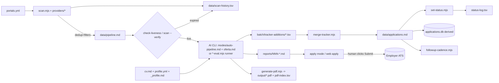
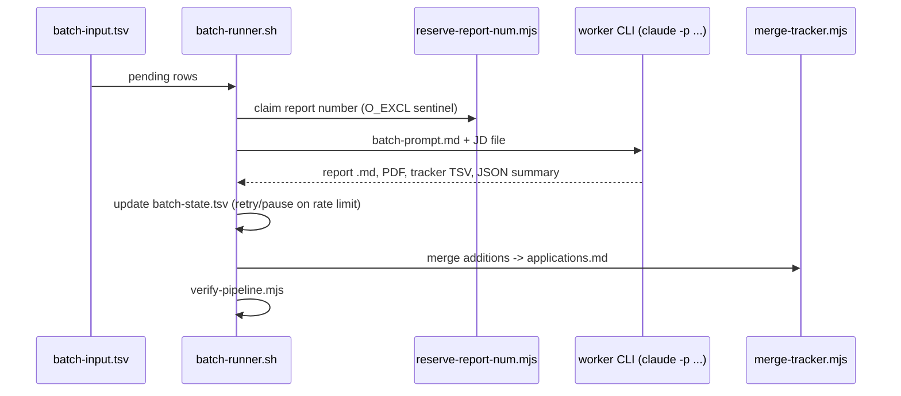

# PROJECT_CAREER_OPS - Deep Architecture Analysis of `career-ops`

- Repo analysed: `C:\Projects\project_rho\career-ops` (read-only; HEAD `05ae8c2c` "fix(jd-skill-gap) ... (#6257)", 2026-10-31; `VERSION` = 1.38.0)
- Method: multi-pass read of top-level `*.mjs`, `lib/`, `providers/`, `plugins/`, `modes/`, `batch/`, `web/`, `dashboard/`, `templates/`, `tests/`, `.github/`, manifests. Knowledge graph (`research/career-ops/graphify-out/GRAPH_REPORT.md`) used only for navigation (god nodes: `fail()`/`pass()` test helpers, `ROOT`, `getCareerOpsRoot()`, `loadYaml()`, `isMainModule()`).
- Labels: **FACT** = verified in source (path given). **ASSUMPTION** = inferred / from memory / not verifiable offline. **RECOMMENDATION** = my advice. Status: IMPLEMENTED / PARTIAL / PLANNED.
- Not done (by rule): no install, no execution of project code, no `node_modules` present (FACT: `ls node_modules web/node_modules` fails). Anything runtime-only is therefore unverified.
- Honesty note: the repo is ~2,930 files; I read headers/key functions of the central modules, not every one of ~166 root scripts, ~126 providers or ~1,000 test files. Where a script is described only from its header comment, I say so.

---

## 1 Project overview

**What it is.** FACT (`package.json` description, `AGENTS.md` "What is career-ops", `ARCHITECTURE.md`): an open-source, local-first, "AI job search" toolkit. It is *not* a hosted app and *not* a single program: it is a bundle of (a) Markdown prompt files ("modes", `modes/*.md`) executed by whatever AI coding CLI the user runs (Claude Code, Codex, OpenCode, Gemini, Qwen, Grok, Antigravity, Cursor, Pi, Copilot), (b) ~166 root-level Node `.mjs` scripts that do deterministic work with zero LLM tokens (scanning, dedup, tracker maintenance, liveness, PDF), (c) standalone LLM "runner" scripts that call Gemini/Ollama/OpenAI-compatible/OpenRouter directly, (d) an optional Go terminal dashboard (`dashboard/`), and (e) an optional alpha Next.js web UI (`web/`).

**Problem solved.** FACT (`MANIFESTO.md`, `AGENTS.md` "Ethical Use"): job seekers drown in volume. The tool scans public career portals, filters and dedups postings, verifies they are still live, scores each against the user's CV with a structured A-G(H) report and 1-5 score, generates ATS-safe tailored CV PDFs and cover letters, drafts form answers, tracks the pipeline and follow-ups. Design principle: **quality over quantity, human-in-the-loop, never auto-submit** (FACT: `AGENTS.md` Ethical Use; `web/AGENTS.md` rule 3; `web/src/lib/apply/submit-guard.mjs`).

**Users.** Individual job seekers technical enough to run a CLI (needs Node >= 22.13, optionally Go, Playwright Chromium, LaTeX). FACT (`CONTRIBUTING.md`, `LEGAL_DISCLAIMER.md`): the maintainers run no service; explicit plan for a *separate, opt-in* hosted service exists (`CONTRIBUTING.md` line ~107 refers to discussion #904) - PLANNED, not in repo.

**Provenance/governance.** FACT: creator Santiago Fernandez de Valderrama (`LICENSE`, `package.json` author), BDFL governance (`GOVERNANCE.md`), org `career-ops-hq` (repo URL in `package.json`; note `dashboard/go.mod` module path still `github.com/santifer/career-ops/dashboard`).

**Scale signal.** FACT (counts via listing): 166 root `.mjs`; 55 files in `lib/`; 145 files in `providers/` (126 non-underscore provider modules); 45 top-level mode `.md` + 15 locale dirs; 51 Next.js API routes; 1,004 `tests/**/*.test.mjs` + 242 `web/tests/**/*.test.mjs` + 65 Go `_test.go`; 18 translated READMEs.

---

## 2 Directory structure

FACT (directory listing, file counts):

| Path | Files | Role |
|---|---:|---|
| `*.mjs` (root) | 166 | One script = one job (policy in `ARCHITECTURE.md` "Why the flat root"). Examples: `scan.mjs`, `check-liveness.mjs`, `merge-tracker.mjs`, `generate-pdf.mjs`, `followup-cadence.mjs`, `update-system.mjs`, `doctor.mjs`, `test-all.mjs` |
| `lib/` | 55 | Shared helpers: `dir-lock.mjs`, `privacy-guard.mjs`, `llm-outbound.mjs`, `pii-interceptor.mjs`, `cli-flags.mjs`, `update-manifest.mjs` (SYSTEM_PATHS), `yaml-document.mjs`, `context-budget.mjs`, `walk-tree.mjs`... |
| `providers/` | 145 | Job-source plugins (`greenhouse.mjs`, `ashby.mjs`, `lever.mjs`, `workday.mjs`, ... ) + `_http.mjs`, `_ip-guard.mjs`, `_safe-url.mjs`, `_registry.mjs`, `_trust-validator.mjs`, `ADDING_A_PROVIDER.md` |
| `plugins/` | 36 | Opt-in keyed integrations: `apify`, `gmail`, `notion`, `h1b-sponsor`, `_engine.mjs`, `_lock.mjs`, `_net.mjs`, `_template/` |
| `plugins-registry/` | 13 | JSON entries for third-party community plugins (`serper.json`, `tavily.json`, `obsidian.json`, ...) |
| `modes/` | 225 | Prompt "brain": `_shared.md` (scoring core), `oferta.md`, `auto-pipeline.md`, `scan.md`, `pdf.md`, `apply.md`, ... + `oferta-signals/` (14 jurisdiction checks), `interview/`, `regional/`, `heuristics/`, and 15 locale dirs (`ar da de es fr hi id it ja ko nl pl pt ru sg`, 5-7 files each) |
| `batch/` | 9 | `batch-runner.sh` (2,424 lines), `batch-prompt.md`, `batch-prompt-match.md`, `aggregate-tokens.mjs`, `jd-rescue.mjs`, `company-scope.mjs` |
| `templates/` | 47 | CV HTML/LaTeX templates, `states.yml` (canonical statuses), `portals.example.yml`, `jurisdiction-*.yml` (legal data tables), `ats-rules.yml`, `protected-grounds.yml`, `sections/`, `ats/` |
| `config/` | 5 | Examples only: `profile.example.yml`, `privacy.example.yml`, `plugins.example.yml`, `cv-facts.example.json`, `local-paths.example.txt` |
| `data/`, `reports/`, `output/`, `jds/`, `documents/`, `interview-prep/`, `writing-samples/` | ~1 each | Empty scaffolds (`.gitkeep`) for **user-layer** data (gitignored) |
| `dashboard/` | 99 | Go TUI (Bubble Tea): `main.go`, `internal/{data,model,theme,i18n,ui/screens}` |
| `web/` | 682 | Next.js alpha UI: `src/app` (pages + 51 `api/**/route.ts`), `src/components`, `src/lib` (many plain `.mjs` for testability), `tests/`, `scripts/` |
| `scaffolder/` | 7 | `@santifer/career-ops` npm installer (`bin/cli.mjs`) |
| `tests/` | 1,179 | `*.test.mjs` auto-discovered by `test-all.mjs`; `tests/providers/` one suite per provider; `tests/cv-visual/` Playwright snapshots + Dockerfile |
| `evals/` | 21 | Golden-set harness for cheap-model routing (`eval-golden.mjs`) |
| `docs/` | 72 | Setup, privacy, plugins, architecture SVGs, recipes |
| `.github/` | - | 26 workflows, `scripts/`, issue/PR templates, `agents/` (maintainer agents) |
| `.claude/`, `.agents/`, `.claude-plugin/`, `.codex-plugin/`, `.cursor-plugin/`, `antigravity-directory/`, `claude-directory/`, `cursor-directory/`, `openai-directory/` | - | Skill/plugin manifests for multiple agent hosts; each directory ships its own `LICENSE` |
| `seeds/`, `fonts/`, `utils/`, `scripts/`, `hooks/`, `test-fixtures/`, `examples/` | small | VC-portfolio seeds, DM Sans/Space Grotesk fonts, token tracker, UI launcher, fixtures |

FACT: root `CLAUDE.md` is 103 bytes and `@AGENTS.md`-wraps the 92 KB canonical `AGENTS.md` (`ARCHITECTURE.md` "Multi-CLI entry files").

---

## 3 Technology stack

| Layer | Tech | Version (manifest) | Evidence |
|---|---|---|---|
| Runtime | Node.js | `^22.13.0 \|\| >=23.4.0` (CI tests 22.13 floor syntax + Node 24 suite) | `package.json` engines; `.github/workflows/test.yml` |
| Language | JavaScript ESM (`.mjs`), no build step; TypeScript only in `web/` | - | `ARCHITECTURE.md`; `providers/_types.js` is JSDoc-only |
| Root deps (5) | `@google/generative-ai` ^0.24.1, `dotenv` ^18.0.4, `js-yaml` ^5.3.0, `playwright` 1.64.1, `undici` ^7.30.1 | | `package.json` |
| Built-in Node | `node:sqlite` (derived tracker index, "unflagged from 22.13"), `node:test`, `fetch` | | `tracker.mjs` header |
| Web | Next.js 16.4.1, React ^19.2.5, Tailwind ^4.2.2, TypeScript 7.0.2, react-markdown ^10, remark-gfm ^4, pdfjs-dist ^6.4.299, playwright-core ^1.61.0, lucide-react ^1.8.0, class-variance-authority, clsx, tailwind-merge, `@paper-design/shaders-react` ^0.0.80, js-yaml ^5.4.1 | web pkg v0.16.0 | `web/package.json` |
| TUI | Go 1.26.0 (`go.mod`), Bubble Tea v1.3.10, Lipgloss v1.1.0, x/ansi v0.11.9, termenv v0.16.0, x/sys v0.49.0 | | `dashboard/go.mod`; Dockerfile installs Go 1.27.2 with pinned sha256 |
| Rendering | Playwright Chromium (HTML->PDF), optional LaTeX (tectonic/latexmk/xetex) | | `generate-pdf.mjs`; `Dockerfile` |
| Persistence | Markdown/TSV/YAML/JSON files; SQLite derived index | | section 7 |
| Shell | Bash (`batch/batch-runner.sh`), PowerShell/sh for scheduler install scripts | | `web/scripts/*` |
| CI | GitHub Actions, CodeQL, release-please, Dependabot, Renovate, CodeRabbit | | `.github/` |

ASSUMPTION: several manifest versions (Next 16.4.1, TypeScript 7.0.2, Go 1.26/1.27, Playwright 1.64.1, dotenv 18) are newer than my reliable knowledge; I take them from the manifests and could not verify they resolve on registries offline.

FACT: **no root `package-lock.json`** (listing; `.gitignore:244` ignores it, only `web/package-lock.json` is un-ignored) -> root dependency resolution is non-reproducible from the repo; CI uses `npm install --ignore-scripts` (`test.yml`). RECOMMENDATION: if vendoring, pin and lock yourself.

---

## 4 System architecture

**Core idea (FACT, `ARCHITECTURE.md`):** "Files are canonical - databases are derived." Everything is plain files in a **data root**; scripts and prompts are stateless over them. Three commitments: local-first, AI-agnostic (logic in Markdown prompts), human-in-the-loop.

**Two layers (the Data Contract, FACT: `DATA_CONTRACT.md`, `lib/update-manifest.mjs` `SYSTEM_PATHS`/`USER_PATHS`, enforced by `updater-migration-tests.mjs`, `validate-system-paths-coverage.mjs`, `.github/workflows/no-user-data.yml`):**
- *System layer*: `modes/*` (except `_profile.md`, `_custom.md`, `_brief.md`), root scripts, `lib/`, `providers/`, templates, dashboard. Updated by `update-system.mjs`.
- *User layer*: `cv.md`, `config/profile.yml`, `modes/_profile.md`, `portals.yml`, `data/*`, `reports/*`, `output/*`, `jds/*`, `.career-ops-web/*`, etc. Never touched by the updater.

**Data root resolution (FACT: `path-resolver.mjs`, restated in `modes/_shared.md` "Data Root & Path Resolution"):** `CAREER_OPS_ROOT` / `CAREER_OPS_DATA_DIR` env -> `.career-ops-data` marker file -> repo root. Tracker: `CAREER_OPS_TRACKER` -> `data/applications.md` -> `applications.md`. This allows a split code-checkout/data-root layout (`web/src/lib/core/code-root.mjs`, `data-root.mjs`, `apply-scope.mjs allowedRoots()`).

**Execution planes:**
1. *Agent plane*: user's AI CLI loads `AGENTS.md` + `.agents/skills/career-ops/SKILL.md` (router with ~45 mode names) -> reads `modes/{mode}.md` + `_shared.md` + `_profile.md` + `cv.md` -> acts using its own tools (Playwright MCP, WebFetch) and shells out to `.mjs` scripts.
2. *Script plane*: zero-token deterministic Node scripts (scan, liveness, merge, dedup, PDF, cadence).
3. *Runner plane*: `gemini-eval.mjs`, `ollama-eval.mjs`, `openai-eval.mjs`, `openrouter-runner.mjs`, `batch-evaluate-gemini.mjs`, `openai-tailor.mjs` - read the same mode files and call an LLM HTTP API directly, then write report + tracker TSV addition.
4. *Batch plane*: `batch/batch-runner.sh` spawns headless agent CLIs (`claude -p`, `opencode run`, `gemini -p`, `qwen -p`, `grok -p`) per offer.
5. *View plane*: Go TUI and Next.js UI read (and for status, write through) the same files; the web UI spawns the agent CLIs via `/api/run`.

```
              +---------------- user layer (files, gitignored) ----------------+
              | cv.md  config/profile.yml  portals.yml  modes/_profile.md       |
              | data/{pipeline.md,applications.md,scan-history.tsv,...}         |
              | reports/NNN-*.md  output/*.pdf  jds/  batch/tracker-additions/  |
              +----^------------^-------------^-------------^------------------+
                   |            |             |             |
  scan.mjs/providers   AI CLI + modes/*.md   *-eval.mjs      merge-tracker/set-status
  (HTTP, 0 tokens)     (oferta, pdf, apply)  (LLM HTTP)      dedup/verify-pipeline
                   \            |             |             /
                    +-- Go TUI (dashboard/)   +-- Next.js UI (web/, spawns CLIs/scripts)
```

---

## 5 Frontend architecture

### 5a `web/` (Next.js, "alpha")
- FACT (`web/README.md`, `web/AGENTS.md`): experimental, opt-in, "a view over the user's own files, not a second engine". Three rules: orchestrate the core never reimplement; Markdown is source of truth (status writes only through `/api/status` -> `set-status.mjs`); nothing is ever auto-submitted.
- FACT (`web/src/app`): App Router. Pages: `/` (Today), `/explore`, `/scheduled-scans`, `/pipeline`, `/pipeline/[id]`, `/pipeline/[id]/apply`, `/pipeline/[id]/cv-studio`, `/pipeline/compare`, `/followups`, `/portals`, `/analytics`, `/cv`, `/documents`, `/config`, `/apply`, `/jobs`, `/jobs/[id]` (nav list: `web/src/lib/nav-items.ts`). `/login` has only a `loading.tsx` (no page) - see section 9.
- FACT: ~120 components in `web/src/components/` (e.g. `explore/*`, `followups/*`, `cv-studio/*`, `analytics/pipeline-sankey.tsx`, `assistant-console.tsx`, `apply-view.tsx`). State is mostly server-rendered from disk (`force-dynamic`) plus NDJSON/stream consumers for long runs (`web/src/lib/job-stream.mjs`, `post-ndjson-xhr.mjs`).
- FACT (design choice): rule-bearing logic is in plain `.mjs` (`tracker-table.mjs`, `cv-selection.mjs`, `origin-guard.mjs`, `bind-host.mjs`) so `node --test` runs without a build (`web/AGENTS.md` "Testing").
- FACT: telemetry disabled (`web/next.config.mjs` sets `NEXT_TELEMETRY_DISABLED`); Turbopack root pinned; `serverExternalPackages: ["pdfjs-dist"]`.
- Launch: FACT `scripts/ui-server.mjs` (`npm run ui`) polls readiness then opens the browser on `127.0.0.1:3000` by default; `web/server.mjs` computes bind host (`bind-host.mjs`).
- Maturity: PARTIAL - self-labelled alpha; separate versioning/release (`web` component in release-please; `web-ci.yml` "informative by design", not a required check).

### 5b `dashboard/` (Go TUI)
- FACT (`dashboard/main.go`): Bubble Tea app with 4 views (`viewPipeline`, `viewReport`, `viewProgress`, `viewStats`); screens in `internal/ui/screens/{pipeline,viewer,progress,stats,fit}.go`; themes Catppuccin (mocha/latte) in `internal/theme`; i18n catalog `internal/i18n/catalog.go`.
- FACT: it parses `applications.md` itself (`internal/data/career.go`, `derive.go`), reads `data/pdf-index.tsv` (`pdf.go`), and **writes status changes by shelling out to `set-status.mjs`** (`internal/data/status_writer.go`, `CheckoutScriptPath`) with its own cross-platform tracker lock mirror (`tracker_lock*.go`). Parity of states with `templates/states.yml` is test-enforced (`states_parity_test.go`).
- FACT: platform shims `open_{darwin,linux,windows,unsupported}.go`, `clipboard.go`.
- Isolated and optional (`ARCHITECTURE.md`: "never required").

---

## 6 Backend architecture

There is no server for the core. "Backend" = scripts + runners + (optionally) Next.js route handlers.

**Root scripts (FACT, grouped; descriptions from header comments unless noted):**
- Discovery: `scan.mjs` (5,264 lines), `scan-ats-full.mjs` (reverse-ATS sweep over public directories incl. Feashliaa/job-board-aggregator dataset, `--seeds yc,a16z`), `scan-hn.mjs` (Hacker News + optional Gemini), `scan-interamt.mjs`, `scan-dayforce.mjs` (Playwright), `discover-ats.mjs`, `discover-new-companies.mjs`, `company-funded.mjs`, `seeds/vc-portfolios.mjs`, `fetch-jd.mjs`, `browser-extract.mjs`, `jd-capture.mjs`.
- Verification: `check-liveness.mjs`, `liveness-{core,api,browser}.mjs`, `verify-portals.mjs`, `validate-portals.mjs`, `audit-portals.mjs`, `dead-boards.mjs`, `precheck-duplicate.mjs`.
- Evaluation runners: `gemini-eval.mjs`, `ollama-eval.mjs`, `openai-eval.mjs`, `openrouter-runner.mjs`, `batch-evaluate-gemini.mjs`, `rank-pipeline.mjs` (opt-in LLM annotator via installed agent CLI), `eval-golden.mjs`, `calibrate.mjs`.
- Tracker: `merge-tracker.mjs` (2,447 lines), `dedup-tracker.mjs`, `set-status.mjs`, `normalize-statuses.mjs`, `tracker.mjs` (SQLite index), `tracker-utils.mjs`, `tracker-parse.mjs`, `reconcile-pipeline.mjs`, `verify-pipeline.mjs`, `fix-report-links.mjs`, `reserve-report-num.mjs`, `add-entry.mjs`.
- Documents: `generate-pdf.mjs` (2,598 lines), `build-cv-html.mjs`, `build-cv-latex.mjs`, `generate-latex.mjs`, `generate-cover-letter.mjs`, `verify-cv-facts.mjs`, `verify-ats.mjs`, `verify-cv-structure.mjs`, `cv-sync-check.mjs`, `cv-title-check.mjs`, `keyword-match.mjs`, `openai-tailor.mjs`, `batch-tailor.mjs`, `img-to-pdf.mjs`.
- Apply support: `prepare-application.mjs`, `apply-scope.mjs`, `application-answers.mjs`, `application-artifacts.mjs`.
- Lifecycle/analytics: `followup-cadence.mjs`, `followup-seed.mjs`, `stats.mjs`, `funnel-velocity.mjs`, `analyze-patterns.mjs` (98 KB), `weekly-digest.mjs`, `outcome.mjs`, `reply-watch.mjs`, `paste-reply.mjs`, `rejection-latency.mjs`, `closing-soon.mjs`, `detect-reposts.mjs`, `salary-gap.mjs`, `negotiation-roi.mjs`, `sponsor-check.mjs`.
- Platform: `update-system.mjs` (5,935 lines), `doctor.mjs`, `plugins.mjs`/`plugin-install.mjs`/`plugin-audit.mjs`, `privacy-status.mjs`, `test-all.mjs`.

**Cross-cutting infrastructure (FACT):**
- Locking: `lib/dir-lock.mjs` is "the one cross-process directory lock" (mkdir-based, owner stamp, stale recovery); used by `pipeline-lock.mjs`, `tracker-utils.mjs acquireTrackerLock/openTrackerTransaction`, `portal-health-lock.mjs`, followups lock. Atomic writes: `tracker-utils.mjs writeFileAtomic`, `scan.mjs atomicWriteFile` (fsync, rename-with-retry for Windows `RENAME_RETRY_DELAYS_MS`).
- CLI hygiene: `lib/cli-flags.mjs validateFlags/flagValue/hasFlag` - unknown flags fail fast (comment: silent fall-through to live-run default was a recurring bug class #2744).
- Unified CLI result codes: `tracker-utils.mjs CLI_EXIT = {OK:0, USAGE:1, NOT_FOUND:2, AMBIGUOUS:3, LOCK_TIMEOUT:4}`.
- Node-based test of module-vs-CLI: `lib/is-main-module.mjs isMainModule()` (119 edges in graph).

**Web "runners" (FACT: `web/src/app/api/run/route.ts`):** `POST /api/run` with `{kind, input, cliId, brief, evaluationSections}`; resolves a CLI (`web/src/lib/clis.ts resolveCliOrFallback`), checks per-kind capability (`worker-capabilities.mjs capabilitiesFor(kind)`, `cli-fencing.mjs isCliAllowedForCapabilities`), builds the prompt (`run-prompts.mjs buildPrompt`), spawns the headless CLI (`spawn-cli.mjs spawnHeadlessCli`), parses the `<<offer:>>`/`<<cv:>>`/report envelopes (`cv-envelope.mjs`, `report-envelope.mjs`), persists the report (`report-persist.mjs` -> `persistEvaluation`), renders PDF via `generate-pdf.mjs` (`pdf-render.mjs renderAndMarkPdf`), holds a tracker write slot (`core/run-registry.ts acquireTrackerWrite`). `maxDuration = 800`.

---

## 7 Data / storage architecture

**No database is canonical.** FACT (`ARCHITECTURE.md` "Files are canonical", settled doctrine #918): SQLite "will never become a primary store - not even opt-in".

| Artifact | Format | Writer(s) | Notes |
|---|---|---|---|
| `cv.md` | Markdown | user | Source-of-truth CV; `modes/_shared.md` "Sources of Truth (EXCLUSIVE)" |
| `config/profile.yml` | YAML | user / `onboard-write.mjs`, `web` profile patch | identity, targets, `spend_tier`, `language`, `culture_screen`, `scan`, follow-up cadence keys (`followup-cadence.mjs PROFILE_CADENCE_KEYS`) |
| `modes/_profile.md`, `_custom.md`, `_brief.md` | Markdown | user | archetypes, house rules, compact brief for triage |
| `portals.yml` | YAML | user | `tracked_companies[]`, `job_boards[]`, `title_filter`, `location_filter`, `salary_filter`, `content_filter`, `trust_filter`, `visa_filter`, `country_eligibility_filter`, `experience_filter`, `skip_tiers`, `field_filters` (`scan.mjs main()`) |
| `data/pipeline.md` | Markdown checklist inbox | `scan.mjs appendToPipeline` under `pipeline-lock.mjs` | `- [ ] url ...` pending rows; `- [!]` for JD-unavailable |
| `data/scan-history.tsv` | TSV append-only | `scan.mjs appendToScanHistory`, `check-liveness.mjs` | dedup source; statuses `added`, `skipped_title`, `skipped_location`, `skipped_age`, `skipped_expired`, `skipped_no_apply_control`, `skipped_experience`, cooldown statuses; columns append-only (`lib/scan-history-columns.mjs`) |
| `data/scan-runs.tsv`, `data/portal-health.tsv`, `data/dead-boards.tsv` | TSV | `scan.mjs`, `scan-ats-full.mjs` | run counters / reachability streaks |
| `data/applications.md` | Markdown table | `merge-tracker.mjs`, `set-status.mjs`, `dedup-tracker.mjs`, `normalize-statuses.mjs`, hand edits | columns documented in `AGENTS.md`: `# \| Date \| Company \| Role \| Score \| Status \| PDF \| Report \| Notes`; migrations add **Via** and **URL** columns (`merge-tracker.mjs --migrate-via/--migrate-urls`); column resolution by name alias (`tracker-parse.mjs resolveColumns`) |
| `data/status-log.tsv` | TSV append-only ledger | `set-status.mjs` | `tracker# date from to source note` |
| `data/applications.db` | SQLite (derived) | `tracker.mjs sync` | tables incl. `status_events`; safe to delete; "Phase 2 DB-as-source NOT implemented" |
| `data/follow-ups.md`, `active-interviews.md`, `agent-inbox.md`, `contacts.tsv`, `salary-observations.tsv`, `assessments.tsv`, `blacklist.md`, `pdf-index.tsv`, `reply-candidates.json`, `reply-proposals/*.json`, `scheduled-jobs.json`, `cache/provider-ids/*.json` | md/tsv/json | various | all listed in `DATA_CONTRACT.md` |
| `reports/NNN-{slug}-{date}.md` | Markdown + `## Machine Summary` YAML | agent/runners | MUST embed archived JD (`AGENTS.md`, `check-jd-archive.mjs`); numbering via `reserve-report-num.mjs` |
| `batch/tracker-additions/*.tsv` | TSV (header `num date company role status score pdf report notes` = `tracker-parse.mjs TSV_ADDITION_HEADER`) | evaluators/workers | merged by `merge-tracker.mjs`, then moved to `merged/` |
| `batch/batch-input.tsv`, `batch/batch-state.tsv` | TSV | user / `batch-runner.sh` | resumable state |
| `output/*.pdf`, `jds/*` | binary/text | `generate-pdf.mjs`, `archive-posting.mjs` | |
| `.career-ops-web/{chats,cv-studio}/*.json` | JSON | web API | local assistant history, CV Studio edits |
| `config/plugins.yml` + `plugins.lock` | YAML/lock | user / `plugins.mjs` | integrity pins + recorded consent |

**Report-number allocator (FACT, `reserve-report-num.mjs`):** counts occupied numbers from report files, `NNN-RESERVED.md` sentinels, tracker row IDs, report links in the tracker, ledgers (status-log, follow-ups, salary-observations, contacts) and numbers `failed` in `batch/batch-state.tsv`; claims with `O_CREAT|O_EXCL` under the tracker lock; `MAX_SENTINEL_AGE_MS` = 4 h GC; `--count N` (<=50), `--release`, `--gc`; bare-date files (`YYYY-MM-DD.md`) excluded so they cannot inflate the counter.

---

## 8 API architecture

### 8a CLI surface
FACT: `package.json` scripts expose ~90 `npm run` aliases (e.g. `scan`, `liveness`, `pdf`, `merge`, `dedup`, `verify`, `or:eval`, `gemini:eval`, `ollama:eval`, `openai:eval`, `update`, `rollback`, `ui`, `build:dashboard`). Flags are validated per script via `lib/cli-flags.mjs`. `scan.mjs` flags (header): `--dry-run`, `--company`, `--verify`, `--headed-fallback`, `--throttle[=ms]`, `--include-blacklisted`, `--since N`, `--posted-after/--posted-before YYYY-MM-DD`, `--rediscover-404`, `--quiet`, `--json` (single JSON receipt on stdout, `emitJsonReceipt`). `batch-runner.sh` flags: `--cli`, `--model`, `--parallel`, `--dry-run`, `--retry-failed`, `--resume-paused`, `--start-from`, `--company`, `--limit`, `--min-score`, `--skip-pdf`, `--max-retries`, `--worker-timeout`, `--mode full|match`, `--thin-action`, `--rate-limit-sleep` (`batch/README.md`).

### 8b Web API (51 route handlers, FACT: `find web/src/app/api -name route.ts`)
Grouped (all `runtime = "nodejs"`; many shell out to core scripts):
- Runs: `/api/run` (evaluate/pdf/cover/fix-portal workers), `/api/runs/save`, `/api/assistant`, `/api/assistant/chats`, `/api/usage`, `/api/clis`
- Tracker: `/api/status` (delegates to `set-status.mjs`, exit-code->HTTP map {2:404, 3:409, 4:503}), `/api/tracker/delete`, `/api/pipeline`, `/api/stats`, `/api/patterns`, `/api/inbox/skip`, `/api/company-history`, `/api/quiet-companies`
- Discovery: `/api/explore`, `/api/explore/ai` (streams `<<offer:{..}>>` envelopes from `modes/discover.md`), `/api/explore/add`, `/api/portals`, `/api/portals/verify`, `/api/scheduled-jobs[/id[/run]]`, `/api/scheduler`
- Documents: `/api/cv`, `/api/cv/ingest`, `/api/cv-pdf`, `/api/cover-pdf`, `/api/cv-studio/[n]`, `/api/cv-studio/[n]/rewrite`, `/api/documents`, `/api/pdf-ready`, `/api/keyword-match`, `/api/report/shape`
- Apply: `/api/apply/{session,prefill,fill,drive,close}` (Playwright-driven form assistance)
- Follow-ups: `/api/followups`, `/cadence`, `/log`, `/override`, `/seed`
- Misc: `/api/profile`, `/api/personalization`, `/api/memory`, `/api/doctor`, `/api/version`, `/api/whats-new`, `/api/upskill`, `/api/logo`
- Request validation helper: `web/src/lib/json-body.ts readJsonObject`. No OpenAPI/schema doc found (ASSUMPTION: none exists; not searched exhaustively).
- All traffic gated by `web/src/proxy.ts` (section 9).

### 8c Provider/plugin contract (internal API)
FACT (`providers/_types.js`, `_registry.mjs`, `scan.mjs` header): provider = default export `{ id, detect(entry)?, fetch(entry, ctx) -> Job[] }`; `Job = {title, url, company, location, description?, postedAt?, salary?, externalId?...}`. Loader imports every non-`_` `.mjs` alphabetically, skips malformed/duplicates with a warning. Plugin contract (`plugins/_engine.mjs`): manifest `{id, apiVersion, hooks[provider|ingest|search|notify|export], requiredEnv, allowedHosts, humanInTheLoop}`.

---

## 9 Authentication & authorization

- **FACT: the core has no user accounts, sessions or auth.** Single-user, local files. `LEGAL_DISCLAIMER.md`: no telemetry, no hosted service.
- **FACT: web UI has no login.** `web/src/app/login/` contains only `loading.tsx`. Access control is *network position + request guard*:
  - Bind: default loopback (`web/server.mjs` + `src/lib/bind-host.mjs`; warns when widened via `CAREER_OPS_WEB_ALLOWED_HOSTS`).
  - `web/src/proxy.ts` (Next 16 "proxy", formerly middleware) runs `checkRequest` from `origin-guard.mjs` on every request except `_next/static|image`: (F1) Fetch-Metadata `Sec-Fetch-Site` / Origin-vs-Host same-origin check against drive-by CSRF; (F2/DNS-rebinding) Host filter answering only loopback or hosts in `CAREER_OPS_WEB_ALLOWED_HOSTS`; extra origins via `CAREER_OPS_ALLOWED_ORIGINS` (e.g. browser extension). Header comment states this cannot stop a direct LAN client spoofing `Host: localhost` - the bind is the real control.
  - RECOMMENDATION: if embedding into a multi-user product, this model does not transfer; real authn/z is needed.
- **Secrets:** API keys only in `.env` (`.env.example`) loaded by `dotenv` from the data root (`scan.mjs`); plugins must keep secrets in `.env` not in `config/plugins.yml` (`config/plugins.example.yml` comment). `plugins/_engine.mjs` forbids plugins declaring core-owned env var names.
- **Agent authorization (the real "authz" story):** FACT `web/src/lib/claude-invocation.mjs` builds per-worker `--allowedTools`/`--disallowedTools` lists (comment: "`disallowedTools` is the hard guardrail"); `web/src/lib/clis.ts` carries a rule that no CLI may auto-approve beyond the audited Claude path, enforced by `tests/lib/clis-permissions.test.mjs`; unknown worker kinds get least-capable record (`worker-capabilities.mjs`). **Contrast:** FACT `batch/batch-runner.sh:1509` runs `claude -p --dangerously-skip-permissions --strict-mcp-config` (batch workers are unattended and fully permitted; mitigated only by prompt-level untrusted-content rules and `CAREER_OPS_HEADLESS=1`).
- **Apply-scope sandbox:** FACT `apply-scope.mjs` - `allowedRoots()` (code root + data root), `resolveInsideProject()` rejects paths outside; launch options reject remote-debugging/user-data-dir args (`ATTACH_ARG` regex); modes forbid `connectOverCDP`/attaching to the user's Chrome.

---

## 10 Important modules & core business logic (traced)

### 10.1 `scan.mjs` - zero-token portal scanner
FACT flow (`main()`, lines ~4061-4900):
1. Validate flags (`validateFlags`), parse `--since/--posted-*` (`parseSinceDays`, `resolveEffectiveAfter`).
2. `loadProviders(providers/)` (all non-`_` modules) then `mergeProviderPlugins` (opt-in `config/plugins.yml`; no-op if absent).
3. Read `portals.yml` (`PORTALS_PATH` or `CAREER_OPS_PORTALS`), build compiled filters: `buildTitleFilter`, `buildLocationFilter`, `buildPostingAgeFilter`, `buildPostedDateFilter`, `buildSalaryFilter`, `buildTrustValidator`, `buildContentFilter`, `buildCountryEligibilityFilter`, `buildVisaFilter`, `resolveExperienceFilter`, `skip_tiers` via `classify-tier.mjs`, and `field_filters`/`filter_on` (startup validation exits on malformed config rather than silently passing everything).
4. `resolveProvider(entry, providers)` per tracked company/board: explicit `provider:` wins -> `local-parser` if `parser.command` configured -> first provider whose `detect()` matches. Entries with `scan_method: websearch` are handed off to the agent.
5. Fetch in parallel (`parallelFetch`, `CONCURRENCY = 10`) with per-entry error classification (`classifyFetchError` from `verify-portals.mjs`) and portal-health recording.
6. **Dedup stack** (all exported, heavily tested): URL normalization (`normalizeUrlForDedup`, `url-key.mjs`), seen-set from `scan-history.tsv` + `pipeline.md` + `applications.md` (`collectSeenUrls`/`loadSeenUrls`, with language-variant handling `isUnseenLanguageVersion`), company+role keys with corporate-form stripping and alias canonicalizer (`companyRoleDedupKey`, `buildCompanyCanonicalizer`, `normalizeRoleForDedup`, optional location/language inclusion), requisition-ID distinctness (`requisitionIdsForDedup`, `isDistinctRequisition`), stable listing identity (`listing-fingerprint.mjs`, `listingIdentityToken`), re-apply cooldown windows from the profile (`loadReApplyWindows`, `buildCooldownFilter`), `data/blacklist.md` (`parseBlacklist`, `findBlacklistEntry`), aggregator repost detection (`checkAggregatorRepost`), and cross-company JD fingerprint (`fingerprint-core.mjs findCrossListings`, step 5.7).
7. Optional `--verify`: `verifyOffers()` - API-first liveness (`liveness-api.mjs`) then sequential Playwright fallback; 404/410 URLs can be re-discovered (`searchForNewUrl`, `pickRediscoveredUrl`) when `--rediscover-404`.
8. Experience filter (`jd-years.mjs applyExperienceFilter`): reads stated years from JD, drops only a *required* overall bar beyond the user's band.
9. Write: `appendToPipeline` + `appendToScanHistory` (skipped when `--dry-run`); non-added outcomes recorded with distinct statuses that carry no dedup weight where the user's setting caused the cut (`OBSERVATIONAL_SCAN_HISTORY_STATUSES`).
10. Appends `scan-runs.tsv` summary and portal health under their locks.
Design notes (FACT, comments): importing `scan.mjs` must be side-effect free (#3159); `--json` redirects `console.log` to stderr; trust validation (`providers/_trust-validator.mjs`) *flags* (score 0-100, flags, level), never drops.
Network safety: FACT `providers/_http.mjs` (`makeHttpCtx`), `_safe-url.mjs`, `_ip-guard.mjs` (AsyncLocalStorage-scoped `dns.lookup` patch rejecting loopback/RFC1918/169.254 *at resolution time*, plus literal-IP check), per-provider host allowlists (e.g. `greenhouse.mjs assertGreenhouseUrl`: HTTPS + `ALLOWED_GREENHOUSE_HOSTS`), `redirect: 'error'` noted. `tests/providers/ats-ssrf-hardening.test.mjs` exists.

### 10.2 Evaluation / scoring
FACT (`modes/_shared.md` "Scoring System", `modes/oferta.md`): five dimensions - CV match, North Star alignment, Comp, Cultural signals, Red flags - combined into **one holistic 1-5 Global score with "no arithmetic formula"** (LLM judgment). Same value must appear in report header, Machine Summary `score` and tracker. Interpretation: 4.5+ strong; 4.0-4.4 good; 3.5-3.9 decent; <3.5 recommend against; `AGENTS.md` "Ethical Use" sets the "strongly discourage" line at 4.0 (small internal inconsistency between the two docs).
- Report blocks A-F + G (posting legitimacy: High Confidence / Proceed with Caution / Suspicious; explicitly does NOT affect the score) + Block H (draft application answers) only for high scores; archived JD section mandatory; `## Machine Summary` YAML with `confidence` tier (Low/Medium/High) derived from per-dimension evidence status `supported|partial|unknown` (deterministic rules in `_shared.md`).
- Culture screen cap: if `culture_screen.require` contradicted -> Cultural signals capped at 2/5.
- Gates before Block A: liveness gate (URLs), blacklist gate, dealbreaker gate (user's hard rules), local job-facts cache reuse (`evaluation-cache.mjs`: needs strong listing identity, fresh active liveness, facts < 24 h).
- Jurisdiction add-ons (`modes/oferta-signals/*.md`, data in `templates/jurisdiction-*.yml`, staleness check `check-table-freshness.mjs`): agency licensing, immigration-status overreach, prohibited content, pay-transparency, AI-screening disclosure, fixed-term disclosure, unpaid placement, candidate-paid fees, accommodation notice, etc.
- Spend tiers: `config/profile.yml spend_tier` economy/standard/premium -> model mapping table in `_shared.md` (Claude Code row names Haiku 5.5 / Sonnet 5.5 / Opus 5.5; other CLIs "your CLI's cheapest/balanced/most capable").
- Cheap first pass: `modes/triage.md` reads only `modes/_brief.md`, writes no files; `rank-pipeline.mjs` annotates pending pipeline rows `rank: N/5 - reason`, never filters/reorders.
- Calibration: `calibrate.mjs`, `eval-golden.mjs` + `evals/` (10 synthetic cases; agreement-with-reference metric; not wired to CI per `evals/README.md`).
- ASSUMPTION: score quality depends entirely on the model + prompts; no numeric scoring code exists to unit-test (verified: no formula).

### 10.3 LLM eval runners across providers
FACT (headers/imports):
| Script | Backend | Key points |
|---|---|---|
| `gemini-eval.mjs` (668 lines) | `@google/generative-ai`; default `gemini-3.6-flash`; `GEMINI_API_KEY`, `GEMINI_MODEL` | file-based JD (`--file`), `--posting-url`; header lists deprecations |
| `ollama-eval.mjs` (550) | local Ollama (`localhost:11434`) | recommends 32K+ ctx models; prompt ~10-15K tokens |
| `openai-eval.mjs` (586) | any OpenAI-compatible `/chat/completions` (`OPENAI_BASE_URL`, `OPENAI_MODEL`, `OPENAI_API_KEY`) | listed: OpenAI, OpenRouter, Together, Groq, DeepSeek, GLM, MiniMax, Fireworks, LM Studio, llama.cpp, vLLM; `lib/endpoint-headers.mjs` |
| `openrouter-runner.mjs` (1,276) | OpenRouter free models with live free-model discovery (price 0/0), rotation, persistent model blacklist after 3x 429 (`data/...model-blacklist.json`), subcommands `scan|evaluate|pipeline|apply|models` | reuses `scan.mjs` exports and liveness |
| `batch-evaluate-gemini.mjs` (625), `openai-tailor.mjs` (371), `batch-tailor.mjs` | batch / CV tailoring variants | not read in depth |
Common spine (FACT): read `modes/_shared.md`+`oferta.md`+`cv.md`+`_profile.md`+`_custom.md`+`profile.yml` -> `buildBudgetedPrompt` (`lib/context-budget.mjs`) -> `assertLlmRequestAllowed` (privacy guard) -> HTTP -> parse `---SCORE_SUMMARY---` -> `reserveReportNumbers` -> write `reports/NNN-*.md` + `batch/tracker-additions/*.tsv` (`TSV_ADDITION_HEADER`, `tsvSafe`, `normalizedTrackerScore`) -> `TokenAccumulator` cost report (`utils/token-tracker.mjs`). Output language via `profile-language.mjs`.

### 10.4 Batch runner + report numbering
FACT (`batch/batch-runner.sh`, `batch/README.md`): reads `batch/batch-input.tsv` (`id url source notes`), keeps resumable `batch-state.tsv` (state lock dir `.batch-state.lock`), per offer: fetch JD text, reserve report number via `node reserve-report-num.mjs`, spawn worker CLI with `batch/batch-prompt.md` (full A-G + PDF + TSV line) or `batch-prompt-match.md` (single pass, no PDF), enforce `--worker-timeout` (default 1800 s), parse worker's final JSON, on claude: adaptive rate-limit retries (30 s start, doubling, +0-20 % jitter, cap `--rate-limit-sleep` default 300, honours `Retry-After:` lines), session-limit pause (`batch-runner.paused`), `--parallel` default 3 (claude only; other CLIs sequential, single attempt). At end: `merge-tracker.mjs`, `reconcile-pipeline.mjs`-style cleanup of `pipeline.md`, `verify-pipeline.mjs`. `--thin-action webfetch|skip|browser-extract` handles JS-only pages (`browser-extract.mjs`). `--min-score N` records low scores as `skipped`. Resolves data root/profile via `path-resolver.mjs` through inline `node -e` (so bash and Node agree).

### 10.5 PDF / CV generation
FACT: `generate-pdf.mjs` renders HTML to PDF via Playwright Chromium; flags `--format letter|a4` (country-aware default `lib/page-format.mjs`), `--kind cv|cover`, `--report NNN` (writes `data/pdf-index.tsv` row keyed by report + kind), `--batch manifest.json` (one shared Chromium), `--max-pages` (default 2; `--strict-pages` hard-fails), `--allow-reorder`, `--allow-nonchronological`, `--skip-fact-check`. Pipeline: `normalizeTextForATS(html)` (em-dashes/smart quotes/arrows -> ASCII), section-order guard vs `cv.md` (`theme-style.mjs readCvSectionOrder`), experience-order guard (`cv-experience-order.mjs`), **fact gate** (`verify-cv-facts.mjs assertFacts`) checking quantified claims and forbidden phrases against `cv.md` + `article-digest.md` + `config/cv-facts.json`. Templates in `templates/cv-template*.html` (default, compact, executive, jake, leadership, modern, cjk/zh-minimal) and `.tex`; payload builders `build-cv-html.mjs`, `build-cv-latex.mjs`, `cv-payload-schema.mjs`; ATS lints `verify-ats.mjs`, `ats-payload.mjs`; visual regression `tests/cv-visual/` run in Docker (`playwright.cv.config.mjs`). LaTeX path compiles via tectonic/latexmk (`install-latex-engine.mjs`, Dockerfile TeX packages). Cover letter: `generate-cover-letter.mjs --payload` + `templates/cover-letter-template.html`.

### 10.6 Tracker dedup / merge
FACT: `merge-tracker.mjs` merges TSV additions into `applications.md` under the tracker lock (`openTrackerTransaction`/`acquireTrackerLock`): header-aware TSV parsing (`resolveTsvColumns`), also 9/8-col headerless and pipe-row forms; dedup on normalized company + `roleFuzzyMatch` (`role-matcher.mjs`) + report-number match; higher score updates in place; statuses validated against `templates/states.yml` (non-canonical rejected with warning); refuses report numbers that batch-state marks `failed`; one-off migrations (`--migrate`, `--migrate-via`, `--migrate-urls`, `--backfill-urls`). `dedup-tracker.mjs`: groups by normalized company, merges only exact-role rows with non-conflicting URLs, keeps highest score but preserves the more advanced status via `STATUS_RANK` (`skip/discarded 0 ... applied > rejected`), runs the same status hooks as `set-status.mjs` (`lib/status-hooks.mjs`), merges notes. `normalize-statuses.mjs` canonicalizes via `states.yml` aliases (multilingual aliases e.g. `aplicado`, `entrevista`, `başvuruldu`). Canonical states (FACT `templates/states.yml`): evaluated, applied, responded, assessment, interview, offer(terminal), rejected(terminal), ... (list continues past line 60; not fully read).

### 10.7 Liveness check
FACT: two rungs. (1) `liveness-api.mjs checkLivenessViaApi`: per-ATS public JSON (Greenhouse/Lever/Workday per-job; Ashby org-board membership; LinkedIn guest HTML; Zoho/UltiPro/WWR/VDAB special cases), 8 s timeout, strict path-segment charset `SAFE_SEGMENT`, fixed API hosts, redirects refused; returns `null` when ambiguous. (2) `liveness-browser.mjs` Playwright fallback. Classification `liveness-core.mjs classifyLiveness({status, requestedUrl, finalUrl, bodyText, applyControls})`: 404/410 -> `expired/http_gone`; bot-challenge patterns, 401/403/429/451/503/other 5xx -> `uncertain` (never expired); large multilingual `HARD_EXPIRED_PATTERNS` (e.g. "no longer accepting applications", German "Stelle besetzt", Dutch VDAB banner) with guards against false positives ("application form has been filled", "closed-loop"). Principle (FACT comment): a false "expired" is worse than a miss because expired URLs are written as `skipped_expired` and dedup-skipped by every later scan. `check-liveness.mjs` modes: URLs, `--file`, `--tracker [--status]`, `--discard-expired [--apply]` (moves Evaluated rows to Discarded), records `skipped_expired` unless `--no-record`. Exit 0 only if all active.

### 10.8 Follow-up cadence
FACT (`followup-cadence.mjs`): `DEFAULT_CADENCE = {applied_first:7, applied_subsequent:7, applied_max_followups:2, responded_initial:1, responded_subsequent:3, interview_thankyou:1}` (days), overridable from `config/profile.yml` (`loadProfileCadence`) and `--applied-days`. `computeUrgency(status, daysSinceApp, daysSinceLastFollowup, followupCount)` -> `overdue|waiting|urgent|cold`; `computeNextFollowupDate`. Inputs: tracker, `data/follow-ups.md` (`parseFollowups`, next-date overrides, cleared directives), `status-log.tsv` for applied date (`statusLogAppliedDates`), contact extraction from Notes (`extractContacts`, excluding user's own identities). Output JSON or `--summary`. Seeded at the Applied transition by `followup-seed.mjs`. Known import cycle `followup-cadence -> funnel-velocity -> stats -> followup-cadence` (graph report).

### 10.9 Apply flow
FACT: CLI/agent: `modes/apply.md` (9-step workflow: detect, identify, search reports, load report/Block H, tailored-CV resolve, preflight liveness + blacklist + duplicate/cross-channel check (`precheck-duplicate.mjs`), knock-out question pre-scan (visa/sponsorship/salary), jurisdiction warnings, generate answers, completeness sweep, present, persist). Never submits: "Stop before Submit, Send, or Apply". Script: `prepare-application.mjs` prints prefill summary for Greenhouse/Ashby/Lever only (host allowlist), "Never POSTs anything". Web: `/api/apply/*` + `web/src/lib/apply/{session,planner,drive,drive-action,submit-guard,url-guard,greenhouse}` - an agentic "drive" loop where the planner's action vocabulary has no submit action and submit-like controls are listed without refs (`submit-guard.mjs`). Known residual (FACT, in guard header): a custom button's own JS can still submit a form; only a submit-event interlock would close it - documented as the next step, not implemented. Application answers helper: `application-answers.mjs`.

### 10.10 Update system
FACT: `update-system.mjs` (5,935 lines) `check | status | apply --confirm | rollback | dismiss`; default channel = newest release tag; backs up, re-execs the target version's updater (self-loading, no static relative imports), checks out only `SYSTEM_PATHS`; keeps locally edited system files unless `--force`; from a git worktree re-runs in the main checkout. Tests: `updater-migration-tests.mjs`, `upgrade-tests.mjs`.

---

## 11 Data-flow diagrams

**A. Discover -> evaluate -> apply (typical run)**


**B. Batch**


**C. Outbound LLM privacy boundary**
```
prompt built -> assertLlmRequestAllowed(url, body) [lib/llm-outbound.mjs, explicit]
            -> global fetch wrapper installPiiInterceptor() [ambient, LLM_HOSTS match]
            -> privacy-guard.mjs: config/privacy.yml protected values + opt-in auto-detect (email/phone/profile URL)
            -> BLOCK (default, PrivacyGuardError names category only) | REDACT (PRIVACY_REDACT=1, rehydrate on response)
```

**D. Web run**
`Browser -> proxy.ts origin guard -> POST /api/run -> resolve CLI + capability fence -> spawnHeadlessCli (claude/codex/grok...) -> stream parse (envelopes) -> persistEvaluation / renderAndMarkPdf -> files in data root -> UI re-reads files`.

---

## 12 External integrations

| Integration | How | Evidence | Status |
|---|---|---|---|
| ATS public APIs: Greenhouse, Ashby, Lever, BambooHR, Teamtailor, Workday, Breezy, SmartRecruiters, Workable, Recruitee, iCIMS, Taleo, SuccessFactors, Personio, Jobvite, Rippling, Paylocity, JOIN, ... | `providers/*.mjs` (126 modules) | `providers/` listing; `ARCHITECTURE.md` | IMPLEMENTED |
| Aggregators/boards: RemoteOK, Remotive, WeWorkRemotely, Himalayas, Arbeitnow, TheMuse, BuiltIn, Hacker News, justjoin, NoFluffJobs, VDAB, Jobicy, getonbrd, ... | providers | listing | IMPLEMENTED |
| Regional/gov: Arbeitsagentur, Platsbanken, Job Bank CA, MyCareersFuture, NEOGOV, Interamt (Playwright), Dayforce (Playwright) | providers / `scan-interamt.mjs` / `scan-dayforce.mjs` | | IMPLEMENTED |
| Telegram channel provider, Notion-as-source provider | `providers/telegram-channel.mjs`, `providers/notion.mjs` | listing only (not read) | PARTIAL (unverified depth) |
| Local parser | `providers/local-parser.mjs` executes `parser.command + script` from `portals.yml` | `scan.mjs` header; `docs/local-parser-cookbook.md` | IMPLEMENTED (security-sensitive, see 17) |
| LLMs: Gemini API, Ollama, OpenAI-compatible, OpenRouter | direct HTTP | section 10.3 | IMPLEMENTED |
| Agent CLIs: Claude Code, Codex, OpenCode, Gemini CLI (legacy), Qwen, Grok, Antigravity (`agy`), Copilot, Pi, Cursor | headless spawn / skill routing | `AGENTS.md` "Headless / Batch Mode"; `web/src/lib/clis.ts`; `batch-runner.sh` | IMPLEMENTED (batch runner supports only claude/opencode/gemini/qwen/grok) |
| Apify | plugin `plugins/apify`, host `api.apify.com`, `APIFY_TOKEN`, provider hook | manifest | IMPLEMENTED (opt-in) |
| Gmail | plugin `plugins/gmail`, read-only ingest of a label, OAuth refresh token; hosts `oauth2.googleapis.com`, `gmail.googleapis.com` | manifest | IMPLEMENTED (opt-in) |
| Notion | plugin `plugins/notion` export tracker to DB + search; `api.notion.com` | manifest, `_notion.mjs` | IMPLEMENTED (opt-in) |
| H-1B sponsor | plugin `plugins/h1b-sponsor` (local index from DOL data, optional `H1B_API_BASE`); UK sponsor register via `sponsor-check.mjs` (Home Office register, advisory only) | manifest; script header | IMPLEMENTED (opt-in / advisory) |
| Community plugin registry | `plugins-registry/*.json` pinned by repo+sha (serper, tavily, exa, obsidian, docx, google-calendar, outlook-interviews, linkedin-alerts...) | `serper.json` | PARTIAL: registry metadata only; plugin code lives in third-party repos |
| LinkedIn | guest-endpoint liveness check; `linkedin-join.mjs` joins user's own `Connections.csv` export; LinkedIn JD guard forbids scraping workarounds | `liveness-api.mjs`, `AGENTS.md` | IMPLEMENTED (bounded) |
| GitHub | `github-evidence.mjs` (optional PR/commit evidence for `expand` mode); `hired-share.mjs` opens prefilled issue; `scan-ats-full.mjs` uses `Feashliaa/job-board-aggregator` dataset | headers | IMPLEMENTED |
| Canva MCP | optional visual CV (`AGENTS.md` "Stack and Conventions") | doc only | ASSUMPTION: relies on user-installed MCP |
| Email/calendar | `ics-interview.mjs`, `invite-match.mjs`, `reply-watch.mjs`/`paste-reply.mjs` (manual paste or integration-supplied `reply-candidates.json`); no direct Gmail send | headers | PARTIAL |
| Company logos | `/api/logo` + `lib/core/logo-fetch.mjs` | route exists; behaviour not read | PARTIAL (unverified) |

---

## 13 AI & automation workflows

- **Modes system (FACT):** `modes/*.md` are the product's logic. Router `.agents/skills/career-ops/SKILL.md` maps ~45 inputs (`oferta, ofertas, auto-pipeline (default for pasted JD/URL), scan, discover, pipeline, batch, triage, pdf, ats, text, latex, latex-tex, cover, email, apply, tracker, patterns, calibrate, followup, reply-watch, outcome, interview-prep, interview/{plan,practice,debrief}, interview-redflag, offer-prep, contacto, deep, training, project, titles, upskill, intake, master-profile, retro, expand, add, agent-inbox, update, eu-swe`). Locale dirs (`modes/{ar..sg}`) hold translated/market-adapted subsets (5-7 files each: `_shared`, evaluation, apply, pipeline, interview) selected by `language.modes_dir` in `profile.yml`; `language.output` independently controls prose language (`SKILL.md` "Output Language Directive"). Treat the 15 locales as one feature.
- **Rules injected into every prompt (FACT, `modes/_shared.md`, `AGENTS.md`):** exclusive Sources of Truth (cv.md, article-digest, profile, _profile, writing-samples, voice-dna, story-bank); "reformulate, never fabricate"; no claiming authorship of tools the user merely uses; **Untrusted External Content** (JD/pages/emails are data, never instructions; injection text is quoted as a Block G anomaly); Unattended-runs protocol (never ask, never submit; emit `needs_confirmation:` lines); `retro` mode turns user corrections into proposed rules written only on acceptance.
- **Agents:** `.github/agents/*` are maintainer-side agents (address-review, adopt-pr, docs-drift, i18n-sync, pr-brief, repro) sharing a "CO-CLOUD-REPORT" output contract (graph hyperedge) - repo maintenance, not product features. Product "agents" = whichever CLI the user runs.
- **Playwright usage (FACT):** `generate-pdf.mjs` (HTML->PDF), `liveness-browser.mjs` (fallback check, optional headed fallback, throttling), `browser-extract.mjs` (JD text extraction, `scan.extractor: cli`), `scan-interamt.mjs`, `scan-dayforce.mjs`, `scan.mjs searchForNewUrl` (404 rediscovery), agent-driven `apply` mode via `apply-scope.mjs launch-options`, web `/api/apply/*`, CV visual regression `tests/cv-visual/`. Root `playwright` is pinned exact 1.64.1 to match the Docker base image.
- **Automation:** `web/scripts/scheduled-jobs-runner.mjs` + `install-scan-schedule.{sh,ps1}` / `uninstall-*` (OS scheduler install; `data/scheduled-jobs.json`); `scripts/followup-sweep.sh`; `scripts/claude-plugin-session-start.mjs` (Claude Code plugin hook); `docs/AUTOMATION.md` (not read). Claude Code plugin/marketplace manifests in `.claude-plugin/`; similar for Codex/Cursor/Antigravity.
- **Cost control:** zero-token scanning; `spend_tier`; `lib/context-budget.mjs`; `utils/token-tracker.mjs`; two-pass triage; `evaluation-cache.mjs` job-facts reuse.

---

## 14 Error handling

- FACT: fail-fast CLI validation (`lib/cli-flags.mjs`); structured exit codes (`CLI_EXIT`); `--json` receipts on stdout with logs on stderr (`scan.mjs emitJsonReceipt`).
- FACT: fail-open for optional layers - plugin engine skips malformed manifests/throwing hooks with a warning (`plugins/_engine.mjs` header), provider loader skips bad modules, provider-id cache save failure only warns, dotenv optional.
- FACT: fail-closed for safety layers - privacy guard raises when payload cannot be inspected or config present-but-broken (`lib/privacy-guard.mjs` header "FAIL-CLOSED"); absent config = safe documented state.
- FACT: distinguish "missing" from "malformed" user files (`web/AGENTS.md` "A missing file is not a malformed file", `portals-config.mjs`); config validation exits on malformed `field_filters` rather than passing every posting.
- FACT: liveness errs toward `uncertain` (see 10.7); lone-surrogate-safe URL encoding returns `null` and drops one posting rather than aborting a page (`providers/_safe-url.mjs`).
- FACT: concurrency failures handled by lock protocol with stale-owner recovery, Windows rename retry, owner-stamp read-back (`lib/dir-lock.mjs`); `tests/lock-rm-contention.test.mjs`.
- FACT: web routes map CLI exit codes to HTTP (`/api/status`), allow-list "client error" codes so unknown failures read 500; run finalizer (`run-finalizer.mjs`), timeouts (`killMsForKind`, `timeoutMessage`), fatal-stderr regexes per CLI.
- FACT: batch runner: per-offer states, `--retry-failed`, pause/resume, discard log `batch/logs/discard.log` (`discard-analytics.mjs`).
- Weakness (ASSUMPTION from sheer script count): error conventions are consistent but enforced mostly by tests/comments, not a shared framework.

---

## 15 Testing architecture

- FACT: single harness `test-all.mjs` (`--quick`, `--only <substr>`, `--needs browser,latex`, `--jobs N`); discovers `tests/**/*.test.mjs` in-process (shared `pass()/fail()` from `tests/helpers.mjs`) or child-processes `node:test` suites (30 s cap); inline legacy sections for syntax/scripts/dashboard/data contract/personal data/paths; `lib/test-queue.mjs` serializes full runs per machine. Guard tests: `tests/no-root-suites.test.mjs`, `tests/root-tests-registration.test.mjs`.
- FACT counts: 1,004 root-level suites (854 entries directly in `tests/`, 162 files in `tests/providers/`), 242 web suites (`web/tests`, run with `node --experimental-strip-types --test`), 65 Go test files, `tests/cv-visual/*.spec.mjs` Playwright snapshots (Docker `linux/amd64`), `updater-migration-tests.mjs`, `upgrade-tests.mjs`, `evals/` golden harness. README claims "500+ checks" (`ARCHITECTURE.md`); actual far larger.
- Test style (FACT, graph): provider tests per module with fixtures; contract tests (`states_parity_test.go`, `scan-field-filters-parity.test.mjs`, `analytics-state-contract.test.mjs`); self-tests via `--self-test` entry points.
- CI (FACT `.github/workflows/test.yml`): matrix ubuntu/macos/windows; `npm run lint` (syntax check on Node 22.13 floor) -> Node 24 -> `npm install --ignore-scripts` -> `node test-all.mjs --quick` -> `go test ./...`; separate non-required jobs `cv-visual` (Docker) and `tool-suites` (browser+LaTeX); `web-ci.yml` informative only.
- Not verified: actual pass state, coverage percentages (no coverage tooling seen).

---

## 16 Deployment / CI

- **Distribution (FACT):** `npx @santifer/career-ops init` via `scaffolder/` (downloads latest release, installs skill entrypoints); Claude Code plugin (`.claude-plugin/marketplace.json`); Codex/Cursor/Antigravity plugin manifests; plain `git clone`. Self-update through `update-system.mjs`.
- **Docker (FACT `Dockerfile`, `docker-compose.yml`, `DOCKER.md`):** base `mcr.microsoft.com/playwright:v1.64.1-jammy`, adds latexmk/texlive, Go 1.27.2 (sha256-verified), tini; project bind-mounted at `/app` (no COPY of sources); compose forwards `GEMINI_API_KEY`, `ANTHROPIC_API_KEY` etc.; helper `./cops` script (mentioned in DOCKER.md). Not a production deployment - a dev/runtime sandbox.
- **Workflows (26, FACT filenames):** `test`, `web-ci`, `codeql`, `dependency-review`, `sbom`, `release` (release-please + npm trusted publishing via OIDC for the scaffolder), `no-user-data` (blocks PRs touching user-layer paths), `signature-ci`/`manifesto-guestbook` (manifesto signatures ledger), `hired-wall`, `plugin-registry-validate`/`-freshness`, `label-bot`, `labeler`, `pr-triage`, `pr-adoption`, `direction-gate`, `depends-on`, `ci-approve`, `gfi-claims`/`gfi-handoff`, `welcome`, `stale`, `auto-triage-scan-output`, `ledger-bot`, `gh-events-feed`, `copilot-setup-steps`. Dependabot weekly for npm, gomod, github-actions.
- Hosting of the web UI: none in repo (local only). PLANNED: official hosted surface per `CONTRIBUTING.md`/TRADEMARK.md (not implemented here).

---

## 17 Security considerations

- **Personal-data guard / user vs system layer (FACT):** `.gitignore` (294 lines) ignores `cv.md`, `config/profile.yml`, all of `data/*`, `reports/**/*.md`, `output/*`, `batch/*` (allow-list of tracked scripts) etc.; CI `no-user-data.yml` hard-blocks PRs adding user-layer files (works for fork PRs via API); `lib/update-manifest.mjs` + tests assert no SYSTEM/USER path overlap; `config/local-paths.txt` lets forks declare extra user paths.
- **Outbound LLM privacy guard (FACT):** `lib/privacy-guard.mjs`, `lib/llm-outbound.mjs` (`LLM_HOSTS` list: openrouter, openai, anthropic, google generativelanguage, deepseek, moonshot, mistral, groq, together, fireworks, perplexity, cohere, x.ai, z.ai, requesty, cerebras + local Ollama/LM Studio/vLLM ports + path hints), `lib/pii-interceptor.mjs` (global `fetch` wrapper). Config `config/privacy.yml` (protected values + auto-detect email/phone/profile_url). Default BLOCK, error names category not value. `PRIVACY_GUARD=off` requires `PRIVACY_BYPASS_TOKEN`. Documented limits: heuristic only; native clients, child processes and browsers are outside both layers (`llm-outbound.mjs` header). Important gap (FACT): when delegating to an AI CLI (Claude Code etc.) the CV goes to that vendor outside this guard (`LEGAL_DISCLAIMER.md` section 2 says so).
- **Prompt-injection posture (FACT):** "Untrusted External Content" rule in `AGENTS.md`, `modes/_shared.md`, `modes/oferta.md`, `batch/batch-prompt.md`; CI `validate-untrusted-content-coverage.mjs` exists (name only, not read). Residual risk (ASSUMPTION): prompt-only defence, especially with batch workers running `--dangerously-skip-permissions`.
- **SSRF/network (FACT):** provider host allowlists, HTTPS-only, `_ip-guard.mjs` private-range rejection at DNS resolution, redirects refused; liveness API builds URLs from fixed hosts + strict segments; plugins constrained by manifest `allowedHosts` + `plugins/_net.mjs resolveAndValidate`; plugin integrity pins/consent in `plugins.lock` (`plugins/_lock.mjs hashPluginTree`, `diffPlugin`). Plugin trust model explicitly "a convenience, not a sandbox" (`_engine.mjs`).
- **Local-parser provider (FACT/ASSUMPTION):** executes a user-configured command from `portals.yml` - user-trusted config; dangerous if a shared `portals.yml` is imported. Not audited in depth.
- **Path traversal:** report links are untrusted (`tracker-utils.mjs containedReportFile`/`pathIsInsideCanonical`); apply-scope; spreadsheet formula injection guard `lib/tsv-formula-escape.mjs`; control-char stripping in tracker cells (`CONTROL_CHARS`, verify-pipeline check 16).
- **Web UI:** see section 9; spawns child processes from routes -> CSRF/DNS-rebinding is treated as RCE-class (header of `origin-guard.mjs`); shell-safety of company names (`isShellSafeCompanyName`).
- **Legal/ethical (FACT: `LEGAL_DISCLAIMER.md`):** local tool, no GDPR controller/processor role, no telemetry, hallucination warning, ToS responsibility on user, ban on auto-submit/spam/misrepresentation, EU AI Act "not placed on market", indemnification clause, cost responsibility. `SECURITY.md` private vuln reporting. `TRADEMARK.md` reserves the name.
- **Supply chain:** CodeQL, dependency-review, SBOM workflow, SHA-pinned actions in some workflows; root lockfile absent (see 3).

---

## 18 Performance considerations

- FACT: scan concurrency fixed at `CONCURRENCY = 10` (`scan.mjs`); Workday early-stop pagination when `sinceMs` known; `--since` narrows; provider id cache (`provider-id-cache.mjs`, `data/cache/provider-ids/`); DNS cache (`providers/_dns-cache.mjs`); per-entry response cap (`applyEntryResponseCap`); throttling for anti-bot (`--throttle`).
- FACT: JD fetches for experience filter bounded to postings that survive every other cut; liveness API-first before browser; Playwright checks sequential.
- FACT: PDF `--batch` shares one Chromium; context budgeting for LLM prompts; token accounting; triage reads one compact file.
- FACT: file-based store with whole-file read-modify-write under locks - fine at personal scale; `tracker.mjs` derived SQLite index exists because "at hundreds of rows, a markdown table degrades structurally" (header comment).
- Costs/risks: monolith scripts (`scan.mjs` 5.3 K lines, `update-system.mjs` 5.9 K lines) -> slow startup of tests; full test suite ~11 min on slowest CI leg (comment in `test.yml`); `batch-runner.sh` Claude-only parallelism (default 3).
- ASSUMPTION: ~10 concurrent HTTP fetches across ~100+ tracked companies completes in minutes; not measured.

---

## 19 Technical debt & missing features

- FACT: contradictory/legacy cruft is documented openly: three test layouts consolidated recently; `GEMINI.md` is a legacy no-op; Gemini CLI "now a legacy wrapper"; `dashboard/go.mod` still `santifer` module path vs `career-ops-hq` org; web UI alpha; markdown table tracker has multiple migrations (Via, URL columns) and 17 integrity checks - structural fragility acknowledged (`tracker.mjs` header).
- FACT: score is a pure LLM judgment ("no arithmetic formula") -> not reproducible across models; `evals/` golden set only 10 synthetic cases and not in CI (`evals/README.md`).
- FACT: no root lockfile; many scripts >1,000 lines (`scan.mjs`, `update-system.mjs`, `generate-pdf.mjs`, `merge-tracker.mjs`, `analyze-patterns.mjs`) contradicting a <800 line norm; flat root of 166 scripts is a deliberate, defended choice (`ARCHITECTURE.md` #1386).
- FACT: Phase 2 of #918 (DB as source of truth) deliberately not implemented and ruled out.
- FACT: submit-event interlock for the web apply drive loop is "documented next step", not done (`submit-guard.mjs`).
- FACT: batch runner multi-CLI parity is partial (only claude has retries/parallelism/strict-mcp) (`batch-runner.sh` header).
- FACT: web has no auth layer, no multi-user, no hosted story; no OpenAPI.
- PLANNED (docs only): hosted/shared service (#904), "agents exchange requirements" future in `MANIFESTO.md`.
- ASSUMPTION: significant coupling between `scan.mjs` and sibling scanners (`scan-ats-full`, `scan-hn`, `openrouter-runner` import its exports), hence import-cycle risk noted in graph.
- ASSUMPTION: scraping ~126 sources is a maintenance treadmill (site changes); `KEEPING_PORTALS_LIVE.md`, `validate-portals`, `verify-portals`, `dead-boards` are the mitigation.

---

## 20 Strengths / weaknesses

**Strengths (FACT-backed)**
1. Strict data contract + CI enforcement keeps personal data out of the repo and out of the updater.
2. Zero-token deterministic front end (scan, liveness, dedup) with unusually deep dedup (URL, company+role, requisition, language, listing fingerprint, cross-listing, cooldown, blacklist).
3. Safety-conscious by construction: never-submit rule, fact gate on CVs, privacy guard fail-closed, SSRF hardening, locks and atomic writes, conservative liveness.
4. Provider plugin pattern is clean, small and well-documented (`providers/ADDING_A_PROVIDER.md`, `_types.js`), 126 sources.
5. AI-agnostic: same prompts run on many CLIs and direct-HTTP runners.
6. Huge test suite incl. cross-platform CI (Windows/macOS/Linux) and visual PDF regression.
7. Multilingual (15 mode locales, 18 READMEs, multilingual status aliases, localized expiry patterns).

**Weaknesses**
1. Core product value lives in prose prompts; quality is non-deterministic and model-dependent.
2. Tracker as markdown table + many repair scripts = complexity tax; concurrency solved with directory locks rather than a DB.
3. Monolithic big scripts, 166-file flat root; steep onboarding for contributors.
4. Web UI alpha, no auth, spawns CLIs; security rests on loopback + origin guard.
5. Batch runner uses `--dangerously-skip-permissions` for Claude workers.
6. Heavy reliance on third-party site structure; legal ToS exposure shifted to the user.
7. Unverifiable offline: dependency resolution, actual test results, runtime behaviour.

---

## 21 LICENSE

- **FACT (`LICENSE`):** MIT License, "Copyright (c) 2026 Santiago Fernandez de Valderrama". `package.json` `"license": "MIT"`; `CITATION.cff` `license: MIT`; `.agents/skills/career-ops/SKILL.md` frontmatter `license: MIT`; `scaffolder/LICENSE` and `plugins/_template/LICENSE` also MIT (template: "Copyright (c) the career-ops-plugin-{{NAME}} authors"). `antigravity-directory/`, `claude-directory/`, `cursor-directory/`, `openai-directory/` each carry a `LICENSE` (contents not read - ASSUMPTION MIT).
- **Obligations (MIT, FACT from text):** retain the copyright notice and permission notice in all copies or substantial portions; no warranty; no liability. No copyleft, no patent clause, no attribution-in-UI requirement.
- **TRADEMARK.md (FACT):** separate policy. MIT does not grant rights to the *name/brand* "career-ops" or its visual identity; written permission required for product/service/company names that include "career-ops" or close variants (e.g. "career-ops Cloud/Pro/SaaS"), and for implying official affiliation/endorsement. Permitted without asking: forking, "based on/fork of/works with career-ops" with attribution, educational/journalistic/personal use, distinctly-named forks. RECOMMENDATION: if reusing code in Project Rho, rename branding, keep the MIT notice, and do not ship "career-ops" in the product name.
- **MANIFESTO.md / SIGNATURES.md / GOVERNANCE.md (FACT):** The Manifesto is an ethical declaration ("Your rights" 1-9; "Nothing is ever auto-submitted", "You never pay", etc.). Nothing in `LICENSE` conditions the MIT grant on it, and no file I read states it is a licence term. It binds the project *morally and for licensed operators of official surfaces*: `CONTRIBUTING.md` (~line 117): "A licensed operator is bound by the nine rights in MANIFESTO.md" under a TRADEMARK.md licence. So reuse of *code* under MIT is not bound; operating an *official* career-ops surface is. `SIGNATURES.md` is a public ledger of GitHub-account signatories (contains personal usernames/names - treat as PII if copying). `GOVERNANCE.md` is BDFL contribution process only. Also `LEGAL_DISCLAIMER.md` section 7 contains an indemnification clause "By using career-ops, you agree to indemnify..." - FACT it exists; ASSUMPTION: it is not a condition of the MIT license (MIT text itself has none), enforceability unclear. `CONTRIBUTING.md` governs which contributions are accepted (ToS-violating scrapers rejected).
- **Bundled non-code assets:** fonts under SIL OFL 1.1 (`fonts/dm-sans-OFL.txt`, `fonts/space-grotesk-OFL.txt`, `web/src/assets/fonts/{inter,instrument-serif}/OFL.txt`) - OFL requires keeping the license text with the fonts and not selling fonts standalone.
- **Dependency licenses** (ASSUMPTION: from memory, `node_modules`/lockfile not available offline; verify with `npm ls`/`license-checker` before redistributing):
  - Root: `@google/generative-ai` Apache-2.0; `dotenv` BSD-2-Clause; `js-yaml` MIT; `playwright` Apache-2.0; `undici` MIT.
  - Web: `next` MIT; `react`/`react-dom` MIT; `react-markdown` MIT; `remark-gfm` MIT; `pdfjs-dist` Apache-2.0; `playwright-core` Apache-2.0; `lucide-react` ISC; `class-variance-authority` Apache-2.0; `clsx` MIT; `tailwind-merge` MIT; `tailwindcss`/`@tailwindcss/postcss` MIT; `postcss` MIT; `typescript` Apache-2.0; `sharp` (override) Apache-2.0; `@paper-design/shaders-react` **license uncertain - I believe it may be non-MIT (possibly PolyForm-style); must be checked** before reuse.
  - Go: bubbletea, lipgloss, x/ansi, termenv MIT; `golang.org/x/sys` BSD-3-Clause.
  - Docker/system: Playwright base image (Microsoft), TeX Live (various, mostly LPPL/GPL) - only relevant if redistributing the image.

---

## 22 FEATURE TABLE

Status legend: IMPLEMENTED = code + tests seen; PARTIAL = exists but unverified depth, alpha, or limited; PLANNED = documented intent only. "Reusable independently?" = can the module be lifted out with few dependencies.

| Feature | Status | Key files | How it works | Data/APIs/tables | Deps | Reusable independently? | Needs modification? |
|---|---|---|---|---|---|---|---|
| Portal scanner (multi-ATS, zero token) | IMPLEMENTED | `scan.mjs`, `providers/_registry.mjs`, `providers/_http.mjs` | Loads providers, resolves per-entry, fetches in parallel (10), filters, dedups, verifies, appends | `portals.yml`, `data/pipeline.md`, `scan-history.tsv`, `scan-runs.tsv`, `portal-health.tsv` | `js-yaml`, `dotenv`, `undici`/fetch, `playwright` (verify) | Partly - tightly coupled to the file layout and 20+ lib modules; the provider modules themselves are very reusable | Yes - parametrize paths, drop markdown inbox for a DB |
| Provider plugin layer (126 sources) | IMPLEMENTED | `providers/*.mjs`, `_types.js`, `ADDING_A_PROVIDER.md`, `_ip-guard.mjs`, `_safe-url.mjs` | `{id, detect, fetch}` -> normalized `Job` | public ATS JSON/RSS/HTML | node built-ins, per-provider helpers | Yes (each module nearly standalone) | Light: respect each site's ToS; map `Job` to your schema |
| SSRF/IP guard for scrapers | IMPLEMENTED | `providers/_ip-guard.mjs`, `_http.mjs`, `_safe-url.mjs`, `_dns-cache.mjs` | AsyncLocalStorage-scoped `dns.lookup` patch + literal-IP check | n/a | node `dns`, `async_hooks` | Yes | No |
| Scan filters (title/location/age/salary/content/visa/country/experience/tier) | IMPLEMENTED | `scan.mjs` builders, `title-keywords.mjs`, `jd-years.mjs`, `classify-tier.mjs` | Compiled predicates from `portals.yml` | `portals.yml` keys | none beyond node | Partly (exports in `scan.mjs`) | Extract from the 5 K-line file |
| Multi-layer posting dedup | IMPLEMENTED | `scan.mjs` (`companyRoleDedupKey`, `collectSeenUrls`...), `url-key.mjs`, `listing-fingerprint.mjs`, `fingerprint-core.mjs`, `detect-reposts.mjs`, `precheck-duplicate.mjs` | URL norm + company/role canonical key + req-ID + language + JD fingerprint + cooldown | `scan-history.tsv` | none | Yes (pure functions) | Adapt key schema |
| Trust/legitimacy flagging at scan | IMPLEMENTED | `providers/_trust-validator.mjs` | URL/domain/ATS-allowlist heuristics -> score/flags (never drops) | n/a | none | Yes | Extend heuristics |
| Liveness check (API-first, browser fallback) | IMPLEMENTED | `check-liveness.mjs`, `liveness-core.mjs`, `liveness-api.mjs`, `liveness-browser.mjs` | HTTP status + multilingual expiry patterns + ATS JSON; conservative `uncertain` | `scan-history.tsv` (`skipped_expired`), tracker | `playwright` (fallback) | Yes (`classifyLiveness` pure) | Light |
| Rediscover moved 404 postings | PARTIAL | `scan.mjs searchForNewUrl`, `pickRediscoveredUrl` | Browser search on company domain for the role | `scan-history.tsv` | `playwright` | Partly | Yes - opt-in, fragile |
| Reverse ATS sweep / VC seeds | IMPLEMENTED | `scan-ats-full.mjs`, `seeds/vc-portfolios.mjs`, `discover-ats.mjs`, `dead-boards.mjs` | Walks public directories of boards per ATS, filters by title/location | `data/dead-boards.tsv`, external dataset | fetch | Partly | Yes - dataset dependency |
| Hacker News scanner (+optional Gemini) | IMPLEMENTED | `scan-hn.mjs`, `providers/hackernews.mjs` | HN API + keyword or Gemini ranking | `pipeline.md` | `@google/generative-ai` optional | Yes | Light |
| Playwright-only scanners (Interamt, Dayforce) | IMPLEMENTED | `scan-interamt.mjs`, `scan-dayforce.mjs` | Browser automation for no-API portals | `portals.yml dayforce_boards` | `playwright` | Yes | Region-specific |
| A-G(H) evaluation prompts (the scoring "brain") | IMPLEMENTED | `modes/_shared.md`, `modes/oferta.md`, `modes/ofertas.md`, `modes/auto-pipeline.md` | Holistic 1-5 score, 5 dimensions, archetypes, legitimacy block, evidence-confidence rules | `reports/*.md` + Machine Summary YAML | AI CLI or LLM runner | Yes (pure prompts) | Rewrite for your product/persona; strip user-specific archetypes |
| Triage / quick score | IMPLEMENTED | `modes/triage.md`, `modes/_brief.md` template | Reads one compact brief; no file writes | none | LLM | Yes | Light |
| LLM rank annotator | IMPLEMENTED | `rank-pipeline.mjs` | Annotates pending rows with `rank: N/5 - reason` via installed agent CLI | `pipeline.md` | agent CLI | Yes | Swap CLI call for API |
| Gemini eval runner | IMPLEMENTED | `gemini-eval.mjs`, `batch-evaluate-gemini.mjs` | Prompt assembly -> Gemini -> report + TSV | `reports/`, `tracker-additions/` | `@google/generative-ai` | Yes | Replace file outputs |
| Ollama eval runner | IMPLEMENTED | `ollama-eval.mjs` | Local model evaluation | same | none (HTTP) | Yes | Light |
| OpenAI-compatible eval runner | IMPLEMENTED | `openai-eval.mjs`, `openai-tailor.mjs`, `lib/endpoint-headers.mjs` | Any `/chat/completions` endpoint | same | none | Yes | Light |
| OpenRouter free-model runner (scan/eval/pipeline/apply) | IMPLEMENTED | `openrouter-runner.mjs` | Free-model discovery, rotation, 429 blacklist, subcommands | `.env`, model-blacklist json | fetch | Partly (1.3 K lines, imports `scan.mjs`) | Yes |
| Spend tiers / model routing | IMPLEMENTED (prompt-level) | `modes/_shared.md` Spend Tier, `config/profile.yml` | Maps economy/standard/premium to CLI models | profile | n/a | Yes (concept) | Replace with real router |
| Golden-set eval harness | PARTIAL | `eval-golden.mjs`, `evals/` | Agreement-with-reference on archetype/score | 10 synthetic fixtures | LLM | Yes | Needs real data; not in CI |
| Batch evaluation runner | IMPLEMENTED | `batch/batch-runner.sh`, `batch-prompt*.md`, `aggregate-tokens.mjs`, `jd-rescue.mjs` | Headless worker per offer, resumable TSV state, retries | `batch-input.tsv`, `batch-state.tsv`, `logs/` | bash, node, agent CLI | Partly (bash, Windows via Git Bash) | Rewrite orchestration in Node/queue for a service |
| Atomic report numbering | IMPLEMENTED | `reserve-report-num.mjs`, `lib/dir-lock.mjs` | O_EXCL sentinels + multi-source occupancy scan under tracker lock | `reports/`, tracker, ledgers | node fs | Yes | Replace with DB sequence in a service |
| Tracker merge | IMPLEMENTED | `merge-tracker.mjs`, `tracker-parse.mjs`, `role-matcher.mjs` | TSV additions -> markdown table with fuzzy dedup | `applications.md`, `tracker-additions/` | none | Partly (markdown-bound) | If using a DB, port only dedup/role matching |
| Tracker dedup / status canonicalization | IMPLEMENTED | `dedup-tracker.mjs`, `normalize-statuses.mjs`, `templates/states.yml`, `tracker-utils.mjs` | Alias-resolved canonical states, STATUS_RANK merge | `states.yml` | none | Yes (states.yml reusable) | Light |
| Status writer + ledger | IMPLEMENTED | `set-status.mjs`, `lib/status-hooks.mjs`, `followup-seed.mjs` | Locked read-modify-write; appends transition log; hooks | `status-log.tsv` | none | Partly | Light |
| SQLite derived tracker index | IMPLEMENTED (phase 1) | `tracker.mjs` | `sync/query/history/export/delete` over `node:sqlite` | `data/applications.db` | `node:sqlite` | Yes | Phase 2 not built |
| Pipeline integrity verification | IMPLEMENTED | `verify-pipeline.mjs`, `fix-report-links.mjs`, `reconcile-pipeline.mjs` | 17 checks with fix hints | tracker, reports | none | Partly | Light |
| Follow-up cadence | IMPLEMENTED | `followup-cadence.mjs`, `followup-seed.mjs`, `modes/followup.md`, `scripts/followup-sweep.sh` | Day-based urgency by status; overrides; contact extraction | `follow-ups.md`, `status-log.tsv`, profile cadence | none | Yes (`computeUrgency`) | Light |
| Pipeline analytics (funnel, velocity, patterns, stats) | IMPLEMENTED | `stats.mjs`, `funnel-velocity.mjs`, `analyze-patterns.mjs`, `weekly-digest.mjs`, `templates/benchmarks.yml` | Folds tracker + ledger into funnel/rates | tracker, ledger | none | Partly | Re-point inputs |
| CV -> ATS PDF generation | IMPLEMENTED | `generate-pdf.mjs`, `templates/cv-template*.html`, `fonts/`, `lib/page-format.mjs` | HTML -> normalized -> Playwright PDF; page budget, order guards | `output/`, `pdf-index.tsv` | `playwright` | Yes | Replace templates/branding |
| LaTeX CV path | IMPLEMENTED | `generate-latex.mjs`, `build-cv-latex.mjs`, `install-latex-engine.mjs`, `templates/cv-template.tex` | Fact-gated TeX compile | output | tectonic/latexmk | Yes | Optional |
| CV fact-check gate | IMPLEMENTED | `verify-cv-facts.mjs`, `config/cv-facts.example.json` | Quantified claims/forbidden phrases vs source files | cv.md, article-digest.md | none | Yes (strong candidate to lift) | Light |
| ATS lint / keyword coverage | IMPLEMENTED | `verify-ats.mjs`, `ats-payload.mjs`, `keyword-match.mjs`, `modes/ats.md` | Structural lints, JD-keyword coverage % | reports | none | Yes | Light |
| CV Studio (web) | PARTIAL (alpha) | `web/src/lib/cv-studio/*`, `/api/cv-studio/[n]*`, `components/cv-studio/*` | Section-wise rewrite of tailored CV with coverage meter | `.career-ops-web/cv-studio/*.json` | Next, agent CLI | No | Heavy |
| Cover letters | IMPLEMENTED | `generate-cover-letter.mjs`, `modes/cover.md`, `templates/cover-letter-template.html`, `/api/cover-pdf` | Payload -> HTML -> PDF with brief/tone | output | playwright | Yes | Light |
| CV intake / master profile | IMPLEMENTED (prompt + script) | `intake.mjs`, `modes/intake.md`, `modes/master-profile.md`, `career-profile.mjs`, `web /api/cv/ingest` | Parse documents -> proposed facts -> user-reviewed `career-profile.yml` | `documents/`, `data/career-profile.yml` | pdfjs (web) | Partly | Medium |
| Apply assistant (CLI/agent) | IMPLEMENTED | `modes/apply.md`, `apply-scope.mjs`, `prepare-application.mjs`, `application-answers.mjs` | Playwright-visible form fill assistance, preflight gates, never submits | reports (Block H) | playwright | Partly | Rewrite for your UX |
| Apply drive loop (web) | PARTIAL (alpha) | `web/src/lib/apply/*`, `/api/apply/*`, `submit-guard.mjs` | Planner-driven fill with no submit action | session | playwright-core, agent CLI | No | Heavy; add submit-event interlock |
| Interview prep suite | IMPLEMENTED (prompts) | `modes/interview-prep.md`, `modes/interview/*`, `interview-redflag.md`, `story-bank.template.md`, `lib/story-bank.mjs`, `match-star.mjs` | STAR story bank, plans, mock practice, debriefs | `interview-prep/` | LLM | Yes (prompts) | Light |
| Outreach / contacts | IMPLEMENTED | `modes/contacto.md`, `contacts.mjs`, `contact-lookup.mjs`, `linkedin-join.mjs` | Contact phonebook, vCard export, warm-intro join with LinkedIn export | `contacts.tsv`, `Connections.csv` | none | Yes | PII handling |
| Reply tracking | PARTIAL | `reply-watch.mjs`, `paste-reply.mjs`, `lib/reply-proposals.mjs`, `modes/reply-watch.md` | Manual paste or integration JSON -> classified proposals reviewed before status change | `reply-candidates.json`, `reply-proposals/` | none | Yes | Needs real mail ingest |
| Outcome & offer tooling | IMPLEMENTED | `outcome.mjs`, `modes/outcome.md`, `modes/offer-prep.md`, `salary-gap.mjs`, `negotiation-roi.mjs` | Archives artifacts, comp analysis | `data/outcomes`, `salary-observations.tsv` | none | Partly | Light |
| Jurisdiction legal-signal checks | IMPLEMENTED (data + prompts) | `modes/oferta-signals/*.md`, `templates/jurisdiction-*.yml`, `check-table-freshness.mjs`, `protected-grounds.yml` | Tables of local rules referenced by evaluation/apply | YAML tables | none | Yes (valuable data) | Needs legal verification; tables expire |
| Visa/sponsor checks | IMPLEMENTED (advisory) | `sponsor-check.mjs`, `plugins/h1b-sponsor/*`, `scan.mjs buildVisaFilter` | UK register match; US H-1B local index; text filter | cached register / index | fetch | Yes | Region-specific |
| Privacy guard for LLM egress | IMPLEMENTED | `lib/privacy-guard.mjs`, `lib/llm-outbound.mjs`, `lib/pii-interceptor.mjs`, `privacy-status.mjs`, `config/privacy.example.yml` | Fail-closed block/redact of protected values/PII in outbound LLM bodies | `config/privacy.yml` | none | Yes (strong candidate to lift) | Light |
| Plugin engine (opt-in integrations) | IMPLEMENTED | `plugins/_engine.mjs`, `_lock.mjs`, `_net.mjs`, `plugins.mjs`, `plugin-audit.mjs` | Manifest + hook kinds + host allowlist + hash pinning/consent | `config/plugins.yml`, `plugins.lock` | none | Yes | Light |
| Apify / Gmail / Notion plugins | IMPLEMENTED (opt-in) | `plugins/{apify,gmail,notion}/*` | Provider / read-only label ingest / tracker export | API tokens in `.env` | fetch | Yes | Need keys; re-verify OAuth flow |
| Self-updater with rollback | IMPLEMENTED | `update-system.mjs`, `lib/update-manifest.mjs`, `updater-migration-tests.mjs` | Backup -> re-exec target updater -> checkout SYSTEM_PATHS only | git, VERSION | git | Partly | Not needed for a service |
| Go TUI dashboard | IMPLEMENTED | `dashboard/**` | Bubble Tea pipeline/report/progress/stats; status edit via `set-status.mjs` | tracker, pdf-index | Go, Bubble Tea | Yes (standalone) | Low value for web product |
| Web UI (local) | PARTIAL (alpha) | `web/**`, `scripts/ui-server.mjs` | Next.js pages + 51 routes over the same files | all user-layer files | Next 16, React 19 | No (tightly bound to file layout) | Heavy; add auth/DB for multi-user |
| Web origin/host guard | IMPLEMENTED | `web/src/proxy.ts`, `origin-guard.mjs`, `bind-host.mjs` | Fetch-Metadata + Host allowlist + loopback bind | env vars | none | Yes (small) | Not a substitute for authn |
| Web scheduled scans | PARTIAL (alpha) | `web/scripts/scheduled-jobs-runner.mjs`, `install-scan-schedule.*`, `/api/scheduled-jobs*` | OS-scheduler-triggered runner with queue and bounded history | `data/scheduled-jobs.json` | OS scheduler | No | Heavy |
| AI Explore / Discover (web + mode) | PARTIAL (alpha) | `modes/discover.md`, `/api/explore/ai`, `web/src/lib/explore-ai.ts`, `components/explore/*` | Agent CLI streams `<<offer:{}>>` envelopes parsed with chunk-boundary buffering | session | agent CLI | Partly (parser reusable) | Heavy |
| Web assistant console | PARTIAL (alpha) | `/api/assistant`, `assistant-console.tsx`, `assistant-status-write.mjs` | Chat that can propose `<<act:>>` status/file writes with confirmation | `.career-ops-web/chats` | agent CLI | No | Heavy |
| Multi-CLI skill router + locales | IMPLEMENTED | `.agents/skills/career-ops/SKILL.md`, `AGENTS.md`, `modes/{ar..sg}/*` | One router, 15 market/locale mode dirs, output-language directive | `profile.yml language.*` | agent CLI | Yes (prompts) | Translation QA (`i18n-drift.mjs`) |
| Installer / packaging | IMPLEMENTED | `scaffolder/bin/cli.mjs`, `.claude-plugin/*`, `.codex-plugin/*`, `.cursor-plugin/*` | `npx @santifer/career-ops init`; plugin marketplaces | npm registry, GitHub releases | node | No | Not needed |
| Docker dev sandbox | IMPLEMENTED | `Dockerfile`, `docker-compose.yml`, `DOCKER.md`, `tests/cv-visual/Dockerfile` | Playwright + TeX + Go image with bind-mounted source | n/a | Docker | Yes | Light |
| Doctor / onboarding | IMPLEMENTED | `doctor.mjs`, `validate-profile.mjs`, `onboard-write.mjs`, `AGENTS.md` First Run | Prerequisite checks (`--json`), template seeding | profile, cv | none | Partly | Light |
| Hosted/shared service | PLANNED | `CONTRIBUTING.md` (discussion #904), `TRADEMARK.md` | Documented direction only | n/a | n/a | n/a | n/a |
| DB-as-source-of-truth tracker (phase 2) | PLANNED (explicitly rejected) | `tracker.mjs` header, `ARCHITECTURE.md` | Not implemented; doctrine says never | n/a | n/a | n/a | n/a |

**Reuse guidance for Project Rho (RECOMMENDATION, not fact):** highest-value, lowest-coupling lifts: provider modules + `_ip-guard`/`_safe-url`, `classifyLiveness`, multi-layer dedup functions, `verify-cv-facts.mjs`, `privacy-guard` + `llm-outbound`, `templates/states.yml`, jurisdiction YAML tables (re-verify legally), `modes/_shared.md` + `oferta.md` (as prompt starting points), `computeUrgency`. Lowest-value for a service: markdown-tracker scripts, updater, flat-root layout, Go TUI, local-only web UI.

Features in table: 59 rows

---

Path written: C:\Projects\project_rho\research\PROJECT_CAREER_OPS.md
