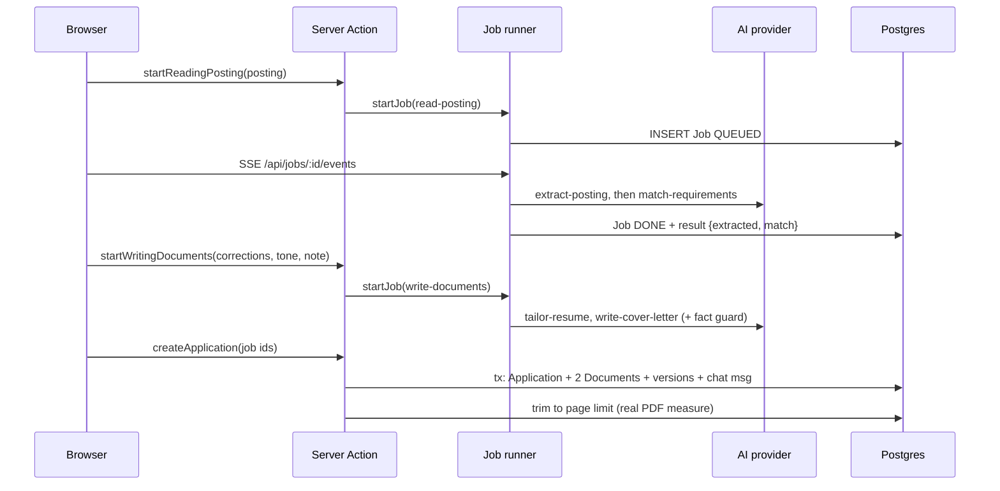
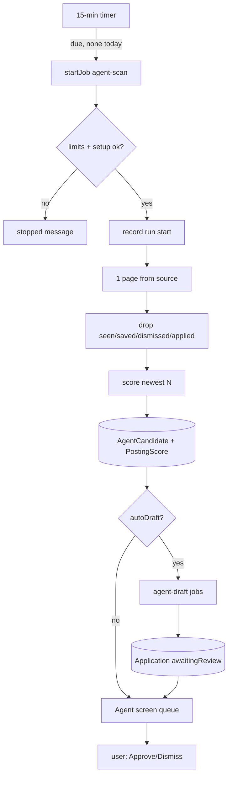
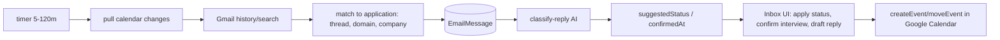

# PROJECT DOSSIER: Architecture and Reuse Analysis of `dossier` (v1.11.0)

Analyst role: Senior Software Architect, read-only. Subject: `C:\Projects\project_rho\dossier` (git HEAD `57097fc "Dossier 1.11.0"`, 25 commits, authors `Alien <[email omitted]>` x24 and `Ali Hassan` x1).
Method: source files were read directly (Read/Grep/Glob and read-only shell). Nothing was installed, built, migrated or executed. The graphify report (`research/dossier/graphify-out/GRAPH_REPORT.md`) was used only for navigation. README/DEVELOPMENT.md were used as maps, and every claim below was traced into code unless marked otherwise.

**Labels.** `[F]` FACT (verified in source; path given, relative to the `dossier/` repo root). `[A]` ASSUMPTION (reasonable inference, not verified). `[R]` RECOMMENDATION. Feature status: IMPLEMENTED / PARTIAL / PLANNED.
**Not verifiable here.** Nothing was executed, so runtime behaviour, test pass/fail state, coverage figures, and the generated Prisma client (`src/generated/prisma`, git-ignored, absent) are unverified. No `node_modules` exist, so dependency licenses cannot be read from installed packages.

---

## 1. Project overview

**Problem.** [F] Dossier is a self-hosted, single-user job-search workbench: one profile, a tailored resume and cover letter per job, and application tracking from draft to offer (`package.json` name `dossier.aien.me`, `README.md` intro; behaviour traced in sections 6 and 10).
**Users.** [F] Exactly one human per install. There are no user accounts: one password hash in an env var (`src/lib/env.ts`, `src/lib/auth/session.ts`). [F] The data model has no `User` table and no per-row owner column (`prisma/schema.prisma`).
**Core value loop** [F]:
1. Maintain a profile (`ProfileField`, `Experience`, `Skill`, ... tables).
2. Find a posting (Find jobs search, Startups, a daily job agent, a pasted text/URL, or Claude chat via MCP).
3. A background job reads the posting (`extract-posting`), matches requirements to the profile (`match-requirements`), then writes resume + cover letter (`tailor-resume`, `write-cover-letter`) in "strict" mode with a fact guard (`src/lib/ai/fact-guard.ts`).
4. Refine via chat, edit units, undo, and print PDFs via headless Chromium.
5. Track status, optionally send through Gmail, read replies, and sync interviews to Google Calendar.
**Maturity signals.** [F] 34 Prisma migrations (27 Sep to 30 Oct 2026), ~220 test files, 25 Playwright specs, CI with coverage ratchet (`vitest.config.mts`, `.github/workflows/ci.yml`). [A] The date stamps are in the repo's own 2026 timeline.

---

## 2. Directory structure

```
dossier/
  package.json, yarn.lock, .yarnrc.yml        Yarn 4.18.1 (corepack), Node 24 in Docker
  next.config.ts, tsconfig.json, eslint.config.mjs, postcss.config.mjs
  prisma/ schema.prisma (937 lines), migrations/ (34), seed.ts, seed/{built-ins,demo}.ts
  prisma7.config.ts                            Prisma 7 config (see 19, anomaly #1)
  src/
    proxy.ts                                   Next 16 "proxy" (ex-middleware): login redirect + CSP nonce
    instrumentation.ts                         register(): env check + start all in-process timers
    app/
      layout.tsx, globals.css, login/, oauth/authorize/, print/, dev/
      (app)/                                   signed-in shell: layout.tsx + 12 route groups
        page.tsx (dashboard), profile/, resume/, jobs/, startups/, agent/,
        applications/[id]/, new/, inbox/, settings/
      api/                                     16 route.ts files (see 8)
    components/ (ui/ primitives, documents/ resume+letter renderers, email/)
    hooks/ use-job.ts, use-autosave.ts
    lib/                                       ~all business logic (34k lines incl. tests)
      ai/ (provider.ts, providers/, tasks/, fact-guard.ts, config.ts)
      job-search/ (4 adapters + index/cache/http/config/sources)
      jobs/ (runner.ts + 13 job definitions)   agent/  scoring/  google/  connector/
      startups/  pdf/  auth/                   themes.ts  profile.ts  settings.ts ...
    fonts/ (20 OFL families, WOFF2 + OFL.txt)  test/ (db helpers)
  e2e/ 25 *.spec.ts + fake-ai/jobs/google servers
  docker/ start.sh, studio-proxy.mjs, bin/yarn
  Dockerfile, compose.yml, compose.production.yml, captain-definition
  .github/ workflows (ci, release, pages), ISSUE_TEMPLATE, images
  site/ static marketing site (HTML/CSS/JS)   scripts/hash-password.ts
  LICENSE, PRIVACY.md, SECURITY.md, CONTRIBUTING.md, DEVELOPMENT.md, README.md
```
[F] All of the above verified by Glob/`find`. [F] `src/generated/prisma` is git-ignored (`.gitignore:50`) and produced by `prisma generate` (`Dockerfile` dev CMD and build stage).

---

## 3. Technology stack

| Layer | Choice | Evidence |
|---|---|---|
| Language | TypeScript (strict-style, zod-validated boundaries), CSS Modules + Tailwind 4 | `tsconfig.json`, `package.json` |
| Runtime | Node 24 (`node:24-trixie-slim`), Debian (not Alpine) because Playwright Chromium needs glibc | `Dockerfile:3-5` |
| Framework | Next.js `16.4.3` App Router, React `19.3.1`, `output: "standalone"` | `package.json`, `next.config.ts` |
| DB | PostgreSQL 18 (`postgres:18-alpine`), Prisma `^7.10.1` with `@prisma/adapter-pg`, `citext` extension | `compose.yml`, `src/lib/prisma.ts`, migration `20260927203329_profile_schema` |
| Validation | `zod ^4.6.5` everywhere (env, actions, JSON columns, AI outputs, provider payloads) | `src/lib/env.ts`, `src/lib/application-data.ts` |
| Auth crypto | `jose ^6.2.13` (JWE session, HS256 JWTs); Node `crypto.argon2`, HKDF, AES-256-GCM | `src/lib/auth/session.ts`, `password-hash.ts`, `keys.ts`, `secrets.ts` |
| AI SDKs | `@anthropic-ai/sdk ^1.3.0`, `openai ^7.43.0`, `ollama ^0.6.4` | `package.json`, `src/lib/ai/providers/*` |
| MCP | `@modelcontextprotocol/server ^2.4.0` | `src/app/api/mcp/route.ts` |
| PDF | `playwright-core ^1.64.1` (headless Chromium shell) | `src/lib/pdf/render.ts` |
| Parsing | `unpdf ^1.9.1`, `mammoth ^1.13.0`, `node-html-parser ^9.0.5`, `fflate ^0.8.3` (zip) | `src/lib/resume-text.ts`, `posting-fetch.ts`, `jobs/zip-pdfs.ts` |
| UI libs | `radix-ui ^1.8.1`, `lucide-react ^1.61.0`, `@dnd-kit/{core ^6.3.1, sortable ^10.0.0, utilities ^3.2.2}` | `package.json`, `src/components/ui/*` |
| Test | `vitest ^5.0.5` (+ `@vitest/coverage-v8`), `@playwright/test 1.64.1`, `@axe-core/playwright ^4.14.0`, Testing Library (`dom ^10.4.2`, `react ^16.3.3`, `jest-dom ^7.0.1`, `user-event ^14.6.8`), `jsdom ^30.1.3` | `package.json`, `vitest.config.mts` |
| Build/dev | `vite ^8.3.5`, `@vitejs/plugin-react ^6.1.2`, `esbuild 0.28.2`, `tsx ^4.23.15`, `eslint ^9` + `eslint-config-next 16.4.3`, `typescript ^5`, `tailwindcss ^4`, `@tailwindcss/postcss ^4`, `dotenv ^18.0.9`, `pg ^8.23.1`, `@types/{node ^24,react ^19,react-dom ^19,pg ^8.16.0,jsdom ^30}` | `package.json` |
| Pinned override | `resolutions: mysql2@npm:3.15.3 -> 3.24.4` (Prisma CLI ships it; never loaded) | `package.json`, `SECURITY.md` |

[F] `package.json` `version` is `1.11.0`, `license` is `AGPL-3.0-only`, `private: true`, `packageManager: yarn@4.18.1`.
[F] No state libraries (no Redux/Zustand/SWR/React Query); verified by grep of `package.json`.
[A] Several dependency versions (Next 16.4, React 19.3, Prisma 7.10, Vitest 5, Vite 8, Claude "Sonnet 5") postdate my training data. They were taken verbatim from the manifest.

---

## 4. System architecture

**Shape.** [F] A single Node process (Next.js standalone server) + one PostgreSQL. No queue broker, no cache server, no worker container. All background work runs in the web process:

```mermaid
flowchart LR
  B[Browser<br/>React 19 client comps] -->|Server Actions action()<br/>fetch route() handlers<br/>SSE /api/jobs/:id/events| N
  subgraph N[Next.js 16 standalone server one process]
    P[proxy.ts<br/>session + CSP nonce]
    SA[Server Actions 144]
    RH[Route handlers 16]
    JR[Job runner<br/>in-memory queue]
    TM[Timers: job sweep 15m, backups 03:00,<br/>inbox 5-120m, agent 15m, startups 1h]
    PDF[Chromium pool max 2]
    MCP[/api/mcp + OAuth AS/]
  end
  N --> DB[(PostgreSQL 18)]
  JR --> AI[AI provider<br/>Ollama LM Studio OpenAI-compat Anthropic Mistral]
  N --> JS[Job sources: JSearch Adzuna BA FreeHire]
  N --> G[Google: OAuth Gmail Calendar]
  N --> HN[HN API / startup sites]
  N --> TS[TypeSafe Jev]
  N --> GH[GitHub releases / telemetry]
  C[Claude / MCP clients] -->|Bearer JWT| MCP
```

Key architectural properties:
- [F] **Single instance by design**: the job queue, search cache, held PDFs, Google access-token cache, and all timers live in module/`globalThis` state (`src/lib/jobs/runner.ts`, `job-search/cache.ts`, `pdf/downloads.ts`, `google/account.ts`, `agent/schedule.ts`). `DEVELOPMENT.md` and code comments say "run a single instance".
- [F] **Data-validated JSON columns**: Prisma `Json` columns are parsed through zod schemas on read (`src/lib/application-data.ts`).
- [F] **Config precedence**: DB `Setting` rows (saved in UI) override `DOSSIER_*` env vars, which override defaults (`ai/config.ts: resolveAiConfig`, `job-search/config.ts`, `scoring/config.ts`, `google/oauth.ts: resolveGoogleClient`).
- [F] **Test seams in production code**: `DOSSIER_*_TEST_BASE_URL` env vars redirect job sources, Google, GitHub, telemetry and TypeSafe to fakes (`src/lib/env.ts`, `google/endpoints.ts`, `job-search/config.ts: requestContext`).
- [F] **Layering**: UI pages call `src/lib/*-data.ts` loaders (server) -> Prisma; mutations go through `action()`/`route()` wrappers -> domain modules; long AI tasks go through `startJob()`.

---

## 5. Frontend architecture

- [F] **Routing**: Next App Router. Public: `/login`. Signed-in group `src/app/(app)/` with a shared shell (`layout.tsx`: sidebar, skip link, `verifySession()`, `after()` hooks for usage ping + update check + time-zone memory). Screens: `/` dashboard, `/profile` (+`/profile/import`), `/resume`, `/jobs`, `/startups`, `/agent`, `/applications`, `/applications/[id]`, `/new`, `/inbox`, `/settings`. `/calendar` redirects to `/` (`next.config.ts`). Print pages `/print/base`, `/print/[doc]/[id]`; `oauth/authorize` consent page; dev-only galleries `/dev/*` (return 404 in production: `src/app/dev/ui/page.tsx`).
- [F] **Nav** is data-driven from `src/lib/nav.ts` (`NAV`, `currentSection`).
- [F] **Rendering model**: every page renders per request (`await connection()` in `app/layout.tsx`) because each response needs a CSP nonce. Server components load data; each screen has `loading.tsx`/`error.tsx` siblings. 113 files are `"use client"` out of 170 non-test `.tsx`.
- [F] **Components**: `components/ui/*` (button, card, checkbox, chip, confirm-dialog, dropdown-menu, field, input, progress-steps, segmented-control, select, status-dot, stepper, tabs, textarea, toggle) built on Radix primitives + `cn()` (136 graph edges, most-connected node). Documents: `components/documents/{resume-document,cover-letter-document,document-preview,download-pdf-button,tailored-documents}.tsx` rendered identically in preview and print (print uses `printCss` from `lib/themes.ts`). The funnel chart is hand-rolled SVG (`funnel-chart.tsx`); `activity-chart.tsx` was not inspected for its rendering method [A: also custom, no chart library in `package.json`].
- [F] **State management**: no global client store. Patterns: (a) server state via Server Action results + `revalidatePath`; (b) `useJob` (`hooks/use-job.ts`) follows background jobs by SSE with polling fallback (1.5 s); (c) `useAutosave`/`createAutosaver` (`hooks/use-autosave.ts`) debounced single-flight autosave with one retry; (d) toast singleton (`components/toast.tsx`; `toastResult()` unwraps `ActionResult`); (e) new-application draft in `sessionStorage` (`app/(app)/new/draft-store.ts`); (f) UI prefs in cookies (`lib/ui-preferences.ts`, color scheme + sidebar); (g) drag-and-drop board/reorder with dnd-kit (`applications/board.tsx`, `profile/entry-list.tsx`).
- [F] **Accessibility is tested**: `e2e/accessibility.spec.ts` runs axe (WCAG 2.2 AA, no serious/critical) on every screen + menus, and checks focus (`DEVELOPMENT.md`; spec exists).
- [F] **Fonts**: `next/font/local` in `src/fonts/index.ts`; 20 WOFF2 families incl. script fallbacks (Arabic, Devanagari, JP, KR, SC, Greek) per `src/fonts/README.md`.

---

## 6. Backend architecture

**Server Actions** [F]: 144 `action(schema, handler)` exports across 20 `actions.ts` files + `src/lib/{application-actions,fact-actions,status-actions,update-actions}.ts`, `src/lib/google/actions.ts`, `src/lib/jobs/actions.ts`. `action()` (`src/lib/action.ts`) does: session check -> zod parse -> handler -> typed `ActionResult` (`{ok,data,toast?}|{ok:false,error,fieldErrors?}`); `ActionError` is user-visible; any other error is logged via `logServerError` (first message line + stack only) and replaced by a generic message; `redirect()/notFound()` are rethrown with `unstable_rethrow`. `publicAction()` is only used for sign-in.
**Route handlers** [F]: wrapped in `route()` (`src/lib/route.ts`): same-origin check (`Sec-Fetch-Site`, `Origin` vs forwarded host), session check (401), generic 500, default `Cache-Control: private, no-store`. Exceptions are whitelisted in `src/lib/session-audit.test.ts` (health, Google callback, MCP, 4 OAuth routes).
**Background jobs** [F] (`src/lib/jobs/runner.ts`): `defineJob({type,input,result,run})` registers a handler; `startJob()` inserts a `Job` row (zod-validated input) and enqueues its id; `pump()` runs up to 1 job at a time for local providers or 3 for hosted (`LOCAL_CONCURRENCY=1`, `HOSTED_CONCURRENCY=3`, decided via `providerOption(...).local`); `step()` writes `Job.step` and notifies SSE listeners; `AbortController` per job for cancel; `retryJob`, `cancelJob`, `cancelApplicationJobs`; `recoverInterruptedJobs()` marks leftover QUEUED/RUNNING as FAILED at boot (`instrumentation.ts`). Job types registered in `jobs/definitions.ts`: `read-posting`, `write-documents`, `regenerate-unit`, `refine`, `write-email`, `zip-pdfs`, `import-profile`, `draft-reply`, `agent-scan`, `agent-draft`, `posting-score`, `startups-refresh`, `connector-draft`. Retention: `jobs/retention.ts` sweeps finished jobs every 15 min according to `jobRetentionHours` (1h/24h/7d/30d; default 24h), also expired zips and `ClaudePaste` rows.
**Schedulers** (all started from `src/instrumentation.ts: register()` under `NEXT_RUNTIME==="nodejs"`) [F]:
| Timer | File | Cadence / rule |
|---|---|---|
| Job sweep | `jobs/retention.ts` | every 15 min, `unref()`'d |
| Nightly backup | `backup-schedule.ts` | 03:00 server time (`HOUR=3`), prune by `DOSSIER_BACKUP_RETENTION_DAYS` |
| Inbox/calendar check | `google/sync.ts: startInboxSchedule` | `setTimeout` chain, `gmailInterval` 5-120 min (default 10); pulls calendar changes first, then Gmail if `gmailRead` |
| Job agent | `agent/schedule.ts` | checks every 15 min; starts day's run once `agentHour` (default 7) in user's zone and no run today; resets `DRAFTING` candidates at boot |
| Startups refresh | `startups/schedule.ts` | hourly check; only after a manual refresh and screen opened within 14 days; ~22 h min age |
**Other server modules** [F]: `src/lib/env.ts` (zod-validated env behind a lazy `Proxy`; process exits on invalid config in `checkEnvOnStartup`); `prisma.ts` (lazy Proxy singleton on `globalThis`); `settings.ts`/`settings-data.ts` (KV settings with zod defaults via `.catch`); `profile.ts`/`profile-data.ts` (KV basics + typed entries); `data-export.ts`/`data-import.ts`/`backups.ts`; `pdf/*`; `time-zone.ts`; `log.ts`.

---

## 7. Database architecture

PostgreSQL via Prisma 7 (`prisma/schema.prisma`, generator `prisma-client` output `../src/generated/prisma`, datasource `postgresql` with the URL supplied by the config file). [F] The `citext` extension is created in migration 1.

**Conventions** [F] (schema header): profile basics and settings are key-value tables, so new fields need no migration; user-editable text fields are non-null defaulting to `""`; `sort` orders list entries.

### Enums (all [F])
`LanguageLevel`(NATIVE,C2,C1,B2,B1,A2,A1) · `ThemeFont`(15: NEWSREADER,GARAMOND,SOURCE_SERIF,LORA,LIBRE_CASLON,PLAYFAIR,FRAUNCES,GEIST,PLEX_SANS,INTER,MANROPE,WORK_SANS,SPACE_GROTESK,PLEX_MONO,JETBRAINS_MONO) · `ThemeLayout`(SINGLE,SIDE_HEADINGS,SPLIT,SPLIT_END) · `ThemeAlign`(LEFT,CENTER) · `HeadingStyle`(RULE,CAPS,PLAIN,BAR,BAND) · `HeaderStyle`(PLAIN,BANNER) · `SidebarStyle`(PLAIN,TINTED) · `DateStyle`(INLINE,TIMELINE) · `PhotoShape`(CIRCLE,ROUNDED,SQUARE,PORTRAIT) · `PhotoPosition`(HEADER_END,HEADER_START,ABOVE_NAME,SIDEBAR) · `Density`(COMPACT,REGULAR,AIRY) · `AiProvider`(LOCAL,OPENAI,ANTHROPIC,MISTRAL,LMSTUDIO) · `Creativity`(FAITHFUL,BALANCED,EXPRESSIVE) · `PaperSize`(A4,LETTER) · `DateFormat`(DAY_MONTH_YEAR,MONTH_DAY_YEAR,NUMERIC) · `Tone`(WARM,DIRECT,FORMAL) · `ApplicationStatus`(DRAFT,SENT,SCREENING,INTERVIEW,OFFER,ACCEPTED,REJECTED,DECLINED) · `ApplicationOrigin`(MANUAL,AGENT) · `AgentCandidateStatus`(SCORED,DRAFTING,DRAFTED,APPROVED,DISMISSED) · `FunnelStage`(SENT,SCREENING,INTERVIEW,OFFER,ACCEPTED) · `DocumentKind`(RESUME,COVER_LETTER,EMAIL) · `VersionCause`(WRITTEN,TRIMMED,REGENERATED,REFINED,UNDONE,BEFORE_RESTORE,RESTORED) · `ChatRole`(USER,AI) · `PostingSource`(JSEARCH,ADZUNA,ARBEITSAGENTUR,FREEHIRE) · `StartupStatus`(NEW,SAVED,CONTACTED,DISMISSED) · `EmailDirection`(OUTGOING,INCOMING) · `ReplyKind`(REJECTION,INTERVIEW,QUESTION,OFFER,ACKNOWLEDGEMENT,OTHER) · `JobStatus`(QUEUED,RUNNING,DONE,FAILED).

### Models (30, all [F])
**Profile**
- `ProfileField` `{key @id, value, updatedAt}`: KV for basics + `showAge`, `photo` (data URL), `photoOnResumes` (`lib/profile.ts`, `lib/photo.ts`).
- `Skill` `{id cuid, name @unique citext, sort, group "", createdAt}` -> `ExperienceSkill[]`, `ProjectSkill[]`.
- `Language` `{id, name @unique citext, level LanguageLevel, sort, createdAt}`.
- `Experience` `{id, role, company, location, descriptor, startYear?, startMonth?, endYear?, endMonth?, current, bullets (newline-separated), sort, createdAt, updatedAt}` -> `ExperienceSkill`.
- `ExperienceSkill` `{experienceId, skillId}` composite PK, both FKs `onDelete: Cascade`, `@@index([skillId])`.
- `Project` (same shape as Experience minus role/company/location/descriptor, plus `name`, `link`) -> `ProjectSkill` (composite PK, cascades).
- `Education` `{id, degree, school, dates..., current, notes, sort, ...}`.
- `Publication` `{id, citation (markdown-ish **bold**/*italic*), link, onResumes default true, sort, ...}`.
- `Reference` `{id, name, relation, company, email, phone, sort, ...}`.
- `Fact` `{id, applicationId? -> Application (Cascade), text, sort, ...}` `@@index([applicationId, sort])`; null applicationId = profile-level "Facts about me".
**Themes/settings**
- `Theme` `{id (cuid or built-in slug), builtIn, name, headFont, bodyFont, accent "#rrggbb", layout, align, headingStyle, density, headerStyle, sidebarStyle, dateStyle, photoShape, photoPosition, createdAt, updatedAt}` -> `Document[]`. A DB trigger `Theme_prevent_builtin_delete` blocks deleting built-ins (migration `20260927204812`).
- `Setting` `{key @id, value, updatedAt}`: all settings (typed by `settingsSchema` in `lib/settings.ts`).
**Applications**
- `Application` `{id, origin, agentScore?, awaitingReview, title, company, role, location, mode, salary, deadline? @db.Date, postingUrl, postingText, extracted Json?, extractedWith?, match Json?, matchedWith?, status @default DRAFT, furthestStage?, sentAt?, nextInterviewAt?, tone, language, followThemeLayout, showPhoto?, archivedAt?, emailThreadId?, interviewEventId?, interviewCalendarId?, createdAt, updatedAt}`; relations: `posting? Posting`, `agentCandidate? AgentCandidate`, `startup? Startup`, `emails EmailMessage[]`, `events StatusEvent[]`, `documents Document[]`, `messages ChatMessage[]`, `notes Note[]`, `facts Fact[]`, `jobs Job[]`; indexes `[status]`, `[updatedAt]`.
- `StatusEvent` `{id, applicationId (Cascade), from, to, at, previousFurthestStage?, previousSentAt?}` `@@index([applicationId, at])` (stores what is needed to undo).
- `Document` `{id, applicationId (Cascade), kind, units Json, themeId? (SetNull), writtenWith?, trimmed Json?, versions[], updatedAt}` `@@unique([applicationId, kind])`.
- `DocumentVersion` `{id, documentId (Cascade), units Json, cause, detail, createdAt}` `@@index([documentId, createdAt])`.
- `ChatMessage` `{id, applicationId (Cascade), role, text, targetUnit?, edits Json?, undone, previousTone?, writtenWith?, createdAt}`.
- `Note` `{id, applicationId (Cascade), body, createdAt, updatedAt}`.
**Job discovery**
- `Posting` `{id, source, externalId, title, company, place, remote?, salary, postedAt?, url, via, description, complete, savedAt?, dismissedAt?, applicationId? @unique (SetNull), ...}` `@@unique([source, externalId])`, indexes on `savedAt`, `dismissedAt`.
- `PostingScore` `{source, externalId, score, reasons Json, redFlags Json, scoredWith, ...}` PK `(source, externalId)`.
- `PostingSearch` `{id, source, query Json, postings Json, found, next?, ...}` `@@index([createdAt])`: past searches with results (so reopening costs no quota).
- `AgentCandidate` `{id, source, externalId, title..., description, complete, score, reasons Json?, redFlags Json?, status, error?, applicationId? @unique (SetNull), dedupeKey @unique, ...}` `@@unique([source, externalId])`, `@@index([status, score])`.
- `Startup` `{id, source "YC"|"HN" (String), externalId, company, website, summary, details, location, remote?, stage, roles Json, emails Json, links Json, postedAt?, score, reasons Json, scoredWith, status, noApplicationsFrom, emailsCheckedAt?, peopleCheckedAt?, notes, seenAt, applicationId? @unique (SetNull)}` `@@unique([source, externalId])`, `@@index([status, score])`.
- `StartupBlock` `{hash @id, createdAt}`: SHA-256 of "removed for good" startups.
- `ClaudePaste` `{id uuid, text, url, expiresAt, createdAt}` (14-day handoff store for MCP).
**Google**
- `GoogleAccount` `{id "google" default, email, refreshTokenEnc, scopes, historyId?, lastSyncAt?, syncProblem?}`: at most one row.
- `EmailMessage` `{id, gmailId @unique, threadId, applicationId? (Cascade), direction, fromName/fromAddress/toAddress/subject/messageId/body, sentAt, kind?, summary, questions Json?, suggestedStatus?, confirmedAt?, classifiedWith?, replyDraft, replyGaps Json?, draftedWith?, handledAt?, dismissedAt?, createdAt}` indexes `[threadId]`, `[applicationId, sentAt]`, `[sentAt]`.
**Auth/Jobs**
- `LoginThrottle` `{key @id (IP or "*"), failures, windowStart, blockedUntil?, updatedAt}` `@@index([updatedAt])`.
- `Job` `{id, type, key?, applicationId? (Cascade), status, step?, input Json, result Json?, error?, createdAt, startedAt?, finishedAt?, updatedAt}` indexes `[key, createdAt]`, `[status]`, `[applicationId]`.

### Migrations [F]
34 folders `prisma/migrations/20260927...` to `20261030193609_skill_group`, `migration_lock.toml`. Notable: `profile_schema` (citext, Skill/Language/Experience), `theme_settings_schema` (built-in-theme delete trigger), `application_schema`, `login_throttle`, `job_table`, `key_value_profile_settings` (drops `Profile` and `Settings` tables; replaces with `ProfileField`/`Setting`), `document_versions`, `theme_styles`, `job_search_postings/_runs`, `google_integration`, `projects`, `job_agent`, `ai_provider_mistral/_lmstudio`, `posting_scores`, `facts`, `publications`, `profile_photo`, `startups`, `claude_pastes`, `experience_descriptor`, `freehire_source`, `skill_group`.
[F] Seeds: `prisma/seed.ts` + `prisma/seed/built-ins.ts` upsert `BUILT_IN_THEMES` (`src/lib/themes.ts`) idempotently at every start; `--demo [--reset]` loads sample data.
[F] No `User`/tenant column anywhere; there is no row-level security. Cascades: deleting an `Application` removes its documents, versions, chat, notes, facts, jobs and emails; `Posting`, `AgentCandidate`, `Startup` links go `SetNull`.
[A] README says "twelve themes"; `BUILT_IN_THEMES` was not enumerated in this analysis (`DEVELOPMENT.md` says six; stale doc).

---

## 8. API architecture

**Route handlers** (16 `route.ts`; [F] all under `src/app/api/`):
| Route | Method | Guard | Purpose |
|---|---|---|---|
| `/api/health` | GET | open (proxy skips it) | `SELECT 1` with 3 s timeout, returns `{status,version,db}` 200/503 |
| `/api/export` | GET | `route()` | full JSON export (`lib/data-export.ts`, `EXPORT_SCHEMA_VERSION=7`) |
| `/api/import` | POST | `route()`, 10 MB cap (`lib/import-limits.ts`) | `?preview=1` dry-run; else cancels unfinished jobs, writes `before-import` backup, replaces all data in one transaction |
| `/api/profile/import` | POST | `route()`, 5 MB | resume bytes -> text (`resume-text.ts`) -> `import-profile` job |
| `/api/pdf` | GET/POST | `route()` | `?doc=base|resume|letter&application=id`; POST holds PDF 5 min and returns `{url:/api/pdf/<uuid>}` |
| `/api/pdf/[id]` | GET | `route()` | fetch held PDF |
| `/api/downloads/[id]` | GET | `route()` | one-shot "all PDFs" zip, deletes file after |
| `/api/jobs/[id]` | GET | `route()` | job view (polling fallback) |
| `/api/jobs/[id]/events` | GET | `route()` | SSE: job state on every change, 15 s heartbeat, `x-accel-buffering: no` |
| `/api/google/connect` | GET | `route()` | builds Google consent URL with signed `state` |
| `/api/google/callback` | GET | custom (session + signed state) | code exchange, stores encrypted refresh token |
| `/api/mcp` | POST/GET/DELETE | Bearer JWT (`verifyAccessToken`), 404 when connector off | MCP Streamable HTTP server |
| `/api/oauth/metadata` | GET | open, 404 when off | RFC 8414; reachable also via rewrite `/.well-known/oauth-authorization-server` |
| `/api/oauth/protected-resource` | GET | open, 404 when off | RFC 9728 |
| `/api/oauth/register` | POST | open, 404 when off | RFC 7591 dynamic client registration |
| `/api/oauth/token` | POST | open, 404 when off | `authorization_code` + `refresh_token` |

**Server Actions** [F] (144; grouped): applications (`status-actions: setStatus/undoStatus`; `applications/[id]/actions.ts`: saveUnit, sendMessage, startRegenerating, startWritingEmail, restoreVersion, notes, interview date, theme, put-back trimmed...), new application (`new/actions.ts`: fetchPostingText, startReadingPosting, startWritingDocuments, createApplication, handOffToClaude), profile (~45: CRUD/reorder/restore for each entity, photo, import apply/discard, skill groups), jobs (`jobs/actions.ts`: runJobSearch, showMorePostings, save/dismiss/restore, startScoringPosting, startApplicationFrom, loadFullText, acceptArbeitsagenturNote), agent (`agent/actions.ts`: runAgentNow, prepare/approve/dismiss/restore, saveAgentSettings), startups, settings (~16: AI provider/key, job source/key, scorer, TypeSafe key, connector on/off, redirects, updateSettings, deleteEverything, zip PDFs, checkUpdates), google (`lib/google/actions.ts`: saveGoogleClient/Settings, sendWithGmail, checkInbox, rereadEmail, startDraftingReply, sendReplyEmail, applySuggestedStatus, confirmInterview, linkEmail, loadFreeSlots, dismissEmail, markHandled), jobs (`retry`, `cancel`), login (`signIn`, `signInWithForm`), `signOut`, `answerConnector` (OAuth consent).
[F] `src/lib/session-audit.test.ts` asserts every `"use server"` export is wrapped in `action()` (except signIn/signInWithForm/signOut) and all routes use `route()` except the whitelist.
[F] Server Action request body is 1 MB (Next default), hence large uploads use route handlers (`DEVELOPMENT.md`; photos capped at 700k chars in `lib/photo.ts`).

**MCP tools** [F] (`src/lib/connector/tools.ts`, `registerTool` x11): `get_profile`, `search_jobs`, `more_jobs`, `save_job_scores`, `list_applications`, `get_application`, `get_posting`, `save_application`, `draft_application`, `check_draft`, `set_application_status`. No delete/archive/send tools. Server instructions tell Claude to write drafts itself and never invent facts.

---

## 9. Authentication & authorization

**Model** [F]: single user, single shared password, no accounts or roles.
- **Password**: `DOSSIER_PASSWORD` holds an argon2id hash in a custom `$`-free format `argon2id:m=19456,t=2,p=1:<salt>:<hash>` (`lib/auth/password-hash.ts`; parse rejects memory >256 MiB). `env.ts` refuses to boot if it is not a hash or `DOSSIER_SECRET` < 32 chars. Hash generated by `scripts/hash-password.ts` (bundled as `hash-password` in the image).
- **Session**: stateless JWE (`alg: dir`, `enc: A256GCM`) in cookie `dossier_session`, key = HKDF(`DOSSIER_SECRET`, purpose `session`); claims `persistent`, `pwd` = HMAC fingerprint of the password hash; lifetime 24 h (browser session) or 30 d ("Keep me signed in"); HttpOnly, SameSite=Lax, `Secure` if `x-forwarded-proto=https` (`lib/auth/session.ts`). Changing the password or secret invalidates all sessions.
- **Enforcement layers**: (1) `src/proxy.ts` optimistic check + login redirect (exempts `/login`, connector/OAuth paths, Server Actions with `next-action` header, `/print/*` with a valid print token); (2) `verifySession()` in layouts/pages; (3) `action()`/`route()`; (4) print pages use `verifyPrintAccess` (`lib/pdf/print-access.ts`): short-lived (60 s) path-bound HS256 JWT in header `x-dossier-print-token` for headless Chromium.
- **Brute force**: `LoginThrottle` in Postgres: 5 failures/min/IP then 30 s doubling to 15 min; global backstop 30 failures/10 min (`lib/auth/throttle.ts`, `login-throttle.ts`); IP = last `X-Forwarded-For` entry (`client-ip.ts`).
- **Google OAuth connector** [F]: standard auth-code flow for a "web application" client entered in Settings (secret stored AES-GCM, key purpose `google-client-secret-encryption`) or `DOSSIER_GOOGLE_CLIENT_ID/SECRET`. Scopes by feature group (`google/oauth.ts: SCOPES`): `openid email`; `gmail.send`; `gmail.readonly`; `calendar.freebusy` + `calendar.events`. `access_type=offline`, `prompt=consent`, `include_granted_scopes`. State is a 10-minute HS256 JWT carrying `returnTo`. Refresh token encrypted (`GOOGLE_TOKEN` kind). Access tokens cached in memory only; 401 evicts the cache. The ID token's `email` is read without signature check (justified in a code comment: direct TLS response from the token endpoint).
- **MCP OAuth** [F] (`lib/connector/oauth.ts`): a minimal OAuth 2.1 authorization server inside the app. DCR client ids are signed JWTs (no DB); PKCE S256 only; public clients (`token_endpoint_auth_method: none`); redirect URIs restricted to Claude's hosted callbacks, loopback `http://localhost|127.0.0.1/.../callback`, or addresses the operator adds in Settings (`connectorRedirects`, validated by `redirectProblem`). Access tokens 1 h, refresh 30 d, auth codes 5 min; every token carries `pwd` fingerprint + `gen` (= `connectorEnabledAt`), so changing password/secret, "Disconnect apps", or toggling the connector revokes everything. Consent screen is a normal signed-in page (`app/oauth/authorize`, `answerConnector`). Endpoints answer 404 while connector is off. Single scope `dossier`.
- **Multi-user?** [F] Not supported: no user table, global `Setting` rows, a single `GoogleAccount` (`id` default `"google"`), global in-process queue. [R] Multi-user would require a tenant/user column on all ~30 tables, per-user settings and secrets, and rework of the in-process singletons (see 19).

---

## 10. Important modules and core business logic

### 10.1 Job-search providers (`src/lib/job-search/`)
[F] Strategy pattern: `adapter.ts` `JobSourceAdapter<S>` with `search(query, credentials, next, ctx)`, `details(posting, ...)`, `test(...)`. `index.ts` registers `JSEARCH, ADZUNA, ARBEITSAGENTUR, FREEHIRE`, checks `sourceCovers(source, country)`, caches pages in memory 30 min (max 200, FIFO eviction, `cache.ts`), and logs only `changed|unavailable` problems (never the search). Cursor tokens are opaque strings (`cursor:`, `page:`, `offset:`). All adapters share `requestJson` (`http.ts`): 10 s timeout, 5 MB cap, status->problem mapping (401/403 `key`, 429 `quota`, 5xx `unavailable`, other 4xx/parse `changed`). Every adapter validates provider payloads with forgiving zod (`maybeText = z.string().nullish().catch(null)`) so one bad field never drops a posting, truncates lengths, and filters links to http(s) via `safeLink`.
| Source | File | Details |
|---|---|---|
| JSearch | `jsearch.ts` | OpenWeb Ninja (`api.openwebninja.com/jsearch`, header `x-api-key`) or RapidAPI host; `/search-v2`, cursor paging, 45 s timeout, free plan 200/mo; place appended to query text (`"X in Y"`); radius param; prefers direct apply link; descriptions complete |
| Adzuna | `adzuna.ts` | `api.adzuna.com/v1/api/jobs/{country}/search/{page}` with `app_id`/`app_key`, 19 countries (`SOURCE_INFO`), 20/page; description only a snippet (`complete:false`) so `details()` fetches the posting page through the SSRF-guarded fetcher; currency inferred from country; attribution "Jobs by Adzuna" with locale link rule |
| Arbeitsagentur | `arbeitsagentur.ts` | `rest.arbeitsagentur.de/jobboerse/jobsuche-service/pc/v6/jobs` + `v4/jobdetails/<base64 id>`, static public header `X-API-Key: jobboerse-jobsuche`; DE only; 25/page; unofficial: needs per-install "I understand" (`arbeitsagenturAcceptedAt`) and can be disabled server-wide (`DOSSIER_JOBS_ARBEITSAGENTUR=off`); excluded from the job agent (`agentSetupProblem`); 403 on key is remapped to `changed` |
| FreeHire | `freehire.ts` | `freehire.me/api/v1/agent/jobs/search` (self-host override via `DOSSIER_FREEHIRE_URL`), no key, full text descriptions, offset paging, 10,000-result ceiling, no radius |
[F] Credentials resolve in `config.ts: credentialsFor` (per-source encrypted keys via `JOB_SOURCE_KEY`; each key only ever goes to its own source). `find.ts` provides `askSource` and `fullText` for the UI/agent/connector. `posting-searches.ts` persists searches; `postings.ts` persists only saved/dismissed/applied postings.

### 10.2 Scoring (`src/lib/scoring/`, `ai/tasks/score-posting.ts`)
[F] Two interchangeable `PostingScorer`s selected by `loadPostingScorer()`: (a) **AI** `score-posting@2`: JSON `{score, reasons[<=4], redFlags[<=3]}`, `creativity FAITHFUL`, `effort low`, rubric 85-100/70-84/50-69/<50, seniority-gap penalty, years of experience precomputed in code (`experienceMonths`); `scoreFrom()` clamps and trims; (b) **Jev** (TypeSafe System One API `api.typesafe.ai`, model `jev-latest`): one request of typed questions (3 Score, 3 Noul, plus per-posting-line `choice` and `noul`), code computes the weighted score (`JEV_WEIGHTS`) and builds "Covers:/Missing:" reasons from the posting's own lines (`posting-lines.ts`); retries 429/503/529; name removed from the candidate payload. Scores persist in `PostingScore` keyed by `(source, externalId)` with `scoredWith`. Settings -> Scoring chooses; env `DOSSIER_SCORER`/`DOSSIER_TYPESAFE_KEY` as defaults.
[F] Startups use a *separate, non-AI* scorer `startups/match.ts` (`match@1`): skill regex hits, field-of-work classes, location reach, freshness, presence of an address.
[F] Application "match" (requirement coverage) is `match-requirements@1`: model only maps each requirement to a profile skill/language; code decides covered/partial/gap, and "years" requirements are decided in code without the model.

### 10.3 AI tasks (`src/lib/ai/tasks/`; all [F])
Common shape `Task<Input, Output> = (provider, input, options) => {data, promptVersion}`; prompt versions are strings stored with outputs (`tailor-resume@6`, `write-cover-letter@5`, `write-email@2`, `refine-chat@7`, `regenerate-unit@6`, `extract-posting@2`, `match-requirements@1`, `classify-reply@2`, `draft-reply@3`, `score-posting@2`, `extract-profile@4`).
- **Shared prompt parts** (`prompt-parts.ts`): `profileForPrompt` (no email/phone/address/DOB/links; references only when asked; ids for roles/projects/degrees), `postingForPrompt` (wrapped `<posting>`, cut at 20,000 chars), `UNTRUSTED_POSTING` anti-injection line, `truthfulness(strict)`, `CREATIVITY` wording per level, `languageRule`, `NO_EM_DASHES`, `COVER_LETTER_APPROACH`.
- **Cover letter** `write-cover-letter.ts`: JSON `{recipient, greeting, paragraphs[{label,text}], signOff}`; strips greeting/closing models add (`withoutFrame`); English letters use the tone's own sign-off (`lib/tones.ts`); sender, date and signature are added later from the profile by `letter-frame.ts` (never sent to the model); only paragraphs are fact-checked.
- **Resume tailoring** `tailor-resume.ts`: model returns summary, per-role/per-project bullets, ordered skills, education notes; `resumeUnits()` trusts nothing (unknown ids dropped, skills must match profile names, skipped roles keep original bullets, publications and languages come from the profile word-for-word). Page-fit instructions injected for 1- or 2-page limits.
- **Email** `write-email.ts`: contact name/email must literally occur in the posting text (`recipient()`), otherwise empty (never guessed).
- **Reply** `classify-reply.ts` (kind, one-line summary, questions, confirmedTime ISO -> `suggestedStatus` map) and `draft-reply.ts` (answers only from profile; unknowns become `[...]` + `gaps`; offers calendar free slots; fact guard sources include the employer mail and slots).
- **Regenerate** `regenerate-unit.ts`: one unit, with unit-type specific rules (bullets, letter frame, email subject/body).
- **Refine chat** `refine-chat.ts`: JSON `{reply, edits[{document,unitId,text}], tone|null, declined}`; edits only apply to existing units, never to publications; stores `previousText` for undo; `declined` when the request needs facts the profile lacks; last 10 turns only. The job (`jobs/refine.ts`) applies an edit only if the unit text is unchanged since the model saw it ("optimistic" check) and writes a `DocumentVersion` (`REFINED`).
- **Fact guard** (`fact-guard.ts`): heuristic only (not an LLM): flags capitalised non-sentence-start words, acronyms, numbers (incl. `k`/`m`, word numbers), and credential words not found in profile/posting/facts; flags are stored on the unit as `unverified` and shown as "check this".
- **Structured output** (`provider.ts: BaseProvider.complete`): native schema output where available; on invalid JSON one repair retry that includes the schema; `cutOff` -> `AiError("cut-off")`; `extractJson` tolerates fences/prose.

### 10.4 Resume/profile model
[F] Basics are KV rows (`ProfileField`, keys in `BASICS_FIELDS`), entries are typed tables (7 entity kinds + skills/languages), assembled into `ProfileData` by `profile-data.ts`. Strength meter in `profile/strength-meter.tsx`. Resume import: `resume-text.ts` (PDF via `unpdf`, DOCX via `mammoth`, Markdown; 5 MB, 30k chars) -> `import-profile` job -> `extract-profile@4` -> `profile-import.ts` marks each field `unverified` if its words are absent from the file -> preview -> `applyProfileImport` (merge or replace). Themes: `themes.ts` (`BUILT_IN_THEMES`, `resolveTheme`, `printCss`), `theme-file.ts` import/export. Tailored documents are arrays of `Unit {id,label,text,unverified?}`; `Document.units` JSON with ids like `summary`, `experience:<id>`, `project:<id>`, `skills`, `education:<id>`, `publication:<id>`, `languages`, `paragraph:N`, `sign-off`, `recipient`, `greeting`, `to`, `subject`, `body`. `page-limit.ts` trims a resume to the page limit by measuring the real PDF (`countPdfPages`) and cutting oldest roles, then bullets, projects, publications; cuts are kept in `Document.trimmed` for "put back".

### 10.5 Application status machine (`status.ts`, `status-changes.ts`, `status-actions.ts`)
[F] Any status can move to any other (no restricted graph). `advance()` is pure: `sentAt ??= now` and `furthestStage = max(furthestStage, SENT)` for every target except DRAFT and DECLINED; reaching a funnel stage raises `furthestStage` (never lowers it, so rejected-after-screening still counts to Screening). `applyStatusChange` runs in a transaction with `SELECT ... FOR UPDATE` on the application row and writes a `StatusEvent` holding previous `furthestStage`/`sentAt`; `undoStatusChange` only undoes the latest event (else `"superseded"`). Moving an agent draft off DRAFT approves it first. "In progress" = DRAFT..OFFER; closed = ACCEPTED/REJECTED/DECLINED. Dashboard figures (`dashboard.ts`, 296 lines) derive funnel, per-stage "stopped" outcomes, weekly activity, and "worth a look" items from these fields.

### 10.6 Calendar
[F] Dashboard calendar (`calendar-view.ts`, `google/calendar-data.ts`, `app/(app)/dashboard-calendar.tsx`, streamed in a `Suspense` boundary). Google Calendar client `google/calendar.ts` (freeBusy, create/get/patch/delete events, list up to 1000, private `extendedProperties.dossierApplication`). `google/slots.ts` computes free slots (working days/hours, buffer, DST-safe `zonedTime`); `availability.ts: proposeSlots` (next 14 days), `scheduleInterview`, `syncInterviewToCalendar` (add/move keeping length/delete/re-add), `pullInterviewEvents` (two-way: moved event updates `nextInterviewAt`, deleted event clears it).

### 10.7 Inbox / Gmail
[F] `google/gmail.ts`, `mime.ts` (RFC 5322 build/parse, `stripQuoted`), `send.ts`, `sync.ts`, `matching.ts`, `inbox-data.ts`. Send: renders resume+letter PDFs, sends the application email in the user's name with attachments, stores `emailThreadId`, moves DRAFT->SENT. Sync (`syncInbox`): Gmail history API since `historyId`, else search last 21 days; drops noise labels; matches each mail to an application by (1) known thread, (2) company mail domain (from posting/email addresses, excluding freemail), (3) company name in sender/subject (>=4 chars, unambiguous); unmatched mail is kept only when `gmailScope="all"`; outgoing mail kept only in known threads; body stored stripped and capped 20k chars (no attachments). If AI is configured each incoming kept mail is classified (`readReply`); `worthSuggesting` allows only forward status moves or a rejection of an in-progress application; ACK/REJECTION are auto-marked handled. All sends are user-initiated.

### 10.8 Agent runner + schedule
[F] `agent/run.ts: runAgentScan` (job `agent-scan`, key `agent`): guard (`agentEnabled` unless manual; `agentSetupProblem`: keywords, country, scorer ready, source chosen and not Arbeitsagentur, credentials) -> `runLimitProblem` (max 3 runs/24 h, manual needs >1 h since last run; runs recorded in `agentRuns` setting, kept 10) -> `recordRunStart` **before** the source request (so a crash cannot double-spend quota) -> **first page only** -> `newPostings()` drops saved/dismissed/applied postings and known candidates (`agentDedupeKey` = sha256 of tracking-stripped link else normalised company|title|place) -> score newest `agentMaxScores` (default 15) -> store `AgentCandidate` + `PostingScore` -> optional auto-draft (`agentAutoDraft`, default off) for best `agentMaxDrafts` (3) above `agentMinScore` (70). `agent/draft.ts: draftCandidate` claims SCORED->DRAFTING (race-safe), runs `readPostingJob` + `writeDocumentsJob`, then `createApplicationFromDocuments` with `origin AGENT`, `awaitingReview=true` (hidden from lists, board, dashboard, inbox matching). `approveCandidate` / `dismissCandidate` (transactionally deletes draft, trims candidate to dedupe data) / `restoreCandidate`. Never sends or applies. Schedule: `agent/schedule.ts` (see 6).

### 10.9 Usage ping and update check
[F] **Usage ping** (`usage-ping.ts`): opt-in. Only in `NODE_ENV=production`. Resolution: `DOSSIER_TELEMETRY` env > stored answer matching `USAGE_PING_TEXT_VERSION` (=1) > ask via `UsagePingDialog` after sign-in. On first page load of each UTC day (`after(notePageLoad)` in `(app)/layout.tsx`) POSTs `{id: random UUID, version}` to `https://telemetry.dossier.aien.me/ping` (10 s timeout, never throws). The day is stored *before* sending. A "no" deletes the ID. Install-specific settings are excluded from exports (`INSTALL_SETTINGS`).
[F] **Update check** (`update-check.ts`): daily (production only, setting `updateCheck` default on) `GET api.github.com/repos/AienTech/dossier/releases/latest`; accepts only releases whose `html_url` starts with the repo URL; semver-ish `isNewer`; result stored in settings; sidebar `UpdateNotice` with "Not now" (`dismissUpdate`).

### 10.10 Other core modules
- `posting-fetch.ts` (345 lines): SSRF-guarded fetch ("Fetch" on New application and Adzuna/FreeHire `details`): custom `lookup` that rejects private/reserved IPv4/IPv6 ranges (`BlockList`), max 5 redirects, 10 s, 2 MB, gzip/br/deflate; extracts schema.org `JobPosting` JSON-LD first, else main text; <200 chars treated as unreadable.
- `application-create.ts: createApplicationFromDocuments`: transactional creation, idempotent via claims (`manual` -> claims the write `Job` row by key; `agent` -> candidate state; `connector`), writes initial `DocumentVersion(WRITTEN)`, an AI "tailoring summary" chat message (`ai/tailoring-summary.ts`), then page-limit trimming outside the transaction.
- `document-language.ts`, `document-labels.ts`, `language-samples.ts`: localisation of headings/dates/RTL for documents.
- `startups/*`: YC job posts (HN API user-agent'd as `Dossier/<version>` with info link), HN "Who is hiring?" parsing, `robots-rules.ts`/`robots.ts` (RFC 9309; unreachable = deny; 24 h cache), site email lookup (`emails.ts`), `place.ts` geography, store with block-list hashing.
- `data-export/import`, `backups.ts`, `jobs/zip-pdfs.ts` (fflate zip of all PDFs in `DOSSIER_DATA_DIR/downloads`).

---

## 11. Data-flow diagrams

**11.1 New application (manual)**


**11.2 Job agent**


**11.3 Inbox -> status/calendar**


**11.4 PDF**: browser -> `POST /api/pdf` -> `renderPdf(path)` -> shared Chromium (pool 2) opens `http://localhost:PORT/print/...` with `x-dossier-print-token`; all non-app origins blocked; `page.pdf({preferCSSPageSize})` -> held 5 min -> `GET /api/pdf/<uuid>`.

---

## 12. External integrations

| Service | Direction | Auth | Where | Notes |
|---|---|---|---|---|
| Ollama / llama.cpp / LM Studio / any OpenAI-compatible / OpenRouter / DeepSeek / OpenCode / Ollama Cloud | out | optional key | `ai/providers/*`, `servers.ts` | user-chosen URL |
| Anthropic API | out | user's key | `providers/anthropic.ts` | default model `claude-sonnet-5` |
| Mistral API | out | user's key | `providers/mistral.ts` | default `mistral-medium-latest` |
| JSearch (OpenWeb Ninja / RapidAPI) | out | key | `job-search/jsearch.ts` | |
| Adzuna | out | app id + key | `adzuna.ts` | |
| Bundesagentur für Arbeit | out | public static header | `arbeitsagentur.ts` | unofficial |
| FreeHire | out | none | `freehire.ts` | self-hostable |
| Hacker News Firebase API + startup sites | out | none, polite UA + robots | `startups/*` | |
| TypeSafe (Jev) | out | user key | `scoring/typesafe.ts` | redirects refused |
| Google OAuth, Gmail, Calendar | out | OAuth | `lib/google/*` | |
| GitHub releases API | out | none | `update-check.ts` | |
| `telemetry.dossier.aien.me` | out | none | `usage-ping.ts` | opt-in |
| Claude / MCP clients | in | OAuth 2.1 JWT | `app/api/mcp`, `lib/connector/*` | |
| `claude.ai/new?q=` | browser hand-off | n/a | `connector/handoff.ts` | prompt URL only |
| GHCR | CI out | `GITHUB_TOKEN` | `.github/workflows` | image publish |
[F] Outbound requests that carry user data are server-side only; the browser talks only to the app origin (`connect-src 'self'` in `lib/csp.ts`).

---

## 13. AI and automation workflows

- **Provider abstraction** [F]: `AIProvider` interface (`ai/provider.ts`): `complete()` (text or zod-validated JSON), `listModels()`, `test()`. `BaseProvider` adds timeout (`AbortSignal.timeout`), cancellation, error mapping to `AiError` kinds (`errors.ts`, user-readable messages, provider messages never surface), JSON validation with one corrective retry, truncation detection. Implementations: `AnthropicProvider` (Messages API; `output_config.format` via `zodOutputFormat`, `effort` only if the model supports it per `models.retrieve`, `THINKING_TOKENS=12000` headroom, falls back to schema-in-prompt when the API refuses a schema as too complex; temperature not sent), `OpenAICompatibleProvider` (learns per-server quirks at runtime: temperature, `max_tokens` vs `max_completion_tokens`, reasoning effort, JSON mode ladder `schema -> object -> prompt`), `OllamaProvider`, `LocalProvider` (probes `/api/version` to choose Ollama vs OpenAI flavour), `LmStudioProvider` (uses LM Studio's own `/api/v1/models` API; `LMSTUDIO_CONTEXT_TOKENS=16384`), `MistralProvider`, `MockProvider` (tests). `servers.ts` registers per-host differences (DeepSeek, OpenRouter, OpenCode, Ollama Cloud).
- **BYO keys** [F]: yes. API keys are entered in Settings or env, encrypted with AES-256-GCM under HKDF-derived per-purpose keys (`secrets.ts`, `keys.ts`), never returned to the browser (UI only sees `keyState`), requests carrying a key use `keyGuardedFetch` that refuses cross-origin redirects.
- **No Dossier-hosted AI** [F]: there is no vendor proxy; the project operator receives only the optional usage ping.
- **Prompts** [F]: inline template strings per task in `src/lib/ai/tasks/*.ts`, version-stamped, composed by `system(...)`. Posting/email text is wrapped and flagged as untrusted. The model has no tools; outputs are schema-checked and rendered as text.
- **Settings that shape AI** [F]: `creativity` (temperature where accepted + wording), `strict` ("Never invent experience"; default on), `docLanguage`, `pageLimit` (default `"2"`), `defaultTone` (WARM/DIRECT/FORMAL).
- **Automation** [F]: background jobs (13 types), daily agent, nightly backups, inbox sync, startups refresh. None sends email or applies without a user click (verified: only `sendWithGmail`/`sendReplyEmail` actions call `sendMail`).
- **Claude-as-AI alternative** [F]: with the MCP connector on and no usable Dossier model (`isAiUsable()` false), buttons hand off to a new claude.ai chat (`handOffFoundPosting`, `handOffPastedPosting`); Claude then writes via `save_application`, and Dossier validates (`connector/write.ts`: ids must exist in profile, fact guard applied, letter frame added).

---

## 14. Error handling

- [F] **Typed errors with user-safe messages** at every boundary: `ActionError` (actions), `AiError` (+`kind`, `retryable`), `JobSearchError` (+`problem`), `GoogleError`, `OAuthError`, `SourceError`, `SecretUnreadable`/`ApiKeyUnreadable`, `EnvError`.
- [F] `logServerError`/`logServerWarning` (`lib/log.ts`) log name, code, first message line and stack frames only, because Prisma validation errors print query data on later lines. AI logs record schema paths, never answers (`provider.ts`).
- [F] Jobs: unknown errors -> generic "Something went wrong"; `AiError` messages shown as-is; cancellation detected via the abort signal; restart marks unfinished jobs FAILED with "Dossier restarted before this finished" (Retry offered).
- [F] UI: per-segment `error.tsx` (`screen-error.tsx`), `global-error.tsx`, `not-found.tsx`; toasts for action results; autosave shows "Couldn't save" after one retry.
- [F] Fail-fast boot: invalid env logs each problem and `process.exit(1)`; `docker/start.sh` exits non-zero if `migrate deploy` or seed fails so the platform does not switch over.
- [F] Idempotency/concurrency: row locks (`FOR UPDATE`) in status changes and candidate dismissal; unique constraints (`dedupeKey`, `applicationId @unique`) turn double clicks/retries into P2002 handled as "already seen" (`agent/run.ts`).
- [A] A crash between `recordRunStart` and finishing a run leaves the run recorded as started with `message: null`; this is intentional quota protection.

---

## 15. Testing architecture

- [F] **Vitest 5 projects** (`vitest.config.mts`): `node` (`src/**/*.test.ts`, `prisma/**/*.test.ts`, excluding `*.db.test.ts`), `db` (`*.db.test.ts`, real Postgres, `fileParallelism:false`, `globalSetup` runs `yarn prisma migrate deploy` against `<db>_test`; helpers refuse any DB not ending in `_test`; `resetDatabase()` truncates all tables), `dom` (`*.test.tsx`, jsdom + Testing Library). `server-only` is aliased to an empty module.
- [F] Counts: 220 `*.test.ts(x)` files, of which 55 `*.db.test.ts`, 61 component tests `*.test.tsx`; 5 `*.live.test.ts` (providers, tasks, JSearch, sources, Jev) skipped unless `AI_LIVE`/`JOBS_LIVE`/`JEV_LIVE` set.
- [F] **Coverage ratchet**: v8 provider; thresholds lines 86 / statements 84 / functions 82 / branches 78 globally, and `src/lib/**` 94/92/90/83, `src/lib/ai/**` 94/92/92/81. CI fails below these (`yarn test:coverage`). Actual coverage unverified.
- [F] **Mock provider**: `ai/providers/mock.ts` returns JSON from code through the same validation path as real models.
- [F] **E2E** (`playwright.config.ts`, `e2e/`): 25 specs (`login, profile, profile-import, resume, find-jobs, new-application, applications, reorder, refine, versions, email, dashboard, calendar, google, connector, agent, startups, themes, photo, publications, facts, data, updates, usage-ping, accessibility`) in headless Chromium against a production standalone build on port 3100 with DB `<db>_e2e` (guarded), `workers:1`. Fakes started by Playwright `webServer`: `fake-ai.mts` (OpenAI-compatible, answers by JSON schema name), `fake-jobs.mts` (all four job sources + GitHub + telemetry + Jev + startup sites), `fake-google.mts` (OAuth/Gmail/Calendar). Production code reaches fakes through `DOSSIER_*_TEST_BASE_URL`.
- [F] **Security regression tests**: `session-audit.test.ts` (every action/route guarded), `csp.test.ts`, `guarded-fetch.test.ts`, `password-hash.test.ts`, `session-cookie.test.ts`, `print-token.test.ts`, `login-throttle.db.test.ts`.
- [F] `.github/scripts/coverage-summary.mjs` prints coverage into the job summary. `playwright.readme.config.ts` + `e2e/readme-images.ts`/`readme-video.ts` regenerate README media.

---

## 16. Deployment architecture

- [F] **Dockerfile** multi-stage: `base` (node:24-trixie-slim + corepack) -> `dev` (bind-mounted source, runs `prisma generate && migrate deploy && db seed && yarn dev`) / `deps` -> `build` (`prisma generate && yarn build`; builds `/tools` with Prisma CLI + seed bundled by esbuild into `seed.mjs`, and `hash-password.mjs`) -> `production` (Playwright Chromium headless shell with system libs, standalone server, `HEALTHCHECK` on `/api/health`, runs as `node`, `CMD ./start.sh`). The build needs no secrets (env parsed lazily).
- [F] **Compose**: `compose.yml` (dev: `db`, `app` (target dev), `studio` profile `tools` bound to 127.0.0.1:5555 via `studio-proxy.mjs`, `ollama` profile `ai`); `compose.production.yml` (published image `ghcr.io/aientech/dossier:latest`, port published only to `127.0.0.1:${DOSSIER_PORT:-3000}`, `mem_limit: 1g` for Chromium, `host.docker.internal` mapping, volumes `pgdata`, `data`, optional `ollama`, required env `POSTGRES_PASSWORD`, `DOSSIER_PASSWORD`, `DOSSIER_SECRET`). `captain-definition` for CapRover.
- [F] **HTTPS**: not terminated by the app. SECURITY.md and `compose.production.yml` instruct to put a reverse proxy with TLS in front (Caddy/Traefik/nginx); the app honours `X-Forwarded-Proto/Host/For`, sets `Secure` cookie and `upgrade-insecure-requests` + COOP only when proxied over HTTPS; HSTS is explicitly left to the proxy (`next.config.ts`). SSE sends `x-accel-buffering: no`.
- [F] **CI** (`.github/workflows/ci.yml`): jobs `checked` (skip duplicate merge-commit runs), `check` (lint, typecheck, test:coverage with postgres:18 service), `e2e` (Chromium install, `yarn build`, `yarn test:e2e`, upload report on failure), `image` (on `main` after both pass: build/push `ghcr.io/<owner>/<repo>:<sha>` and `:main` via buildx + GHA cache). `release.yml`: on `v*` tag waits for the commit's image, tags `:<version>` and `:latest`, creates a GitHub release from the tag message. `pages.yml` publishes `site/` to GitHub Pages. Actions pinned by major (`actions/checkout@v7`, etc.). Dependabot is claimed in SECURITY.md; no `.github/dependabot.yml` exists in the tree (only `FUNDING.yml`, `ISSUE_TEMPLATE`, `images`, `scripts`, `workflows`). [A] It may be configured in the hosting repo's settings.
- [F] **Operational constraints**: one app replica; `TZ` should be set for 03:00 backups; Postgres must be backed up separately (`pg_dump`), per `DEVELOPMENT.md`.

---

## 17. Security considerations

Strengths [F]:
- Argon2id password hash in env; stateless encrypted sessions; fingerprint binding (rotation logs everyone out); login throttling in DB.
- Defence in depth on auth: proxy (optimistic) + page + action/route wrappers + an automated audit test.
- CSP with per-request nonce and `strict-dynamic`; `frame-ancestors 'none'`, `form-action 'self'`, `connect-src 'self'`; plus `X-Content-Type-Options`, `X-Frame-Options: DENY`, `Referrer-Policy: same-origin`, `Permissions-Policy` (`next.config.ts`, `lib/csp.ts`). `style-src 'unsafe-inline'` is accepted (documented).
- CSRF: Next's Origin check for actions + `isSameOrigin()` for routes (also rejects `Sec-Fetch-Site: cross-site|same-site`).
- Secrets at rest: AES-256-GCM, random IV, AAD per kind, HKDF per purpose; secrets never serialised to the browser; `logServerError` strips arguments.
- SSRF: `posting-fetch.ts` `guardedLookup` checked at connect time (covers DNS rebinding and redirects), blocks RFC1918/loopback/link-local/ULA/etc.; job source hosts are fixed; AI/key requests refuse cross-host redirects.
- Prompt-injection posture: untrusted markers, no tool use, schema-validated outputs, fact guard, human review before send.
- PDF renderer: Chromium restricted to the app's own origin (all else aborted), print routes need a path-bound 60-s token.
- Upload validation: size caps (5 MB resume, 10 MB import, 700k-char photo with magic-byte checks), `safeLink` for http(s) only.
- MCP: no delete/send tools; tokens revocable; redirect-URI allow-list; PKCE S256 only.
Weaknesses / risks:
- [F] Rate limiting keyed on last `X-Forwarded-For`; spoofable when exposed directly (documented; global backstop exists).
- [F] No MFA, single shared password; no audit log; Prisma Studio service in dev compose has no auth (bound to loopback).
- [F] Google ID token email not signature-verified (justified in code comment).
- [F] `GET /api/health` is public and returns app version (low-risk fingerprinting).
- [F] The Arbeitsagentur integration uses a public client key without the agency's permission and against its terms (stated openly in `sources.ts`); a legal/ToS risk for any redistributor.
- [F] A hosted AI provider receives profile content (name excluded from Jev, email/phone/address/DOB/links excluded from prompts) as documented in `PRIVACY.md`; `Startups` crawls third-party sites (robots-respecting).
- [A] In-process state means a second replica would double-run agent/backup/inbox timers and have inconsistent job queues.
- [R] Add a `.github/dependabot.yml` (absent here); add HSTS/rate limiting at the proxy; consider optional TOTP; consider verifying the Google `id_token` signature via JWKS for defence in depth.

---

## 18. Performance considerations

- [F] Every page is dynamic (per-request nonce): no static/ISR caching; mitigated by lightweight loaders and Suspense streaming of the calendar.
- [F] Job-search page cache (30 min, 200 entries), kept searches avoid repeat quota use; description fetched lazily (`complete` flag).
- [F] Chromium: one shared browser, max 2 concurrent renders, idle shutdown after 5 min; measured figures in comment (0.25 s per render; 6 parallel finish in 1.4 s, peak 520 MB at 2 vCPU/1 GB).
- [F] AI concurrency: 1 for local models, 3 for hosted; per-call timeouts 300 s local / 120 s hosted; prompts truncated (posting 20k chars, email 8k chars, startup/HTML caps).
- [F] Prisma + pg adapter (single pool). Indexes exist on status/updatedAt/sentAt/source keys; JSON-heavy columns (`Document.units`, `PostingSearch.postings`) are read whole.
- [F] Argon2 memory 19 MiB per sign-in (cap 256 MiB) chosen to leave room for Chromium.
- [F] SSE plus polling fallback; autosave single-flight with coalescing.
- [R] Cache and queue are per-process; if horizontal scaling is ever needed, move queue to Postgres `SKIP LOCKED` or a broker and cache to Redis. For moderate data, `Setting` rows are loaded per request (`loadSettings()` is the most-connected data function at 113 graph edges): consider request-level memoisation via React `cache()` if profiling shows cost.

---

## 19. Technical debt and missing features

Anomalies / debt (all verified unless marked):
1. [F] **`prisma7.config.ts`** is the only Prisma config file (no `prisma.config.ts`); `Dockerfile:54` copies it as-is into `/tools`, and `docker/start.sh` runs `prisma migrate deploy` from there. Prisma 7's default discovery name is `prisma.config.ts`. [A] This may work through a rename/flag not visible here, or be a defect introduced by how the repo was exported. **UNVERIFIED**; check before building.
2. [F] **Single-process architecture**: queue, timers, caches, token caches (see 4). `DEVELOPMENT.md` states it. No leader election.
3. [F] **No multi-user, no roles, no audit trail.**
4. [F] **Doc drift**: `DEVELOPMENT.md` says "six built-in themes"; README says "twelve themes". `README.md`'s Claude model names and env docs vs code not fully reconciled.
5. [F] **Large files**: `src/lib/connector/tools.ts` 476 lines, `data-export.ts` 459, `document-labels.ts` 404 (data), `posting-fetch.ts` 345; all under the 800-line guideline. Largest areas of complexity are `ai/providers/openai-compatible.ts` (quirk learning) and `dashboard.ts`.
6. [F] **Hard-coded external endpoints** (telemetry host, GitHub repo `AienTech/dossier`, Arbeitsagentur public key) in `usage-ping.ts`, `releases.ts`, `arbeitsagentur.ts`; a fork must change them or it will phone home to the original project's hosts (ping is opt-in; update check is on by default and hits GitHub).
7. [F] **English UI only** (app strings are inline literals; documents are multilingual).
8. [F] **AI-written third-party adaptations** are credited in comments (`agent/*` "Adapted from avinashbatchala's fork", `connector/*` "Adapted from Anirudh Sharma's fork").
9. [A] Runtime behaviour of Next 16 `proxy.ts` conventions (replacing `middleware.ts`) and Vitest 5 `projects` config is version-specific; not verified here.
10. [F] The telemetry receiver is "not published with the app" (`DEVELOPMENT.md`), so that part of the system is not auditable from this repo.

Features not present (no code found) [F]/[A]: email/Slack notifications or reminders [F: none found]; mobile app / PWA manifest [A: not seen, `public/` holds only Next default svgs]; import from LinkedIn [F: none]; real-time collaboration [F: none]; i18n of UI [F: none]; ATS-specific auto-apply [F: none, README states it never applies]; other calendar/mail providers than Google [F: none].

---

## 20. Strengths and weaknesses

**Strengths**
- [F] Unusually disciplined engineering: typed boundaries, schema-validated JSON columns, prompt-version stamping, deterministic code around AI (match decision, resume assembly, recipient extraction), fact-guard, undoable AI edits with version history.
- [F] Very strong test posture (unit/DB/DOM/E2E/axe), fakes for every external dependency, security audit test, CI ratchet.
- [F] Clean provider abstractions (AI + job source + scorer) that make the modules separable; privacy-first defaults (everything opt-in, local models supported, no hosted dependency).
- [F] Production-minded: health check, migrations on boot, backups, import/export with versioned schema, retention sweeps, graceful degradation when optional services are unconfigured.
- [F] Accessible and internationalised documents (RTL, CJK fonts, localised headings/dates).
**Weaknesses**
- [F] Single-user/single-instance by construction; in-memory state.
- [F] Heavy coupling to Next.js server features (`server-only`, Server Actions, `after()`, `instrumentation`) makes extraction of logic into another framework non-trivial, though `src/lib` is mostly framework-light.
- [F] AGPL-3.0 limits reuse in closed products (section 21).
- [F] Dependence on unofficial/third-party endpoints (Arbeitsagentur, FreeHire, HN scraping) that can change.
- [F] Some very new dependency versions (Prisma 7, Vite 8, Vitest 5, Next 16) increase upgrade/compat risk.

---

## 21. LICENSE

- **License type** [F]: GNU Affero General Public License **v3** (`LICENSE` is the verbatim FSF text, "Version 3, 19 November 2007"). `package.json` declares `"license": "AGPL-3.0-only"`. README: "free software under the GNU Affero General Public License v3.0".
- **"Or later"** [F]: the trailing "How to Apply" boilerplate in `LICENSE` contains the generic "(at your option) any later version" text, but that is the unmodified template; no source file carries a license header (grep for `SPDX`/`Copyright` in `src`, `prisma`, `scripts`, `docker` returned nothing) and `package.json` says `-only`. [A] Treat as AGPL-3.0-only.
- **Copyright holder** [F]: **not stated**. `LICENSE` only has the FSF's own 2007 copyright on the license text and the placeholder "Copyright (C) <year> <name of author>". No `NOTICE`/`COPYRIGHT` file exists. Evidence of authorship: git commits by `Alien <[email omitted]>` (24) and `Ali Hassan <[email omitted]>` (1); repository/org `AienTech/dossier`, domain `aien.me`/`dossier.aien.me`; the sidebar and `releases.ts` point to `github.com/AienTech/dossier`. [A] The effective copyright owner is the project author(s) ("Alien"/AienTech); this must be confirmed with the owner for any redistribution. `CONTRIBUTING.md` says accepted PRs are re-implemented by the maintainer and the PR is closed rather than merged; no CLA is stated.
- **Third-party code adapted** [F]: comments in `src/lib/agent/{run,draft}.ts`, `ai/tasks/score-posting.ts` ("avinashbatchala's fork of Dossier") and `src/lib/connector/{oauth,tools}.ts` ("Anirudh Sharma's fork of Dossier"). [A] They are derivatives of an AGPL work and therefore AGPL-compatible by inheritance.
- **Obligations when you use/modify/distribute (AGPLv3)** [F per the license text]:
  - Keep copyright notices and the license; provide the full license text with copies.
  - Distributing copies (including container images): provide Corresponding Source under AGPLv3 (section 6), mark modifications (section 5a), license the whole combined work under AGPLv3 (section 5c).
  - **Section 13 (network clause)**: if you modify Dossier and let users interact with it remotely, you must offer those users the Corresponding Source of your modified version. [F] Dossier's UI today contains only a "Star on GitHub" link to the upstream repo (`src/app/(app)/repository-link.tsx`, `lib/releases.ts: REPOSITORY_URL`); a modified deployment must point to its own source. [R] Change `RELEASES_REPOSITORY`/`REPOSITORY_URL` and add a visible source link in forks.
  - Running an unmodified copy privately has no source-offer obligation beyond normal AGPL terms. Linking/embedding AGPL code into a proprietary service makes that service subject to AGPL if it is a covered work. [R] To reuse only ideas/patterns in proprietary software, reimplement from scratch; to reuse code, keep the reused module set AGPL and published.
  - Patent grant and "no further restrictions" apply (sections 10-11).
- **Bundled fonts** [F]: all 20 families in `src/fonts/*` are **SIL Open Font License 1.1**, each folder has `OFL.txt` (verified headers): EB Garamond (2017 The EB Garamond Project Authors), Fraunces (2018), Geist (2024 The Geist Project Authors), IBM Plex Sans/Mono/Arabic/Devanagari/JP/KR (2017 IBM Corp., Reserved Font Name "Plex"), Inter (2020), JetBrains Mono (2020), Libre Caslon Text (2018), Lora (2011, RFN "Lora"), Manrope (2018), Newsreader (2020), Noto Sans SC (2014-2021 Adobe, RFN "Source"), Playfair Display (2017, RFN "Playfair Display"), Source Serif 4 (2014), Space Grotesk (2020), Work Sans (2019). OFL obligations: keep each `OFL.txt` and copyright notice with the font files; do not sell fonts on their own; do not use a Reserved Font Name for modified versions. [F] The project WOFF2-converted all fonts and subset Noto Sans SC to GB 2312 (`src/fonts/README.md`). [A] Because Noto Sans SC is a modified version (subset, weight axis limited) with RFN "Source", its distributed file name should avoid "Source"; the shipped name `NotoSansSC-Variable.woff2` does not contain it.
- **Docker images** [A]: `postgres:18-alpine` (PostgreSQL License + Alpine components), `node:24-trixie-slim` (MIT + Debian packages), `ollama/ollama` (MIT), Chromium via Playwright (BSD-style + components). Not verified.
- **Direct dependency licenses**: **cannot be verified offline**: there is no `node_modules` and `yarn.lock` carries no license field. The following are from general knowledge [A] and must be confirmed (`yarn licenses list` or `npm view <pkg> license`) before relying on them:

| Package | Expected license [A] |
|---|---|
| `@anthropic-ai/sdk`, `jose`, `fflate`, `ollama`, `unpdf`, `zod`, `node-html-parser`, `radix-ui`, `@dnd-kit/*`, `next`, `react`, `react-dom` | MIT |
| `lucide-react` | ISC |
| `mammoth` | BSD-2-Clause |
| `@modelcontextprotocol/server` | MIT historically; the MCP SDKs have moved new contributions to Apache-2.0: verify |
| `openai`, `playwright-core`, `@playwright/test`, `@prisma/client`, `@prisma/adapter-pg`, `prisma`, `typescript` | Apache-2.0 |
| Dev: `@axe-core/playwright` | MPL-2.0 (dev-time only, not shipped) |
| Dev: `tailwindcss`, `@tailwindcss/postcss`, `vite`, `vitest`, `@vitest/coverage-v8`, `@vitejs/plugin-react`, `esbuild`, `eslint`, `eslint-config-next`, `jsdom`, `pg`, `tsx`, `@types/*`, Testing Library packages | MIT |
| Dev: `dotenv` | BSD-2-Clause |
[A] All of these are compatible with distributing a combined work under AGPL-3.0 (Apache-2.0 is compatible with GPLv3/AGPLv3; MPL-2.0 is dev-only).

---

## 22. Feature table

Legend: Status = IMPLEMENTED / PARTIAL / PLANNED. "Reusable independently?" = can the module be lifted into another project with modest work. Reuse is rated assuming AGPL-3.0 is acceptable (see 21). [F] for every row unless noted.

| # | Feature | Status | Key files | How it works | Data / APIs / tables | Deps | Reusable independently? | Needs modification? |
|---|---|---|---|---|---|---|---|---|
| 1 | Single-password login + stateless session | IMPLEMENTED | `src/lib/auth/{session,password-hash,client-ip,next-path}.ts`, `src/app/login/*`, `src/proxy.ts`, `scripts/hash-password.ts` | argon2id hash in env; JWE cookie with password fingerprint; sliding choice 24 h / 30 d | `DOSSIER_PASSWORD`, `DOSSIER_SECRET`; cookie `dossier_session` | `jose`, node:crypto | Yes (small, self-contained) | Needs user store for multi-user |
| 2 | Login throttling | IMPLEMENTED | `src/lib/auth/{throttle,login-throttle}.ts` | per-IP and global exponential backoff in SQL with row locks | `LoginThrottle` | Prisma | Yes | Swap storage if no Postgres |
| 3 | Action/route guard framework | IMPLEMENTED | `src/lib/{action,route}.ts`, `src/lib/session-audit.test.ts` | zod-validated Server Actions, same-origin + session for routes, generic errors, audit test | n/a | Next, zod | Yes (Next-specific) | Replace `getSession` |
| 4 | Profile (basics, skills, languages, experience, projects, education, publications, references, facts, photo) | IMPLEMENTED | `src/lib/{profile,profile-data,profile-entries,photo,skill-groups,fact-actions}.ts`, `src/app/(app)/profile/*` | KV basics + typed tables; autosave; reorder via dnd-kit; strength meter | `ProfileField`, `Skill`, `Language`, `Experience`, `Project`, `Education`, `Publication`, `Reference`, `Fact`, join tables | Prisma, dnd-kit | Partly (schema + UI coupled) | User scoping |
| 5 | Resume import to profile (PDF/DOCX/MD) | IMPLEMENTED | `src/lib/{resume-text,profile-import,profile-import-apply}.ts`, `ai/tasks/extract-profile.ts`, `jobs/import-profile.ts`, `api/profile/import/route.ts` | extract text, AI maps to schema, "unverified" markers, preview then merge/replace | `Job`; profile tables | `unpdf`, `mammoth`, AI provider | Yes (parser + task) | Provider wiring |
| 6 | Base resume themes + theme builder | IMPLEMENTED | `src/lib/{themes,theme-file,theme-data}.ts`, `src/components/documents/*`, `src/app/(app)/resume/*`, `src/fonts/*` | token-based themes (fonts, accent, layout, heading/header/sidebar/date/photo styles), live preview, shareable theme files | `Theme`, `Setting.baseThemeId`; DB trigger protects built-ins | React, CSS modules, fonts | Yes (renderer + themes) | Fonts' OFL notices |
| 7 | PDF rendering | IMPLEMENTED | `src/lib/pdf/{render,print-token,print-access,downloads,pages}.ts`, `src/app/print/*`, `api/pdf/*` | headless Chromium prints app print pages with scoped token; pooled; held 5 min for download | none | `playwright-core` | Yes | Needs Chromium in runtime |
| 8 | JSearch job source | IMPLEMENTED | `src/lib/job-search/jsearch.ts` | OpenWeb Ninja or RapidAPI `/search-v2`, cursor paging, schema-forgiving parse | key in `Setting.jsearchKeyEnc` | zod | Yes (adapter) | Requires own API key |
| 9 | Adzuna job source | IMPLEMENTED | `.../adzuna.ts` | 19 countries; snippet descriptions completed by guarded page fetch | `adzunaAppId`, `adzunaKeyEnc` | zod, `posting-fetch` | Yes | Key; attribution rules |
| 10 | Bundesagentur für Arbeit source | IMPLEMENTED (unofficial) | `.../arbeitsagentur.ts`, `sources.ts` | public jobsuche v6/v4 API with static client key; opt-in acknowledgement; can be disabled by env | `arbeitsagenturAcceptedAt`; `DOSSIER_JOBS_ARBEITSAGENTUR` | zod | Yes | ToS/legal review before redistribution |
| 11 | FreeHire job source | IMPLEMENTED | `.../freehire.ts` | keyless catalogue API, full text, offset paging; self-host override | `DOSSIER_FREEHIRE_URL` | zod | Yes | None |
| 12 | Find jobs UI: search, past searches, save/dismiss, start application | IMPLEMENTED | `src/app/(app)/jobs/*`, `src/lib/{posting-searches,postings,posting-scores}.ts`, `job-search/{find,cache,index}.ts` | server-side search, 30-min cache, persisted searches, per-posting state | `PostingSearch`, `Posting`, `PostingScore` | Prisma | Partly | Source choice |
| 13 | Posting scoring: AI | IMPLEMENTED | `src/lib/ai/tasks/score-posting.ts`, `scoring/index.ts`, `jobs/score-posting.ts` | schema-constrained JSON score + reasons + flags; code clamps | `PostingScore` | AI provider | Yes | Provider wiring |
| 14 | Posting scoring: Jev (TypeSafe) | IMPLEMENTED | `src/lib/scoring/{jev,typesafe,posting-lines,config}.ts` | typed Score/Noul/choice questions, code-weighted score and quoted reasons | `typesafeKeyEnc`; `api.typesafe.ai` | zod | Yes if TypeSafe key available | Third-party service dependence |
| 15 | Startups (YC job posts + HN "Who is hiring?") | IMPLEMENTED | `src/lib/startups/*`, `src/app/(app)/startups/*` | HN API fetch, robots-respecting site email lookup, no-AI profile match, block-list, daily refresh while in use | `Startup`, `StartupBlock`, `Setting.startups*` | zod, node-html-parser | Partly | Scraping policy; user agent identity |
| 16 | Job agent (daily scan, score, optional draft, review queue) | IMPLEMENTED | `src/lib/agent/*`, `src/app/(app)/agent/*` | scheduled one-page search, dedupe, scoring, optional drafting, approve/dismiss, run limits | `AgentCandidate`, `Application.origin/awaitingReview/agentScore`, `Setting.agent*` | job runner, scorer | Partly (needs job-search + scoring + drafting) | Single-instance scheduler |
| 17 | New application flow (paste/fetch posting, read, match, write, create) | IMPLEMENTED | `src/app/(app)/new/*`, `jobs/{read-posting,write-documents}.ts`, `application-create.ts` | read-posting and write-documents jobs; transactional idempotent creation | `Application`, `Document`, `DocumentVersion`, `ChatMessage`, `Job` | AI provider | Partly | Coupled to schema |
| 18 | SSRF-guarded posting fetch | IMPLEMENTED | `src/lib/posting-fetch.ts` | DNS lookup guard, redirect/size/time limits, JSON-LD JobPosting first | none | `node-html-parser` | Yes | None |
| 19 | AI requirement matching | IMPLEMENTED | `ai/tasks/{extract-posting,match-requirements}.ts`, `components/match-rows.tsx` | model extracts typed requirements; code decides covered/partial/gap; add-skill closes gap | `Application.extracted/match` | AI provider | Yes | Profile shape |
| 20 | Resume tailoring | IMPLEMENTED | `ai/tasks/tailor-resume.ts`, `page-limit.ts` | model rewrites bullets/summary/skill order; code enforces ids/skills; trims to page limit by measuring PDF | `Document.units/trimmed` | AI, Chromium | Partly | Document schema |
| 21 | Cover letter writing | IMPLEMENTED | `ai/tasks/write-cover-letter.ts`, `letter-frame.ts`, `tones.ts` | structured paragraphs; sender/date/signature added in code; tone-specific sign-off | `Document` kind COVER_LETTER | AI | Yes | Frame localisation |
| 22 | Application email writing | IMPLEMENTED | `ai/tasks/write-email.ts`, `application-email.ts`, `jobs/write-email.ts` | recipient only if literally in posting; subject/body units | `Document` kind EMAIL | AI | Yes | None |
| 23 | Regenerate a unit | IMPLEMENTED | `ai/tasks/regenerate-unit.ts`, `jobs/regenerate-unit.ts` | per-unit rewrite with unit-type rules | `Document`, `DocumentVersion` | AI | Yes | None |
| 24 | Refine chat with undo + version history | IMPLEMENTED | `ai/tasks/refine-chat.ts`, `jobs/refine.ts`, `document-versions.ts`, `applications/[id]/{refine-panel,version-history}.tsx` | chat returns edits with previous text; stale-edit protection; versions per cause | `ChatMessage.edits/undone`, `DocumentVersion` | AI | Partly | Unit model |
| 25 | Fact guard ("never invent") | IMPLEMENTED | `ai/fact-guard.ts` | heuristic detection of unbacked names/numbers/credentials; flags stored per unit | `Unit.unverified` JSON | none | Yes (pure) | Tune per language |
| 26 | Application status machine + undo | IMPLEMENTED | `status.ts`, `status-changes.ts`, `status-actions.ts`, `components/change-status.ts` | pure `advance`, transactional lock, event with undo data | `Application`, `StatusEvent` | Prisma | Yes | None |
| 27 | Applications board/table, archive, delete, notes | IMPLEMENTED | `src/app/(app)/applications/*`, `application-actions.ts`, `applications-list.ts` | dnd board, filters, sorts remembered in settings | `Application`, `Note` | dnd-kit | Partly | None |
| 28 | Dashboard (funnel, activity, attention list, calendar) | IMPLEMENTED | `dashboard.ts`, `dashboard-data.ts`, `app/(app)/{dashboard,funnel-chart,activity-chart}.tsx` | server-computed figures; SVG charts | `Application`, `StatusEvent` | none | Yes (pure calc) | None |
| 29 | Gmail send with PDF attachments | IMPLEMENTED | `google/{send,gmail,mime}.ts`, `applications/[id]/send-with-gmail.tsx` | builds MIME, attaches rendered PDFs, stores thread id, moves to SENT | `GoogleAccount`, `EmailMessage` | Google API | Yes (mime) | Own OAuth client |
| 30 | Inbox sync, matching, AI reply classification | IMPLEMENTED | `google/{sync,matching,inbox-data}.ts`, `ai/tasks/classify-reply.ts`, `app/(app)/inbox/*` | history-based poll, thread/domain/name matching, classify and suggest status | `EmailMessage` | Google API, AI | Partly | Single instance timer |
| 31 | AI reply drafting + free slots | IMPLEMENTED | `ai/tasks/draft-reply.ts`, `jobs/draft-reply.ts`, `google/{availability,slots}.ts` | drafts answer from profile, offers free calendar times | `EmailMessage.replyDraft/replyGaps` | Google Calendar, AI | Partly | None |
| 32 | Google Calendar interview sync (two-way) + dashboard calendar | IMPLEMENTED | `google/{calendar,availability,calendar-data}.ts`, `calendar-view.ts` | create/move/delete events tied by extended property; pull external changes | `Application.nextInterviewAt/interviewEventId/interviewCalendarId` | Google API | Yes | Own OAuth client |
| 33 | Google OAuth connector | IMPLEMENTED | `google/{oauth,account,origin,endpoints}.ts`, `api/google/*` | auth-code flow, signed state, encrypted refresh token, scope groups | `GoogleAccount`, settings | `jose` | Yes | Redirect URI config |
| 34 | MCP server (Claude connector) + OAuth 2.1 AS | IMPLEMENTED | `api/mcp/route.ts`, `api/oauth/*`, `oauth/authorize/*`, `lib/connector/*` | 11 tools; DCR; PKCE; stateless signed tokens revoked by password/secret/connector toggle | `Setting.connectorEnabledAt/connectorRedirects`, `ClaudePaste` | `@modelcontextprotocol/server`, `jose` | Yes (strong candidate) | Tool set tied to Dossier domain |
| 35 | Hand-off to Claude chat | IMPLEMENTED | `connector/{handoff,write,draft}.ts` | opens `claude.ai/new?q=` with posting id; Claude saves via `save_application`, validated | `ClaudePaste` | MCP | Partly | None |
| 36 | AI provider abstraction | IMPLEMENTED | `src/lib/ai/{provider,config,errors,provider-options}.ts`, `providers/*` | unified interface, runtime quirk learning, schema retry, per-server profiles | `Setting` provider keys | `openai`, `@anthropic-ai/sdk`, `ollama` | Yes (best reusable asset) | Remove Prisma enums coupling |
| 37 | Background job runner with SSE progress | IMPLEMENTED | `jobs/runner.ts`, `api/jobs/*`, `hooks/use-job.ts` | DB-backed rows, in-memory queue, concurrency by provider, cancel/retry/recover | `Job` | Prisma | Yes | Distributed queue if scaling |
| 38 | Settings + encrypted secrets | IMPLEMENTED | `settings.ts`, `settings-data.ts`, `secrets.ts`, `keys.ts`, `app/(app)/settings/*` | KV rows with zod defaults, per-purpose AES-GCM keys | `Setting` | node:crypto | Yes (`secrets.ts`/`keys.ts`) | None |
| 39 | Export / import / backups / delete everything | IMPLEMENTED | `data-export.ts`, `data-import.ts`, `backups.ts`, `backup-schedule.ts`, `api/{export,import}` | versioned JSON (v1-7), single-transaction restore with pre-import backup, nightly backup | all user tables | Prisma | Partly | Schema-bound |
| 40 | Usage ping (opt-in telemetry) | IMPLEMENTED | `usage-ping.ts`, `usage-ping-dialog.tsx` | consent dialog, daily random-ID ping | settings `usagePing*` | fetch | Yes | **Change host before any fork** |
| 41 | Update check | IMPLEMENTED | `update-check.ts`, `releases.ts`, `update-notice.tsx` | daily GitHub latest-release poll, sidebar notice | settings `latestVersion*` | fetch | Yes | **Change repo constant in forks** |
| 42 | Security headers + CSP nonce | IMPLEMENTED | `csp.ts`, `proxy.ts`, `next.config.ts` | nonce per request, strict-dynamic, hardened headers | none | Next | Yes | App-specific directives |
| 43 | Document localisation (RTL/CJK, headings, dates) | IMPLEMENTED | `document-labels.ts`, `document-language.ts`, `language-samples.ts`, `fonts/*` | script-aware fonts and labels | `Application.language` | fonts | Partly | More languages |
| 44 | Health check + Docker/CapRover deployment | IMPLEMENTED | `api/health/route.ts`, `Dockerfile`, `compose*.yml`, `docker/start.sh`, `captain-definition` | image with migrations on boot and healthcheck | none | Docker | Yes | None |
| 45 | CI/CD (lint, types, coverage, E2E, image, release, pages) | IMPLEMENTED | `.github/workflows/*` | see section 16 | GHCR | GitHub Actions | Yes | Repo-specific names |
| 46 | Marketing website | IMPLEMENTED | `site/*`, `.github/workflows/pages.yml` | static HTML/CSS/JS built by `build.sh` | none | none | Yes | Branding |
| 47 | Multi-user / teams | PLANNED? none: NOT PRESENT | n/a (no code) | not implemented; schema has no owner column | n/a | n/a | n/a | Major redesign |
| 48 | Prisma config discovery (`prisma7.config.ts`) | PARTIAL / UNVERIFIED | `prisma7.config.ts`, `Dockerfile:54` | see 19 #1 | n/a | Prisma | n/a | Verify/rename |

Notes on row 47: [F] no code or roadmap in the repository describes multi-user support; the "PLANNED?" mark means only that it is absent. No other PLANNED features were found (no TODO/FIXME markers in `src`, `prisma`, `scripts`, `docker`).

Count of features in table: **48** (46 IMPLEMENTED, 1 PARTIAL/UNVERIFIED, 1 not present).
