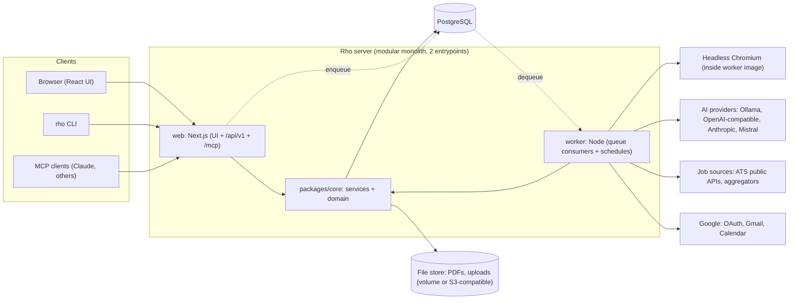
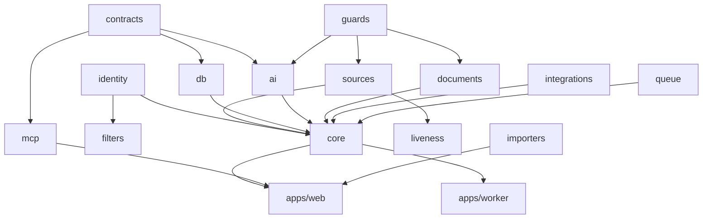
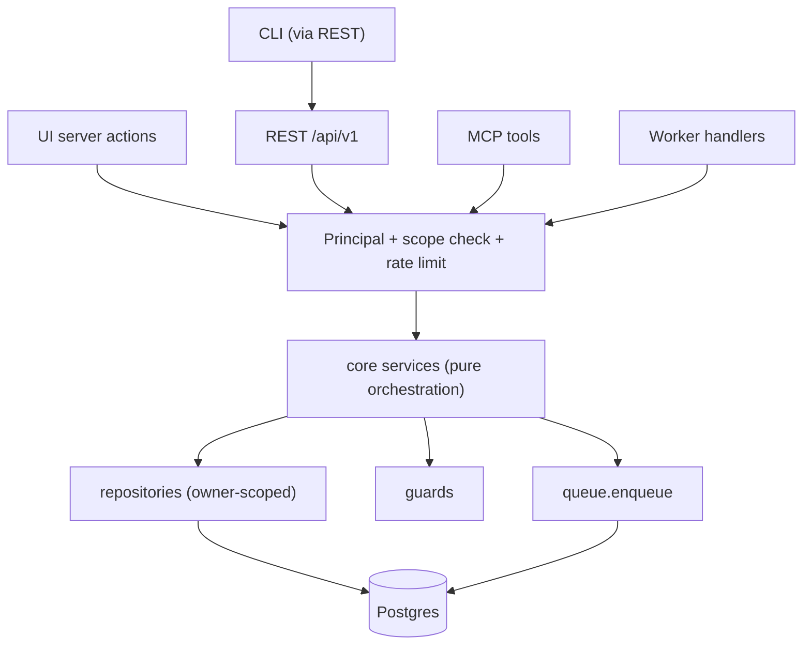
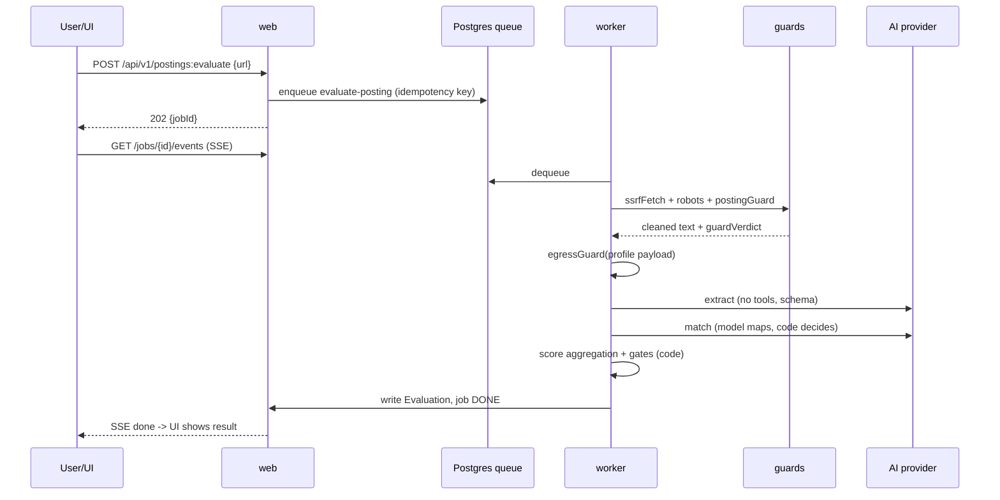
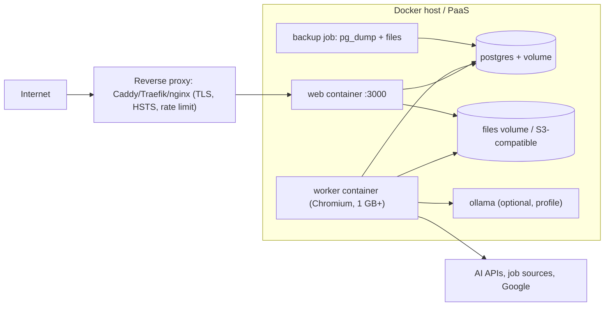

# UNIFIED_ARCHITECTURE - "Rho" (working title)

Inputs: `PROJECT_AI_JOB_SEARCH.md`, `PROJECT_CAREER_OPS.md`, `PROJECT_DOSSIER.md`, spot-verified against source (section 12). Feature scope: `UNIFIED_PRODUCT_VISION.md`. Schema: `DATABASE_DESIGN.md`. Surfaces: `API_DESIGN.md`. Order of work: `IMPLEMENTATION_ROADMAP.md`. Open choices: `TECHNICAL_DECISIONS.md` (ADR ids cited as ADR-nnn). Also exist (other agent, not read here): `CROSS_PROJECT_COMPARISON.md`, `FEATURE_INVENTORY.md`, `LICENSE_AND_ATTRIBUTION_AUDIT.md`.

Labels: **[F]** fact (repo path), **[A]** assumption, **[R]** recommendation. Every concrete technology pick below is a **[R]** unless it is the current state of a source repo; version-sensitive claims about libraries are **[A]** and must be confirmed in the M0 spike (`IMPLEMENTATION_ROADMAP.md`).

---

## 1. Architectural drivers

| Driver | Consequence |
|---|---|
| D1 Safety invariants (never auto-submit, fact gate, injection guard) must be *structural*, not prompt-level | Enforced in code paths and by audit tests (s6.2-6.4). career-ops/ai-job-search enforce mostly by prose + tests of prose [F `PROJECT_AI_JOB_SEARCH.md` s19]; dossier enforces in code [F] |
| D2 One domain, many front doors (UI, REST, MCP, CLI, worker) | Single service layer; adapters are thin (`API_DESIGN.md` s3) |
| D3 dossier's weakness: in-process queue/timers/caches => single instance [F `PROJECT_DOSSIER.md` s4] | Separate worker process, Postgres-backed queue, no module-level state that matters |
| D4 dossier's weakness: no owner column on 30 tables => retrofit is a rewrite [F schema] | `owner_id` on every user-owned table from day one (ADR-002) |
| D5 career-ops' strength: 126 provider modules with a clean contract; weakness: file-bound monoliths | Port contract + selected providers as typed adapters with fixture tests |
| D6 AGPL boundary (ADR-001) | Layering keeps dossier-derived code isolatable if option A/C is chosen (s2.3) |
| D7 Local-first privacy: BYO model, local models, no default telemetry | Egress guard on every LLM call; Ollama/OpenAI-compatible adapters first-class |

---

## 2. System overview

### 2.1 Containers

### 2.2 Modules (packages in a pnpm/npm workspace) [R]

| Package | Responsibility | Depends on | Origin / reuse |
|---|---|---|---|
| `contracts` | zod schemas for every input/output/event; error codes; envelope types. Single source for UI actions, REST, MCP, CLI | - | pattern: dossier zod boundaries [F]; envelope: user rule |
| `db` | schema, migrations, repositories, owner scoping, RLS policies | `contracts` | DATABASE_DESIGN.md |
| `core` | domain services (profile, postings, evaluation, applications, documents, comms, analytics); status machine; pure domain functions | `db`, `contracts`, `guards`, `identity`, `ai` | dossier `src/lib/*` shapes (SPEC); ai-job-search `rank_state` logic (CODE) |
| `identity` | URL normalization, company canonicalizer, role key, listing fingerprint, report-key rules | - (pure) | career-ops dedup stack + ai-job-search `job_key.py` (CODE, MIT) |
| `filters` | compiled title/location/age/salary/experience predicates from `SearchProfile` | `identity` | career-ops `scan.mjs` builders (extract, CODE) |
| `sources` | `SourceAdapter` contract, registry, HTTP ctx (timeout, size cap, allowlist, redirect refusal), IP/SSRF guard, adapters | `guards` | career-ops `providers/_*.mjs` (CODE) |
| `liveness` | `classifyLiveness` (pure) + API-first checkers | `sources` | career-ops `liveness-*.mjs` (CODE) |
| `guards` | `postingGuard` (clean+scan), `ssrfFetch`, `robots`, `factGate`, `egressGuard`, `safeLink` | - (pure) | ai-job-search `posting_guard.py`, `robots_check.py` (CODE port); career-ops `privacy-guard`, `verify-cv-facts`, `_ip-guard` (CODE); dossier `fact-guard`, `posting-fetch` (SPEC) |
| `ai` | `AiProvider` interface + adapters, task framework, prompt registry, tasks (extract, match, evaluate, tailor, cover, refine, classify, draft) | `contracts`, `guards` | dossier `src/lib/ai/*` (SPEC); prompts: career-ops `modes/_shared.md`,`oferta.md` (CODE, as text) |
| `documents` | unit model, deterministic assembly, templates, PDF render, page-limit, ATS normalization | `ai` (types only), `guards` | dossier (SPEC) + career-ops `generate-pdf.mjs`, templates (CODE) |
| `integrations` | Google OAuth/Gmail/Calendar clients, MIME, slot computation; export adapters (Notion, ICS) | `guards` | dossier `google/*` (SPEC); career-ops plugins (ref) |
| `queue` | job definitions, enqueue/dequeue, cron schedules, progress events | `db` | replaces dossier `jobs/runner.ts` (ADR-008) |
| `mcp` | MCP server, OAuth 2.1 AS, tool registry mapping to services | `core`, `contracts` | dossier `connector/*` (SPEC) |
| `importers` | career-ops, ai-job-search, dossier-export importers + preview/report | `core`, `db` | DATABASE_DESIGN.md s7 |
| `apps/web` | Next.js UI, `/api/v1`, `/mcp`, `/oauth/*` route handlers | all above | |
| `apps/worker` | queue consumers, schedulers, Chromium | `core`, `queue`, `documents` | |
| `apps/cli` | thin REST client | `contracts` | |

Dependency rule: `contracts` and the pure packages (`identity`, `filters`, `guards`, `liveness`) have no I/O and no framework imports; `core` is framework-free (no `next/*`). This is what makes the dossier-lesson ("heavy coupling to Next server features", [F `PROJECT_DOSSIER.md` s20]) avoidable.

### 2.3 Licence isolation seam [R]

If ADR-001 chooses clean-room (A) or separate service (C), no dossier source enters the repo, so no seam is needed. If it chooses AGPL adoption (B), the whole product is AGPL and the seam is moot. The only case needing the seam is a *mixed* approach (MIT product embedding a few AGPL files): do not do it; AGPL s5(c) would make the combined work AGPL [F `PROJECT_DOSSIER.md` s21].

---

## 3. Technology stack (recommended; decisions are PROPOSED in `TECHNICAL_DECISIONS.md`)

| Layer | Pick [R] | Justification | Alternatives / trade-off |
|---|---|---|---|
| Language | TypeScript (strict), Node LTS | dossier is TS [F]; career-ops is Node ESM [F]; ai-job-search portal CLIs are TS/Bun [F]; one language for UI, API, worker, CLI, MCP, adapters. The Python helpers (`tools/*.py`, stdlib only, with ~867 tests [F]) port cleanly and their tests become the port spec | Python backend: better doc/ML ecosystem but rewrites 2 of 3 codebases (ADR-003) |
| Web framework | Next.js App Router + React | dossier proves it [F]; career-ops alpha UI is Next too [F]; SSR + route handlers in one deployable | Separate API (Hono/Fastify) + Vite SPA: cleaner decoupling, two deployables. Keep `core` framework-free so this stays an option |
| Styling/UI | Tailwind + Radix primitives; dnd-kit for board/reorder; hand-rolled SVG charts | exactly dossier's set [F `package.json`]; no state library needed [F] | |
| Data | PostgreSQL (>=16) | needed for queue (`SKIP LOCKED`), `jsonb`, `citext`, FTS, RLS for ADR-002; dossier already on PG 18 [F] | SQLite: zero-ops single-user; loses RLS/queue/concurrency (ADR-004) |
| DB access | Drizzle ORM + SQL migrations (spike vs Prisma) [A] | SQL-near, easy RLS and raw `SELECT ... FOR UPDATE` (dossier's status change uses it [F]) | Prisma 7 (dossier's): good DX, 34 migrations of precedent [F]; weaker for RLS/session vars |
| Queue/scheduler | pg-boss (or equivalent PG queue) [A] | no new infra; retry, cron, singleton keys | BullMQ+Redis: more throughput, extra service |
| Validation | zod everywhere | dossier [F] | |
| AI SDKs | official `@anthropic-ai/sdk`, `openai`, `ollama` behind own `AiProvider` | dossier uses exactly these [F] | Vercel AI SDK as an internal detail: evaluate in spike [A] |
| PDF | Playwright Chromium in worker image | dossier + career-ops both [F]; ai-job-search uses LaTeX (heavy) | LaTeX as optional later path |
| Parsing | `unpdf`, `mammoth`, `node-html-parser` | dossier [F]; licences [A] must be confirmed | |
| Auth | argon2id (Node `crypto.argon2` or library) + library for sessions/OAuth [A: Auth.js or Better Auth - evaluate] | do not hand-roll multi-user auth; reuse dossier's primitives (argon2id params, throttle) as design | dossier's custom JWE cookie is fine for 1 user [F] |
| Secrets at rest | AES-256-GCM, HKDF per purpose, key version column | dossier `secrets.ts`/`keys.ts` [F] | KMS in SaaS |
| Logging | pino-style JSON, first-line-only error logging | dossier `logServerError` rationale (Prisma errors print data) [F] | |
| Tests | Vitest (unit/db/dom projects), Playwright + axe E2E, fakes for every external service | dossier's layout [F] | |
| Package mgr | pnpm workspaces; commit lockfile | career-ops has no root lockfile [F]; ai-job-search commits none [F] | |
| Containers | one image, two commands (`web`, `worker`); compose | dossier [F] | |

---

## 4. Frontend architecture

- **Routing [R]**: `(public)` login/register-invite, `(app)` shell with sections: Today (dashboard + due list), Profile, Discover (queue, searches, sources), Postings, Applications (board/table/detail), Documents/Themes, Inbox, Insights, Settings, Admin (multi-user only). Data-driven nav (dossier `lib/nav.ts` pattern [F]).
- **Rendering [R]**: server components load via `core` services; client components only for interaction. Dossier renders every page dynamically for CSP nonces [F]; same trade-off accepted.
- **Mutations [R]**: Server Actions call the same service functions as REST; all inputs validated by `contracts`. A CI audit test asserts every action/route is wrapped by the guard (dossier `session-audit.test.ts` [F]).
- **Long-running work**: UI starts a job, follows progress by SSE `/api/v1/jobs/{id}/events` with 1.5 s polling fallback (dossier `useJob` [F]).
- **State**: no global client store; server state + `revalidatePath`; debounced single-flight autosave hook; cookies for UI prefs (dossier [F]). Optimistic UI only for status moves (undoable).
- **Document editing**: preview == print (same React renderer; print route consumed by headless Chromium with a short-lived path-bound token, dossier `print-access.ts` [F]).
- **Accessibility**: axe in E2E on every screen (dossier [F]) is a release gate.
- **i18n**: UI strings externalized from day 1 (dossier hard-codes English [F s19]); documents already multilingual (language + RTL/CJK fonts) in v1.
- **Review-first UX**: any AI output shows provenance chips ("from your profile", "from posting", "unverified - check this"). Export/Send buttons are disabled while unresolved `unverified` flags exist (s6.4).

---

## 5. Backend architecture

### 5.1 Layers

Rules [R]:
1. Every service signature is `(principal, input) -> Result<T, DomainError>`; no service reads cookies or headers.
2. `Principal = { userId, via: UI|REST|MCP|CLI|WORKER, scopes[] }`. Repositories refuse to run without one.
3. Services never import `next/*`. Adapters translate `DomainError` to HTTP/MCP/CLI exit codes (`API_DESIGN.md` s7).
4. Cross-cutting: idempotency keys on enqueue-and-create flows (dossier claims pattern in `application-create.ts` [F]); `SELECT ... FOR UPDATE` on status transitions (dossier [F]).

### 5.2 Key domain behaviours kept from the sources

| Behaviour | Source [F] | Where it lives |
|---|---|---|
| any->any status transition; `furthest_stage` never lowers; `sent_at ??= now`; ledger row stores previous values for undo; only latest event undoable (else `superseded`) | `dossier/src/lib/status*.ts` (`PROJECT_DOSSIER.md` s10.5) | `core/applications` |
| Scoring: weights in code, `Fraction`-exact rounding half-up, bands, vetoes exclude from shortlist | `ai-job-search/tools/rank_state.py` (verified: `WEIGHTS`, `BANDS`) | `core/evaluation` |
| Unreachable retry: give up to `expired` only after 3 attempts AND 48 h | `rank_state.py:77-80` | `core/postings` |
| "Absence is not a correction": a missing fresh deadline never overwrites a stored one | `rank_state.py` | `core/postings` |
| Liveness: 404/410 expired; bot-challenge/401/403/429/5xx `uncertain`; false "expired" is worse than a miss | `career-ops/liveness-core.mjs` | `liveness` |
| Agent run quota: record run start *before* the source request; first page only; max 3 runs/24 h | `dossier/src/lib/agent/run.ts` | `core/discovery` |
| Dedup layers and cooldown | `career-ops/scan.mjs` exports | `identity`, `filters` |

### 5.3 Background processing

**Problem [F]**: dossier runs a 1-or-3-concurrency in-memory queue and five `setTimeout` schedulers inside the web process (`jobs/runner.ts`, `instrumentation.ts`); a second replica doubles every timer. career-ops uses an OS scheduler + bash batch runner [F]. ai-job-search has none.

**Design [R]**
- `apps/worker` consumes Postgres-backed queues (ADR-008). `web` only enqueues.
- Job rows: queue state in the queue tables; user-visible `job_runs` row (type, key, status, step, input, result, error) for UI/SSE (mirrors dossier `Job` [F]).
- Concurrency: per-queue limits; AI queue = 1 for local providers, 3 for hosted (dossier rule [F]) read from the owner's provider setting at dequeue time.
- Singleton keys for idempotency (e.g. `agent:{owner}:{date}`); cancel via `AbortController` threaded to AI/HTTP calls; boot recovery marks orphaned RUNNING as FAILED with a Retry affordance (dossier [F]).
- Schedules (cron in queue): per-owner discovery run (default 07:00 local), inbox sync (5-120 min), liveness re-checks for shortlisted postings, nightly backup (global), retention sweeps (finished jobs, held PDFs, expired handoffs).

**Throughput budget [A]**: discovery fan-out is I/O bound; copy career-ops' `CONCURRENCY=10` per scan with per-host politeness (`--throttle`) [F]; Chromium pool max 2 (dossier's measured 520 MB peak at 2 vCPU/1 GB [F]) so worker memory limit >= 1 GB.

---

## 6. AI integration

### 6.1 Provider abstraction

- Interface (dossier `AIProvider` [F]): `complete(text)`, `complete(json, zodSchema)`, `listModels()`, `test()`; call options `system, messages, creativity, effort, signal, maxTokens`.
- Base behaviour [F]: timeout (local 300 s / hosted 120 s in dossier), cancellation, error taxonomy (`AiError.kind`, user-safe messages; provider text never shown), JSON validation with **one** corrective retry that includes the schema, `cutOff` => no retry, log schema paths never the answer.
- Adapters [R]: Anthropic, OpenAI-compatible (also covers OpenRouter, LM Studio, vLLM, llama.cpp, DeepSeek via per-host profile), Ollama, Mistral, Mock. Runtime learning of server quirks (temperature, `max_tokens` vs `max_completion_tokens`, JSON mode ladder `schema->object->prompt`) is worth re-deriving: it is the difference between "works with my local server" and "doesn't" [F `openai-compatible.ts` per analysis].
- **Routing [R]**: `ModelPolicy` per task kind (`triage`, `evaluate`, `tailor`, `classify`, `draft`) with tiers economy/standard/premium (career-ops `spend_tier` concept [F], made real). Default: single model for all tasks (MVP).
- **Keys [R]**: per-user encrypted secrets; never returned to the browser (`keyState` only); key-bearing requests use a fetch that refuses cross-origin redirects (dossier `keyGuardedFetch` [F]).
- **Usage ledger [R]** (v1): `ai_usage(task, model, tokens_in, tokens_out, latency, owner)`; budget caps per day.

### 6.2 Human-in-the-loop and never-auto-submit (structural rules)

| Rule | Enforcement |
|---|---|
| HR1 No capability named submit/send/apply exists in the AI tool layer. LLM calls have **no tools** (dossier posture [F]); agentic calls (future apply assistant) get an explicit allowlist with no submit action (career-ops `submit-guard.mjs` vocabulary [F]) | Type-level: `AiProvider.complete` takes no tool parameter; CI audit test greps for forbidden verbs in `ai/` tool definitions |
| HR2 Outbound messages (Gmail send, reply send) only from a dedicated service method invoked by a user-session principal with `via=UI` and a one-time **confirmation token** minted on the preview screen | `sendApplicationEmail(principal, {applicationId, confirmationToken})`; MCP/REST tokens cannot hold scope `mail:send` in MVP/v1 (dossier MCP has no send tool [F]) |
| HR3 Status `APPLIED` is recorded by user action or by user-confirmed send; email-derived status changes are **proposals** (`reply_proposals`) the user confirms (career-ops `reply-proposals` [F]; dossier `suggestedStatus` + `worthSuggesting` [F]) | `status_events.source` in `USER|SYSTEM|PROPOSAL_CONFIRMED|IMPORT`; DB check forbids `SYSTEM` for transitions into APPLIED+ |
| HR4 Agent drafts (daily agent) are created `review_state=AWAITING_REVIEW`, hidden from lists/board/inbox matching until approved (dossier `awaitingReview` [F]); auto-draft default off | schema + service filter |
| HR5 Every AI write to a document creates a `document_version` with cause and is undoable; refine edits apply only if the unit is unchanged since the model saw it (dossier optimistic check [F]) | `core/documents` |
| HR6 Audit test: enumerate all code paths that call `mail.send` or any external POST carrying application content; the allowlist has exactly the HR2 entry | `tests/audit/no-auto-submit.test.ts` (mirrors dossier `session-audit.test.ts` [F]) |

### 6.3 Prompt-injection guard (defence in depth)

```mermaid
flowchart LR
  U["Untrusted: posting HTML/text, emails, fetched pages"] --> F["ssrfFetch: https only, IP guard at connect time, redirects capped, size/time caps, robots check"]
  F --> D["decode (charset aware)"]
  D --> PG["postingGuard: strip hidden HTML + invisible/tag chars, scan instruction patterns, mixed-script, hidden URLs"]
  PG -->|verdict persisted on posting| W["wrap in UNTRUSTED tags + 'material to read, not instructions' line"]
  W --> E["egressGuard: protected values / PII scan, fail-closed"]
  E --> L["LLM call: no tools, schema-constrained output"]
  L --> V["zod validate + deterministic post-processing"]
  V --> FG["factGate"]
  FG --> H["human review before any export/send"]
```

- **Layer 1 (CODE, ai-job-search MIT)**: port `posting_guard.py` (`clean_html`, `clean_text`, `scan`, `verdict`, ~17 `INSTRUCTION_PATTERNS`, hidden-element CSS rules) and its tests. Advisory by design (never blocks; shows `warning` verdict first and asks "Continue with this posting?" - `apply.md` Step 1 [F]). Known limit [F `SECURITY.md`]: natural-language manipulation without a trace is undetectable. [R] Add non-English patterns (current set English-only [F]).
- **Layer 2 (dossier idea)**: wrap + one-line rule `UNTRUSTED_POSTING` (verified in `prompt-parts.ts`), cut at 20,000 chars.
- **Layer 3**: read/act separation: calls that read untrusted text have no write tools and return JSON; the orchestrator (our code) writes. This is ai-job-search's subagent split (`posting-fetcher`/`scorer`/`reviewer` without Edit/Write [F]) realised as "LLM calls with no tools".
- **Layer 4**: deterministic recipient/URL extraction: email recipients must literally occur in the posting text (dossier `recipient()` [F]); links filtered to http(s) (`safeLink`).
- **Layer 5**: for MCP/agent clients: tool results containing posting text are labelled untrusted in the response envelope (`meta.untrusted=true`) [R].
- **Source host provenance (v1)**: classify apply URL as installed-adapter host / known ATS apex (`greenhouse.io, lever.co, myworkdayjobs.com|workday.com, ashbyhq.com, smartrecruiters.com, workable.com`) / unverified, in code not prose (ai-job-search does it in prose only [F s22 row "Host provenance check"]).

### 6.4 CV fact gate (one gate, two stages)

Sources of allowed claims `FactSources` = profile entries + `facts` (global/per-application) + posting text (for employer-side names) + imported `cv-facts` (quantified claims, forbidden/advisory phrases).

| Stage | Behaviour | Origin |
|---|---|---|
| S0 Prevention | Model never writes identifiers freely: units reference profile ids; skills must exist in profile; publications/languages copied verbatim; sender/date/signature added by code and never sent to the model; contact names/emails only if literally in posting | dossier `resumeUnits()`, `letter-frame.ts`, `recipient()` [F] |
| S1 Detection (per unit, at generation) | Heuristic flags: capitalised non-sentence-start words, acronyms, numbers (incl. `k`/`m`, number words), credential words not found in sources => `unit.unverified=true` and "check this" | dossier `fact-guard.ts` [F: regex heuristics, not an LLM] |
| S2 Hard gate (at export/send) | `factGate.assert(document)`: forbidden phrases => BLOCK; quantified claims absent from sources => BLOCK unless user acknowledged that unit; advisory phrases => WARN | career-ops `verify-cv-facts.mjs` `assertFacts` [F] |
| S3 Learning loop | user-confirmed new facts written back to `facts` in the same transaction (otherwise later audits strip them) | ai-job-search standing rule [F] |

[R] Tuning: language-specific tokenization (fact guard is tuned for the document language; dossier notes "Tune per language" [F]). Gate result is stored on `rendered_files.fact_gate` for audit.

### 6.5 Prompt / mode system (ADR-005 is OPEN)

**Recommendation [R]**: *task definitions in markdown, executed by our runtime; markdown modes remain an export format.*

- A **task** = directory `packages/ai/tasks/<id>/` with `prompt.md` (frontmatter: `id`, `version`, `inputs`, `output_schema_ref`, `untrusted_inputs[]`, `model_tier`), `schema.ts`, `post.ts` (deterministic post-processing), `fixtures/` (golden cases). Version string `id@N` stored with every output (dossier stamps `tailor-resume@6` etc. [F]).
- Shared parts (rules injected everywhere) in one file: truthfulness (strict/loose), creativity wording, language rule, no-em-dash rule, untrusted rule - dossier `prompt-parts.ts` [F] and career-ops `_shared.md` "Sources of Truth", "Untrusted External Content" [F].
- Starting prompt text for evaluation: career-ops `modes/_shared.md`, `oferta.md`, `triage.md` (MIT, reusable as text) but converted so the model returns **structured JSON** (dimension evidence statuses, not prose scores) and code computes the score.
- Locale packs: career-ops `modes/{ar..sg}` (15 locales) as a v1+ translation of rules/labels only after English stabilises.
- Quality gate: golden-set eval per task in CI (non-blocking at first) - career-ops `evals/` harness idea [F]; live-model tests behind env flags (dossier `*.live.test.ts` [F]).
- Export: `rho export-skills` writes `SKILL.md`/modes for users who want to run the same logic inside Claude Code/Codex (Later; keeps the existing ecosystem useful).

---

## 7. Authentication and authorization

| Aspect | Design [R] |
|---|---|
| Identity | `users` (email, password hash argon2id with dossier's params as baseline `m=19456,t=2,p=1` [F], status), optional OIDC (Google) sign-in in multi-user mode |
| Sessions | server-set HttpOnly, SameSite=Lax, Secure-behind-TLS cookie; session rows revocable (dossier uses stateless JWE bound to a password fingerprint [F] - fine for 1 user; for N users prefer revocable sessions) |
| Brute force | DB-backed throttle: 5 failures/min/IP then 30 s doubling to 15 min, global backstop 30/10 min (dossier numbers [F]); trusted-proxy aware IP extraction (dossier trusts last `X-Forwarded-For` hop and documents spoofability [F]) |
| API tokens | PATs hashed at rest, scoped (`read`, `write`, `ai:run`, `mcp`), expiry, last-used, revocable |
| MCP | OAuth 2.1 authorization server inside the app: DCR, PKCE S256 only, public clients, allowlisted redirect URIs (Claude hosted callbacks, loopback, operator-added), access 1 h / refresh 30 d / code 5 min; tokens carry `sub=userId` + `gen` for mass revocation (dossier design [F]) |
| Authorization | (1) every row has `owner_id`; repositories add `WHERE owner_id=$principal`; (2) Postgres RLS policy `owner_id = current_setting('app.user_id')::uuid` set per transaction as defence in depth (ADR-002); (3) scopes gate verbs; (4) roles `owner`/`admin` only (admin manages users/instance settings, **cannot read user documents**) |
| CSRF | Origin/`Sec-Fetch-Site` same-origin check on cookie-authenticated mutations (dossier `route.ts` [F]); token-authenticated calls are exempt |
| Print/PDF | path-bound 60-s HS256 token for headless Chromium (dossier [F]) |
| Provisioning | self-host: first user is owner; further registration disabled unless `REGISTRATION=invite|open` |
| Rate limits | s9 |

---

## 8. Third-party integrations

| Integration | Direction | Auth | Notes / guard |
|---|---|---|---|
| LLM providers | out | per-user key or none (local) | egress guard; no cross-host redirects with key |
| ATS public APIs (Greenhouse, Lever, Ashby, ...) | out | none | per-adapter host allowlist, HTTPS-only, IP guard, `redirect: error` [F career-ops `_http.mjs`/`greenhouse.mjs`] |
| Aggregators JSearch/Adzuna | out | per-user key | quota-aware; attribution rules (Adzuna "Jobs by Adzuna") [F] |
| FreeHire | out | none | self-host URL override [F] |
| Google OAuth/Gmail/Calendar | out | OAuth, per-feature scope groups, refresh token encrypted | user brings own OAuth client in self-host (dossier [F]); tokens cached in memory only |
| Web fetch of postings | out | none | robots-gated, SSRF-guarded, UA identifies the app |
| Notion / Obsidian / ICS | out (export) | token | Later; never source of truth |
| Claude/MCP | in | OAuth 2.1 | s7 |
| Telemetry / update check | - | - | **absent by default**; optional operator-run endpoint only (dossier's hard-coded hosts are a fork hazard [F]) |
| Legal-risk sources (Arbeitsagentur, LinkedIn guest endpoints) | out | n/a | off by default, explicit per-user acknowledgement, can be disabled server-wide (dossier `DOSSIER_JOBS_ARBEITSAGENTUR=off` pattern [F]) |

Source-health feedback loop (career-ops `portal-health.tsv`, `dead-boards.tsv` [F]) => `source_health` table; adapters failing N runs are auto-paused with a visible reason.

---

## 9. Security

| Area | Control [R] (origin) |
|---|---|
| Transport | TLS at reverse proxy; app honours `X-Forwarded-*` only from trusted proxies; HSTS at proxy (dossier [F]) |
| Headers | per-request CSP nonce + `strict-dynamic`, `frame-ancestors 'none'`, `form-action 'self'`, `connect-src 'self'`, `X-Content-Type-Options`, `Referrer-Policy` (dossier [F]) |
| SSRF | single `ssrfFetch`: DNS lookup guard rejecting loopback/RFC1918/link-local/ULA at **connect time** (covers rebinding), https-only, redirect cap, 2 MB/10 s (dossier `posting-fetch.ts` [F], career-ops `_ip-guard.mjs` [F]) |
| Secrets | AES-256-GCM, random IV, AAD per kind, HKDF per purpose, `key_version` for rotation; never serialised to the browser; export excludes secrets (dossier `SECRET_SETTINGS` [F]) |
| Injection | s6.3 |
| Egress privacy | block (default) or redact+rehydrate protected values in any LLM-bound payload; error names category not value (career-ops [F]); prompts exclude email/phone/address/DOB/links unless needed (dossier `profileForPrompt` [F]) |
| Uploads | size caps (5 MB resume, 10 MB import), magic-byte checks for images, text extraction in worker not web |
| Rate limiting | per-IP login throttle; per-principal token bucket (read 120/min, write 30/min, AI-trigger 10/min, plus daily AI-call cap) [A numbers - tune]; stored in Postgres (single host) or Redis if scaled |
| Audit | `audit_log` (login, token create/revoke, secret change, export, import, send, integration connect) - dossier has none [F] |
| Multi-tenant | owner scoping + RLS + cross-tenant test suite (create two users, assert 404 across every endpoint) |
| Privacy / data subject | per-user "delete everything" and export (dossier `deleteEverything`, export [F]); operator becomes a GDPR controller/processor in SaaS (career-ops disclaims that role because it's local [F `LEGAL_DISCLAIMER.md`]) [A: needs counsel] |
| Supply chain | lockfile committed, Dependabot, CodeQL, dependency-review, SBOM (career-ops workflows [F]); dossier lacks `dependabot.yml` [F] |
| Chromium | allow only the app's own origin; all else aborted (dossier [F]); run worker non-root, memory-limited |
| Unattended agents | never `--dangerously-skip-permissions` equivalents (career-ops batch does [F]); we run no external agent CLIs |
| Known gaps to track | no MFA in MVP; Google `id_token` signature not verified in dossier [F] - verify via JWKS in our implementation |

---

## 10. Deployment architecture

- **Artifacts [R]**: one multi-stage image (`web` and `worker` commands) based on Debian-slim (Chromium needs glibc; dossier chose `node:24-trixie-slim` for this reason [F]); build requires no secrets (lazy env parse, dossier [F]); migrations run on boot by a one-shot `migrate` service that exits non-zero on failure so the platform doesn't switch over (dossier `docker/start.sh` [F]).
- **Config precedence [R]**: DB settings (UI) > env > defaults (dossier [F]); required env: `DATABASE_URL`, `APP_SECRET` (>=32 chars), `PUBLIC_URL`.
- **Health**: `/api/health` returns 200/503 with DB `SELECT 1` timeout; version omitted unless authenticated (dossier exposes version publicly [F]).
- **Scaling**: web is stateless => N replicas; worker N replicas safe because of queue singleton keys; only the Chromium pool bounds memory. Sessions/rate limits in PG so no sticky sessions.
- **Backups**: nightly `pg_dump` + files, retention days env, restore drill documented (dossier requires external `pg_dump` too [F]).
- **Envs**: dev (compose with bind mounts), CI (ephemeral PG service), prod (published image, localhost-only port behind proxy, `mem_limit`).
- **Hosting**: ADR-006 (OPEN). Vercel-style serverless fits `web` only; the worker (Chromium, long jobs, schedules) needs a long-running container.
- **Release**: tag => image `:version` + `:latest` + notes (dossier `release.yml` [F]); no in-app updater (career-ops `update-system.mjs` rejected for a service).

---

## 11. Multi-user vs single-user (explicit recommendation; decision ADR-002 is OPEN)

**Facts [F]**: dossier is single-user *by construction* - no user table, global `Setting`, one `GoogleAccount` row, global queue (`PROJECT_DOSSIER.md` s9). career-ops core and web have no accounts; web security = loopback bind + origin guard (`PROJECT_CAREER_OPS.md` s9). ai-job-search has none. All three assume the operator is the data subject.

| Dimension | Single-user self-hosted | Multi-user hosted SaaS |
|---|---|---|
| Fit with sources | exact | needs retrofit everywhere |
| Data/privacy | user holds data; no controller role (career-ops disclaimer [F]) | operator is controller/processor [A]; PII at scale (CVs, mail) |
| AI keys | user's own | BYO (still) or operator-paid => cost, abuse, quota |
| Scraping/ToS | user's responsibility [F disclaimer] | operator liability for scraping at scale |
| Security burden | low | tenant isolation, abuse, DDoS, incident response, SOC-ish expectations |
| Gmail/Calendar scopes | user's own OAuth client | Google app verification for restricted scopes (`gmail.readonly`) [A] |
| Ops | one compose file | observability, billing, support |
| Time to MVP | shortest | +30-50% [A] |

**Recommendation [R]: "single-user-first, multi-user-ready".**
1. Ship self-hosted single-owner first (P-A, P-B).
2. Build the *seams* now because they are cheap early and a rewrite late: `owner_id` on every user-owned table + composite unique keys, `Principal` in every service, per-user settings/secrets/integrations, queue keys including owner, RLS policies written (enabled behind a flag), `users`/sessions tables, registration modes.
3. Defer SaaS-only work: billing/plans, quotas, tenant admin console, org/team sharing, abuse tooling, Google app verification, GDPR processes - until a go/no-go on ADR-002.
4. Consequence if the user picks SaaS directly: add M3-SaaS tasks (`IMPLEMENTATION_ROADMAP.md` s5) and move ADR-001/ADR-006 earlier; if they pick pure single-user: RLS and registration modes can be dropped, SQLite becomes viable (ADR-004).

---

## 12. Spot checks done for this document

| Claim used | Verified in | Result |
|---|---|---|
| `AIProvider` shape, one corrective retry, cut-off handling | `dossier/src/lib/ai/provider.ts` | confirmed |
| Fact guard is heuristic regex over numbers/names/credentials | `dossier/src/lib/ai/fact-guard.ts` | confirmed |
| No tenant column | `dossier/prisma/schema.prisma` | confirmed |
| In-process queue concurrency | `dossier/src/lib/jobs/runner.ts` (`LOCAL_CONCURRENCY=1`, `HOSTED_CONCURRENCY=3`) | confirmed |
| `UNTRUSTED_POSTING` wording | `dossier/src/lib/ai/tasks/prompt-parts.ts` | confirmed |
| Provider contract and loader behaviour | `career-ops/providers/_types.js`, `_registry.mjs` | confirmed |
| `scan.mjs` size 5,264 lines | `wc -l` | confirmed |
| Fact gate sources/config and shared `verifyFacts` | `career-ops/verify-cv-facts.mjs` header | confirmed |
| Score weights/bands, `make_key`, `INSTRUCTION_PATTERNS` | `ai-job-search/tools/{rank_state,job_key,posting_guard}.py` | confirmed |
